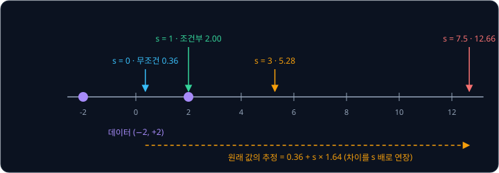
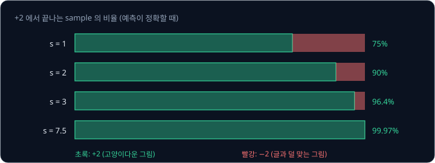
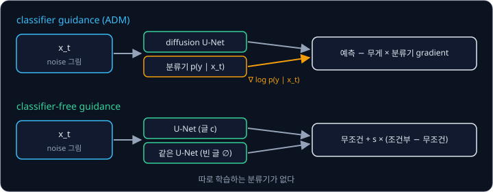
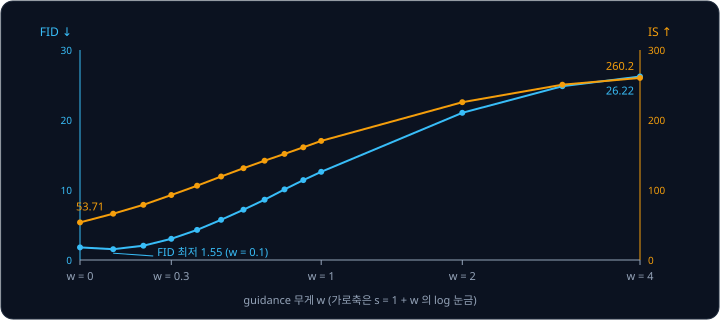
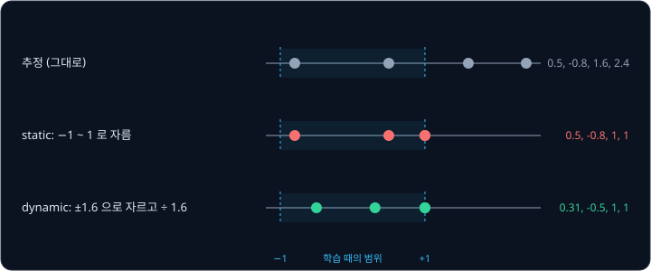
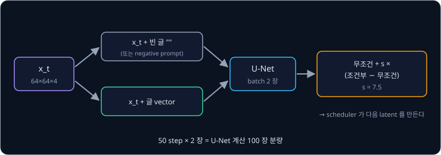

# Classifier-Free Guidance

[Cross-Attention](../cross-attention/README.md) 으로 글을 넣어 학습한 U-Net 은 글을 보고 noise 를 더 잘 맞히도록 배웠을 뿐, 글을 얼마나 세게
따를지는 따로 배우지 않았다. 학습 그림의 설명 글은 인터넷에서 모은 것이라 "고양이" 라고 적힌 그림에 고양이가 작게 있거나 아예 없는
경우도 섞여 있고, U-Net 은 그런 그림까지 모두 맞히도록 배운다. 그래서 학습한 그대로 sampling 하면 글과 느슨하게만 맞는 그림이 자주
나온다. 학습을 다시 하지 않고 sampling 할 때 글을 더 세게 따르게 만들 수는 없을까?

이 문제를 푸는 sampling 방법인 **classifier-free guidance**(CFG)는 step 마다 U-Net 으로 noise 를 두 번 맞힌다. 한 번은 글을 넣고, 한 번은
빈 글을 넣는다. 두 예측의 차이는 글이 예측을 바꾸는 방향이므로, CFG 는 그 방향으로 몇 배 더 나아간다. OpenAI 의 Nichol 등은 Ho 와 Salimans 가
2021 년에 제안한 이 방법을 GLIDE 에서 글 조건에 썼는데, 사람이 평가한 결과 CFG 를 쓴 효과가 model 을 약 10 배 키운 효과보다 컸다. Stable Diffusion 의 기본 설정도 이 차이를 7.5 배로 키운다.

## 학습 목표

- 글을 넣은 예측과 빈 글을 넣은 예측을 guidance scale 로 섞는 식을 숫자로 계산하고, scale 이 1 보다 클 때 일어나는 일을 설명할 수 있다
- classifier guidance 와 비교해 classifier-free guidance 가 무엇을 없앴는지, 학습 때 조건을 일정 비율로 빼는 이유를 설명할 수 있다
- guidance scale 을 키울 때 그림의 다양성과 글과의 일치가 어떻게 바뀌는지 논문의 숫자로 설명할 수 있다
- CFG 가 step 마다 U-Net 을 두 번 쓰는 이유와 negative prompt 가 하는 일을 설명할 수 있다

## 조건부 예측과 무조건 예측

U-Net 에 글을 넣어 맞힌 noise 를 **조건부 예측** $\epsilon_\theta(x_t, c)$ 라고 하고, 빈 글을 넣어 맞힌 noise 를 **무조건 예측**
$\epsilon_\theta(x_t, \varnothing)$ 라고 한다. $c$ 는 조건(글)이고 $\varnothing$("공집합")은 조건이 없다는 표시다. 무조건 예측은 어떤 그림이든
그럴듯하다고 보고 맞힌 noise 이고, 조건부 예측은 이 글에 맞는 그림이라고 보고 맞힌 noise 다. 두 예측을 빼면 글이 예측을 어느 쪽으로 옮겼는지가 남는다.

두 예측의 차이는 [DDPM](../ddpm/README.md) 강의의 1 차원 두 봉우리 예에서도 숫자로 볼 수 있다. 데이터는 $+2$ 와 $-2$ 반반이고, $+2$ 쪽
그림에는 "고양이" 라는 글이 붙어 있고 $-2$ 쪽 그림에는 "개" 라는 글이 붙어 있다고 하자. $T = 5$ schedule 에서 받은 $x_5$ 가 0.2 이면, DDPM
강의에서 계산한 대로 이 값이 $+2$ 에서 왔을 가능성은 0.59 다. 그래서 글을 모르는 model 은 원래 값을 $0.59 \times 2 - 0.41 \times 2 = 0.36$ 으로 추정한다. "고양이" 를 아는 model 은 원래 값이 $+2$ 임을 알고
2 로 추정한다. 원래 값의 추정에서 noise 를 계산하면 아래와 같다($\sqrt{\bar\alpha_5} = 0.39$, $\sqrt{1 - \bar\alpha_5} = 0.92$).

| 예측 | 원래 값의 추정 $\hat x_0$ | noise $= (x_5 - 0.39\, \hat x_0) \div 0.92$ |
| --- | --- | --- |
| 무조건 $\epsilon_\theta(x_5, \varnothing)$ | 0.36 | 0.065 |
| 조건부 "고양이" $\epsilon_\theta(x_5, c)$ | 2.00 | $-0.630$ |
| 차이 (조건부 − 무조건) | 1.64 | $-0.695$ |

CFG 는 두 예측을 아래처럼 섞는다. $s$ 를 **guidance scale** 이라고 한다.

$$
\tilde\epsilon = \epsilon_\theta(x_t, \varnothing) + s \times \big(\epsilon_\theta(x_t, c) - \epsilon_\theta(x_t, \varnothing)\big)
$$

"무조건 예측에서 출발해 글이 바꾼 차이를 $s$ 배만큼 더한다" 로 읽는다. $s = 0$ 이면 무조건 예측이 되고 $s = 1$ 이면 조건부 예측이
그대로 나온다. $s > 1$ 이면 조건부 예측을 지나 같은 방향으로 더 간다.

| $s$ | $\tilde\epsilon = 0.065 + s \times (-0.695)$ | 이 noise 에 맞는 원래 값 $(0.2 - 0.92\,\tilde\epsilon) \div 0.39$ |
| --- | --- | --- |
| 0 | 0.065 | 0.36 |
| 1 | $-0.630$ | 2.00 |
| 3 | $-2.021$ | 5.28 |
| 7.5 | $-5.149$ | 12.66 |

$s = 3$ 의 추정 5.28 은 데이터에 없는 값이다. CFG 의 식은 두 예측을 잇는 직선을 연장하므로, 원래 값의 추정도 $0.36 + s \times 1.64$ 처럼 그
직선을 따라 데이터 밖으로 나간다. [색이 타는 현상](#색이-타는-현상) 도 이 때문에 생긴다. 그런데도 CFG 를 쓰는 것은 실제 조건부 예측이
이 예처럼 정확하지 않기 때문이다.

**확인 문제.** 어떤 위치에서 무조건 예측이 0.4, 조건부 예측이 0.1 이다. guidance scale 5 로 섞은 noise 는 얼마일까?

답 보기

① 차이는 $0.1 - 0.4 = -0.3$ 이다.

② 무조건 예측에 차이의 5 배를 더한다.

$$
0.4 + 5 \times (-0.3) = 0.4 - 1.5 = -1.1
$$

답: $-1.1$. 조건부 예측 0.1 을 지나 같은 방향으로 더 갔다.

## 글을 더 세게 따르는 이유

실제 학습 데이터의 글은 그림과 느슨하게 맞는다. 위 예를 바꿔, "고양이" 라고 적힌 그림의 75% 는 $+2$ 이고 25% 는 $-2$ 라고 하자. 고양이가 작게
있거나 다른 동물이 함께 있는 그림에도 "고양이" 가 붙는 경우를 25% 로 나타낸 것이다. 전체 데이터는 여전히 $+2$ 와 $-2$ 반반이다. 이 데이터로 학습한 조건부 model 을
그대로 쓰면 "고양이" 로 만든 sample 의 25% 가 $-2$ 가 된다.

CFG 논문은 CFG 가 무엇을 하는지를 **암묵적 분류기**(implicit classifier)로 설명한다. 조건부 분포와 무조건 분포의 비 $p(x \mid c) / p(x)$ 는
Bayes 규칙으로 $x$ 를 보고 조건이 $c$ 라고 판단할 확률 $p(c \mid x)$ 에 비례한다. 예측이 정확하다면 guidance scale $s$ 의 sampling 은
$p(x \mid c) \times p(c \mid x)^{\,s-1}$ 에 비례하는 분포에서 뽑는 것과 같다. 이 분포는 원래의 조건부 분포에 그림이 그 글에 맞을 확률을 $s - 1$
번 더 곱한 것이다.

이 예에서 $+2$ 를 보고 "고양이" 일 확률은 $0.75 \times 0.5 \div 0.5 = 0.75$ 이고, $-2$ 를 보고 "고양이" 일 확률은 0.25 다. guidance scale 마다
$+2$ 에서 끝나는 sample 의 비율을 계산하면 아래와 같다.

| $s$ | $+2$ 의 무게 $0.75 \times 0.75^{\,s-1}$ | $-2$ 의 무게 $0.25 \times 0.25^{\,s-1}$ | $+2$ 의 비율 |
| --- | --- | --- | --- |
| 1 | 0.75 | 0.25 | 75.0% |
| 2 | 0.5625 | 0.0625 | 90.0% |
| 3 | 0.4219 | 0.0156 | 96.4% |
| 7.5 | 0.1156 | 0.0000305 | 99.97% |

$s$ 를 키우면 "고양이" 와 덜 맞는 $-2$ 쪽 sample 이 빠르게 사라지고, 가장 고양이다운 $+2$ 쪽에 몰린다. 글과의 일치는 좋아지고 sample 의
다양성은 준다. CFG 논문도 guidance 를 키우면 "sample 의 다양성이 줄고 각 sample 의 품질이 좋아진다" 고 적었다. Stable Diffusion 의 기본값
$s = 7.5$ 에서는 이 예의 $-2$ 쪽이 1 만 개에 3 개꼴로만 남는다.

**흔한 오해.** CFG 의 결과를 "조건부 분포에서 더 잘 뽑는 것" 으로 이해하기 쉽지만, $s > 1$ 의 sampling 은 학습 데이터의 조건부 분포 $p(x \mid c)$
와 다른 분포에서 뽑는다. 위 예에서 데이터의 "고양이" 그림은 25% 가 $-2$ 인데 $s = 3$ 의 sample 은 3.6% 만 $-2$ 다. CFG 논문도 신경망이 낸
예측은 정확한 값이 아니라서 CFG 의 식(논문의 식 (6))이 어떤 분류기의 gradient 와도 정확히 같지는 않다고 적었다. 위 표는 예측이 정확할 때의 계산이다.

<b>심화: 암묵적 분류기의 식</b>

[Derivatives](../derivatives/README.md) 에서 본 gradient 로 쓰면, noise 예측은 $\log p(x_t)$ 의 gradient(score)에 $-\sqrt{1 - \bar\alpha_t}$ 를 곱한
값과 같다. Bayes 규칙 $p(c \mid x_t) = p(x_t \mid c)\, p(c) / p(x_t)$ 에 log 를 씌우고 $x_t$ 로 미분하면 $p(c)$ 는 $x_t$ 와 관계없어서 사라진다.

$$
\nabla \log p(c \mid x_t) = \nabla \log p(x_t \mid c) - \nabla \log p(x_t)
$$

조건부 score 에 이 분류기 gradient 를 $w$ 배 더하면

$$
\nabla \log p(x_t \mid c) + w \big(\nabla \log p(x_t \mid c) - \nabla \log p(x_t)\big) = (1 + w)\, \nabla \log p(x_t \mid c) - w\, \nabla \log p(x_t)
$$

이고, score 를 noise 예측으로 바꾸면 CFG 논문의 식 (6) $\tilde\epsilon = (1 + w)\,\epsilon_\theta(x_t, c) - w\,\epsilon_\theta(x_t)$ 이다. 정리하면
$\epsilon_\theta(x_t) + (1 + w)\big(\epsilon_\theta(x_t, c) - \epsilon_\theta(x_t)\big)$ 라서 $s = 1 + w$ 다. 오른쪽의 score 는
$p(x_t \mid c)\, p(c \mid x_t)^{w}$ 의 score 와 같고, 본문의 표는 이 분포의 비율을 계산한 것이다.

**확인 문제.** 위 예에서 guidance scale 이 5 이면 $+2$ 에서 끝나는 sample 은 몇 % 일까?

답 보기

① $s - 1 = 4$ 라서 $+2$ 의 무게는 $0.75 \times 0.75^4 = 0.75^5 \approx 0.2373$ 이고, $-2$ 의 무게는 $0.25^5 \approx 0.00098$ 이다.

② 비율은 $0.2373 \div (0.2373 + 0.00098) \approx 0.996$ 이다.

답: 약 99.6%.

## classifier guidance

CFG 라는 이름의 "classifier-free" 는 그 전의 방법인 **classifier guidance** 에서 분류기를 없앴다는 뜻이다. Dhariwal 과 Nichol 은 ADM(2021)에서 noise
가 섞인 그림 $x_t$ 를 보고 class 를 맞히는 분류기 $p(y \mid x_t)$ 를 따로 학습한 뒤, sampling 할 때 그 분류기의 gradient
$\nabla_{x_t} \log p(y \mid x_t)$ 를 noise 예측에 더해 원하는 class $y$ 쪽으로 그림을 밀었다. gradient 의 어떤 자리 값이 $+$ 이면 $x_t$ 의 그
자리 값을 키울 때 그림이 class $y$ 일 log 확률이 커지므로, 그 자리 값을 키우는 쪽으로 민다. $-$ 면 줄이는 쪽으로 밀고, 0 이면 그대로 둔다.

이 방법은 그림의 품질을 크게 올렸지만 불편한 점이 있다.

- 분류기를 noise 가 섞인 그림으로 따로 학습해야 한다. ImageNet 처럼 깨끗한 그림으로 학습한 분류기는 쓸 수 없다
- 분류기가 class 목록을 미리 정해야 해서, 자유로운 글을 조건으로 쓰기 어렵다
- CFG 논문이 지적하듯 분류기의 gradient 로 그림을 미는 것은 분류기를 속이는 adversarial attack 과 닮아서, 분류기 기반 점수가 좋아진 이유가 그림이
  정말 좋아져서인지 분류기를 속여서인지 가리기 어렵다

CFG 는 따로 학습한 분류기 대신, 같은 diffusion model 이 낸 두 예측의 차이를 분류기 gradient 처럼 쓴다. 앞 절의 심화에서 본 것처럼 그 차이가
암묵적 분류기의 gradient 에 비례하기 때문이다. Nichol 등은 GLIDE 에서 글 조건에 CLIP 의 gradient 로 미는 CLIP guidance 와 CFG 를 비교했는데, 사람이
평가한 결과 CFG 가 사실성과 글과의 일치 모두에서 더 좋았다.

## 학습 때 조건을 빼기

CFG 는 무조건 예측도 필요하므로 그림을 조건 없이 만드는 model 이 하나 더 있어야 할 것 같다. 하지만 CFG 논문의 저자들은 network 하나가 두 예측을
모두 하도록 학습했다. 학습 예마다 정해진 확률 $p_\text{uncond}$ 로 조건 $c$ 를 빈 조건 $\varnothing$ 으로 바꿔 넣을 뿐이다(Algorithm 1). 그러면 같은 network 가
조건을 받았을 때의 예측과 받지 않았을 때의 예측을 함께 배운다.

| model | 조건을 빼는 비율 | 빈 조건 |
| --- | --- | --- |
| CFG 논문 (ImageNet class 조건) | 0.1, 0.2, 0.5 를 비교 | 빈 class 번호 |
| GLIDE (글 조건) | 20% | 빈 token 열 |
| Stable Diffusion v1-3, v1-4 | 10% | 빈 글 "" |

Stable Diffusion 공식 리포의 README 는 v1-3 과 v1-4 가 학습 중에 "글 조건을 10% 빼서 classifier-free guidance sampling 을 개선했다" 고 적었다.
Stable Diffusion 의 빈 조건은 빈 글 "" 을 [Cross-Attention](../cross-attention/README.md) 의 CLIP text encoder 에 넣은 결과다. 빈 글은 시작
표시와 끝 표시 뒤를 모두 끝 표시로 채운 77 자리가 되고, text encoder 를 지나면 $77 \times 768$ vector 가 된다. diffusers 의 pipeline 은 negative prompt 가 없으면 이 빈 글을 무조건 예측에 쓴다.

CFG 논문의 ImageNet $64 \times 64$ 실험(표 1, 그림 4)에서는 0.1 과 0.2 가 비슷하게 좋았고, 0.5 는 guidance scale 을 어떻게 정해도 FID 와 IS 의
조합이 0.1·0.2 보다 나빴다. 저자들은 무조건 학습에 model 의 능력을 조금만 떼어 주어도 guidance 가 충분히
잘 된다고 해석했다.

**확인 문제.** batch 에 학습 예가 256 개 있고 $p_\text{uncond} = 0.1$ 이면, 평균 몇 개의 예에 빈 글을 넣어 학습할까?

답 보기

$256 \times 0.1 = 25.6$ 이다.

답: 평균 약 26 개. 나머지 약 230 개는 원래 글로 학습한다.

## guidance scale 과 trade-off

guidance scale 은 논문마다 적는 방식이 다르다. CFG 논문은 조건부 예측에 $(1 + w)$ 를 곱하고 무조건 예측에서 $w$ 를 빼는 식 (6) 으로 $w$ 를 적고,
GLIDE 와 Stable Diffusion 은 앞 절의 $s$ 로 적는다. 두 식은 $s = 1 + w$ 일 때 같다.

| 표기 | guidance 없음 | Stable Diffusion 기본값 |
| --- | --- | --- |
| CFG 논문의 $w$ | $w = 0$ | $w = 6.5$ |
| GLIDE, Stable Diffusion 의 $s$ | $s = 1$ | $s = 7.5$ |

Stable Diffusion 공식 리포의 `txt2img.py` 는 기본으로 `--scale 7.5` 를 쓰고, 그 도움말에는 `eps = eps(x, empty) + scale * (eps(x, cond) - eps(x, empty))`
가 적혀 있다. diffusers 의 pipeline 도 `guidance_scale` 의 기본값이 7.5 이고, 이 값이 1 보다 클 때만 CFG 를 한다.

CFG 논문의 저자들은 ImageNet $64 \times 64$ 에서 $w$ 를 0 부터 4 까지 바꾸며 그림 5 만 장씩으로 FID 와 IS 를 쟀다. FID 는 만든 그림 전체와
실제 그림 전체의 통계 차이로 낮을수록 좋고, 전체를 비교하므로 다양성이 부족해도 나빠진다. IS(Inception Score)는 그림마다 분류기가 얼마나 확신하는지와 class 가 얼마나
고르게 나오는지를 함께 잰 점수로, 높을수록 그림 하나하나가 그 class 답다. $p_\text{uncond} = 0.1$ 의 결과는 아래와 같다.

| $w$ | 0 | 0.1 | 0.3 | 0.5 | 1.0 | 2.0 | 4.0 |
| --- | --- | --- | --- | --- | --- | --- | --- |
| $s = 1 + w$ | 1 | 1.1 | 1.3 | 1.5 | 2 | 3 | 5 |
| FID (낮을수록 좋음) | 1.80 | 1.55 | 3.03 | 5.74 | 12.6 | 21.03 | 26.22 |
| IS (높을수록 좋음) | 53.71 | 66.11 | 92.8 | 119.3 | 170.1 | 225.5 | 260.2 |

FID 는 $w = 0.1$ 에서 가장 좋고, IS 는 $w$ 가 클수록 계속 좋아진다. $w$ 가 0.1 보다 커지면 두 점수는 서로 반대로 움직인다. 앞 절의 예처럼 guidance 를 키우면
그림 하나하나는 class 다워지지만(IS 상승) 전체의 다양성이 줄어 실제 그림의 분포에서 멀어진다(FID 상승). 글로 그림을 만드는 Stable Diffusion
에서는 사람이 그림 한 장 한 장이 글에 맞는지를 보기 때문에, ImageNet 의 FID 최적값보다 훨씬 큰 7.5 를 기본으로 쓴다. 공식 리포의 README 도
v1 의 checkpoint 들을 guidance scale 1.5 ~ 8.0 과 PLMS 50 step 으로 평가한 그래프를 싣고 있다.

**확인 문제.** CFG 논문의 $w = 2$ 는 Stable Diffusion 의 guidance scale 로 얼마일까? Stable Diffusion 의 guidance scale 4 는 CFG 논문의 $w$ 로 얼마일까?

답 보기

$s = 1 + w$ 이므로 $w = 2$ 는 $s = 3$ 이고, $s = 4$ 는 $w = 3$ 이다.

답: 3 과 3.

## 색이 타는 현상

guidance scale 을 크게 하면 그림의 색이 지나치게 진해지고 대비가 강해진다. CFG 논문은 $w = 3$ 으로 만든 ImageNet 그림이 "색이 포화된" 모습을
보인다고 적었고, Imagen 논문은 guidance 무게를 키우면 글과의 일치는 좋아지지만 "지나치게 포화되고 부자연스러운 그림" 이 나온다고 적었다.

색이 타는 것은 [조건부 예측과 무조건 예측](#조건부-예측과-무조건-예측) 의 표에서 본 것처럼 원래 값의 추정이 데이터의 범위를 벗어나기
때문이다. 그 표에서 $s = 7.5$ 의 추정 12.66 은 데이터의 범위($-2$ ~ 2)를 크게 벗어났다. Imagen 논문의 설명에 따르면 학습 때의 원래 값은 언제나
정해진 범위(pixel 이면 $-1$ ~ 1) 안에 있다. 큰 guidance 의 추정은 그 범위를 벗어나므로 학습과 sampling 사이에 어긋남이 생긴다. 그래서 Imagen 의
저자들은 step 마다 원래 값의 추정을 범위 안으로 되돌리는
**thresholding** 을 썼다.

- static thresholding: 추정을 $-1$ ~ 1 로 잘라 낸다. 빈 그림이 나오는 것은 막지만 여전히 포화된다
- dynamic thresholding: step 마다 추정의 절댓값 가운데 정해진 백분위의 값 $s_\text{th}$ 를 구해, 1 보다 크면 $-s_\text{th}$ ~ $s_\text{th}$ 로 자르고 $s_\text{th}$
  로 나눈다. 이렇게 하면 포화된 pixel 이 안쪽으로 당겨진다

Imagen 은 pixel 에서 diffusion 을 해서 범위가 분명하지만, Stable Diffusion 이 diffusion 을 하는 [Latent Diffusion](../latent-diffusion/README.md)
의 latent 에는 pixel 처럼 정해진 범위가 없어서 이 방법을 그대로 쓰기 어렵다. diffusers 의 Stable Diffusion 설정도
`clip_sample: false` 로 원래 값의 추정을 자르지 않는다. 그래서 Stable Diffusion 에서는 guidance scale 을 너무 키우지 않는 것이 기본 대응이다.

<b>심화: dynamic thresholding 의 숫자 예</b>

어떤 step 의 원래 값 추정이 pixel 네 개에서 0.5, $-0.8$, 1.6, 2.4 라고 하자. 절댓값은 0.5, 0.8, 1.6, 2.4 이고, 예로 백분위를 정해 $s_\text{th} = 1.6$
이 나왔다고 하자. $s_\text{th} > 1$ 이므로 먼저 $-1.6$ ~ 1.6 으로 잘라 0.5, $-0.8$, 1.6, 1.6 을 만들고, 1.6 으로 나눠 0.31, $-0.5$, 1.0, 1.0 을
얻는다. static thresholding 이라면 결과가 0.5, $-0.8$, 1.0, 1.0 이다. 1.6 과 2.4 는 모두 1.0 으로 납작해지고 0.5 와 $-0.8$ 은 그대로 남아서,
밝은 pixel 들만 한계에 몰린다. dynamic thresholding 은 모든 값을 같은 비율로 줄여 pixel 사이의 차이를 남긴다.

## 두 번의 U-Net 과 negative prompt

CFG 는 step 마다 조건부 예측과 무조건 예측이 모두 필요하므로 U-Net 을 두 번 쓴다. diffusers 의 pipeline 은 빈 글의 vector 와 글의 vector 를 이어
붙여(`torch.cat([negative_prompt_embeds, prompt_embeds])`) latent 두 장을 한 batch 로 U-Net 에 한 번에 넣고, 결과를 반으로 나눠
`noise_pred_uncond + guidance_scale * (noise_pred_text - noise_pred_uncond)` 를 계산한다.

그래서 기본 설정인 50 step 은 U-Net 의 계산이 그림 100 장 분량이다. 한 batch 로 묶으면 GPU 가 두 계산을 함께 하므로 시간이 정확히 두 배가 되지는
않지만, 계산량과 memory 는 두 배에 가깝다. guidance scale 을 1 로 두면 무조건 예측이 필요 없어져 U-Net 을 한 번만 쓴다.

무조건 예측에 넣는 빈 글을 다른 글로 바꾼 것이 **negative prompt** 다. 식은 그대로이고 $\varnothing$ 자리에 negative prompt 의 vector $c_\text{neg}$ 가
들어간다.

$$
\tilde\epsilon = \epsilon_\theta(x_t, c_\text{neg}) + s \times \big(\epsilon_\theta(x_t, c) - \epsilon_\theta(x_t, c_\text{neg})\big)
$$

차이 $\epsilon_\theta(x_t, c) - \epsilon_\theta(x_t, c_\text{neg})$ 는 negative prompt 에 맞는 그림에서 글에 맞는 그림으로 가는 방향이라서, $s$ 배로 나아가면
글 쪽으로 가는 동시에 negative prompt 에서 멀어진다. 예를 들어 negative prompt 에 "흐릿한" 을 넣으면 흐릿한 그림에서 멀어지는 방향이 더해진다.
diffusers 의 pipeline 은 `negative_prompt` 를 받으면 빈 글 대신 그 글을 CLIP text encoder 에 넣어 같은 batch 계산을 한다.

**확인 문제.** guidance scale 7.5, 30 step 으로 그림 4 장을 만든다. U-Net 이 계산하는 latent 는 모두 몇 장 분량일까?

답 보기

① step 하나에 그림마다 두 장(조건부, 무조건)이라 $4 \times 2 = 8$ 장이다.

② 30 step 이면 $8 \times 30 = 240$ 장이다.

답: 240 장 분량. guidance scale 이 1 이면 절반인 120 장이다.

## 정리

- CFG 는 step 마다 글을 넣은 예측과 빈 글을 넣은 예측을 구해 $\tilde\epsilon = \epsilon_\theta(x_t, \varnothing) + s\,(\epsilon_\theta(x_t, c) - \epsilon_\theta(x_t, \varnothing))$
  로 섞는다. $s = 1$ 은 조건부 예측 그대로이고 $s > 1$ 은 글이 바꾼 방향으로 더 간다. 예측이 정확하면 이 sampling 은
  $p(x \mid c)\,p(c \mid x)^{s-1}$ 에서 뽑는 것과 같아, 글과 덜 맞는 그림이 빠르게 줄어든다($+2$ 의 비율 75% → $s = 3$ 에서 96.4%)
- 따로 학습한 분류기의 gradient 를 쓰는 classifier guidance 와 달리, CFG 는 같은 network 를 학습 때 일정 비율(Stable Diffusion v1-3·v1-4 는 10%)로
  빈 조건으로 학습해 두 예측을 모두 얻는다
- guidance scale 을 키우면 그림 하나하나는 글에 맞아지지만 다양성이 준다. CFG 논문의 ImageNet 에서 FID 는 $w = 0.1$ 에서 1.55 로 가장 좋았다가 $w = 4$
  에서 26.22 로 나빠지고 IS 는 53.71 에서 260.2 로 커졌다. Stable Diffusion 은 $s = 7.5$ 를 기본으로 쓰며, 너무 키우면 원래 값의 추정이 범위를 벗어나
  색이 탄다. CFG 는 step 마다 U-Net 을 두 번 쓰고, 빈 글 대신 negative prompt 를 넣으면 그 글에서 멀어진다

CFG 로 섞은 noise 는 scheduler 가 받아 다음 latent 를 만든다. DDPM 과 DDIM 말고도 PLMS, Euler, DPM-Solver 처럼 같은 U-Net 으로 step 수를 줄이는
여러 sampler 가 무엇이 다른지는 [Samplers](../samplers/README.md) 에서 다룬다.

## 참고 자료

- Jonathan Ho, Tim Salimans, [Classifier-Free Diffusion Guidance](https://arxiv.org/abs/2207.12598) (2022) — CFG 의 원 논문. 3.2 절의 식 (6) 과
  Algorithm 1·2, 암묵적 분류기의 설명, 표 1 과 그림 4 의 FID·IS trade-off, 그림 3 의 포화된 색을 본다
- Prafulla Dhariwal, Alex Nichol, [Diffusion Models Beat GANs on Image Synthesis](https://arxiv.org/abs/2105.05233) (2021) — noise 그림으로 학습한
  분류기의 gradient 로 미는 classifier guidance(4 절)
- Alex Nichol 등, [GLIDE](https://arxiv.org/abs/2112.10741) (2021) — 글 조건의 CFG. 2.3 절의 guidance scale $s$ 식, 20% 의 빈 token 열, CLIP
  guidance 와의 사람 평가 비교, model 을 키우는 것보다 큰 CFG 의 효과(표 4 주변)
- Chitwan Saharia 등, [Imagen](https://arxiv.org/abs/2205.11487) (2022) — 큰 guidance 무게가 만드는 포화와 학습·sampling 의 어긋남, static·dynamic
  thresholding(2.3 절)
- CompVis, [stable-diffusion README](https://github.com/CompVis/stable-diffusion) — v1-3·v1-4 의 10% 글 빼기, `--scale 7.5` 와 그 식, guidance scale
  별 평가
- diffusers, [pipeline_stable_diffusion.py](https://github.com/huggingface/diffusers/blob/main/src/diffusers/pipelines/stable_diffusion/pipeline_stable_diffusion.py)
  — `guidance_scale` 기본값 7.5, 두 vector 를 이어 붙인 batch, negative prompt 의 처리
