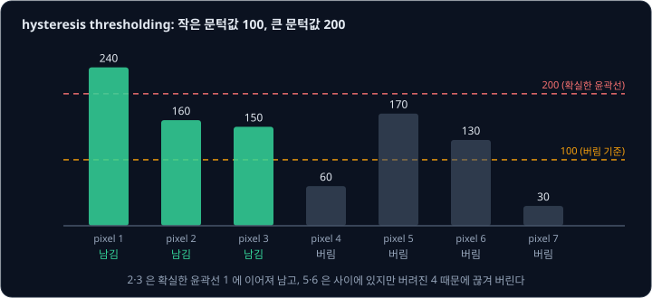
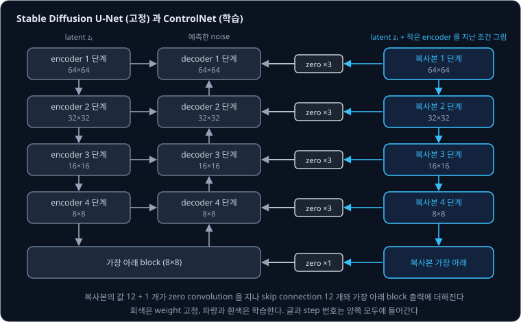
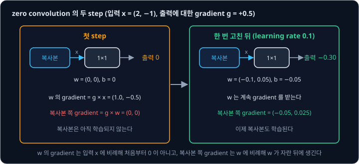
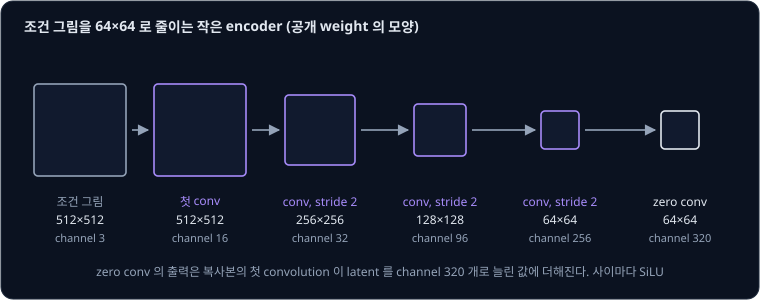
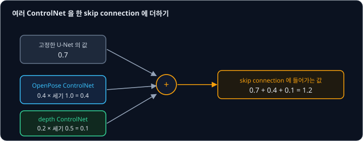

# ControlNet

왼손을 들고 오른쪽을 보는 사람을 그리고 싶다고 하자. "a person raising the left hand, looking right" 라고 쓰면 그림에 사람은 나오지만, 손의
높이나 몸의 각도까지 원하는 대로 나오리라는 보장은 없다. ControlNet 의 저자들도 논문 서론에서 글만으로는 복잡한 배치·자세·모양을 정확히 나타내기 어려워서, 머릿속
그림에 맞추려면 글을 고치고 결과를 보는 일을 여러 번 되풀이해야 한다고 지적한다. 원하는 자세를 막대 인형으로 그려서 건네면 그 자세대로 그려 주게
할 수는 없을까?

**ControlNet** 은 윤곽선, 사람의 자세, 깊이처럼 그림으로 된 조건을 Stable Diffusion 에 넣는 방법이다. Zhang, Rao, Agrawala 가 2023 년에 발표했다.
이미 학습한 U-Net 은 고정하고, 그 encoder 쪽을 복사한 network 만 조건 그림을 보도록 학습시킨다. 저자들이 공개한 Canny edge 용 ControlNet 은
윤곽선 그림·사진·설명 글 300 만 쌍으로 NVIDIA A100 80GB GPU 를 모두 600 GPU 시간 써서 학습했다. 저자들은 1 천 장의 작은 dataset 으로도 학습이 무너지지
않는다고 보고했다.

## 학습 목표

- Canny edge 같은 조건 그림을 사진에서 만드는 과정과, 사진·조건 그림·글을 묶은 학습 데이터를 설명할 수 있다
- U-Net 을 고정하고 encoder 복사본을 학습하는 구조와 그 parameter 수를 설명할 수 있다
- weight 를 0 으로 두고 시작하는 층인 zero convolution 이 학습 처음에 원래 model 을 그대로 지키면서도 gradient 를 받아 자라는 이유를 숫자로 따라갈 수 있다
- 어느 step 에서 갑자기 조건을 따르기 시작하는 갑작스러운 수렴, 글을 비운 채 학습하기, 생성할 때의 세기 조절과 여러 ControlNet 섞기를 설명할 수 있다

## 그림으로 된 조건

ControlNet 에 넣는 조건은 생성할 그림과 같은 크기의 그림이다. 저자들이 Stable Diffusion v1.5 용으로 공개한 checkpoint 8 개는 아래 조건을 받는다.

| 조건 | 조건 그림의 내용 |
| --- | --- |
| Canny edge | 검은 바탕에 흰 윤곽선 |
| HED edge | 윤곽선 검출 network HED(holistically-nested edge detection)가 그린, 굵기가 변하는 부드러운 윤곽선 |
| M-LSD line | 곧은 선분 검출 network M-LSD(mobile line segment detection)가 찾은, 방이나 건물의 곧은 선만 |
| scribble | 사람이 손으로 그린 낙서 |
| depth | 가까운 곳은 밝고 먼 곳은 어두운 깊이 지도 |
| normal map | 표면이 향하는 방향을 색으로 칠한 지도 |
| OpenPose | 사람의 관절을 점으로 찍고 이은 막대 인형 |
| segmentation | 벽·바닥·사람처럼 영역마다 종류별 색을 칠한 지도 |

이런 조건 그림은 대부분 사진에서 프로그램으로 만든다. 그래서 사진과 그 설명 글만 있으면, 사진에서 뽑은 조건 그림을 입력으로 두고 원래 사진을 정답으로
삼는 학습 데이터를 얼마든지 만들 수 있다.

Canny edge 는 [Derivatives & Gradients](../derivatives/README.md) 에서 본 밝기의 미분으로 윤곽선을 찾는다. OpenCV 의 Canny 튜토리얼에
따르면 계산은 네 단계다.

1. $5 \times 5$ Gaussian filter 로 noise 를 거른다
2. Sobel 연산자로 가로·세로 방향의 밝기 변화를 구해, pixel 마다 변화의 크기(gradient 의 크기)를 계산한다
3. 변화의 방향을 따라 이웃보다 크지 않은 pixel 을 지워 윤곽선을 한 pixel 두께로 가늘게 만든다
4. 문턱값 두 개로 남길 윤곽선을 고른다. 이 단계를 **hysteresis thresholding** 이라고 한다

hysteresis thresholding 에서는 변화의 크기가 큰 문턱값보다 크면 확실한 윤곽선으로 남기고, 작은 문턱값보다 작으면 버린다. 그 사이의 pixel 은 확실한
윤곽선에 이어져 있을 때만 남긴다. diffusers 의 ControlNet 예제는 작은 문턱값 100, 큰 문턱값 200 으로 `cv2.Canny` 를 부른다. 한 줄로 늘어선 pixel 7 개의 변화 크기에
이 문턱값을 쓰면 아래와 같다.

| pixel | 1 | 2 | 3 | 4 | 5 | 6 | 7 |
| --- | --- | --- | --- | --- | --- | --- | --- |
| 변화의 크기 | 240 | 160 | 150 | 60 | 170 | 130 | 30 |
| 문턱값과 비교 | 200 넘음 | 사이 | 사이 | 100 못 미침 | 사이 | 사이 | 100 못 미침 |
| 결과 | 남김 | 남김 (1 에 이어짐) | 남김 (2 에 이어짐) | 버림 | 버림 | 버림 | 버림 |

pixel 5 와 6 은 문턱값 사이에 있지만, 확실한 윤곽선 1 과의 사이에 버려진 pixel 4 가 끼어 있어서 이어지지 않는다. 이렇게 하면 확실한 윤곽선에 이어진 약한 선은
살리고, 떨어진 약한 선은 noise 로 보고 버린다.

[Cross-Attention](../cross-attention/README.md) 에서 본 것처럼, 그림과 같은 크기의 조건은 latent 옆에 channel 로 이어 붙이는 방법이 자연스럽다.
그런데 이어 붙이면 U-Net 의 첫 convolution 이 받는 channel 수가 바뀌어 U-Net 을 다시 학습해야 한다. 저자들은 자세나 윤곽선처럼 특정한 조건의
dataset 이 대개 10 만 장 규모라서, Stable Diffusion 을 학습한 LAION-5B 보다 약 5 만 배 작다고 지적한다. 이렇게 적은 데이터로 큰 model 을 그대로
미세조정하면 학습 그림만 외우는 overfitting 과, 원래 하던 일을 잊는 catastrophic forgetting 이 생길 수 있다.

**확인 문제.** 문턱값이 100 과 200 일 때, 변화의 크기가 차례로 210, 120, 90, 250 인 pixel 네 개 가운데 남는 것은 어느 것일까?

답 보기

① 210 과 250 은 200 을 넘어 확실한 윤곽선이다.

② 90 은 100 에 못 미쳐 버린다.

③ 120 은 사이에 있고 확실한 윤곽선 210 바로 옆이라 남는다.

답: 210, 120, 250 이 남고 90 만 버린다.

## 고정한 U-Net 과 학습할 복사본

ControlNet 은 Stable Diffusion 의 U-Net 을 건드리지 않는다. U-Net 의 weight 는 고정(lock)하고, U-Net 의 줄이는 길(encoder)과 가장 아래 block 을
weight 까지 그대로 복사해 **trainable copy**(학습할 복사본)를 만든다. 복사본은 조건 그림을 함께 받고, 그 출력은 원래 U-Net 의 skip connection 에
더해진다.

[U-Net](../unet/README.md) 에서 본 것처럼 Stable Diffusion 의 줄이는 길은 $64 \times 64$, $32 \times 32$, $16 \times 16$, $8 \times 8$ 네 크기에서
값을 12 개 남기고, 키우는 길이 이 12 개를 skip connection 으로 받는다. ControlNet 의 복사본도 같은 자리에서 값을 12 개 내고, 가장 아래 block 에서
하나를 더 낸다. 이 13 개가 원래 U-Net 의 skip connection 12 개와 가장 아래 block 의 출력에 하나씩 더해진다.

복사본과 원래 U-Net 사이에는 학습을 시작할 때 무엇을 받든 0 을 내는 **zero convolution** 층이 끼어 있다. 이 층의 계산은 다음 절에서 자세히 한다.
예를 들어 고정한 block 이 어떤 위치에서 0.7 을 낸다고 하고, U-Net 의 한 block 에서 일어나는 일을 이 숫자 하나로 따라가 보자.

| 값 | 이 예의 값 | 기호로 쓴 값 |
| --- | --- | --- |
| 고정한 block 의 출력 | 0.7 | $y = \mathcal F(x; \Theta)$ |
| 조건이 zero convolution 을 지난 값 | 0 | $\mathcal Z(c; \Theta_{z1})$ |
| 복사본의 출력 | 0.7 (같은 weight, 같은 입력) | $\mathcal F(x + \mathcal Z(c; \Theta_{z1}); \Theta_c)$ |
| 복사본 출력이 zero convolution 을 지난 값 | 0 | $\mathcal Z(\cdots; \Theta_{z2})$ |
| ControlNet 을 붙인 block 의 출력 | $0.7 + 0 = 0.7$ | $y_c = \mathcal F(x; \Theta) + \mathcal Z(\mathcal F(x + \mathcal Z(c; \Theta_{z1}); \Theta_c); \Theta_{z2})$ |

마지막 줄이 논문의 식 (2) 다. $\mathcal F$ 는 block 의 계산이고, $x$ 는 block 의 입력이고, $c$ 는 조건이고, $\mathcal Z$ 는 zero convolution 이다.
$\Theta$ 는 고정한 weight 이고, $\Theta_c$ 는 복사본의 weight 이고, $\Theta_{z1}$ 과 $\Theta_{z2}$ 는 두 zero convolution 의 weight 다. 학습을 시작할 때는 $y_c = y$ 라서 ControlNet 을 붙인 model 이 원래 Stable Diffusion 과 똑같은 그림을 낸다.

복사본의 weight 는 무작위 값이 아니라, 논문의 초록이 적은 대로 수십억 장의 그림으로 학습한 U-Net 의 weight 다. 그래서 복사본은 처음부터 그림을 읽는 능력을 갖고 출발하고, 그
위에 조건 그림을 읽는 법만 더 배운다. 저자들은 이것을 큰 model 을 조건 학습의 튼튼한 backbone(다른 일을 배울 때 바탕으로 삼는 network)으로 다시 쓰는 것이라고 설명한다.

공개된 Canny ControlNet 의 weight 파일(`diffusion_pytorch_model.safetensors`, 32 bit)의 tensor 모양으로 parameter 를 세면 아래와 같다.

| 부분 | parameter |
| --- | --- |
| encoder 복사본 (첫 convolution, time embedding, 줄이는 길, 가장 아래 block) | 348,712,960 |
| zero convolution 13 개 | 11,479,680 |
| 조건 그림을 줄이는 작은 encoder | 1,086,480 |
| 합계 | 361,279,120 |

합계를 U-Net 전체 859,520,964 개로 나누면 약 42% 이고, 32 bit(4 byte)로 저장하면 361,279,120 × 4 byte 로 약 1.45 GB 다.
[LoRA](../lora/README.md) 강의에서 센 rank 4 LoRA 의 parameter 79 만 개보다 훨씬 크지만, 그만큼 그림의 배치처럼 새로운 정보를 읽을 깊은 network 를
갖는다. 고정한 U-Net 쪽은 gradient 를 계산하지 않아서 그만큼 memory 와 시간을 아낀다. 저자들이 A100 40GB 한 대로 잰 결과, ControlNet 을 붙여 학습하면
Stable Diffusion 만 학습할 때보다 GPU memory 를 약 23% 더 쓰고 한 step 의 시간도 약 34% 더 걸렸다.

**흔한 오해.** ControlNet 이 Stable Diffusion 을 미세조정하는 방법이라고 생각하기 쉽지만, 원래 U-Net 의 weight 는 한 숫자도 바뀌지 않는다.
학습하는 것은 옆에 붙인 복사본과 zero convolution, 작은 encoder 다. 그래서 논문의 그림 12 처럼, Stable Diffusion v1.5 로 학습한 ControlNet 을
같은 구조의 다른 미세조정 model(Comic Diffusion, Protogen 3.4)에 다시 학습하지 않고 붙여 쓸 수 있다.

**확인 문제.** 어떤 위치에서 고정한 block 이 $-0.3$ 을 내고, 학습이 조금 진행된 뒤 복사본 쪽 zero convolution 이 0.1 을 낸다. ControlNet 을 붙인
block 의 출력은?

답 보기

$$
y_c = -0.3 + 0.1 = -0.2
$$

답: $-0.2$. 학습이 진행되면 zero convolution 의 출력이 0 에서 벗어나 원래 값을 조금씩 바꾼다.

## zero convolution

[CNN](../cnn/README.md) 에서 본 convolution 가운데 kernel 이 $1 \times 1$ 인 것은 이웃 pixel 을 보지 않고, 위치마다 channel 들의 값에 weight 를 곱해 더하고
bias 를 더하기만 한다. zero convolution 은 이 $1 \times 1$ convolution 의 weight 와 bias 를 모두 0 으로 두고 시작하는 층이다. diffusers 의
`ControlNetModel` 은 `zero_module` 이라는 함수로 이 층들의 parameter 를 모두 0 으로 채운다.

weight 가 모두 0 이면 출력이 늘 0 이라 아무것도 배우지 못할 것 같지만 그렇지 않다. 예를 들어 한 위치에서 복사본이 channel 2 개짜리 값 $x = (2, -1)$ 을 내고,
zero convolution 이 이것을 숫자 하나로 바꾼다고 하자. 출력은 $w_1 x_1 + w_2 x_2 + b$ 다.

| 값 | 학습 전 | 계산 |
| --- | --- | --- |
| weight $w$, bias $b$ | $(0, 0)$, 0 | |
| 출력 | 0 | $0 \times 2 + 0 \times (-1) + 0$ |
| 출력에 대한 loss 의 gradient $g$ | $+0.5$ | 예로 정한 값 |
| $w$ 의 gradient | $(1.0, -0.5)$ | $g \times x = 0.5 \times (2, -1)$ |
| $b$ 의 gradient | 0.5 | $g \times 1$ |
| 복사본 쪽($x$)으로 가는 gradient | $(0, 0)$ | $g \times w = 0.5 \times (0, 0)$ |

$w$ 의 gradient 는 입력 $x$ 에 비례해서, $x$ 가 0 이 아니면 $w$ 가 0 이어도 gradient 가 생긴다. $w_1$ 의 gradient 가 $+1.0$ 이라는 것은 $w_1$ 을 키우면
loss 가 는다는 뜻이라, gradient descent 는 $w_1$ 을 줄인다. 반대로 복사본 쪽으로 가는 gradient 는 $w$ 에 비례해서 첫 step 에는 0 이다.

learning rate 0.1 로 한 step 고치면 $w = (0 - 0.1 \times 1.0,\ 0 - 0.1 \times (-0.5)) = (-0.1, 0.05)$, $b = -0.05$ 가 된다. 둘째 step 에서 같은
$x$ 와 $g$ 를 넣으면 아래와 같다.

| 값 | 첫 step | 둘째 step |
| --- | --- | --- |
| 출력 | 0 | $-0.1 \times 2 + 0.05 \times (-1) - 0.05 = -0.30$ |
| 복사본 쪽으로 가는 gradient | $(0, 0)$ | $0.5 \times (-0.1, 0.05) = (-0.05, 0.025)$ |

첫 step 에는 zero convolution 만 움직이고, $w$ 가 0 에서 벗어난 둘째 step 부터 복사본도 gradient 를 받아 학습을 시작한다. 이 원리는 [LoRA](../lora/README.md) 가 $B$ 를
0 으로 두고 $A$ 를 무작위로 두는 것과 같다. 0 인 쪽이 먼저 움직이고, 그 덕분에 나머지가 따라 움직인다.

논문에 따르면 zero convolution 은 학습 초기에 무작위 noise 같은 gradient 로부터 복사본을 지킨다. 저자들은 zero convolution 을 Gaussian
분포로 초기화한 보통의 convolution 으로 바꿔 비교했는데, 성능이 복사본 대신 convolution 한 층만 둔 가벼운 구조(ControlNet-lite)와 비슷한
수준으로 떨어졌다. 이 결과를 저자들은 미세조정 중에 복사본이 가진 pretrained backbone 이 망가졌다는 뜻으로 해석했다.

<b>심화: 1×1 convolution 의 gradient</b>

channel $n$ 개의 입력 $x$ 를 channel 하나로 바꾸는 $1 \times 1$ convolution 의 출력은 위치마다 $o = \sum_i w_i x_i + b$ 다. chain rule 에 따라
출력에 대한 loss 의 gradient 를 $g = \partial L / \partial o$ 라고 하면

$$
\frac{\partial L}{\partial w_i} = g\,x_i, \qquad \frac{\partial L}{\partial b} = g, \qquad \frac{\partial L}{\partial x_i} = g\,w_i
$$

다. 실제 층은 여러 위치와 여러 출력 channel 을 가지므로 위치마다 구한 $g\,x_i$ 를 모두 더한 값이 $w_i$ 의 gradient 가 된다. $w = 0$, $b = 0$ 에서
첫째와 둘째 식은 $x$ 와 $g$ 가 0 이 아닌 한 0 이 아니고, 셋째 식만 0 이다.

**확인 문제.** zero convolution 의 입력이 $x = (1, 3)$ 이고 출력에 대한 gradient 가 $g = -0.2$ 다. 학습 전($w = (0, 0)$, $b = 0$)에 $w$ 의 gradient 와 복사본
쪽으로 가는 gradient 는 각각 얼마일까?

답 보기

① $w$ 의 gradient 는 $g \times x = -0.2 \times (1, 3) = (-0.2, -0.6)$ 이다.

② 복사본 쪽 gradient 는 $g \times w = -0.2 \times (0, 0) = (0, 0)$ 이다.

답: $(-0.2, -0.6)$ 과 $(0, 0)$. $w$ 의 gradient 가 둘 다 음수라 gradient descent 는 $w_1$ 과 $w_2$ 를 모두 키운다.

## 조건 그림을 64×64 로 줄이기

Stable Diffusion 의 U-Net 은 $64 \times 64 \times 4$ latent 를 다루는데, 조건 그림은 $512 \times 512 \times 3$ 이다. ControlNet 은 조건
그림을 VAE 대신 작은 convolution network 로 $64 \times 64$ 까지 줄인다. 공개된 checkpoint 의 tensor 모양과 diffusers 의 `ControlNetConditioningEmbedding` 을
따라 값의 모양을 계산하면 아래와 같다. 모든 convolution 은 $3 \times 3$ kernel 이고, 사이마다 SiLU 라는 activation function 을 쓴다.

| 층 | 출력 크기 | channel |
| --- | --- | --- |
| 조건 그림 | $512 \times 512$ | 3 |
| 첫 convolution | $512 \times 512$ | 16 |
| convolution, stride 2 convolution | $256 \times 256$ | 32 |
| convolution, stride 2 convolution | $128 \times 128$ | 96 |
| convolution, stride 2 convolution | $64 \times 64$ | 256 |
| zero convolution ($3 \times 3$, 0 으로 시작) | $64 \times 64$ | 320 |

stride 2 는 kernel 을 두 pixel 씩 옮겨 가로세로를 반으로 줄인다는 뜻이라, 세 번 줄이면 $512 \div 2 \div 2 \div 2 = 64$ 다. 마지막 출력은 복사본의
첫 convolution 이 latent 를 channel 320 개로 늘린 값에 위치마다 더해진다. 이 마지막 층도 0 으로 시작하므로 식 (2) 의 $\mathcal Z(c; \Theta_{z1})$
역할을 한다.

논문 본문은 이 network 를 $4 \times 4$ kernel, stride 2 인 convolution 4 층(channel 16, 32, 64, 128, ReLU)으로 적었다. 공개된 weight 의 모양은 위 표와
같아서, 이 강의는 실제 weight 를 따랐다. 어느 쪽이든 이 network 는 무작위 weight 에서 출발해 나머지 ControlNet 과 함께 학습한다.

**확인 문제.** 조건 그림이 $768 \times 768$ 이면 작은 encoder 의 출력은 가로세로가 얼마일까? 이 크기는 같은 그림의 latent 크기와 맞을까?

답 보기

① stride 2 로 세 번 줄이므로 $768 \div 8 = 96$ 이다.

② VAE 도 가로세로를 8 분의 1 로 줄이므로 $768 \times 768$ 그림의 latent 도 $96 \times 96$ 이다.

답: $96 \times 96$ 으로 latent 와 크기가 맞는다.

## 학습: 빈 글과 갑작스러운 수렴

ControlNet 의 loss 는 Stable Diffusion 의 loss 에 조건 그림 $c_f$ 하나를 더 넣은 것이다(논문의 식 (5)). model 은 noise 가 섞인 latent $z_t$, step $t$,
글 $c_t$, 조건 그림 $c_f$ 를 받아 섞인 noise $\epsilon$ 을 맞힌다.

$$
L = \mathbb E\Big[\big\lVert \epsilon - \epsilon_\theta(z_t, t, c_t, c_f) \big\rVert^2\Big]
$$

$\epsilon_\theta$ 는 ControlNet 을 붙인 model 이 예측한 noise 이고, $\mathbb E$ 는 여러 학습 예에 대해 낸 평균이다.

저자들은 학습하는 동안 글의 50% 를 빈 글로 바꿨다. [Classifier-Free Guidance](../classifier-free-guidance/README.md) 강의에서 글 없이 하는 예측(무조건 예측)을 배우려고 글을
10% 쯤 비운 것보다 훨씬 많이 비운다. 글이 비어 있으면 model 은 조건 그림만 보고 그 안의 내용을 알아내야 한다. 논문에 따르면 그 덕분에 ControlNet 이
윤곽선·자세·깊이에서 직접 뜻을 읽는 능력이 커진다. 논문의 그림 7 은 글 없이 조건 그림만으로 만든 그림들이다. diffusers 의 학습 예제
`train_controlnet.py` 에서는 같은 일을 `proportion_empty_prompts` 가 맡는데, 기본값은 0 이라 따로 켜야 한다.

학습이 진행되는 모습도 보통과 다르다. zero convolution 덕분에 ControlNet 을 붙인 model 은 학습 내내 원래 Stable Diffusion 만큼 선명한 그림을 낸다.
그런데 조건 그림을 따르는 정도는 조금씩 늘지 않고, 어느 step 에서 갑자기 따르기 시작한다. 저자들은 이것을 **sudden convergence phenomenon**
(갑작스러운 수렴)이라고 부르고, 대개 1 만 step 안에 일어난다고 적었다. 논문의 그림 4 에서는 6133 step 에서 model 이 갑자기 조건을 따르기
시작한다.

ControlNet 리포의 학습 안내는 batch 4 로 학습하면 대개 3 천 ~ 7 천 step 에서 쓸 만한 model 이 나온다고 적었다. 같은 안내의 예제는 batch 4,
learning rate $10^{-5}$ 로 4000 step 을 PCIE 40GB GPU 한 대에서 약 50 분 학습한다. 갑작스러운 수렴이 늘 비슷한 step 에서 일어나므로, 안내는 step 을 더
늘리기보다 batch 를 키우라고 권한다. memory 가 모자라면 gradient accumulation(여러 batch 의 gradient 를 더해 두었다가 한 번에 weight 를
고치는 방법)으로 batch 를 키운다.

데이터의 양은 결과의 질을 바꾼다. 논문의 그림 10 은 같은 조건을 1 천 장, 5 만 장, 300 만 장으로 학습한 결과인데, 1 천 장으로도 학습이 무너지지 않았고
데이터가 많을수록 결과가 좋아졌다. diffusers 의 학습 예제는 `ControlNetModel.from_unet(unet)` 으로 U-Net 의 weight 를 복사해 ControlNet 을 만들고,
U-Net·VAE·text encoder 는 고정한 채 learning rate $5 \times 10^{-6}$, 해상도 512 를 기본값으로 학습한다.

**흔한 오해.** 갑작스러운 수렴을 보면 그전의 step 은 쓸모가 없었다고 생각하기 쉽지만, 그동안에도 zero convolution 과 복사본의 weight 는 계속
바뀌고 있다. 조건을 따르는 결과가 어느 순간 눈에 띄게 나타날 뿐이다.

**확인 문제.** 한 batch 에 그림이 8 장이고 각 그림의 글을 50% 확률로 비운다. 한 batch 에서 빈 글은 평균 몇 장일까? 빈 글이 든 그림에서 model 은
무엇을 보고 noise 를 맞혀야 할까?

답 보기

① 평균 $8 \times 0.5 = 4$ 장이다.

② 글이 비어 있으므로 noise 가 섞인 latent, step 번호, 조건 그림만 보고 맞혀야 한다.

답: 평균 4 장. 조건 그림에서 내용을 읽는 법을 배운다.

## 생성할 때의 세기와 여러 조건

diffusers 의 `StableDiffusionControlNetPipeline` 은 조건 그림과 글을 함께 받는다. pipeline 은 ControlNet 이 낸 값 13 개에
`controlnet_conditioning_scale` 을 곱해 U-Net 에 더하고, 이 값의 기본값은 1.0 이다. 이 값을 $s$ 라고 하면 식 (2) 의 둘째 항이 $s$ 배가 된다. 예를 들어
어떤 skip connection 에서 원래 값이 0.7 이고 ControlNet 이 0.4
를 냈다면, $s = 1$ 일 때는 $0.7 + 0.4 = 1.1$ 이고 $s = 0.5$ 일 때는 $0.7 + 0.5 \times 0.4 = 0.9$ 다. $s = 0$ 이면 ControlNet 이 더하는 값이 0 이 되어 원래 Stable Diffusion 과 같다.

조건을 쓸 step 의 구간도 정할 수 있다. `control_guidance_start` 와 `control_guidance_end` 는 전체 step 가운데 ControlNet 을 쓸 구간을 0 과 1 사이의
비율로 정하고, 기본값은 0.0 과 1.0 이라 모든 step 에 쓴다. pipeline 의 code 는 $N$ step 가운데 $i$ 번째 step($i = 0, 1, \dots$)을
$i / N \ge$ start 이고 $(i + 1) / N \le$ end 일 때만 쓴다.

| step 수 $N$ | start | end | ControlNet 을 쓰는 step |
| --- | --- | --- | --- |
| 20 | 0.0 | 1.0 | 0 ~ 19 번째, 20 개 |
| 20 | 0.0 | 0.5 | 0 ~ 9 번째, 10 개 |
| 20 | 0.25 | 1.0 | 5 ~ 19 번째, 15 개 |

[DDPM](../ddpm/README.md) 에서 본 것처럼 그림의 큰 모양은 앞쪽 step 에서 정해지고 세부는 뒤쪽 step 에서 정해진다. 그래서 이 강의의 해석으로는, end 를 0.5 로 두면
조건 그림이 배치만 정하고 세부는 조건에 덜 묶인 채 그려진다.

[Classifier-Free Guidance](../classifier-free-guidance/README.md) 를 쓰면 U-Net 을 글이 있는 쪽과 빈 글 쪽으로 두 번 계산한다. diffusers 는 기본으로
조건 그림을 두 쪽 모두에 넣는다. `guess_mode` 를 켜면 ControlNet 을 글이 있는 쪽에만 계산하고 빈 글 쪽에는 0 을 더한다. 이때 13 개의 값에 곱하는
세기를 얕은 skip connection 의 0.1 부터 가장 아래 block 의 1.0 까지 log 간격(다음 값이 늘 같은 배수로 커지는 간격)으로 늘린다. 논문에 따르면 글 없이 생성할 때 두 쪽 모두에 넣으면
guidance 가 사라지고, 한쪽에만 넣으면 너무 세진다. 그래서 저자들은 글이 있는 쪽에만 넣되 block 의 가로세로 $h_i$ 에 따라 skip connection 마다 $64 / h_i$ 를 곱하고
guidance scale 을 낮추는 방법(CFG resolution weighting)을 제안했다.

조건 여러 개를 함께 쓸 수도 있다. 사람의 자세와 깊이를 함께 정하고 싶으면 OpenPose ControlNet 과 depth ControlNet 의 출력을 U-Net 에 함께 더하면
된다. 논문에 따르면 이때 따로 weight 를 주거나 섞는 계산은 필요 없다. diffusers 에서는 ControlNet 의 목록과 조건 그림의 목록을 넘기고,
`controlnet_conditioning_scale` 도 목록으로 줘서 조건마다 세기를 정한다.

**확인 문제.** skip connection 의 원래 값이 0.7 이다. OpenPose ControlNet 이 0.4, depth ControlNet 이 0.2 를 냈고 세기는 각각 1.0 과 0.5 다. 더한
값은? 30 step 으로 생성하며 `control_guidance_end` 를 0.6 으로 두면 ControlNet 을 쓰는 step 은 몇 개일까?

답 보기

① $0.7 + 1.0 \times 0.4 + 0.5 \times 0.2 = 0.7 + 0.4 + 0.1 = 1.2$ 다.

② $(i + 1) / 30 \le 0.6$ 이려면 $i + 1 \le 18$ 이라 $i = 0, \dots, 17$ 이다.

답: 1.2 와 18 개.

## 정리

- ControlNet 은 Canny edge·depth·OpenPose 처럼 그림으로 된 조건을 받는다. 조건 그림은 사진에서 프로그램으로 만들 수 있어, 사진·조건 그림·글을 묶은
  학습 데이터를 쉽게 모을 수 있다. Canny 는 밝기의 미분과 두 문턱값(diffusers 예제는 100, 200)으로 이어진 윤곽선만 남긴다
- U-Net 은 고정하고 encoder 와 가장 아래 block 을 weight 째 복사해 학습한다. 복사본의 출력 13 개가 U-Net 의 skip connection 12 개와 가장 아래 block
  에 더해진다. Canny ControlNet 의 parameter 는 361,279,120 개로 U-Net 의 약 42% 다
- zero convolution 은 weight 와 bias 를 0 으로 시작하는 $1 \times 1$ convolution 이라 학습을 시작할 때 model 의 출력이 원래와 똑같다. weight 의 gradient 는 입력에
  비례해 0 이 아니므로 zero convolution 이 먼저 자라고, 그 뒤 복사본도 gradient 를 받는다
- 학습할 때 글의 50% 를 비워 조건 그림에서 뜻을 읽게 하고, 조건을 따르는 능력은 대개 1 만 step 안에 갑자기 생긴다. 생성할 때는 세기와 쓸 step
  구간으로 조건의 영향을 조절하고, 여러 ControlNet 의 출력을 더해 조건을 섞는다

ControlNet 은 Stable Diffusion v1 의 U-Net 을 그대로 두고 그 옆에 붙였다. 다음 강의인 [SDXL](../sdxl/README.md) 은 U-Net 자체를 세 배쯤 키우고 text encoder 를 둘로 늘려
$1024 \times 1024$ 그림을 만든다.

## 참고 자료

- Lvmin Zhang, Anyi Rao, Maneesh Agrawala, [Adding Conditional Control to Text-to-Image Diffusion Models](https://arxiv.org/abs/2302.05543) (2023) —
  ControlNet 논문. 1 절의 작은 dataset 과 overfitting, 3.1 절의 식 (2) 와 zero convolution, 3.2 절의 12 + 1 개 block 과 GPU memory 23%·시간 34%,
  3.3 절의 빈 글 50% 와 갑작스러운 수렴(그림 4), 3.4 절의 CFG resolution weighting 과 여러 ControlNet, 4.2 절의 zero convolution ablation,
  그림 10 의 dataset 크기, 그림 12 의 다른 model 에 붙여 쓰기
- lllyasviel, [ControlNet 리포의 학습 안내 `docs/train.md`](https://github.com/lllyasviel/ControlNet/blob/main/docs/train.md) — batch 4·learning rate
  $10^{-5}$ 로 4000 step 에 약 50 분, 3 천 ~ 7 천 step 의 갑작스러운 수렴, batch 를 키우라는 권고
- Hugging Face, [lllyasviel/sd-controlnet-canny](https://huggingface.co/lllyasviel/sd-controlnet-canny) — 공개 checkpoint 8 개의 조건, Canny 문턱값
  100·200 예제, 300 만 쌍·A100 600 시간 학습. `config.json` 의 `conditioning_embedding_out_channels: [16, 32, 96, 256]` 과 weight 파일의 tensor 모양
- diffusers, [`controlnets/controlnet.py`](https://github.com/huggingface/diffusers/blob/main/src/diffusers/models/controlnets/controlnet.py) —
  `ControlNetConditioningEmbedding`, `zero_module`, `from_unet`, `conditioning_scale` 과 `guess_mode` 의 0.1 ~ 1.0 세기.
  [`pipeline_controlnet.py`](https://github.com/huggingface/diffusers/blob/main/src/diffusers/pipelines/controlnet/pipeline_controlnet.py) 에
  `controlnet_conditioning_scale`·`control_guidance_start`·`control_guidance_end` 의 기본값과 쓸 step 을 고르는 식이 있다
- diffusers, [`train_controlnet.py`](https://github.com/huggingface/diffusers/blob/main/examples/controlnet/train_controlnet.py) — learning rate
  $5 \times 10^{-6}$, 해상도 512, `proportion_empty_prompts` 기본값 0, U-Net·VAE·text encoder 고정
- OpenCV, [Canny Edge Detection 튜토리얼](https://github.com/opencv/opencv/blob/4.x/doc/py_tutorials/py_imgproc/py_canny/py_canny.markdown) —
  Gaussian filter, Sobel, 가늘게 만들기, 두 문턱값으로 고르는 hysteresis thresholding 의 네 단계
