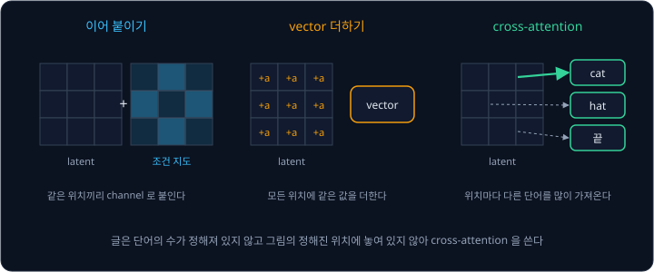
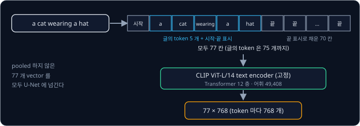
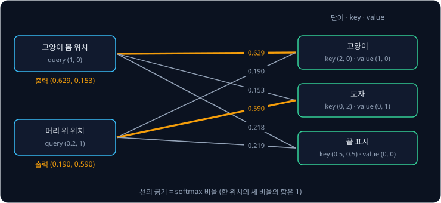
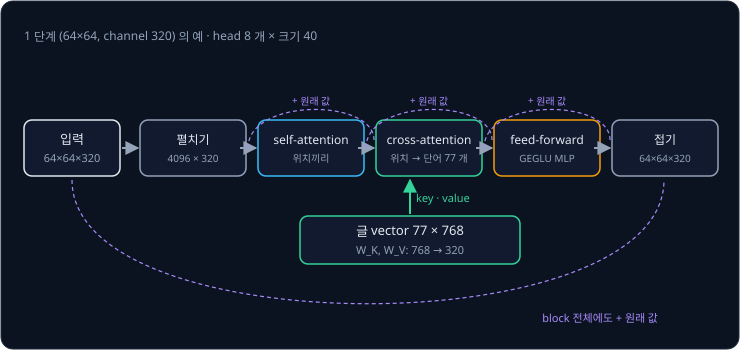
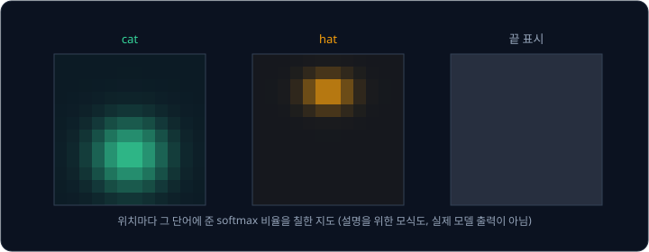

# Cross-Attention

[Latent Diffusion](../latent-diffusion/README.md) 의 U-Net 은 noise 에서 출발해 학습 그림과 비슷한 latent 를 만들 뿐, 무엇을 그릴지는 정하지
않는다. "모자를 쓴 고양이" 라는 글을 받았다면 U-Net 은 latent 의 4096 개 위치마다 다르게 행동해야 한다. 고양이 몸이 놓일 위치는 "고양이"
를, 머리 위의 위치는 "모자" 를 따라야 하고, 배경의 위치는 둘 다 신경 쓰지 않아야 한다. 글 전체를 숫자 하나의 묶음으로 줄여 모든 위치에 똑같이
더하면 이런 차이를 낼 수 없다. 위치마다 글의 다른 단어를 따르게 하려면 어떻게 해야 할까?

이 문제를 푸는 방법인 **cross-attention** 은 그림의 위치마다 글의 단어들을 훑어보고, 그 위치와 관련 있는 단어의 값을 골라 가져오는 계산이다. Rombach 등은 LDM 에서
U-Net 의 중간 층에 cross-attention 을 넣어 글, class, 배치도 같은 조건으로 그림을 만들었다. Stable Diffusion v1 의 U-Net 에는
cross-attention 층이 16 개 있고, 층마다 CLIP 의 text encoder 가 낸 단어 77 개 분량의 vector 를 읽는다.

## 학습 목표

- 조건을 넣는 세 가지 방법(이어 붙이기, vector 더하기, cross-attention)을 비교하고 글에 cross-attention 을 쓰는 이유를 설명할 수 있다
- Stable Diffusion 이 글을 CLIP text encoder 로 $77 \times 768$ 의 숫자 묶음으로 바꾸는 과정을 설명할 수 있다
- 그림의 위치에서 query 를, 단어에서 key 와 value 를 만들어 가져올 값을 정하는 cross-attention 을 작은 숫자로 계산할 수 있다
- Stable Diffusion U-Net 의 attention block 안에서 self-attention, cross-attention, feed-forward 가 이어지는 순서와 값의 모양을 따라갈 수 있다

## 조건을 넣는 세 방법

생성 모델에 "무엇을 만들지" 를 알려 주는 입력을 **조건(condition)** 이라고 하고, 조건을 받는 생성을 조건부 생성이라고 한다. 조건을 U-Net 에
넣는 방법은 조건의 모양에 따라 셋으로 나뉜다.

| 방법 | 조건의 모양 | 넣는 방식 | 예 |
| --- | --- | --- | --- |
| 이어 붙이기 | 그림과 같은 크기의 지도 | 입력 latent 옆에 channel 로 붙인다 | 저해상도 그림을 키우는 super-resolution, 영역마다 종류를 칠한 배치도 |
| vector 더하기 | vector 하나 | 모든 위치의 channel 에 더한다 | step 번호의 time embedding |
| cross-attention | vector 여러 개의 목록 | 위치마다 목록에서 골라 가져온다 | 단어마다 vector 가 하나씩인 글 |

LDM 논문도 그림 3 에서 조건을 이어 붙이는 길과 cross-attention 으로 넣는 길을 함께 그린다. 저자들은 super-resolution 에서는 저해상도 그림을
입력에 이어 붙였고, 글과 배치 상자처럼 그림과 모양이 다른 조건에는 cross-attention 을 썼다.

글은 이어 붙이기에 맞지 않는다. 단어의 수가 글마다 다르고, 단어가 그림의 특정 위치에 놓여 있지도 않기 때문이다. "모자" 가 그림의 위쪽에 놓일지는
U-Net 이 그림을 그리면서 정한다. 글을 vector 하나로 줄여 더하는 방법은 [U-Net](../unet/README.md) 의 time embedding 처럼 같은 channel 의 모든
위치에 같은 값을 더하므로, 고양이 몸의 위치와 머리 위의 위치가 같은 정보를 받는다. 위치마다 다른 단어를 따르게 하려면 단어별 vector 를
그대로 두고 위치가 직접 골라 가져가게 해야 한다.

**확인 문제.** 흑백 스케치를 그대로 따라 색을 칠하는 모델에 스케치를 조건으로 넣는다. 세 방법 가운데 어느 것이 가장 자연스러울까?

답 보기

스케치는 그림과 같은 크기의 지도이고, 스케치의 각 위치가 그림의 같은 위치에 대응한다. 그래서 latent 와 같은 크기로 줄인 스케치를 입력 옆에
channel 로 이어 붙이는 방법이 자연스럽다.

답: 이어 붙이기.

## 글을 vector 로 바꾸는 CLIP text encoder

Stable Diffusion 은 글을 [CLIP](../clip/README.md) 의 text encoder 로 vector 목록으로 바꾼다. 공식 리포의 README 는 "고정한(frozen) CLIP
ViT-L/14 text encoder 를 쓴다" 고 적었다. 고정했다는 것은 Stable Diffusion 을 학습하는 동안 이 text encoder 의 weight 를 바꾸지 않았다는 뜻이다.
CLIP 은 사진과 그 설명 글이 같은 공간의 가까운 vector 가 되도록 학습했으므로, 이 text encoder 의 vector 에는 글이 어떤 장면을 가리키는지가 이미
담겨 있다.

Hugging Face 의 v1-4 설정(`tokenizer/`, `text_encoder/config.json`)에 적힌 숫자로 글이 vector 로 바뀌는 과정을 따라가면 아래와 같다.

1. [Tokenizer](../tokenizer/README.md) 가 글을 token 으로 나눈다. CLIP 의 tokenizer 는 소문자로 바꾼 뒤 BPE 로 나누고, 어휘는 49,408 개다
2. 맨 앞에 시작 표시 `<|startoftext|>` 를, 맨 뒤에 끝 표시 `<|endoftext|>` 를 붙인다
3. 길이를 77 로 맞춘다. 짧으면 남는 자리를 `<|endoftext|>` 로 채우고, 길면 77 번째 뒤를 잘라 낸다
4. 77 개의 token 을 층 12 개짜리 Transformer 에 넣어 token 마다 숫자 768 개짜리 vector 를 얻는다

"a cat wearing a hat" 이 단어마다 token 하나라면 시작 표시와 끝 표시를 합쳐 7 자리이고, 나머지 70 자리는 `<|endoftext|>` 로 채운다. 결과는
$77 \times 768$, 숫자 59,136 개의 묶음이다. CLIP 은 사진과 글을 비교할 때 이 가운데 끝 표시 자리의 vector 하나만 골라
쓰지만, Stable Diffusion 은 단어마다 vector 가 따로 있어야 위치마다 다른 단어를 고를 수 있어서 77 개를 모두 쓴다. README 는 이 77 개를 하나로
모으지 않았다는 뜻으로 pooled 하지 않은 text embedding 이라고 부른다.

diffusers 의 Stable Diffusion pipeline 은 글을 `padding="max_length"`, `truncation=True` 로 tokenizer 에 넣고, 잘린 부분이 있으면 "CLIP 은 77 개
token 까지만 다룰 수 있어서 입력의 뒷부분을 잘랐다" 는 경고를 낸다. 시작과 끝 표시를 빼면 글은 token 75 개까지 들어간다.

text encoder 가 얼마나 강한지는 그림이 글을 얼마나 따르는지를 크게 바꾼다. Google 의 Imagen(2022)은 CLIP 대신 언어 모델 T5-XXL(parameter
4.6B)의 encoder 를 고정해 썼는데, 논문은 diffusion 의 U-Net 을 키우는 것보다 text encoder 를 키우는 것이 그림의 품질과 글과의 일치에 훨씬 큰
효과가 있었다고 적었다.

**확인 문제.** 시작과 끝 표시를 빼고 token 90 개로 나뉘는 글을 Stable Diffusion v1 에 넣으면 token 몇 개가 U-Net 에 전달되고 몇 개가 버려질까?

답 보기

① 77 자리 가운데 시작 표시와 끝 표시가 2 자리를 차지하므로 글의 token 은 75 개까지 들어간다.

② $90 - 75 = 15$ 개가 잘린다.

답: 글의 token 75 개가 전달되고 15 개가 버려진다.

## query, key, value

cross-attention 은 [Transformer](../transformer/README.md) 의 attention 과 같은 계산을 하지만, 아래 세 vector 를 만드는 곳이 다르다. 그림의
위치에서 query 를 만들고, 글의 단어에서 key 와 value 를 만든다.

- **query**: 그림의 위치마다 만드는 vector 로, 이 위치에 어떤 단어가 필요한지를 나타낸다
- **key**: 단어마다 만드는 vector 로, 이 단어가 어떤 위치에 맞는지를 나타낸다
- **value**: 단어마다 만드는 vector 로, 그 단어를 고른 위치에 건네줄 값이다

위치의 query 와 단어의 key 를 곱해 더한 값(내적)이 크면 그 단어를 많이 가져온다. "모자를 쓴 고양이" 의 단어를 "고양이", "모자", 끝 표시 셋으로
줄이고 vector 를 숫자 2 개짜리로 정해 계산해 보자. 아래의 key 와 value 는 학습된 network 가 낼 법한 값을 예로 정한 것이다.

| 단어 | key | value |
| --- | --- | --- |
| 고양이 | (2, 0) | (1, 0) |
| 모자 | (0, 2) | (0, 1) |
| 끝 표시 | (0.5, 0.5) | (0, 0) |

예를 들어 고양이 몸이 놓일 위치의 query 가 (1, 0) 이라면 계산은 아래와 같다. 내적을 vector 의 숫자 개수(칸 수) 2 의 제곱근
$\sqrt 2 \approx 1.414$ 로 나누는 것은 Transformer 와 같다.

| 단어 | 내적 | $\div \sqrt 2$ | softmax 비율 | 비율 × value |
| --- | --- | --- | --- | --- |
| 고양이 | $1 \times 2 + 0 \times 0 = 2$ | 1.414 | 0.629 | (0.629, 0) |
| 모자 | $1 \times 0 + 0 \times 2 = 0$ | 0 | 0.153 | (0, 0.153) |
| 끝 표시 | $1 \times 0.5 + 0 \times 0.5 = 0.5$ | 0.354 | 0.218 | (0, 0) |
| 합 | | | 1 | (0.629, 0.153) |

softmax 는 점수마다 $e$ 를 그 점수만큼 거듭제곱한 값을 구하고, 그 합으로 나눠 비율로 바꾸는 계산이다. 이 위치는 "고양이" 를 63% 가져와
출력 (0.629, 0.153) 을 받는다. 머리 위 위치의 query 를 예로 (0.2, 1) 로 두면 내적을 $\sqrt 2$ 로 나눈 점수가 0.283, 1.414, 0.424 이고 비율이 0.190,
0.590, 0.219 라서 출력은 (0.190, 0.590) 이다. 같은 단어 목록에서 두 위치가 서로 다른 단어를 주로 가져갔다.

<b>심화: softmax 비율의 계산</b>

고양이 몸 위치의 점수 1.414, 0, 0.354 로 비율을 구한다. $e \approx 2.718$ 을 점수만큼 거듭제곱하고, 그 합으로 나눈다.

| 단어 | 점수 | $e^{\text{점수}}$ | $\div$ 합 6.537 |
| --- | --- | --- | --- |
| 고양이 | 1.414 | 4.112 | 0.629 |
| 모자 | 0 | 1.000 | 0.153 |
| 끝 표시 | 0.354 | 1.425 | 0.218 |

점수가 1.414 만큼 큰 단어는 비율을 $e^{1.414} \approx 4.1$ 배 받는다. 점수 차이가 작으면 비율이 고르게 나뉘고, 크면 한 단어에 몰린다. Vaswani 등은 vector 의 숫자가 많으면 내적이 커져
softmax 가 gradient 가 아주 작은 영역으로 밀려난다고 보고, 내적을 $\sqrt d$ 로 나눴다. 점수 차이가 커지면 비율이 한 단어에 거의 1 로 몰리고,
그 근처에서는 점수를 조금 바꿔도 비율이 거의 바뀌지 않는다.

숫자에서 기호로 옮기면 아래와 같다.

| 이 예의 값 | 기호로 쓴 값 |
| --- | --- |
| 위치의 query (1, 0) | $Q = W_Q\, \varphi(z_t)$ 의 한 줄 |
| 단어의 key (2, 0), (0, 2), (0.5, 0.5) | $K = W_K\, \tau_\theta(y)$ 의 각 줄 |
| 단어의 value (1, 0), (0, 1), (0, 0) | $V = W_V\, \tau_\theta(y)$ 의 각 줄 |
| vector 칸 수 2 | $d$ |
| 출력 (0.629, 0.153) | $\text{softmax}\big(QK^\top / \sqrt d\big)\, V$ 의 한 줄 |

$\varphi(z_t)$("파이")는 U-Net 중간 층에서 위치마다 펼친 값이고, $y$ 는 글이고, $\tau_\theta(y)$("타우")는 text encoder 가 낸 단어별 vector 다.
$W_Q$, $W_K$, $W_V$ 는 U-Net 이 학습하는 행렬이다. LDM 논문의 식 (3) 은 아래와 같다.

$$
\text{Attention}(Q, K, V) = \text{softmax}\!\Big(\frac{QK^\top}{\sqrt d}\Big)\, V
$$

self-attention 과의 차이는 $K$ 와 $V$ 가 어디서 오는지 하나다. self-attention 은 $Q$, $K$, $V$ 를 모두 그림의 위치에서 만들고, cross-attention
은 $Q$ 만 그림에서 만들고 $K$ 와 $V$ 는 글에서 만든다. 그래서 위치 쌍의 수도 다르다. $64 \times 64$ 단계에서 self-attention 은 $4096 \times 4096$, 약
1678 만 쌍을 보지만, cross-attention 은 $4096 \times 77 = 315{,}392$ 쌍만 본다.

**흔한 오해.** 끝 표시처럼 뜻이 없어 보이는 token 은 계산에서 빠질 것 같지만, softmax 비율은 77 자리 모두에 나뉘므로 위 예의 끝 표시도 22% 를
가져갔다. CLIP 의 Transformer 는 앞 token 들을 보고 끝 표시 자리의 vector 를 만들기 때문에 이 자리에도 글 전체의 정보가 담긴다. diffusers 의
pipeline 은 기본으로 이 자리들을 가리지 않고 77 자리를 모두 U-Net 에 넘긴다.

**확인 문제.** 위 예에서 query 가 (0, 0) 인 위치는 단어를 어떤 비율로 가져올까? 출력은 무엇일까?

답 보기

① 내적이 모두 0 이라 점수가 0, 0, 0 이다.

② softmax 는 같은 점수에 같은 비율을 주므로 비율이 $\frac13, \frac13, \frac13$ 이다.

③ 출력은 $\frac13 (1, 0) + \frac13 (0, 1) + \frac13 (0, 0) \approx (0.333, 0.333)$ 이다.

답: 세 단어를 똑같이 3 분의 1 씩 가져와 (0.333, 0.333) 을 받는다. 어느 단어와도 맞지 않는 위치는 평균을 받는다.

## Stable Diffusion 의 attention block

[U-Net](../unet/README.md) 에서 본 것처럼 Stable Diffusion 의 U-Net 은 $64 \times 64$, $32 \times 32$, $16 \times 16$ 단계와 가장 아래
$8 \times 8$ 에 attention 층을 둔다. diffusers 의 이름으로는 `Transformer2DModel` 이고, 그 안에 `BasicTransformerBlock` 이 하나 있다. 값이 지나는
순서는 아래와 같다.

1. channel 을 정규화하고 $1 \times 1$ convolution 으로 바꾼 뒤, $64 \times 64$ 위치를 4096 개의 줄로 펼친다
2. **self-attention**: 위치끼리 보고 가져온 값을 원래 값에 더한다
3. **cross-attention**: 위치마다 단어 77 개를 보고 가져온 값을 원래 값에 더한다
4. **feed-forward**: 위치마다 따로 작은 MLP(GEGLU 활성화)를 지나고, 그 결과를 원래 값에 더한다
5. 4096 개의 줄을 다시 $64 \times 64$ 로 접고 $1 \times 1$ convolution 을 지난 뒤, 1 번에 들어오기 전의 값에 더한다

단계마다 원래 값에 더하는 residual connection 이 있어서, cross-attention 이 가져온 값은 그림의 특징을 덮어쓰지 않고 조금씩 바꾼다.

글의 vector 는 숫자 768 개짜리이고 1 단계 그림의 값은 위치마다 숫자 320 개라서, cross-attention 의 $W_K$ 와 $W_V$ 는 숫자 768 개를 그 단계의
channel 수로 바꾸는 행렬이다. v1-4 weight 파일에서 key 를 만드는 행렬(`attn2.to_k.weight`)의 모양을 읽으면 1 단계는 $320 \times 768$ 이고,
2 단계는 $640 \times 768$ 이고, 3 단계와 가장 아래는 $1280 \times 768$ 이다. 이런 cross-attention 층은 줄이는 길에 6 개, 가장 아래에 1 개,
키우는 길에 9 개가 있어 모두 16 개다. 같은 글
vector 를 16 개의 층이 저마다의 $W_K$, $W_V$ 로 다르게 읽는다.

| 단계 | 크기 | channel | head 의 수 × head 의 크기 | cross-attention 층 수 |
| --- | --- | --- | --- | --- |
| 1 단계 | $64 \times 64$ | 320 | $8 \times 40$ | 줄이는 길 2, 키우는 길 3 |
| 2 단계 | $32 \times 32$ | 640 | $8 \times 80$ | 줄이는 길 2, 키우는 길 3 |
| 3 단계 | $16 \times 16$ | 1280 | $8 \times 160$ | 줄이는 길 2, 키우는 길 3 |
| 가장 아래 | $8 \times 8$ | 1280 | $8 \times 160$ | 1 |

head 는 [Transformer](../transformer/README.md) 의 multi-head attention 처럼 channel 을 나눠 attention 을 여러 번 따로 하는 단위다. head 마다
비율을 따로 계산하므로, 한 head 는 "고양이" 를 주로 보고 다른 head 는 "모자" 를 주로 볼 수 있다.

<b>심화: head 둘로 나눈 계산</b>

query 와 key 를 숫자 4 개로 늘리고, 앞의 숫자 2 개는 head 1 이 맡고 뒤의 숫자 2 개는 head 2 가 맡는다고 하자. 예를 들어 위치의 query 가
(1, 0, 0, 1) 이고 key 가 "고양이" (2, 0, 0, 0), "모자" (0, 2, 0, 2), 끝 표시 (0.5, 0.5, 0.5, 0.5) 라면 head 마다 자기 몫의 숫자 2 개끼리만
내적해 $\sqrt 2$ 로 나눈다.

| head | 고양이 점수 | 모자 점수 | 끝 표시 점수 | 비율 (고양이, 모자, 끝 표시) |
| --- | --- | --- | --- | --- |
| 1 (앞 2 칸) | 1.414 | 0 | 0.354 | 0.629, 0.153, 0.218 |
| 2 (뒤 2 칸) | 0 | 1.414 | 0.354 | 0.153, 0.629, 0.218 |

같은 위치인데 head 1 은 "고양이" 를 63% 가져오고 head 2 는 "모자" 를 63% 가져온다. 두 head 의 출력을 이어 붙이면 위치는 두 단어의 값을
모두 받는다. head 하나로 숫자 4 개 전체를 내적했다면 $\sqrt 4 = 2$ 로 나눈 점수가 1, 1, 0.5 라서 한 번의 비율로 두 단어를 섞어야 했다.

학습할 때는 그림을 설명하는 글을 함께 넣어 [Latent Diffusion](../latent-diffusion/README.md) 의 학습 순서대로 noise 를 맞히게 한다. loss 는
여전히 noise 를 맞히는 오차 하나뿐이고, U-Net 은 $W_Q$, $W_K$, $W_V$ 를 그 오차를 줄이는 방향으로 학습한다. 그래서 글을 보면 noise 를 더
잘 맞힐 수 있는 자리에서는 글을 보도록 배운다. CLIP 의 text encoder 는 고정해 두므로 바뀌지 않는다.

**확인 문제.** 2 단계($32 \times 32$, channel 640)의 cross-attention 한 층에서 위치와 단어의 쌍은 몇 개이고, $W_K$ 의 숫자는 몇 개일까?

답 보기

① 위치는 $32 \times 32 = 1024$ 개, 단어는 77 개라서 쌍은 $1024 \times 77 = 78{,}848$ 개다.

② $W_K$ 는 $640 \times 768$ 이라서 숫자는 $640 \times 768 = 491{,}520$ 개다.

답: 쌍은 78,848 개이고, $W_K$ 의 숫자는 491,520 개다.

## 조건을 vector 로 바꾸는 encoder

식의 $\tau_\theta$ 는 조건을 vector 목록으로 바꾸는 encoder 라면 무엇이든 될 수 있다. LDM 의 저자들은 조건의 종류마다 다른 $\tau_\theta$ 를 썼고,
Stable Diffusion 은 그 가운데 글을 다루는 $\tau_\theta$ 를 고정한 CLIP 으로 바꿨다.

| 모델 | 조건 | $\tau_\theta$ | 학습하는가 |
| --- | --- | --- | --- |
| LDM class 조건 (ImageNet) | class 번호 | 512 칸짜리 embedding 하나 | 함께 학습 |
| LDM text-to-image (LAION-400M) | 글 | BERT tokenizer 와 Transformer | 함께 학습 |
| Stable Diffusion v1 | 글 | CLIP ViT-L/14 text encoder | 고정 |
| Imagen | 글 | T5-XXL encoder | 고정 |

LDM 의 class 조건 모델은 class 번호 하나를 숫자 512 개짜리 vector 하나로 바꿔 cross-attention 에 넣었다. 단어가 하나뿐인 글과 같아서 모든
위치가 같은 vector 를 가져가므로, 이 경우 cross-attention 은 vector 더하기와 비슷하게 동작한다. LDM 의 text-to-image 모델은 parameter 가 1.45B
개이고, 글을 BERT 의 tokenizer 로 나눈다. 이 모델에서는 Transformer $\tau_\theta$ 를 U-Net 과 함께 처음부터 학습했다.

Stable Diffusion 의 원래 설정 파일(`v1-inference.yaml`)에는 `cond_stage_trainable: false` 가 적혀 있어서 text encoder 를 학습하지 않는다.
text encoder 를 고정하면 사진–글 쌍 4 억
개로 미리 학습한 CLIP 의 지식을 그대로 쓰고, text encoder 의 gradient 를 계산하지 않아 학습 비용도 준다. 대신 CLIP 이 잘 구별하지 못하는 글은
U-Net 도 구별하기 어렵다.

**확인 문제.** LDM 의 class 조건 모델처럼 조건 vector 가 하나뿐이면, 어느 위치의 query 가 그 vector 에 주는 softmax 비율은 얼마일까?

답 보기

softmax 는 비율의 합을 1 로 맞추는데 vector 가 하나뿐이므로 그 vector 의 비율은 언제나 1 이다.

답: 1. 모든 위치가 같은 value 를 통째로 가져간다.

## 단어마다의 attention map

cross-attention 의 softmax 비율을 단어 하나에 대해 모든 위치에서 모으면 그림 크기의 지도가 된다. $64 \times 64$ 단계라면 단어마다
$64 \times 64$ 의 비율 지도가 생기는데, 이것을 그 단어의 **attention map** 이라고 한다. 앞 예에서 "고양이" 의 비율은 고양이 몸 위치에서 0.629,
머리 위 위치에서 0.190 이었다. 모든 위치에서 이 값을 칠하면 고양이 몸이 있는 곳이 밝은 지도가 된다.

Hertz 등은 Prompt-to-Prompt(2022)에서 이 지도가 그림의 배치를 정한다는 것을 보였다. 저자들은 Imagen 으로 실험해 "cross-attention 층이 그림의
공간 배치와 글의 각 단어 사이의 관계를 정하는 열쇠" 라고 적었다. 한 글로 그림을 만들 때의 attention map 을 저장해 두고, 단어 하나를 바꾼 글로
다시 만들면서 저장한 지도를 대신 넣으면, 배치는 그대로 두고 그 단어만 바뀐 그림이 나온다. 예를 들어 "dog" 를 "cat" 으로 바꾸면 같은 자리에
같은 자세로 고양이가 그려진다. 단어 하나의 지도를 키우거나 줄여 그 단어의 효과를 세게 하거나 약하게 하는 방법도 같은 논문에 있다.

attention map 은 그림이 왜 글과 어긋나는지를 볼 때도 쓴다. Chefer 등은 Attend-and-Excite(2023)에서 Stable Diffusion 이 글에 나온 물체 가운데
하나 이상을 아예 그리지 않거나(catastrophic neglect), 색 같은 속성을 엉뚱한 물체에 붙이는 경우를 분석했다. 이 방법은 sampling 도중에 글의
물체 단어마다 attention map 이 어딘가에서 충분히 밝아지도록 latent 를 조금씩 고쳐, 빠뜨리는 물체를 줄인다.

**확인 문제.** $16 \times 16$ 단계의 cross-attention 한 head 에서 단어 하나의 attention map 은 숫자 몇 개일까? 한 위치에서 77 개 단어의 비율을
모두 더하면 얼마일까?

답 보기

① attention map 은 위치마다 비율 하나라서 $16 \times 16 = 256$ 개다.

② 한 위치에서는 softmax 가 77 개 단어에 비율을 나누므로 합이 1 이다.

답: 256 개이고, 한 위치의 비율을 모두 더하면 1 이다.

## 정리

- 조건은 그림과 같은 크기면 이어 붙이고, vector 하나면 모든 위치에 더하며, 글처럼 vector 의 목록이면 cross-attention 으로 위치마다 골라
  가져온다. 글의 단어는 그림의 정해진 위치에 놓여 있지 않으므로 cross-attention 을 쓴다
- Stable Diffusion 은 글을 고정한 CLIP ViT-L/14 text encoder 로 77 자리에 맞춰(token 75 개까지) $77 \times 768$ 의 vector 목록으로 바꾸고,
  pooled 하지 않은 77 개를 모두 쓴다. 그림의 위치에서 query 를 만들고 단어에서 key 와 value 를 만들어 $\text{softmax}(QK^\top/\sqrt d)\,V$ 를
  계산하며, 위치마다 다른 단어를 다른 비율로 가져온다
- U-Net 의 attention block 은 self-attention, cross-attention, feed-forward 를 차례로 지나며 각각 원래 값에 더하고, cross-attention 층은 모두
  16 개다. 단어별 attention map 이 그림의 배치를 정해서, Prompt-to-Prompt 는 이 지도를 고정한 채 단어를 바꿔 그림을 고친다

글을 넣어 학습해도, sampling 할 때 U-Net 이 글을 얼마나 강하게 따를지는 따로 정해지지 않는다. 글을 넣은 예측과 빈 글을 넣은 예측의 차이를
키워 글을 더 세게 따르게 하는 방법은 [Classifier-Free Guidance](../classifier-free-guidance/README.md) 에서 다룬다.

## 참고 자료

- Robin Rombach 등, [High-Resolution Image Synthesis with Latent Diffusion Models](https://arxiv.org/abs/2112.10752) (2022) — 3.3 절의 식 (3) 과
  그림 3 은 cross-attention 으로 조건을 넣는 방법을 보이고, 부록 E.2 에 U-Net 안의 transformer block 이 있다
- Ashish Vaswani 등, [Attention Is All You Need](https://arxiv.org/abs/1706.03762) (2017) — query·key·value 와 $\sqrt d$ 로 나누는 scaled
  dot-product attention, multi-head attention(3.2 절)
- Alec Radford 등, [Learning Transferable Visual Models From Natural Language Supervision](https://arxiv.org/abs/2103.00020) (2021) — Stable
  Diffusion 이 쓰는 CLIP text encoder 의 원 논문
- Chitwan Saharia 등, [Photorealistic Text-to-Image Diffusion Models with Deep Language Understanding](https://arxiv.org/abs/2205.11487) (2022) —
  Imagen. text encoder 를 키우는 것이 U-Net 을 키우는 것보다 효과가 크다는 결과(4.4 절, 그림 4)
- Amir Hertz 등, [Prompt-to-Prompt Image Editing with Cross Attention Control](https://arxiv.org/abs/2208.01626) (2022) — 단어별 attention map 이
  그림의 배치를 정한다는 관찰과, 지도를 고정하거나 바꿔 그림을 고치는 방법
- Hila Chefer 등, [Attend-and-Excite](https://arxiv.org/abs/2301.13826) (2023) — Stable Diffusion 이 글의 물체를 빠뜨리거나 속성을 엉뚱하게
  붙이는 실패와, attention map 으로 sampling 을 고쳐 이를 줄이는 방법
- Hugging Face, [CompVis/stable-diffusion-v1-4](https://huggingface.co/CompVis/stable-diffusion-v1-4) — `tokenizer/` 의 77 자리와 특수 token,
  `text_encoder/config.json` 의 숫자 768 개짜리 vector 와 12 층
- diffusers, [attention.py](https://github.com/huggingface/diffusers/blob/main/src/diffusers/models/attention.py) 의 `BasicTransformerBlock` 과
  [transformer_2d.py](https://github.com/huggingface/diffusers/blob/main/src/diffusers/models/transformers/transformer_2d.py) — attention block 의
  순서. pipeline 의 `encode_prompt` 에는 77 자리 맞추기와 잘림 경고가 있다
