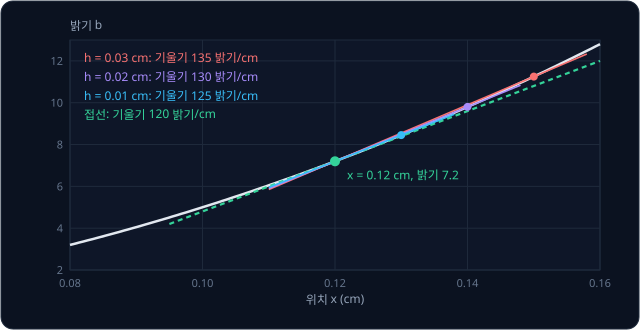
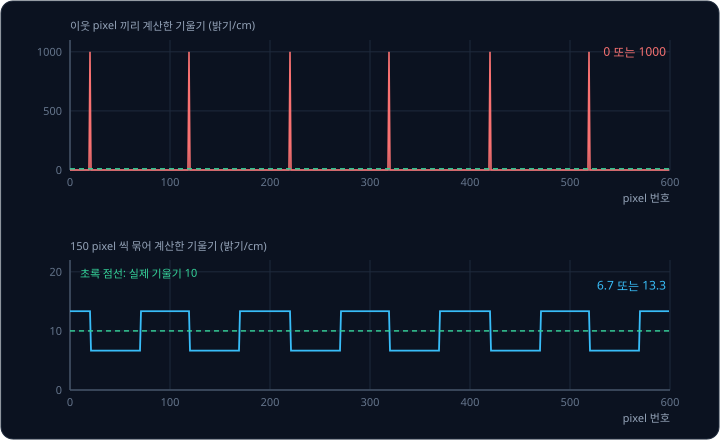
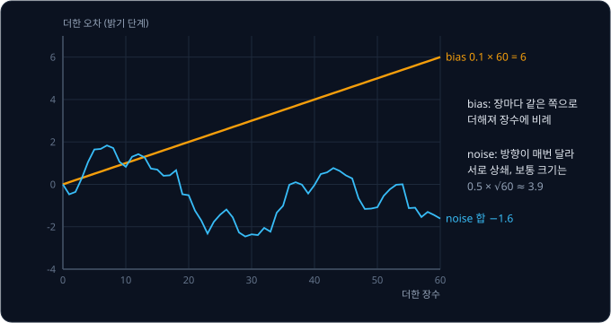
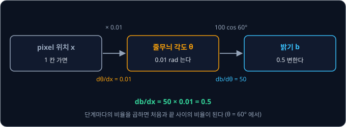
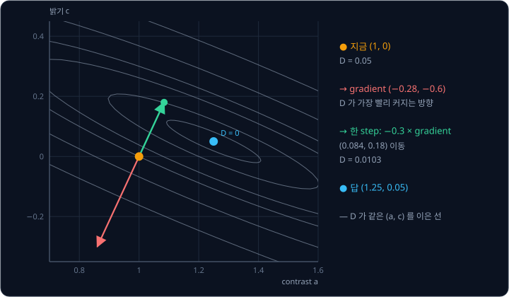
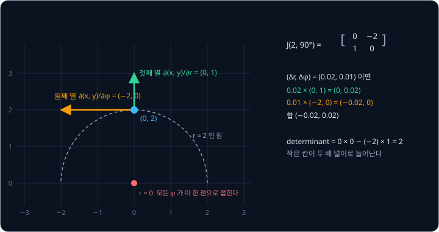

# Derivatives & Gradients

맑은 하늘을 찍은 사진에서 edge(밝기가 갑자기 바뀌는 경계)를 찾는 program 은 옆 pixel 과의 밝기 차이를 계산한다. 하늘은 왼쪽에서 오른쪽으로
아주 조금씩 밝아질 뿐이라 edge 가 없어야 한다. 1 cm 에 10 pixel 이 찍히도록 찍은 사진에서는 이 계산이 실제 기울기를 정확히 내는데, 같은
하늘을 1 cm 에 1000 pixel 이 찍히도록 확대해 찍으면 계산값이 대부분 0 이다가 가끔 아주 큰 값으로 튀어 하늘에 가짜 줄무늬가 생긴다.
더 촘촘하게 찍었는데 기울기는 왜 더 엉터리가 될까?

derivative(미분)는 어떤 값을 조금 바꿨을 때 다른 값이 얼마나 빨리 변하는지 나타내는 비율이고, 위치에 따라 밝기가 변하는 비율이 사진의
기울기다. 이 비율을 측정값으로 계산하면 밝기에 섞인 작은 오차까지 짧은 간격으로 나누게 되어 오차가 커진다. 바꾸는 값이 여럿이 되면
derivative 는 neural network 를 학습시키는 gradient 와, 사진을 휘거나 펼치는 변환이 각 자리를 얼마나 늘이는지 나타내는 Jacobian 이 된다.
OpenCV 의 edge 검출 함수들은 사진의 밝기 derivative 를 계산한다. Stable Diffusion 같은 그림 생성 model 의 weight 수억 개도 gradient 로
학습한다.

## 학습 목표

- 일정한 간격으로 잰 밝기에서 기울기와 그 기울기의 변화율을 계산하고, 그 값이 derivative 의 근사라는 것을 설명할 수 있다
- 확대해 찍은 사진에서 계산한 기울기가 더 크게 튀는 이유와, 평균·blur 로 줄일 때 생기는 대가를 설명할 수 있다
- 값을 계속 더하는 적분에서 작은 bias 가 더한 횟수에 비례해 쌓이는 이유를 숫자로 설명할 수 있다
- chain rule, gradient, Jacobian 이 각각 무엇의 변화율인지 사진 보정과 사진 변환의 숫자 예시로 설명할 수 있다

## 변화율과 derivative

벽에 조명을 비춰 찍은 사진에서 어두운 점으로부터 멀어질수록 밝기가 점점 빠르게 커진다고 하자. 벽 위의 위치 $x$ 를 cm 로 재고, 사진에는
1 cm 에 100 pixel 이 찍혀서 pixel 간격이 0.01 cm 다. 이 간격을 $\Delta x = 0.01$ cm 로 쓰는데, $\Delta$ 는 그리스 문자 delta(델타)로
"변한 양" 을 뜻하고 $\Delta x$ 는 이웃한 두 pixel 사이의 거리다. 아래 표의 밝기는 $b = 500x^2$ 을 따라 커지는 벽에서 계산한 값이다.
밝기를 정수로 저장할 때 생기는 오차는 다음 절에서 다루고, 여기서는 밝기를 소수점까지 정확히 잰다고 가정한다.

| 위치 $x$ (cm) | 밝기 $b$ | 기울기 $\Delta b / \Delta x$ (밝기/cm) | 기울기의 변화율 $\Delta(\text{기울기}) / \Delta x$ (밝기/cm²) |
| --- | --- | --- | --- |
| 0.10 | 5.00 | | |
| 0.11 | 6.05 | $(6.05 - 5.00) \div 0.01 = 105$ | |
| 0.12 | 7.20 | $(7.20 - 6.05) \div 0.01 = 115$ | $(115 - 105) \div 0.01 = 1000$ |
| 0.13 | 8.45 | 125 | 1000 |
| 0.14 | 9.80 | 135 | 1000 |
| 0.15 | 11.25 | 145 | 1000 |

기울기는 밝기가 변한 양을 그 사이 거리로 나눈 값이고, 같은 계산을 기울기에 한 번 더 하면 기울기가 얼마나 빨리 바뀌는지가 나온다. 이렇게
일정한 간격의 측정값끼리 뺀 차이를 간격으로 나누는 계산을 **finite difference**(유한 차분)라고 한다. 표의 105 밝기/cm 는 0.10 cm 와
0.11 cm 사이의 평균 기울기라서, 어느 한 점의 기울기를 알려면 간격을 더 줄여야 한다.

위 그림은 0.12 cm 의 점과 $h$ cm 뒤의 점을 이은 직선을 보여 준다. 이 직선의 기울기가 그 구간의 평균 기울기인데, $h$ 를 0.03, 0.02, 0.01 cm 로
줄이면 기울기가 135, 130, 125 밝기/cm 로 줄어 120 밝기/cm 에 다가간다. 간격을 0 에 한없이 가깝게 줄였을 때 비율이 다가가는 값이 그 점의
변화율이고, 이것을 **derivative**(미분값)라고 한다. 그래프에서 derivative 는 그 점에 살짝 닿고 지나가는 직선(접선)의 기울기다.

derivative 는 $\frac{db}{dx}$ 로 쓰고 "디 비 디 엑스" 라고 읽는데, $d$ 는 $\Delta$ 를 0 에 가깝게 줄였다는 표시다. derivative 를 $b'$ 처럼
작은따옴표를 붙여 쓰기도 하고, 두 번 미분한 값은 따옴표 두 개인 $b''$ 이다. 밝기를 한 번 미분한 값은 밝기가 오르는 기울기이고, 두 번
미분한 값은 그 기울기가 바뀌는 정도로 밝기 곡선이 휘는 정도를 나타낸다. 표의 벽은 두 번 미분한 값이 어디서나 1000 이라 곡선이 일정하게 휜다.
사진에서는 두 번 미분한 값도 쓴다. OpenCV 의 Laplacian 튜토리얼은 edge 에서 한 번 미분한 값이 가장 크고, 두 번 미분한 값이 0 을 지난다는
점을 이용해 edge 를 찾는 방법을 설명한다.

<b>심화: limit 으로 쓰는 derivative 의 정의</b>

위에서 간격을 줄여 간 과정을 기호로 쓰면 아래와 같다.

$$
\frac{db}{dx} = \lim_{h \to 0} \frac{b(x + h) - b(x)}{h}
$$

$\lim_{h \to 0}$ 은 "$h$ 를 0 에 한없이 가깝게 할 때 다가가는 값" 이라고 읽는다. $b = 500x^2$ 을 넣으면 분수는
$\frac{500(x + h)^2 - 500x^2}{h} = \frac{1000xh + 500h^2}{h} = 1000x + 500h$ 다. $x = 0.12$ 이면 $120 + 500h$ 라서 $h = 0.01$ 일 때 125,
$h = 0.03$ 일 때 135 로 그림의 기울기와 같다. $h$ 를 0 으로 보내면 120 이 남는데, 어느 $x$ 에서든 $500h$ 가 사라지므로 $b' = 1000x$
다. 이것을 같은 방식으로 한 번 더 미분하면 $b'' = 1000$ 이다.

**확인 문제.** 0.01 cm 간격의 세 pixel 밝기가 20.00, 20.30, 20.70 이다. 두 구간의 기울기와 그 기울기의 변화율은?

답 보기

첫 구간의 기울기는 $(20.30 - 20.00) \div 0.01 = 30$ 밝기/cm, 둘째 구간은 $(20.70 - 20.30) \div 0.01 = 40$ 밝기/cm 다. 기울기의 변화율은 두
기울기의 차이를 같은 간격으로 나눈 $(40 - 30) \div 0.01 = 1000$ 밝기/cm² 다.

## 수치 미분과 noise

사진 파일은 밝기를 연속된 값으로 저장하지 못하고 정해진 단계로만 저장한다. 흔히 쓰는 8 bit 사진은 밝기를 0 부터 255 까지 256 단계의
정수로 적어서, 실제 밝기가 100.3 이면 100 으로, 100.6 이면 101 로 반올림해 저장한다. 이렇게 값을 단계로 끊어 저장하는 것을 quantization
이라고 하고, 그 때문에 생기는 오차가 quantization error 다. Wikipedia 의 Colour banding 항목은 맑은 하늘이나 노을처럼 밝기가 천천히 바뀌는
곳에서 이 반올림 때문에 단계 사이의 경계가 눈에 띄는 띠(banding)가 생긴다고 설명한다.

1 cm 마다 밝기가 10 단계씩 천천히 오르는 하늘을 생각하자. 1 cm 에 1000 pixel 이 찍히도록 확대해 찍으면, 이웃한 pixel 사이에서 실제 밝기는
0.01 단계만 변해 한 단계에 한참 못 미친다. 그래서 대부분의 pixel 에서 저장된 밝기 차이가 0 이고, 100 pixel 에 한 번꼴로 반올림 결과가
바뀌는 자리에서만 기울기가 $1 \div 0.001 = 1000$ 밝기/cm 로 튄다. 같은 하늘을 찍는 해상도만 바꿔 계산하면 아래와 같다.

| 해상도 | $\Delta x$ | 이웃 pixel 사이의 실제 밝기 변화 | 계산한 기울기 | 한 단계가 만드는 기울기 오차 $1 \div \Delta x$ |
| --- | --- | --- | --- | --- |
| 10 pixel/cm | 0.1 cm | 1 단계 | 10 밝기/cm | 10 밝기/cm |
| 100 pixel/cm | 0.01 cm | 0.1 단계 | 0 또는 100 밝기/cm | 100 밝기/cm |
| 1000 pixel/cm | 0.001 cm | 0.01 단계 | 0 또는 1000 밝기/cm | 1000 밝기/cm |

밝기에 섞인 오차는 해상도와 상관없이 최대 한 단계지만, 기울기는 그 오차를 $\Delta x$ 로 나눈다. $\Delta x$ 를 10 분의 1 로 줄이면
기울기의 오차는 10 배가 되고, 기울기의 변화율은 한 번 더 나누므로 1000 pixel/cm 에서 한 단계가 $1 \div 0.001 \div 0.001 = 1{,}000{,}000$
밝기/cm² 의 가짜 값을 만든다. 측정값을 미분하면 짧은 간격으로 오르내리는 noise 가 커지고, 여러 번 미분할수록 더 커진다. 사진 센서가 더하는
무작위 noise 도 같은 이유로 미분하면 커진다.

1000 pixel/cm 로 찍은 사진도 이웃한 기울기 150 개를 평균하면 쓸 수 있다. 150 개의 평균은 150 pixel 떨어진 두 밝기의 차이를 0.15 cm 로
나눈 것과 같아서, 위 그림 아래쪽처럼 6.7 ~ 13.3 밝기/cm 에 머문다. 대신 평균은 0.15 cm 구간 전체의 기울기라서, 실제 edge 가 있어도 그
위치가 0.15 cm 폭으로 번진다. 사진에서 이웃 pixel 을 평균하는 계산을 blur 라고 한다. blur 처럼 천천히 변하는 값은 통과시키고 빠르게 오르내리는
값은 줄이는 계산을 **low-pass filter** 라고 한다. noise 를 많이 줄이는 filter 일수록 edge 위치를 더 넓게 번지게 한다.

그래서 사진의 미분은 보통 blur 와 함께 쓴다. OpenCV 문서는 Sobel 연산자가 Gaussian smoothing(가운데에 큰 weight 를 주는 blur)과 미분을
함께 해서 noise 에 덜 민감하다고 설명하고, 대표적인 edge 검출 방법인 Canny 의 튜토리얼도 첫 단계로 5×5 Gaussian filter 로 noise 를 거른 뒤
기울기를 구한다.

**흔한 오해.** "사진을 더 촘촘하게 찍을수록 기울기가 정확해진다." 밝기의 quantization error 는 그대로인데 나누는 $\Delta x$ 만 작아져서,
미분한 기울기의 오차는 오히려 커진다. 해상도를 높일 때는 여러 pixel 을 평균하거나 blur 를 거치고, 그 강도는 noise 와 번짐 사이에서 알맞게
고른다.

<b>심화: forward difference 와 central difference 의 오차</b>

지금 값과 다음 값의 차이로 계산하는 $\frac{f(x + h) - f(x)}{h}$ 를 forward difference, 앞뒤 값의 차이로 계산하는 $\frac{f(x + h) - f(x - h)}{2h}$
를 central difference 라고 한다. 앞 절의 표에서 0.10 cm 와 0.11 cm 로 구한 105 밝기/cm 는 0.10 cm 의 실제 기울기 $1000 \times 0.10 = 100$ 이
아니라 두 점 가운데인 0.105 cm 의 기울기 $1000 \times 0.105 = 105$ 와 같다. 0.10 cm 의 기울기를 앞뒤 값 $b(0.09) = 4.05$ 와
$b(0.11) = 6.05$ 로 계산하면 $(6.05 - 4.05) \div 0.02 = 100$ 으로 정확하다. Sobel 연산자도 행마다 $(-1, 0, 1)$ 의 배수라서
앞뒤 pixel 의 차이를 쓰는 central difference 다.

$f(x) = x^3$ 의 $x = 1$ 에서 derivative 는 3 이다. 두 방법의 오차를 비교하면 아래와 같다.

| $h$ | forward | 오차 | central | 오차 |
| --- | --- | --- | --- | --- |
| 0.1 | 3.31 | 0.31 | 3.01 | 0.01 |
| 0.01 | 3.0301 | 0.0301 | 3.0001 | 0.0001 |

$h$ 를 10 분의 1 로 줄이면 forward 의 오차는 10 분의 1 로 줄고 central 의 오차는 100 분의 1 로 준다. forward 의 오차가 $h$ 에 비례하고
central 의 오차는 $h^2$ 에 비례하기 때문이다. 다만 측정값에 크기 $\varepsilon$ 인 noise 가 있으면 그 noise 가 $\varepsilon / h$ 정도의
오차를 더한다. 그래서 $h$ 를 줄이면 식에서 오는 오차는 줄지만 noise 에서 오는 오차는 커지고, 둘의 합이 가장 작아지는 $h$ 가 따로
있다.

**확인 문제.** 1 cm 에 500 pixel 이 찍히는 사진에서 이웃 pixel 끼리 기울기를 계산한다. 밝기 한 단계가 만드는 기울기 오차는 얼마이고, 이웃한
기울기 10 개를 평균하면 얼마로 줄까?

답 보기

500 pixel/cm 의 $\Delta x$ 는 $1 \div 500 = 0.002$ cm 라서 한 단계의 기울기 오차는 $1 \div 0.002 = 500$ 밝기/cm 다. 10 개를 평균하면 밝기
차이를 $10 \times 0.002 = 0.02$ cm 로 나누는 것과 같아서 $1 \div 0.02 = 50$ 밝기/cm 로 준다. 그 대신 0.02 cm 구간의 평균이라 edge 위치가
그만큼 번진다.

## 적분과 쌓이는 오차

기울기에서 밝기를 거꾸로 구하려면 기울기 × $\Delta x$ 를 차례로 더한다. 첫 절의 표에서 0.10 cm 의 밝기 5.00 에 첫 구간에서 오른
$105 \times 0.01 = 1.05$ 를 더하면 6.05 가 된다. 여기에 다음 구간의 $115 \times 0.01 = 1.15$ 를 더하면 7.20 으로, 표의 밝기가 그대로
돌아온다. 이렇게 작은 변화량을 쌓아 전체를 구하는 계산을 **적분**(integral)이라고 하고, 그래프에서는 기울기 곡선 아래의 넓이다. 미분이
변화를 잘게 쪼개 본다면, 적분은 쪼갠 변화를 다시 모은다.

사진을 찍는 일 자체가 적분이다. 카메라 센서는 셔터가 열린 동안 들어온 빛을 계속 모으므로, 노출 시간을 늘리면 같은 장면이 더 밝게
찍힌다. 어두운 밤하늘을 찍을 때는 짧게 찍은 사진 여러 장을 같은 자리끼리 더하기도 하는데, 이것도 적분이다. 그런데 이렇게 더하면
측정 오차도 같이 더해진다. 빛이 전혀 없어도 센서는 0 이 아닌 값을 내는데, 그 오차 가운데 늘 한쪽으로 치우친 부분을 bias 라고 하고, 매번
다르게 오르내리는 부분을 noise 라고 한다. Wikipedia 의 Dark-frame subtraction 항목은 센서의 dark current 처럼 찍을 때마다 같게 나타나는 부분을
설명하고, 그 밝기가 노출 시간과 ISO 감도에 따라 달라진다고 적는다.

빛이 전혀 없는 장면을 찍은 사진 한 장의 pixel 에 0.1 단계의 bias 와 그보다 다섯 배 큰 0.5 단계 크기의 noise 가 섞여 있다고 하고, 이런
사진을 여러 장 더해 보자.

| 더한 장수 | bias 0.1 이 쌓인 오차 | noise 0.5 가 쌓인 보통 크기 |
| --- | --- | --- |
| 10 장 | $0.1 \times 10 = 1$ | $0.5 \times \sqrt{10} \approx 1.6$ |
| 60 장 | $0.1 \times 60 = 6$ | $0.5 \times \sqrt{60} \approx 3.9$ |
| 600 장 | $0.1 \times 600 = 60$ | $0.5 \times \sqrt{600} \approx 12.2$ |

bias 는 매번 같은 쪽으로 더해지므로 더한 장수에 비례해 쌓인다. noise 는 더해질 때마다 방향이 달라 서로 상쇄되고, $n$ 장을 더한 합은 $n$ 배가
아니라 $\sqrt{n}$ 배 정도로만 커진다. 그래서 10 장까지는 noise 가 더 크지만 60 장이면 bias 가 앞서고, 600 장에서는 bias 가 noise 의 다섯
배쯤 된다. 위 그림의 한 번 실험에서 60 장의 noise 합은 −1.6 이었다. 이렇게 적분한 값이 시간이 갈수록 실제에서 멀어지는 현상을 **drift**
라고 한다. 사진에서는 셔터를 닫고 같은 조건으로 찍은 dark frame 을 빼서 이 bias 를 없앤다.

미분과 적분이 오차에 미치는 영향은 정반대다.

| 계산 | noise | 일정한 bias |
| --- | --- | --- |
| 미분 | $\Delta x$ 로 나눠 커진다 | 일정한 값은 변화가 없어 사라진다 |
| 적분 | 서로 상쇄되어 천천히 커진다 | 더한 횟수에 비례해 쌓인다 |

사진 전체에 밝기를 10 단계씩 더해도 이웃 pixel 의 차이는 그대로라서 edge 검출 결과는 같지만, 사진을 여러 장 더할 때 섞인 0.1 단계의 bias 는
600 장이면 60 단계가 된다.

**확인 문제.** 사진 한 장에 0.02 단계의 bias 가 있다. 이런 사진 600 장을 더하면 bias 가 만든 오차는?

답 보기

bias 는 더한 장수에 비례해 쌓이므로 $0.02 \times 600 = 12$ 단계다.

## 미분 규칙

식을 알면 간격을 줄여 가며 표를 만들 필요 없이 규칙으로 derivative 를 바로 쓸 수 있다. 자주 쓰는 규칙은 아래와 같다.

| 함수 | derivative | 예 |
| --- | --- | --- |
| 상수 $c$ | 0 | 사진 전체에 더한 밝기는 기울기에 나타나지 않는다 |
| $x^n$ | $n\,x^{n-1}$ | $500x^2$ 의 derivative 는 $500 \times 2x = 1000x$ |
| $\sin\theta$ | $\cos\theta$ | $\theta$ 는 radian |
| $\cos\theta$ | $-\sin\theta$ | $\theta$ 는 radian |

$x^n$ 의 규칙을 power rule 이라고 하고, 상수를 곱한 함수는 derivative 에도 그 상수가 그대로 곱해진다. 그래서 $b = 500x^2$ 이면
$b' = 1000x$ 이고, 0.12 cm 의 기울기 120 밝기/cm 는 앞의 그림에서 간격을 줄여 다가간 값과 같다.

sin 과 cos 의 규칙은 각도를 radian 으로 쟀을 때 성립한다. radian 은 반지름 1 인 원에서 그 각도만큼 돌았을 때 지나간 원둘레의 길이로
각도를 재는 단위로, $180° = \pi \approx 3.14$ rad 이다. $60° \approx 1.0472$ rad 에서 각도를 0.001 rad 늘리면 $\sin$ 은 0.0004996
늘어나므로, 비율 0.4996 이 $\cos 60° = 0.5$ 와 거의 같다.

변화가 여러 단계를 거쳐 전해질 때는 단계마다 구한 변화율을 곱하면 되는데, 이 규칙을 **chain rule** 이라고 한다. 밝기가 물결처럼 오르내리는
줄무늬를 그리는 경우를 보자. 가로 위치 $x$ (pixel)에서 줄무늬의 각도 $\theta$ 를 $\theta = 0.01x$ rad 로 정하고, 밝기를
$b = 100\sin\theta$ 로 정한다(실제로 그릴 때는 여기에 128 을 더해 0 ~ 255 안에 넣는다). $x$ 가 1 pixel 늘면 $\theta$ 는 0.01 rad 늘고,
$\theta$ 가 1 rad 늘면 밝기는 $100\cos\theta$ 만큼 늘어난다.

$$
\frac{db}{dx} = \frac{db}{d\theta} \times \frac{d\theta}{dx}
$$

$\theta = 60°$ 에서 $\frac{db}{d\theta} = 100\cos 60° = 50$ 이고 $\frac{d\theta}{dx} = 0.01$ 이라서, pixel 1 칸당 밝기는 $50 \times 0.01 = 0.5$
변한다. 줄무늬의 가운데 밝기를 지나는 $\theta = 0°$ 에서는 $\cos 0° = 1$ 이라 pixel 1 칸당 1 씩 변해 가장 가파르고, 가장 밝은 $\theta = 90°$
에서는 $\cos 90° = 0$ 이라 기울기가 0 이다. 줄무늬를 가로로 두 배 늘려 그리면 $\theta = 0.005x$ 가 되어 모든 자리의 기울기가 절반이 되는데,
이것도 chain rule 의 둘째 비율이 절반이 된 것이다. neural network 를 학습시키는 backpropagation 도 층마다 구한 변화율을 곱해 가는 chain rule 이다.

<b>심화: chain rule 의 유도</b>

$x$ 를 $\Delta x$ 만큼 바꿔 $\theta$ 가 $\Delta\theta$, $b$ 가 $\Delta b$ 만큼 변했다면, $\Delta\theta$ 가 0 이 아닐 때 아래 식은 분수의
약분일 뿐이라 늘 성립한다.

$$
\frac{\Delta b}{\Delta x} = \frac{\Delta b}{\Delta\theta} \times \frac{\Delta\theta}{\Delta x}
$$

$\Delta x$ 를 0 에 가깝게 줄이면 $\Delta\theta$ 도 0 에 가까워지므로, 세 분수가 각각 $\frac{db}{dx}$, $\frac{db}{d\theta}$,
$\frac{d\theta}{dx}$ 에 다가가 chain rule 이 된다. $\theta = 60°$ 에서 pixel 을 1 칸 옮겨 $\theta$ 가 0.01 rad 늘면 밝기는 실제로
$100 \times (\sin 1.0572 - \sin 1.0472) \approx 0.496$ 변해서, chain rule 로 구한 0.5 와 거의 같다.

$\cos(\theta_1 + \theta_2)$ 처럼 괄호 안에 다른 식이 든 함수도 같은 규칙으로 미분한다. 바깥 함수의 derivative $-\sin(\theta_1 + \theta_2)$ 에
안쪽 $\theta_1 + \theta_2$ 를 $\theta_1$ 로 미분한 1 을 곱하므로, $\theta_1$ 에 대한 derivative 는 $-\sin(\theta_1 + \theta_2)$ 다.

**확인 문제.** 줄무늬를 $\theta = 0.02x$ rad, 밝기 $b = 40\sin\theta$ 로 그렸다. $\theta = 0°$ 인 자리에서 pixel 1 칸당 밝기는 얼마나 변할까?

답 보기

$\frac{d\theta}{dx} = 0.02$ 이고, $\frac{db}{d\theta} = 40\cos 0° = 40$ 이다. chain rule 로 곱하면 $40 \times 0.02 = 0.8$ 이라서 pixel 1 칸당
밝기가 0.8 변한다.

## partial derivative 와 gradient

지금까지는 바꾸는 값이 하나였지만, 결과가 여러 값에 함께 달려 있는 경우가 많다. 사진 보정 program 에서 contrast 와 밝기를 함께 조절할 때도 그렇다.
pixel 값을 0 ~ 1 로 적을 때, 원래 값 $p$ 에 contrast $a$ 를 곱하고 밝기 $c$ 를 더한 $ap + c$ 를 새 값으로 쓴다고 하자. 어두운 pixel 0.2 는
0.3 이 되고 밝은 pixel 0.6 은 0.8 이 되도록 맞추고 싶은데, 지금 $(a, c) = (1, 0)$ 이라 두 pixel 이 0.2 와 0.6 그대로다. 목표와의 차이를
제곱해 더한 값을 $D$ 라고 하자.

$$
D(a, c) = (0.2a + c - 0.3)^2 + (0.6a + c - 0.8)^2
$$

지금 $D = (-0.1)^2 + (-0.2)^2 = 0.05$ 다. 차이를 그냥 더하지 않고 제곱해 더하면 음수 차이와 양수 차이가 서로 지워지지 않고, 미분도 쉽다.

$D$ 를 줄이려면 $a$ 와 $c$ 를 각각 어느 쪽으로 바꿔야 하는지 알아야 한다. 둘을 한꺼번에 바꾸면 어느 쪽 때문에 $D$ 가 변했는지 알 수
없으므로, 하나만 0.01 바꾸고 다른 하나는 그대로 둔다.

| 바꾼 값 | 바뀐 두 pixel | 바뀐 $D$ | $D$ 의 변화 ÷ 0.01 | 0.01 보다 더 작게 바꾸면 |
| --- | --- | --- | --- | --- |
| $a$ 만 0.01 | $(0.202, 0.606)$ | 0.04724 | $-0.276$ | $-0.28$ 에 다가간다 |
| $c$ 만 0.01 | $(0.21, 0.61)$ | 0.04420 | $-0.58$ | $-0.6$ 에 다가간다 |

다른 값을 고정하고 하나만 바꿔 구한 derivative 를 **partial derivative**(편미분값)라고 하고, $\frac{\partial D}{\partial a} = -0.28$ 처럼
쓴다. 둥근 $\partial$ 는 "다른 값은 고정했다" 는 표시다. 변수마다 구한 partial derivative 를 묶은 vector 가 **gradient** 이고, $\nabla D$
(nabla D)로 쓴다.

$$
\nabla D = \left(\frac{\partial D}{\partial a},\ \frac{\partial D}{\partial c}\right) = (-0.28,\ -0.6)
$$

두 component 가 모두 음수라서 $a$ 와 $c$ 를 모두 키우면 $D$ 가 준다. component 의 크기에도 뜻이 있어서, 같은 양을 바꿀 때 $c$ 쪽이 $a$ 쪽보다 $D$ 를 두 배
넘게 빨리 줄인다. $c$ 는 두 pixel 을 똑같이 올리는데, $a$ 는 값이 작은 pixel 을 조금만 올리기 때문이다. gradient 는 여러 방향 가운데 $D$ 가
가장 빨리 커지는 방향을 가리키고, 그 반대가 가장 빨리 줄어드는 방향이다. 같은 길이 0.01 만큼을 두 값에 여러 비율로 나눠 바꿔 보면 아래와 같다.

| 길이 0.01 을 나눠 바꾸는 방향 $(a, c)$ | $D$ 의 변화 |
| --- | --- |
| $a$ 만 $(1, 0)$ | $-0.00276$ |
| $c$ 만 $(0, 1)$ | $-0.00580$ |
| 둘 다 같게 $(0.71, 0.71)$ | $-0.00602$ |
| gradient 의 반대 $(0.42, 0.91)$ | $-0.00639$ |

$(0.42, 0.91)$ 은 $(0.28, 0.6)$ 을 길이 1 로 줄인 방향으로, 길이가 같은 움직임 가운데 이 gradient 의 반대 방향이 $D$ 를 가장 많이 줄인다.

위 그림의 회색 선은 $D$ 가 같은 $(a, c)$ 를 이은 선으로, 지도의 등고선과 같다. gradient(빨강)는 등고선에 직각으로 오르막을 가리킨다. 그
반대 방향으로 gradient 에 $\alpha$ 를 곱한 만큼 값을 옮기는 계산을 **gradient descent** 라고 하고, $\alpha$ 를 step 크기 또는 learning rate
라고 부른다.

$$
(a, c) \leftarrow (a, c) - \alpha\,\nabla D
$$

$\alpha = 0.3$ 이면 $-0.3 \times (-0.28, -0.6) = (0.084, 0.18)$ 만큼 옮겨 새 값은 $(1.084, 0.18)$ 이다. 두 pixel 은 $(0.397, 0.830)$ 이 되고
$D$ 는 0.05 에서 0.0103 으로 준다. $\alpha$ 에 따라 결과는 크게 달라진다.

| $\alpha$ | 옮긴 양 | 새 $(a, c)$ | 새 $D$ |
| --- | --- | --- | --- |
| 0.1 | $(0.028, 0.06)$ | $(1.028, 0.06)$ | 0.0164 |
| 0.3 | $(0.084, 0.18)$ | $(1.084, 0.18)$ | 0.0103 |
| 0.5 | $(0.14, 0.3)$ | $(1.14, 0.3)$ | 0.0858 |
| 1 | $(0.28, 0.6)$ | $(1.28, 0.6)$ | 0.632 |

gradient 는 지금 자리에서의 기울기일 뿐이라 너무 멀리 가면 오히려 처음(0.05)보다 나빠진다. 그래서 작은 step 으로 여러 번 옮기는데,
$\alpha = 0.3$ 으로 옮길 때마다 gradient 를 다시 구하면 $D$ 가 0.0103, 0.0038, 0.0026 으로 계속 줄고, 30 번 옮기면 0.00025 가 된다. $D$ 가
정확히 0 이 되는 답은 $(a, c) = (1.25, 0.05)$ 다. neural network 를 학습시킬 때도 같은 계산을 하고, 줄이려는 값이 $D$ 가 아니라 loss 이며
바꾸는 값이 두 개가 아니라 weight 수억 개일 뿐이다. learning rate 를 고르는 방법과 gradient descent 가 수렴하는 과정은
[Linear Regression](../linear-regression/README.md) 에서 다룬다.

gradient 는 사진 자체에도 쓴다. 사진의 밝기 $b$ 는 가로 위치 $x$ 와 세로 위치 $y$ 두 값에 달려 있어서, $x$ 로 미분한 값과 $y$ 로 미분한
값을 묶은 $\nabla b$ 가 사진의 gradient 다. 왼쪽 두 열의 밝기가 0 이고 오른쪽 열의 밝기가 255 인 3×3 조각의 가운데에서 central difference 로 구하면
$\frac{\partial b}{\partial x} \approx (255 - 0) \div 2 = 127.5$ 이고, 위아래로는 변화가 없어 $\frac{\partial b}{\partial y} = 0$ 이다. gradient
$(127.5, 0)$ 은 세로로 난 edge 에 직각으로, 밝은 쪽을 가리킨다. Canny 튜토리얼도 Sobel 로 두 partial derivative 를 구해 gradient 의 길이와
방향을 계산한다.

**확인 문제.** 어떤 점에서 $\nabla f = (3, -4)$ 다. $f$ 를 가장 빨리 줄이려면 어느 방향으로 움직여야 하고, $\alpha = 0.1$ 로 한 step 옮기면 각
변수는 얼마나 바뀔까?

답 보기

gradient 의 반대인 $(-3, 4)$ 방향이다. 한 step 은 $-0.1 \times (3, -4) = (-0.3, 0.4)$ 라서 첫째 변수는 0.3 줄이고 둘째 변수는 0.4 늘린다.

## Jacobian 과 선형 근사

앞 절의 gradient 는 $D$ 처럼 값 하나가 여러 변수에 따라 어떻게 변하는지 나타낸다. 그런데 사진을 휘거나 펼치는 변환처럼 결과도 여러 개일 때가
많다. OpenCV 의 warpPolar 함수는 사진의 각 점을 가운데에서의 거리 $r$ 와 각도 $\varphi$ 로 바꿔 직사각형으로 펼치고, 거꾸로
직사각형을 원판으로 말 수도 있다. 원판으로 마는 쪽은 $(r, \varphi)$ 를 화면 위치 $(x, y)$ 로 보낸다.

$$
x = r\cos\varphi, \qquad y = r\sin\varphi
$$

결과가 $x$, $y$ 두 개이면 결과 하나와 변수 하나의 짝마다 partial derivative 가 하나씩 생겨 네 개가 된다. 이 네 값을 결과마다 행(가로 줄)
하나, 변수마다 열(세로 줄) 하나에 늘어놓은 행렬이 **Jacobian** $J$ 다. gradient 가 값 하나의 변화율을 vector 로 모은 것이라면, Jacobian 은
값 여러 개의 변화율을 행렬로 모은 것이다. 이름은 19 세기 독일 수학자 Carl Gustav Jacob Jacobi 의 이름을 딴 것이다.

$r = 2$, $\varphi = 90°$ 인 점은 화면의 $(0, 2)$ 로, 가운데에서 바로 위로 2 떨어져 있다. 앞의 표처럼 변수 하나만 0.01 바꿔 화면 위치가 움직인 양을
0.01 로 나누면, $r$ 만 바꿀 때는 $(0, 1)$ 이 나오고 $\varphi$ 만 바꿀 때는 $(-2.000, -0.010)$ 이 나온다. 더 작게 바꾸면 두 값은 각각 $(0, 1)$
과 $(-2, 0)$ 에 다가간다.

$$
J = \begin{bmatrix} \dfrac{\partial x}{\partial r} & \dfrac{\partial x}{\partial \varphi} \\[2mm] \dfrac{\partial y}{\partial r} & \dfrac{\partial y}{\partial \varphi} \end{bmatrix}
\qquad
J(2, 90°) = \begin{bmatrix} 0 & -2 \\ 1 & 0 \end{bmatrix}
$$

### 작은 움직임 옮기기

첫째 열은 $r$ 만 1 늘릴 때 화면 위치가 움직이는 양이고, 둘째 열은 $\varphi$ 만 1 rad 늘릴 때 움직이는 양이다. 두 변수를 함께 조금 바꾸면 열마다
그 변화량을 곱해 더한 것이 화면 위치의 변화이고, 이것이 행렬과 vector 의 곱 $\Delta\mathbf p \approx J\,\Delta\mathbf q$ 다. 굵은 글씨
$\mathbf q$ 는 $(r, \varphi)$ 를, $\mathbf p$ 는 화면 위치 $(x, y)$ 를 묶은 vector 다.

$(\Delta r, \Delta\varphi) = (0.02, 0.01)$ 이면 화면 위치의 변화는 $0.02 \times (0, 1) + 0.01 \times (-2, 0) = (-0.02, 0.02)$ 다. $r$ 을 늘리면
점이 가운데에서 멀어지는 쪽인 위로 가고, $\varphi$ 를 늘리면 점이 원을 따라 시계 반대 방향인 왼쪽으로 간다. 같은 각도를 돌아도 가운데에서
멀수록 원둘레를 더 많이 지나므로, 둘째 열의 길이가 $r$ 과 같은 2 다. Jacobian 은 자리마다 값이 달라서 점이 바뀌면 다시 계산해야 한다.

### 늘어나는 넓이와 접히는 점

[Vectors & Matrices](../vectors-matrices/README.md) 에서 본 것처럼 행렬의 determinant 는 한 변이 1 인 정사각형이 바뀐 뒤의 넓이다. Jacobian
의 determinant 는 그 자리에서 아주 작은 칸이 변환 뒤에 몇 배 넓이가 되는지를 나타낸다. $J(2, 90°)$ 의 determinant 는
$0 \times 0 - (-2) \times 1 = 2$ 라서, 펼친 사진의 작은 칸 하나가 원판에서는 두 배 넓이로 늘어난다. 이 polar 변환의 Jacobian determinant 는
어느 점에서나 $r$ 과 같다(아래 심화에서 계산한다). 가운데에서 멀수록 펼친 사진의 pixel 이 넓게 늘어나 흐려지고, 가운데에 가까울수록 좁게
몰린다.

$r = 0$ 인 줄에서는 determinant 가 0 이다. Jacobian 의 둘째 열 $(-r\sin\varphi, r\cos\varphi)$ 가 $(0, 0)$ 이 되어, $\varphi$ 를 아무리 바꿔도
점이 움직이지 않는다. 펼친 사진의 맨 아래 줄 전체가 원판의 가운데 한 점으로 접힌다. 이렇게 Jacobian 의 determinant 가 0 이 되는 점에서는
변환을 거꾸로 풀 수 없어서, 가운데 한 점의 색만 보고는 펼친 사진의 그 줄이 어떤 색이었는지 알 수 없다.

### 선형 근사

$x = r\cos\varphi$ 처럼 sin 과 cos 이 섞인 관계는 휘어져 있다. 하지만 움직임이 아주 작을 때는 화면 위치의 변화가 변수의 변화에 거의
비례하므로, 그 범위에서는 휘어진 식 대신 Jacobian 과의 행렬 곱 하나로 계산할 수 있고 거꾸로 풀기도 쉽다. 이 식이 근사($\approx$)인 것은 점이
실제로는 원을 따라 휘어 가는데 Jacobian 은 지금 방향으로 곧게 간다고 보기 때문이다. 움직임을 키워 가며 실제 이동과 비교하면 아래와 같다.

| $(\Delta r, \Delta\varphi)$ | 예측 $J\Delta\mathbf q$ | 실제 이동 | 차이 |
| --- | --- | --- | --- |
| $(0.02, 0.01)$ | $(-0.02, 0.02)$ | $(-0.0202, 0.0199)$ | 0.00022 |
| $(0.2, 0.1)$ | $(-0.2, 0.2)$ | $(-0.220, 0.189)$ | 0.022 |
| $(0.6, 0.3)$ | $(-0.6, 0.6)$ | $(-0.768, 0.484)$ | 0.20 |

움직임을 10 배 키우면 차이는 약 100 배가 된다. 휘어진 관계를 한 점 근처에서 직선 관계로 바꿔 보는 것을 **선형 근사**(linearization)라고 하고,
변수가 하나일 때는 $f(x + \Delta x) \approx f(x) + f'(x)\,\Delta x$ 로 쓴다. 이 식을 first-order Taylor 전개라고도 한다. 예를 들어
$\sin(60° + 0.1\text{ rad}) \approx \sin 60° + \cos 60° \times 0.1 = 0.916$ 이고 실제 값은 0.912 다. Jacobian 은 이 식을 변수 여러 개로 넓힌
것이다. 선형 근사는 곡선 도로도 아주 짧게 잘라 보면 직선처럼 보이는 것과 같다. 사진 한 pixel 은 아주 작은 칸이라, 휘는 변환도 pixel 하나 근처에서는
Jacobian 하나로 늘이고 돌리는 행렬처럼 다룰 수 있다.

<b>심화: polar 변환의 Jacobian</b>

[미분 규칙](#미분-규칙) 의 cos → $-\sin$, sin → cos 를 쓰면 네 칸이 나온다. $x = r\cos\varphi$ 를 $r$ 로 미분할 때는 $\cos\varphi$ 가 상수라서
$\cos\varphi$ 가 남고, $\varphi$ 로 미분할 때는 $r$ 이 상수라서 $-r\sin\varphi$ 가 남는다.

$$
J = \begin{bmatrix} \cos\varphi & -r\sin\varphi \\ \sin\varphi & r\cos\varphi \end{bmatrix}
$$

$r = 2$, $\varphi = 90°$ 를 넣으면 $\cos 90° = 0$, $\sin 90° = 1$ 이라 첫째 열은 $(0, 1)$, 둘째 열은 $(-2, 0)$ 으로 숫자로 잰 값과 같다.
determinant 는 $\cos\varphi \times r\cos\varphi - (-r\sin\varphi) \times \sin\varphi = r(\cos^2\varphi + \sin^2\varphi) = r$ 이다.
$\cos^2\varphi + \sin^2\varphi = 1$ 은 길이 1 인 화살표의 가로·세로 성분으로 만든 직각삼각형에 피타고라스 정리를 쓴 것이다.

**확인 문제.** 같은 점 $(r, \varphi) = (2, 90°)$ 에서 $(\Delta r, \Delta\varphi) = (0.1, -0.1)$ 이면 화면 위치는 어느 쪽으로 얼마나 움직일까?

답 보기

첫째 열 $(0, 1)$ 에 0.1 을, 둘째 열 $(-2, 0)$ 에 $-0.1$ 을 곱해 더하면 $(0, 0.1) + (0.2, 0) = (0.2, 0.1)$ 이다. $r$ 이 늘어 위로 0.1,
$\varphi$ 가 줄어 원을 따라 오른쪽으로 0.2 움직인다.

## 정리

- derivative 는 간격을 0 에 가깝게 줄였을 때 "변한 양 ÷ 간격" 이 다가가는 값이고, 일정 간격으로 잰 값에서는 finite difference
  $\Delta b / \Delta x$ 로 근사한다. 밝기를 한 번 미분하면 기울기, 두 번 미분하면 밝기 곡선이 휘는 정도다
- 수치 미분은 측정 오차를 $\Delta x$ 로 나누므로 간격이 짧을수록 noise 가 커진다. 1000 pixel/cm 사진에서 밝기 한 단계 차이는 1000 밝기/cm 로
  튀고, 평균이나 blur 로 줄이면 그만큼 edge 위치가 번진다. 적분은 반대로 noise 를 상쇄하지만 bias 를 더한 횟수에 비례해 쌓아 drift 를 만든다
- chain rule 은 단계마다 구한 변화율을 곱한다. gradient 는 값 하나를 여러 변수로 미분해 묶은 vector 로, 값이 가장 빨리 커지는 방향을 가리키고,
  그 반대로 조금씩 옮기는 gradient descent 가 contrast 와 밝기를 목표에 맞춘다. Jacobian 은 여러 결과를 여러 변수로 미분한 행렬로, 사진 변환이
  작은 칸을 어떻게 옮기고 늘이는지 나타내며, determinant 가 0 인 점에서는 칸이 한 점으로 접힌다

이 강의에서 gradient 를 따라 한 step 내려간 계산을 수천 번 되풀이하면 데이터를 가장 잘 설명하는 직선이나 neural network 의 weight 를 찾을
수 있다. 다음 강의 [Linear Regression](../linear-regression/README.md) 에서는 측정 데이터에 직선을 맞추며 loss 의 gradient 를 구하고,
learning rate 에 따라 gradient descent 가 수렴하거나 발산하는 과정을 다룬다.

## 참고 자료

- 3Blue1Brown, [The Essence of Calculus](https://www.3blue1brown.com/lessons/essence-of-calculus) — derivative 와 적분을 그림으로 설명하는
  영상 연재의 첫 편. 다음 편 "The paradox of the derivative" 가 [변화율과 derivative](#변화율과-derivative) 절과 같은 내용이다
- 3Blue1Brown, [Visualizing the chain rule and product rule](https://www.3blue1brown.com/lessons/chain-rule-and-product-rule) — chain rule 을
  단계마다 늘어나는 비율의 곱으로 보여 주는 같은 연재의 5 편
- Wikipedia, [Numerical differentiation](https://en.wikipedia.org/wiki/Numerical_differentiation) — forward·central difference 의 오차가 $h$
  와 $h^2$ 에 비례하는 이유와, 반올림 오차 때문에 $h$ 를 무한정 줄일 수 없는 이유를 식으로 정리한 글
- Wikipedia, [Colour banding](https://en.wikipedia.org/wiki/Colour_banding) — pixel 색을 가까운 단계로 반올림해서 하늘처럼 천천히 바뀌는
  곳에 띠가 생기는 현상
- Wikipedia, [Dark-frame subtraction](https://en.wikipedia.org/wiki/Dark-frame_subtraction) — 찍을 때마다 같게 나타나는 센서의 dark current 를
  셔터를 닫고 찍은 사진으로 빼는 방법
- OpenCV, [`Sobel` 문서](https://docs.opencv.org/4.x/d4/d86/group__imgproc__filter.html)와 튜토리얼
  [Canny Edge Detector](https://docs.opencv.org/4.x/da/d5c/tutorial_canny_detector.html)·[Laplace Operator](https://docs.opencv.org/4.x/d5/db5/tutorial_laplace_operator.html)
  — Sobel 이 Gaussian smoothing 과 미분을 함께 한다는 설명, Canny 가 5×5 Gaussian filter 로 noise 를 거른 뒤 gradient 의 길이와 방향을 구하는
  순서, 두 번 미분한 값이 edge 에서 0 을 지난다는 설명
- OpenCV, [`warpPolar` 문서](https://docs.opencv.org/4.x/da/d54/group__imgproc__transform.html) — 사진을 가운데에서의 거리와 각도로 펼치고
  되돌리는 함수와 그 식
