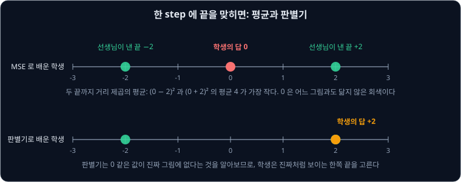
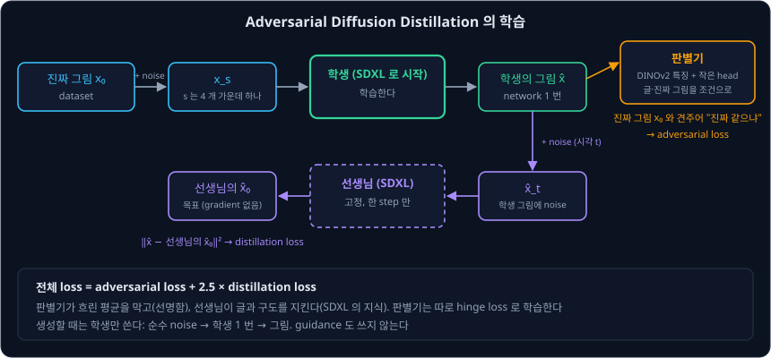
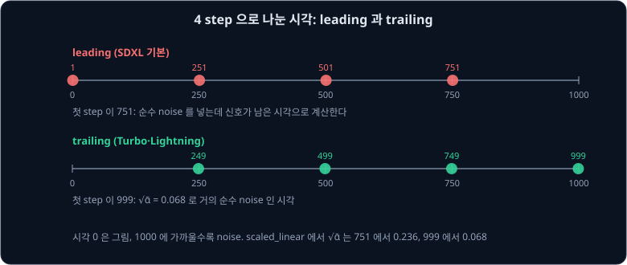
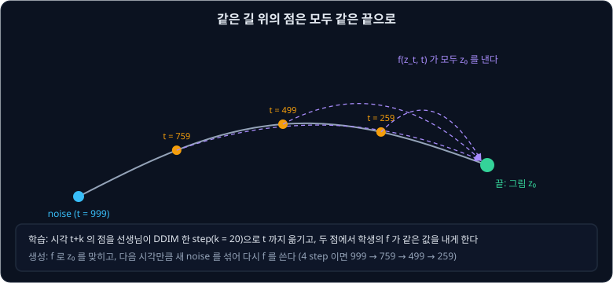
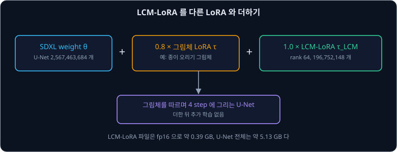
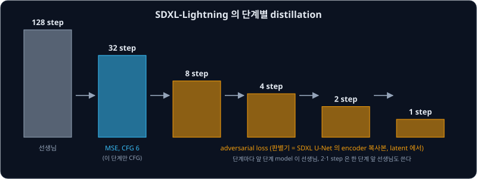
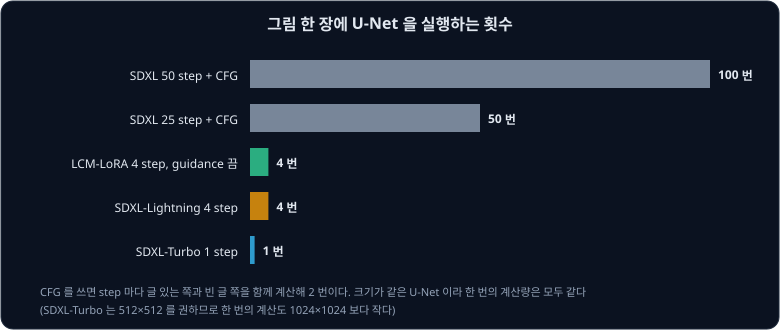

# Diffusion Distillation

diffusers 의 SDXL pipeline 은 기본으로 50 step 을 밟고 `guidance_scale` 이 5.0 이다. [Classifier-Free Guidance](../classifier-free-guidance/README.md)
는 step 마다 글 있는 쪽과 빈 글 쪽을 함께 계산하므로, 그림 한 장에 U-Net 을 100 번 실행한다. SDXL-Lightning 논문에 따르면
[Samplers](../samplers/README.md) 에서 본 좋은 sampler 를 써도 대개 20 step 넘게 필요하다. 같은 U-Net 을 한 번만 실행해서 그림을 얻을 수는 없을까?

이 문제를 푸는 방법 하나는 model 을 다시 학습하는 것이다. 많은 step 을 밟는 model 을 선생님(teacher)으로 두고, 적은 step 으로 같은 그림을 내는 학생(student) model 을
학습하는 일을 **distillation** 이라고 한다. Stability AI 의 Sauer 등이 2023 년에 발표한 ADD 로 만든 SDXL-Turbo 는 U-Net 을 한 번 실행해 $512 \times 512$
그림을 만든다. 논문의 표 2 에서 Stable Diffusion 1.5 로 같은 방법을 쓴 model 은 1 step 에 0.09 초가 걸렸고, DPM-Solver 25 step 은 0.88 초가 걸렸다.

## 학습 목표

- 한 step 에 끝을 맞히도록 MSE 로 학습한 학생이 흐린 평균을 내는 이유를 숫자로 설명할 수 있다
- ADD 가 판별기(discriminator)의 adversarial loss 와 선생님의 distillation loss 를 함께 쓰는 방식과 각 loss 의 역할을 설명할 수 있다
- 시각을 leading 과 trailing 으로 나눌 때 첫 step 의 시각을 계산하고, 적은 step model 이 trailing 을 쓰는 이유를 설명할 수 있다
- LCM 이 같은 길 위의 점을 같은 끝으로 보내도록 학습하는 방법과, 그 결과를 LoRA 로 담아 다른 SDXL model 에 붙이는 LCM-LoRA 를 설명할 수 있다
- SDXL-Lightning 이 step 을 단계마다 줄이는 방법을 설명하고, 내 컴퓨터에서 쓸 model 을 step 수·해상도·guidance·license 로 고를 수 있다

## 한 step 에 끝을 맞히면 흐려진다

가장 단순한 distillation 은 선생님이 여러 step 을 밟아 도착한 그림을 정답으로 두고, 학생이 한 step 에 그 그림을 맞히게 MSE(제곱 오차의 평균)로
학습하는 것이다. SDXL-Lightning 논문의 2.3 절이 설명하는 progressive distillation 이 이 방식으로 step 수를 절반씩 줄인다.

그런데 선생님은 아주 가까운 두 noise 에서도 전혀 다른 그림을 낼 수 있다. 숫자 하나짜리 그림으로 예를 들어, 선생님이 거의 같은 두 noise 에서 각각
$-2$ 와 $+2$ 를 낸다고 하자. 학생은 두 noise 를 구별할 만큼 섬세하지 않아서 둘에 같은 답 $a$ 를 낸다고 하자. 두 경우의 제곱 오차 평균을 $a$ 마다 계산하면
아래와 같다.

| 학생의 답 $a$ | $-2$ 일 때의 제곱 오차 | $+2$ 일 때의 제곱 오차 | 평균 |
| --- | --- | --- | --- |
| $-2$ | 0 | 16 | 8 |
| 0 | 4 | 4 | 4 |
| $+2$ | 16 | 0 | 8 |

평균이 가장 작은 답은 $a = 0$ 이다. MSE 로 학습하면 학생은 두 그림의 평균을 낸다. [VAE](../vae/README.md) 에서 빨간 사과와 초록 사과의 평균이
회색이었던 것처럼, 그림에서는 이 평균이 흐린 그림이 된다. [Flow Matching](../flow-matching/README.md) 에서 1 step 이 데이터의 평균을 낸 것도 같은
이유다.

SDXL-Lightning 의 저자들은 적은 step 의 학생이 여러 step 을 쌓은 선생님만큼 급격한 변화를 흉내 낼 능력이 없어서, MSE 로 학습하면 8 step 아래에서
흐려진다고 분석했다. ADD 논문의 표 2 에서도 이를 볼 수 있다. FID 는 만든 그림들이 진짜 사진들과 얼마나 다른지 재는 값이라 작을수록 좋다.
Stable Diffusion 1.5 를 progressive distillation 으로 1 step 에 담은 model 은 FID 가 37.2 였고, 25 step DPM-Solver 는 20.1 이었다.

**확인 문제.** 선생님이 가까운 세 noise 에서 $-3$, $0$, $+6$ 을 낸다. 학생이 셋에 같은 답 $a$ 를 낸다면 제곱 오차의 평균을 가장 작게 하는 $a$ 는?

답 보기

① 제곱 오차의 평균은 세 값의 평균에서 가장 작다.

② 평균은 $(-3 + 0 + 6) \div 3 = 1$ 이다.

답: $a = 1$. 셋 가운데 어느 값도 아닌 1 을 내므로, 그림이라면 세 그림을 겹친 흐린 그림이 된다.

## 판별기로 선명하게

평균을 피하려면 "정답과 얼마나 가까운가" 대신 "진짜 그림처럼 보이는가" 를 재는 loss 가 필요하다. VAE 강의에서 본 GAN 의 판별기가 이 일을 한다.
판별기는 진짜 그림과 학생의 그림을 가리도록 학습하고, 학생은 판별기를 속이도록 학습한다. 앞의 예에서 0 은 진짜 그림 어디에도 없는 값이라
판별기가 쉽게 알아본다. 그래서 학생은 $-2$ 나 $+2$ 처럼 진짜처럼 보이는 한쪽을 골라 낸다. 이렇게 판별기를 속이는 정도로 매기는 loss 를
**adversarial loss** 라고 한다.

ADD 는 hinge loss 를 쓴다. 판별기는 출력 $D$ 가 진짜 그림에서는 1 이상이 되고 학생의 그림에서는 $-1$ 이하가 되게 학습하고, 학생은 자기 그림의 $D$
를 키우게 학습한다. 예를 들어 판별기가 진짜 그림에는 0.4 를 내고 학생 그림에는 0.2 를 냈다고 하자.

| 항 | 이 예의 값 | 기호로 쓴 값 |
| --- | --- | --- |
| 판별기의 loss: 진짜 그림 | $\max(0, 1 - 0.4) = 0.6$ | $\max(0, 1 - D(x_0))$ |
| 판별기의 loss: 학생 그림 | $\max(0, 1 + 0.2) = 1.2$ | $\max(0, 1 + D(\hat x))$ |
| 학생의 loss | $-0.2$ | $-D(\hat x)$ |

판별기는 진짜 그림의 출력을 1 쪽으로 올리고 학생 그림의 출력을 $-1$ 쪽으로 내려 자기 loss $0.6 + 1.2 = 1.8$ 을 줄인다. 학생의 loss $-0.2$ 의
gradient 는 $D(\hat x)$ 가 커지는 쪽을 가리키므로, 학생은 판별기가 더 진짜라고 여길 그림 쪽으로 바뀐다.

ADD 는 판별기를 처음부터 학습할 필요 없이, 그림을 잘 이해하도록 미리 학습한 ViT 인 DINOv2 의 특징을 고정해 쓰고, 그 위의 여러 층에 작은 판별 head
를 붙여 head 만 학습한다. 판별기는 글(CLIP ViT-g-14 의 text embedding)과 진짜 그림(DINOv2 ViT-L 의 [CLS] embedding)을 조건으로 받는다. 논문의 표 1 에서는
DINOv2 가 다른 특징 network 보다 좋았고, 글과 그림 조건을 함께 줄 때 가장 좋았다. SDXL-Lightning 의 저자들이 지적하듯 DINOv2 는 pixel 그림을 받으므로,
이 판별기는 latent 가 아닌 pixel 그림을 다룬다.

**확인 문제.** 판별기가 진짜 그림에는 1.5 를 내고 학생 그림에는 $-1.3$ 을 냈다. 판별기의 loss 두 항은 각각 얼마이고, 이 경우 판별기는 무엇을 더 배울까?

답 보기

① 진짜 그림 항은 $\max(0, 1 - 1.5) = \max(0, -0.5) = 0$ 이다.

② 학생 그림 항은 $\max(0, 1 + (-1.3)) = \max(0, -0.3) = 0$ 이다.

답: 둘 다 0 이라 이 두 그림에서는 판별기가 더 배울 것이 없다. hinge loss 에서는 이미 충분히 가린 그림의 loss 가 0 이라, 판별기가 그 그림으로 더 배우지 않는다.

## 선생님으로 글과 구도를 지키기

판별기만 있으면 학생은 진짜 같은 그림을 내지만, 글을 얼마나 따르는지는 판별기가 잘 가르치지 못한다. ADD 는 여기에 선생님을 더한다. 선생님은 고정한
SDXL 이고, 학생도 같은 SDXL 의 weight 로 시작한다. 학습 한 번은 아래 순서다.

1. dataset 의 진짜 그림 $x_0$ 에 noise 를 섞어 $x_s$ 를 만든다. 학생이 학습하는 시각 $s$ 는 4 개 가운데 하나이고, 가장 큰 시각은 순수 noise 다
2. 학생이 $x_s$ 를 한 번에 그림 $\hat x$ 로 바꾼다
3. 판별기가 $\hat x$ 와 진짜 그림을 가려 adversarial loss 를 준다
4. $\hat x$ 에 다시 시각 $t$ 의 noise 를 섞어 선생님에게 넣고, 선생님이 한 step 으로 되돌린 그림을 목표로 둔다. 학생 그림과 목표의 제곱 거리가
   **distillation loss** 다. 목표 쪽으로는 gradient 를 보내지 않는다

선생님에게 넣기 전에 $\hat x$ 에 noise 를 섞는 것은, 선생님이 noise 섞인 그림만 보고 학습했기 때문이다. 선생님은 글을 보고 noise 를 걷어 내므로,
학생 그림이 글에서 벗어나 있으면 그 부분을 글 쪽으로 고친 목표를 낸다. 저자들은 두 loss 를 $L_\text{adv} + 2.5 \times L_\text{distill}$ 로 더했다.

예를 들어 학생이 $\hat x = 1.0$ 을 냈고, 선생님이 noise 를 섞은 값을 되돌려 0.6 을 냈다고 하자. 논문의 식에는 시각에 따른 무게 $c(t)$ 가 곱해지는데, 여기서는 1 로 둔다.

| 단계 | 이 예의 값 | 기호로 쓴 값 |
| --- | --- | --- |
| 학생의 그림 | 1.0 | $\hat x$ |
| 선생님이 되돌린 목표 | 0.6 | $\hat x_\psi$ |
| distillation loss | $(1.0 - 0.6)^2 = 0.16$ | $\lVert \hat x - \hat x_\psi \rVert^2$ |
| 전체 loss 에서의 몫 | $2.5 \times 0.16 = 0.4$ | $\lambda \times L_\text{distill}$ |

loss 를 $\hat x$ 로 미분하면 $2.5 \times 2 \times (1.0 - 0.6) = 2$ 로 + 다. $\hat x$ 를 늘리면 loss 가 늘어나므로 학생은 $\hat x$ 를 0.6 쪽으로 줄인다.

저자들은 SDXL 보다 작은 model 로 loss 를 하나씩 빼 보았다(표 1d). COCO 의 FID 와 CLIP score(글과 그림이 맞는 정도, 클수록 좋다)는 아래와 같다.

| 학습한 loss | FID | CLIP score |
| --- | --- | --- |
| adversarial loss 만 | 20.8 | 0.315 |
| distillation loss 만 | 315.6 | 0.076 |
| 둘 다 | 20.6 | 0.319 |

distillation loss 만으로는 학습이 무너졌고, adversarial loss 만으로는 글을 조금 덜 따랐다. 학생을 SDXL 의 weight 가 아닌 무작위 값으로 시작하면 FID 가
293.6 으로 무너졌다(표 1c). 미리 학습한 diffusion model 에서 시작한다는 점에서 ADD 는 GAN 을 처음부터 학습하는 방식과 다르다.

ADD 는 학생이 순수 noise 에서 시작할 수 있게 학습할 때 가장 큰 시각을 1000 으로 두고, 그 시각에서 신호가 남지 않게 했다(zero-terminal SNR).

## SDXL-Turbo 쓰기

SDXL-Turbo 는 SDXL 1.0 base 를 ADD 로 distillation 한 model 이다. weight 파일에서 U-Net 의 parameter 를 세면 2,567,463,684 개로 SDXL 의 U-Net 과 같다.
구조는 그대로이고 weight 만 바뀌었다. model card 의 사용법은 `num_inference_steps=1`, `guidance_scale=0.0` 이고, $512 \times 512$ 그림을 권한다.
guidance 를 쓰지 않으므로 빈 글 쪽 계산도 없어서, 그림 한 장에 U-Net 을 딱 한 번 실행한다.

여러 step 을 쓰려면 시각을 어떻게 나누는지가 중요하다. diffusers 의 scheduler 에는 1000 단계를 step 수로 나누는 방법(`timestep_spacing`)이 여럿 있다.
SDXL base 의 scheduler 설정은 `leading` 이고, SDXL-Turbo 의 설정은 `trailing` 이다. `EulerDiscreteScheduler` 의 코드로 4 step 의 시각을 계산하면 아래와 같다.

| 방식 | 계산 | 4 step 의 시각 | 1 step 의 시각 |
| --- | --- | --- | --- |
| leading | $250 \times (3, 2, 1, 0) + 1$ | 751, 501, 251, 1 | 1 |
| trailing | $1000 - 250 \times (0, 1, 2, 3) - 1$ | 999, 749, 499, 249 | 999 |

생성은 순수 noise 에서 시작한다. leading 의 첫 시각 751 에서는 그림의 신호가 $\sqrt{\bar\alpha} = 0.236$ 만큼 남아 있어야 하는데 실제 입력은 순수 noise 라서,
model 이 받은 것과 기대한 것이 어긋난다. 1 step 이면 leading 의 시각은 1 이라, model 은 noise 가 거의 다 걷힌 그림 자리에서 순수 noise 를 받는다. 50 step 에서는 첫 시각이
981 이라 어긋남이 작지만, 적은 step 에서는 크다. trailing 은 첫 시각이 999 라서 [DDPM](../ddpm/README.md) 에서 본 $\sqrt{\bar\alpha_{1000}} \approx 0.068$
에 해당하는, 거의 순수 noise 인 시각에서 시작한다.

SDXL-Turbo 의 scheduler 는 `EulerAncestralDiscreteScheduler` 다. Samplers 강의의 ancestral sampler 처럼, step 마다 그림을 맞힌 뒤 다음 시각만큼
새 noise 를 섞는다. 논문의 그림 4 에서 seed 가 같으면 1·2·4 step 의 구도가 유지되었고, step 을 늘리면 세부와 일관성이 좋아졌다.

사람 평가(그림 5·6)에서 평가자들은 SDXL-Turbo 를 1 step 으로 쓴 그림을 LCM-XL 4 step 보다 선호했고, 4 step 으로 쓴 그림은 50 step 의 SDXL base
보다도 대부분의 비교에서 선호했다. 모두 $512 \times 512$ 에서 비교한 결과다. 다만 저자들은 그림의 다양성이 조금 줄었다고 적었다. model card 는 그림 크기가
$512 \times 512$ 로 정해져 있고, 읽을 수 있는 글자를 쓰지 못하며, 얼굴과 사람이 잘 안 나올 수 있다고 적었다. license 는 Stability AI 의 비상업
community license 이고, 상업적으로 쓰려면 Stability AI 의 별도 license 를 따라야 한다.

같은 방법으로 Stable Diffusion 2.1 을 distillation 한 SD-Turbo 도 있다. U-Net 의 parameter 가 865,910,724 개라 fp16 으로 약 1.73 GB 이고, 사용법은 SDXL-Turbo 와 같다.

**확인 문제.** 1000 단계를 2 step 으로 나누면 leading 과 trailing 의 시각은 각각 무엇일까? 어느 쪽이 순수 noise 에서 시작하는 생성에 맞을까?

답 보기

① leading 은 $500 \times (1, 0) + 1$ 이라 501, 1 이다.

② trailing 은 $1000 - 500 \times (0, 1) - 1$ 이라 999, 499 다.

답: leading 501·1, trailing 999·499. 순수 noise 에는 999 에서 시작하는 trailing 이 맞는다.

## 같은 길 위의 점을 같은 끝으로: LCM

Tsinghua 대학의 Luo 등이 2023 년에 발표한 LCM(Latent Consistency Model)은 판별기 없이 적은 step 을 얻는다. LCM 은 consistency model 의 생각을 바탕으로 한다.
선생님의 sampler 가 noise 에서 그림까지 가는 길은 정해져 있다. 같은 길 위의 점이라면 시각이 999 든 259 든 결국 같은 그림 $z_0$ 에 닿는다. 그렇다면
길 위의 어느 점을 받아도 그 끝 $z_0$ 를 바로 내는 함수 $f$ 를 학습하면 된다.

이 성질은 Flow Matching 강의에서 본 직선 경로의 숫자로도 확인할 수 있다. 데이터 2 와 noise $-1$ 을 잇는 길에서 SD3 표기의 시각 0.75, 0.5, 0.25 의 점은 $-0.25$, 0.5, 1.25 였다.
consistency 함수는 세 점 모두에서 2 를 내야 한다.

| 시각 | 1 | 0.75 | 0.5 | 0.25 | 0 |
| --- | --- | --- | --- | --- | --- |
| 길 위의 점 | $-1$ | $-0.25$ | 0.5 | 1.25 | 2 |
| $f$ 가 낼 값 | 2 | 2 | 2 | 2 | 2 |

길의 끝을 알려면 선생님으로 끝까지 sampling 해야 하므로, LCM 은 끝까지 가는 대신 한 step 만 옮긴다. 시각 $t_{n+k}$ 의 점을 선생님이 DDIM 한 step 으로 $t_n$ 까지 옮기고,
학생의 $f$ 가 두 점에서 같은 값을 내게 학습한다. 가장 끝($t = 0$ 근처)에서는 $f$ 가 입력을 그대로 내도록 식을 정해 두므로, 이웃한 점끼리 맞추다 보면
모든 점이 끝값에 맞춰진다. 비교할 쪽의 $f$ 는 학습 중인 weight 의 이동 평균(EMA)으로 계산해 목표가 흔들리지 않게 한다.

<b>심화: 끝에서 입력을 그대로 내는 식</b>

LCM 은 $f(z, t) = c_\text{skip}(t)\,z + c_\text{out}(t)\,\hat z_0$ 로 둔다. $\hat z_0$ 는 U-Net 의 noise 예측으로 계산한 그림의 추정이고, 두 계수는
$c_\text{skip}(0) = 1$, $c_\text{out}(0) = 0$ 을 지키는 함수다. 그러면 $t = 0$ 에서 $f$ 는 network 와 상관없이 입력을 그대로 낸다.

diffusers 의 `LCMScheduler` 는 $\sigma_\text{data} = 0.5$ 와 `timestep_scaling` 10 으로 $u = 10t$ 를 두고
$c_\text{skip} = \frac{0.25}{u^2 + 0.25}$, $c_\text{out} = \frac{u}{\sqrt{u^2 + 0.25}}$ 를 쓴다.

| 시각 $t$ | 0 | 19 | 259 |
| --- | --- | --- | --- |
| $c_\text{skip}$ | 1 | 약 0.0000069 | 약 0.00000004 |
| $c_\text{out}$ | 0 | 약 0.999997 | 약 1 |

생성에 쓰는 시각에서는 $c_\text{out}$ 이 거의 1 이라 $f$ 는 사실상 $\hat z_0$ 이고, 두 계수는 $t = 0$ 근처에서만 입력 쪽으로 넘어간다.

Stable Diffusion 의 1000 단계에서 이웃한 단계끼리 맞추면 두 점이 너무 가까워 loss 가 작고 학습이 느리다. 저자들은 $k = 20$ 단계씩 건너뛰어 맞췄다
(skipping-step). 또 선생님의 step 에 guidance 를 넣어 $(1 + \omega)\epsilon_c - \omega\,\epsilon_\varnothing$ 로 옮기고($\epsilon_c$ 는 글을 넣은 예측, $\epsilon_\varnothing$ 는 빈 글을 넣은 예측), $\omega$ 를 2 ~ 14 에서
뽑아 학생의 입력으로도 넣었다. 그래서 학생은 guidance 를 쓴 길의 끝을 한 번의 계산으로 낸다. diffusers 는 `guidance_scale` 에서 1 을 뺀 값을 이 $\omega$
로 넘긴다.

논문의 표 1 은 Stable Diffusion 2.1 base 를 선생님으로 $512 \times 512$, $\omega = 8$ 에서 학습한 결과다.

| 방법 | FID 1 step | 2 step | 4 step | 8 step |
| --- | --- | --- | --- | --- |
| DPM-Solver++ (학습 없음) | 185.78 | 72.81 | 18.43 | 12.20 |
| Guided-Distill (저자들이 다시 구현) | 108.21 | 33.25 | 15.12 | 13.89 |
| LCM | 35.36 | 13.31 | 11.10 | 11.84 |

LCM 은 2 ~ 4 step 에서 다른 방법보다 훨씬 좋았지만 1 step 에서는 차이가 남았다. $768 \times 768$ LCM 을 학습하는 데는 A100 GPU 32 시간이 들었다. 생성할 때
diffusers 의 `LCMScheduler` 는 $f$ 로 $z_0$ 를 맞힌 뒤 다음 시각만큼 새 noise 를 섞는다. 4 step 의 시각은 999, 759, 499, 259 다.

**확인 문제.** 위 표의 길에서 학생의 $f$ 가 시각 0.75 의 점 $-0.25$ 에서 1.8 을 내고, 시각 0.5 의 점 0.5 에서 2.1 을 냈다. 두 출력의 제곱 차이는 얼마이고,
학습은 무엇을 줄일까?

답 보기

① 두 출력의 차이는 $2.1 - 1.8 = 0.3$ 이고 제곱은 0.09 다.

② consistency loss 는 같은 길의 두 점에서 낸 출력의 차이를 줄인다.

답: 0.09. 두 출력이 같아지도록 학습하고, 끝에서는 $f$ 가 입력 2 를 그대로 내므로 둘 다 2 쪽으로 맞춰진다.

## 어떤 SDXL 에도 붙이는 LCM-LoRA

LCM 의 학습은 이미 학습한 U-Net 을 조금 고치는 일이라서 [LoRA](../lora/README.md) 로 할 수 있다. 원래 weight 는 고정하고 변화량만 $B A$ 로 학습한다.
LCM-LoRA 보고서의 표 1 에 따르면 SDXL 의 parameter 3.5B 가운데 LoRA 로 학습하는 parameter 는 197M 이다. LCM-LoRA SDXL 의 weight 파일을 세면
rank 64 인 층이 788 개이고 parameter 는 196,752,148 개다. fp16 파일로 약 0.39 GB 라서 U-Net 전체(약 5.13 GB)를 새로 받는 것보다 훨씬 작다.

저자들은 이 LoRA 가 원래 SDXL 뿐 아니라 SDXL 을 미세조정한 다른 model 에도 그대로 붙는다는 것을 발견했다. LoRA 강의에서 본 여러 LoRA 섞기처럼,
그림체를 학습한 LoRA $\tau$ 와 LCM-LoRA $\tau_\text{LCM}$ 을 함께 더한다.

$\theta = \theta_\text{base} + \lambda_1 \tau + \lambda_2 \tau_\text{LCM}$

보고서의 그림 3 에서 저자들은 종이 오리기 그림체 LoRA 를 $\lambda_1 = 0.8$ 로 더하고 LCM-LoRA 를 $\lambda_2 = 1.0$ 으로 더해, 추가 학습 없이
그 그림체로 적은 step 에 그렸다. LCM 이 배운 변화는 "빠르게 하는 vector" 라고 부르고, 그림체 LoRA 는 "그림체 vector" 라고 불렀다.

LCM-LoRA 는 distillation 할 때 guidance 를 $\omega = 7.5$ 로 고정했고, LCM 처럼 $\omega$ 를 입력으로 받지 않는다. 그래서 model card 는 scheduler 를
`LCMScheduler` 로 바꾸고 2 ~ 8 step 을 쓰며, `guidance_scale` 을 끄거나 1.0 ~ 2.0 에 두라고 적었다. model card 의 예제는 4 step 과 `guidance_scale=0` 을 쓴다. SDXL
pipeline 은 `guidance_scale` 이 1 보다 클 때만 빈 글 쪽을 계산하므로, 1.0 이하에서는 step 마다 U-Net 을 한 번만 실행한다.

**확인 문제.** rank 64 LoRA 를 $1280 \times 1280$ linear 층 하나에 붙이면 parameter 는 몇 개이고, 원래 층의 몇 % 일까? bias 는 빼고 센다.

답 보기

① $A$ 는 $64 \times 1280$ 이고 $B$ 는 $1280 \times 64$ 라 $2 \times 64 \times 1280 = 163{,}840$ 개다.

② 원래 층은 $1280 \times 1280 = 1{,}638{,}400$ 개다.

답: 163,840 개, 10%.

## 단계를 나눠 줄이는 SDXL-Lightning

ByteDance 의 Lin 등이 2024 년에 발표한 SDXL-Lightning 은 progressive distillation 과 adversarial loss 를 섞었다. 처음에는 SDXL 의 128 step 을 MSE 로
32 step 에 담는다. 이 단계에서는 MSE 로도 충분했고, guidance 는 이 단계에서만 scale 6 으로 썼다. 그다음에는 adversarial loss 로
32 → 8 → 4 → 2 → 1 step 으로 줄인다. 단계마다 앞 단계의 model 이 선생님이 된다.

ADD 와 다른 점은 세 가지다.

| 항목 | SDXL-Turbo (ADD) | SDXL-Lightning |
| --- | --- | --- |
| 판별기 | DINOv2 특징, pixel 그림에서 | SDXL U-Net 의 encoder 와 가운데 block 복사본, latent 에서 |
| 학생이 맞히는 것 | 길의 끝 $\hat x_0$ | 선생님이 여러 step 뒤에 닿는 다음 자리 |
| 해상도 | $512 \times 512$ | $1024 \times 1024$ |

저자들은 판별기가 pixel 그림을 다루면 계산과 메모리가 커서 고해상도 distillation 이 어렵고, 그 때문에 SDXL-Turbo 가 $512 \times 512$ 만 지원하는 것으로
보았다. U-Net 의 encoder 는 latent 를 그대로 받고 noise 섞인 입력도 다룬다. 또 학생이 매번 끝을 맞히고 다시 noise 를 섞는 대신 선생님의 길 위의 다음 자리를
맞히므로, 원래 model 의 동작이 덜 바뀌어 다른 LoRA 나 ControlNet 과 잘 맞는다고 설명했다.

저자들은 처음에는 판별기에 출발점 $x_t$ 도 함께 보여 줘 선생님과 같은 길을 따르게 했다. 그러면 학생이 선생님의 급격한 구도 변화를 흉내 내지 못해 머리가 둘
붙은 그림이 나올 때가 있어서, 이어서 $x_t$ 없이 그림만 보는 판별기로 다시 학습했다. LoRA 도 함께 공개했는데, rank 64 를 LCM-LoRA 와 같은 층에 붙여서
weight 파일의 parameter 가 196,752,148 개로 같다. 1 step model 은 noise 대신 그림을 바로 맞히도록 바꿨다. 1 step model 에는 LoRA 가 없다.

논문의 표 2 에서 COCO 의 FID 는 아래와 같다. 그림 전체를 줄여 잰 FID 로는 전체적인 품질과 다양성을 보고, 가운데 299 pixel 조각으로 잰 FID 로는 고해상도
세부를 본다.

| model | step | FID (전체) | FID (조각) |
| --- | --- | --- | --- |
| SDXL | 32 | 18.49 | 35.89 |
| LCM-LoRA | 4 | 21.50 | 40.38 |
| SDXL-Turbo | 4 | 22.58 | 42.65 |
| SDXL-Lightning | 4 | 22.30 | 33.52 |
| SDXL-Lightning | 8 | 21.43 | 33.55 |

distillation 한 model 은 모두 전체 FID 가 SDXL 보다 나빴고, 저자들은 다양성이 줄었기 때문으로 보았다. SDXL-Lightning 은 조각 FID 가 SDXL
보다도 좋았다. 저자들은 이것을 distillation 을 128 step 에서 시작한 덕분으로 보았다. model card 는 step 수에 맞는 checkpoint 를 쓰고, scheduler 를
`timestep_spacing="trailing"` 으로 두며, `guidance_scale=0` 으로 쓰라고 적었다. 1 step model 은 실험용이라 품질이 불안정하다는 설명도 있다.

**확인 문제.** SDXL-Lightning 의 단계를 따라가면, 128 step 의 선생님에서 4 step model 까지 distillation 을 몇 번 거칠까?

답 보기

① 128 → 32 는 MSE 로 한 번이다.

② 32 → 8, 8 → 4 는 adversarial loss 로 두 번이다.

답: 세 번.

## 내 컴퓨터에서 고르기

이 강의의 model 들은 U-Net 의 크기가 SDXL 과 같아서, 한 번 실행하는 계산량과 weight 메모리도 같다. SDXL 의 U-Net 은 fp16 으로 약 5.13 GB 이고, 두
text encoder 와 VAE 를 더하면 약 6.9 GB 다. 달라지는 것은 그림 한 장에 U-Net 을 실행하는 횟수다.

| model | 권하는 step | 해상도 | guidance | LoRA 로 받기 | license |
| --- | --- | --- | --- | --- | --- |
| SDXL-Turbo | 1 ~ 4 | $512 \times 512$ | 끔 | 없음 | Stability AI 비상업 community |
| LCM-LoRA SDXL | 2 ~ 8 | $1024 \times 1024$ | 끔 또는 1 ~ 2 | 있음 | openrail++ |
| SDXL-Lightning | 2·4·8 (1 은 실험) | $1024 \times 1024$ | 끔 | 있음 (2·4·8) | openrail++ |

고르는 기준은 이렇다.

- 속도가 가장 중요하고 $512 \times 512$ 로 충분하면 SDXL-Turbo 를 쓴다. SDXL-Turbo 는 1 step 이고, 크기가 $1024 \times 1024$ 의 4 분의 1 이라 한 번의 계산도 작다
- 이미 쓰는 SDXL 미세조정 model 이나 그림체 LoRA 가 있으면 LCM-LoRA 나 SDXL-Lightning 의 LoRA 를 붙인다. 파일 하나를 더 받으면 된다
- $1024 \times 1024$ 세부가 중요하면 SDXL-Lightning 의 U-Net checkpoint 를 4 step 이나 8 step 으로 쓴다
- 어느 model 이든 scheduler 설정을 model card 대로 맞춘다. 시각 나누기가 틀리면 앞에서 본 것처럼 첫 step 부터 입력이 어긋난다

SD3 강의의 fp16 weight, `torch.compile`, CPU offload 같은 방법은 여기에도 그대로 더할 수 있다. step 을 줄이는 것과 한 번의 계산을 빠르게 하는 것은
서로 다른 곳을 줄이기 때문이다.

**확인 문제.** SDXL 을 30 step, `guidance_scale` 7.0 으로 쓰다가 SDXL-Lightning 4 step 으로 바꾸면 U-Net 실행 횟수는 몇 분의 1 이 될까?

답 보기

① SDXL 은 guidance 를 쓰므로 $30 \times 2 = 60$ 번이다.

② SDXL-Lightning 은 guidance 를 끄므로 4 번이다.

답: $60 \div 4 = 15$, 15 분의 1.

## 정리

- MSE 로 한 step 에 끝을 맞히게 하면, 가까운 noise 에서 다른 그림이 나오는 자리에서 학생이 평균을 내 흐려진다. 선생님이 $-2$ 와 $+2$ 를 낼 때 MSE 를 가장 작게 하는 답은 0 이다
- ADD 는 판별기의 adversarial loss 로 선명함을 얻고, 고정한 선생님 SDXL 이 noise 섞인 학생 그림을 되돌린 목표와의 distillation loss 로 글과 구도를
  지킨다. 전체 loss 는 $L_\text{adv} + 2.5 L_\text{distill}$ 이다. SDXL-Turbo 는 U-Net 구조가 SDXL 과 같고, $512 \times 512$ 그림을 guidance 없이 1 step
  으로 만든다
- 적은 step 에서는 trailing 시각(4 step 이면 999, 749, 499, 249)으로 순수 noise 에서 시작해야 한다. leading 은 751 에서 시작해 입력이 어긋난다
- LCM 은 같은 길 위의 점을 같은 끝으로 보내도록 선생님의 DDIM 한 step 으로 이은 두 점의 출력을 맞추고, guidance 를 쓴 길을 학습해 step 마다 한 번만
  계산한다. LCM-LoRA 는 이를 rank 64 LoRA(196,752,148 개)로 담아 다른 SDXL model 과 그림체 LoRA 에 더한다
- SDXL-Lightning 은 128 → 32 step 은 MSE 로 줄이고, 32 → 8 → 4 → 2 → 1 은 SDXL U-Net encoder 판별기의 adversarial loss 로 줄여
  $1024 \times 1024$ 를 지킨다
- 모두 U-Net 한 번의 계산은 SDXL 과 같고, 그림 한 장의 실행 횟수가 100 번에서 1 ~ 8 번으로 준다

Stable Diffusion branch 는 지금 이 강의까지다. U-Net 과 latent 에서 시작해 글 조건, guidance, sampler, 미세조정, 그림 조건, 큰 model 과 Transformer
를 지나 적은 step 생성까지 왔다.

## 참고 자료

- Axel Sauer 등, [Adversarial Diffusion Distillation](https://arxiv.org/abs/2311.17042) (2023) — ADD 논문. 3 절과 그림 2 의 학습 절차, 식 (2)·(3) 의
  hinge loss, 식 (4) 의 distillation loss, 4 절의 $\lambda = 2.5$ 와 판별기 조건, 표 1 의 ablation, 표 2 의 SD 1.5 기반 비교, 그림 4 ~ 8 의 step 수·사람 평가·다양성
- Simian Luo 등, [Latent Consistency Models](https://arxiv.org/abs/2310.04378) (2023) — 3 절의 consistency function, 4.2 절의 guidance 를 넣은 한 단계
  distillation, 4.3 절의 skipping-step $k = 20$, 표 1·2 의 step 별 FID, 5.1 절의 학습 설정
- Simian Luo 등, [LCM-LoRA: A Universal Stable-Diffusion Acceleration Module](https://arxiv.org/abs/2311.05556) (2023) — 표 1 의 LoRA parameter 수,
  그림 2 의 $\omega = 7.5$, 식 (2)·(3) 과 그림 3 의 LoRA 더하기($\lambda_1 = 0.8$, $\lambda_2 = 1.0$)
- Shanchuan Lin, Anran Wang, Xiao Yang, [SDXL-Lightning: Progressive Adversarial Diffusion Distillation](https://arxiv.org/abs/2402.13929) (2024) — 2.3·2.4
  절의 progressive·adversarial distillation 과 SDXL-Turbo 에 대한 분석, 3.1 절의 MSE 가 흐려지는 이유, 3.3·3.4 절의 판별기, 3.5 절의 schedule, 3.6 절의
  단계와 LoRA 설정, 표 1·2 의 비교
- Hugging Face, [stabilityai/sdxl-turbo](https://huggingface.co/stabilityai/sdxl-turbo) — model card 의 사용법·한계·license, `scheduler/scheduler_config.json`
  (`EulerAncestralDiscreteScheduler`, `timestep_spacing: trailing`), U-Net weight 파일. [stabilityai/sd-turbo](https://huggingface.co/stabilityai/sd-turbo) —
  SD 2.1 기반 model card 와 U-Net weight 파일
- Hugging Face, [latent-consistency/lcm-lora-sdxl](https://huggingface.co/latent-consistency/lcm-lora-sdxl) — model card 의 step 수와 `guidance_scale`,
  LoRA weight 파일. [ByteDance/SDXL-Lightning](https://huggingface.co/ByteDance/SDXL-Lightning) — checkpoint 목록, trailing 과 `guidance_scale=0` 사용법, LoRA weight 파일
- diffusers, [`scheduling_euler_discrete.py`](https://github.com/huggingface/diffusers/blob/main/src/diffusers/schedulers/scheduling_euler_discrete.py) 의
  `timestep_spacing`, [`scheduling_lcm.py`](https://github.com/huggingface/diffusers/blob/main/src/diffusers/schedulers/scheduling_lcm.py) 의 시각 선택과
  다시 noise 섞기, [`pipeline_stable_diffusion_xl.py`](https://github.com/huggingface/diffusers/blob/main/src/diffusers/pipelines/stable_diffusion_xl/pipeline_stable_diffusion_xl.py)
  의 기본값 50 step·5.0 과 guidance 조건, `guidance_scale - 1` 을 넘기는 guidance embedding
