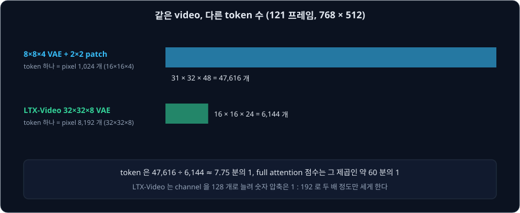
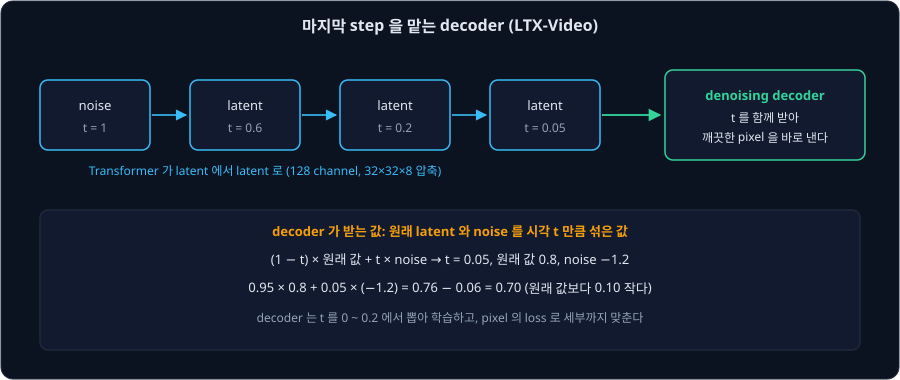
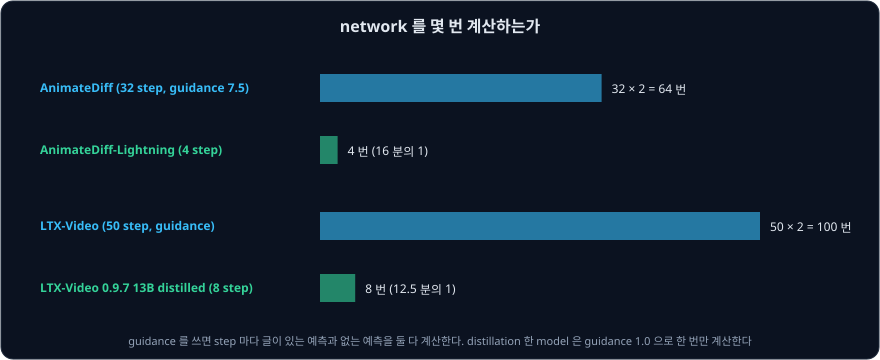
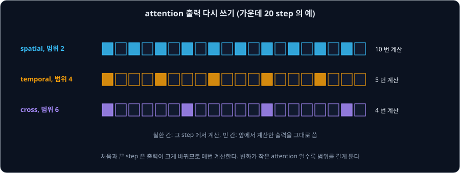

# Fast Video Generation

[Video Diffusion Transformer](../video-dit/README.md) 강의의 Wan 2.1 1.3B 는 RTX 4090 에서 5 초짜리 480P video 하나를 만드는 데 약 4 분이 걸렸다.
그림 한 장을 몇 초 만에 만드는 것과 비교하면 아주 느리다. 생성 시간은 대략 아래 세 가지의 곱이다.

| 줄일 것 | 이 강의에서 다루는 방법 |
| --- | --- |
| network 를 계산하는 횟수 (step 수 × guidance 로 생기는 2 배) | step 과 guidance 의 distillation |
| 한 번 계산할 때의 token 수 (attention 은 그 제곱) | 더 세게 줄이는 VAE (LTX-Video) |
| 한 번 계산할 때 실제로 하는 일 | 이웃한 step 의 attention 출력 다시 쓰기 (PAB) |

GPU 메모리가 모자라면 model 을 아예 실행할 수 없으므로, 메모리를 줄이는 방법도 함께 본다. 이 강의에서는 각 방법이 위의 어느 항을 얼마나 줄이는지 숫자로 따라간다.

## 학습 목표

- LTX-Video 의 VAE 가 token 하나에 pixel 8,192 개를 맡겨 token 수를 줄이는 방식과, 그만큼 잃는 세부를 decoder 가 마지막 step 에서 되살리는 방식을 설명할 수 있다
- step 과 guidance 를 distillation 한 video model 이 network 계산 횟수를 몇 분의 1 로 줄이는지 셀 수 있다
- 이웃한 step 의 attention 출력이 비슷하다는 관찰로 계산을 건너뛰는 Pyramid Attention Broadcast 의 방식과 효과를 설명할 수 있다
- fp8 저장, offloading, VAE tiling 이 메모리와 시간 사이에서 무엇을 바꾸는지 설명할 수 있다

## token 을 줄이는 VAE: LTX-Video

Video Diffusion Transformer 강의에서 본 model 들은 VAE 로 가로세로 8 배, 시간 4 배를 줄인 뒤, Transformer 에 넣을 때 가로세로 $2 \times 2$ 를 patch 하나로 묶었다.
그러면 token 하나가 pixel $16 \times 16 \times 4 = 1024$ 개를 맡는다. 2024 년 12 월 Lightricks 가 공개한 LTX-Video 는 patch 로 묶는 일을 VAE 의 입구로 옮기고,
VAE 가 가로세로 32 배, 시간 8 배를 줄이게 했다. 이 latent 는 Transformer 에서 더 묶지 않으므로 token 하나가 pixel $32 \times 32 \times 8 = 8192$ 개를 맡는다.

121 프레임 $768 \times 512$ video 로 세어 보자. 두 VAE 모두 첫 프레임을 따로 둔다.

| 방식 | latent 프레임 | 프레임당 token | token 수 |
| --- | --- | --- | --- |
| $8 \times 8 \times 4$ VAE + $2 \times 2$ patch | $1 + 120 \div 4 = 31$ | $32 \times 48 = 1536$ | 47,616 |
| LTX-Video $32 \times 32 \times 8$ VAE | $1 + 120 \div 8 = 16$ | $16 \times 24 = 384$ | 6,144 |

token 은 $47{,}616 \div 6{,}144 \approx 7.75$ 분의 1 이고, full attention 의 점수는 그 제곱인 약 60 분의 1 이다. 대신 LTX-Video 는 latent 의 channel 을 16 개가 아니라 128 개로
둔다. 숫자 수로 따지면 pixel 의 숫자 $32 \times 32 \times 8 \times 3 = 24{,}576$ 개를 숫자 128 개로 줄이므로 압축률은 1 : 192 다. 논문의 표 1 에 따르면 CogVideoX 와
HunyuanVideo 의 VAE 는 1 : 48 이다. latent 의 자리 수는 가로세로에서 16 배 줄고 시간에서 2 배 줄어 모두 32 배 줄었지만, channel 이 8 배로 늘어서 숫자 압축은 4 배만 세졌다. LTX-Video 는 latent 에 담는
숫자 수는 크게 줄이지 않고, attention 이 다룰 token 수만 크게 줄였다.

diffusers 설정에서도 이 구조가 보인다. VAE 설정의 `patch_size: 4` 가 입구에서 가로세로 4 × 4 pixel 을 묶는 부분이고, 그 뒤 세 단계가 가로세로와 시간을 각각
2 배씩 줄여 가로세로 $4 \times 8 = 32$ 배, 시간 $2^3 = 8$ 배가 된다(`spatio_temporal_scaling: [true, true, true, false]`). Transformer 설정은 `patch_size: 1`,
`in_channels: 128` 이다. weight 파일의 숫자를 세면 Transformer 는 1,923,385,472 개(논문 1.9B)이고, VAE 는 419,193,905 개다. LTX-Video 는 글을 T5-XXL encoder 로 읽고 cross-attention
으로 Transformer 에 넣는다.

저자들은 이렇게 해서 H100 GPU 에서 121 프레임 $768 \times 512$ video 를 20 step 으로 2 초에 만든다고 적었다. 이 video 는 24 fps 로 재생하면 약 5 초짜리라서
재생 시간보다 짧은 시간에 만들 수 있고, 논문 제목의 "Realtime" 은 이 뜻이다.

**확인 문제.** diffusers 의 LTX-Video 기본값은 161 프레임 $512 \times 704$ 다. token 은 몇 개일까?

답 보기

① latent 프레임: $1 + 160 \div 8 = 21$ 개다.

② 프레임당 token: $(512 \div 32) \times (704 \div 32) = 16 \times 22 = 352$ 개다.

답: $21 \times 352 = 7{,}392$ 개. token 은 Wan 1.3B 의 기본 설정(81 프레임 $480 \times 832$)의 32,760 개보다 4 배 넘게 적은데, 프레임은 2 배 가까이 많다.

## 마지막 step 을 맡는 decoder

세게 줄인 latent 에는 작은 세부가 다 담기지 않는다. 저자들은 압축이 셀수록, 특히 세부가 많은 곳에서 문제가 생긴다고 적었다. diffusion 은 정해진 step 수
안에 완전히 깨끗한 latent 에 닿지 못하고 불확실성을 조금 남긴다. decoder 가 이런 latent 를 받으면 학습 때 보지 못한 입력이라 화면에 자국이 생긴다.
다른 model 들은 해상도를 키우는 model(upsampler)을 따로 두어 이 문제를 풀었다. LTX-Video 논문(2.1.1 절)에 따르면 MovieGen 은 덜 줄인 latent 에서
계산하는 upsampler 를 두었고(표 1 의 7B), Sora 는 pixel 에서 계산하는 upsampler 를 두었다.

LTX-Video 는 decoder 에게 마지막 step 을 맡긴다. Transformer 는 latent 에서 noise 를 줄여 가다가, 시각이 작은 값에 이르면 멈춘다. decoder 는 시각 $t$ 와 noise 가
조금 남은 latent 를 받아 바로 깨끗한 pixel 을 낸다. latent 에서 pixel 로 가므로 Transformer 처럼 여러 번 되풀이할 수는 없지만, 마지막 한 step 은 pixel 의 loss 로
학습한 decoder 가 하므로 latent 에 담기지 않은 세부를 만들어 넣을 수 있다.

decoder 를 학습할 때는 원래 latent 에 noise 를 [Flow Matching](../flow-matching/README.md) 의 rectified flow 와 같은 방식으로 섞어 넣는다. LTX-Video 의 저자들은
SD3 처럼 $t = 1$ 을 noise 로 둔다.

| 단계 | 이 예의 값 | 기호로 쓴 값 |
| --- | --- | --- |
| 원래 latent 의 숫자 하나 | 0.8 | $z_0$ |
| 뽑은 noise | −1.2 | $\epsilon$ |
| 시각 | 0.05 | $t$ |
| decoder 가 받는 값 | $0.95 \times 0.8 + 0.05 \times (-1.2) = 0.70$ | $(1 - t)\,z_0 + t\,\epsilon$ |

decoder 는 $t$ 를 0 ~ 0.2 에서 뽑아 학습한다. decoder 에 $t$ 를 넣을 때는 U-Net 기반 diffusion model 처럼 정규화 층(값의 평균과 크기를 맞추는 층) 뒤에 곱하고 더하는
숫자를 $t$ 로 바꾼다. diffusers 문서는 이런
decoder 를 가진 LTX-Video 0.9.1 이후의 model 에 `decode_timestep` 0.05 를 권한다. 저자들은 GAN 으로 그림을 만드는 StyleGAN 처럼 decoder 의 여러 층에 noise 를 넣고 그 세기를 학습하게
해서 다양한 세부를 만들게 했다.

저자들은 VAE 의 loss 도 바꿨다. 높은 압축에서는 pixel 의 제곱 오차만 쓰면 흐려지고, 사람이 느끼는 차이에 가깝게 재는 LPIPS 를 더하면 움직임이 큰 곳에 질감 자국이 생긴다. 보통의 GAN 판별기는 그림
하나만 보고 진짜인지 가려내야 하는데, 흐린 부분이 초점이 나가서 흐린 것인지 복원이 나빠서 흐린 것인지 알기 어렵다. 저자들이 제안한 Reconstruction GAN 은
판별기에 원래 video 와 복원한 video 를 함께 주고 어느 쪽이 원래 것인지 고르게 한다. 판별기는 둘을 비교하기만 하면 되므로 일이 쉬워진다. 저자들은 GAN 학습이 훨씬
안정되었다고 적었다. 저자들은 또 video 를 굵은 변화와 잘게 바뀌는 세부로 나누는 3 차원 wavelet 변환(DWT)을 원래 video 와 복원한 video 에
적용하고, 그 값들의 차이의 절댓값(L1)을 loss 에 더해 잘게 바뀌는 세부까지 맞추게 했다.

**그림 한 장을 조건으로 주기.** LTX-Video 는 token 마다 시각을 따로 둘 수 있게 해서 같은 model 로 image-to-video 생성도 한다. 학습할 때 가끔 첫 프레임 token 의 시각만
작은 값으로 두고 그만큼만 noise 를 섞는다. 생성할 때는 조건 그림을 VAE 로 latent 프레임 하나로 바꿔 시각을 0 에 가깝게 두고, 나머지 token 은 시각 1 의 noise
에서 시작한다. [Stable Video Diffusion](../svd/README.md) 처럼 channel 을 이어 붙이거나 따로 encoder 를 둘 필요가 없다.

**확인 문제.** 원래 latent 의 숫자가 −0.5 이고 noise 가 2.0 이다. decoder 가 $t = 0.2$ 와 $t = 0.05$ 에서 받는 값은 각각 얼마일까?

답 보기

① $t = 0.2$: $0.8 \times (-0.5) + 0.2 \times 2.0 = -0.4 + 0.4 = 0$ 이다.

② $t = 0.05$: $0.95 \times (-0.5) + 0.05 \times 2.0 = -0.475 + 0.1 = -0.375$ 다.

답: 0 과 −0.375. 시각이 작을수록 원래 값 −0.5 에 가깝다.

## step 과 guidance 줄이기

[Diffusion Distillation](../distillation/README.md) 강의의 방법들은 video 에도 쓸 수 있다. 계산 횟수는 step 수에 guidance 의 배수를 곱한 값이다. guidance 를 쓰면
step 마다 글이 있는 예측과 없는 예측을 둘 다 계산하므로 배수가 2 다.

**AnimateDiff-Lightning.** ByteDance 의 Lin 등은 SDXL-Lightning 에 쓴 progressive adversarial distillation 을 [Video Diffusion](../video-diffusion/README.md)
강의의 AnimateDiff 에 처음 적용했다. step 수를 128, 32, 8, 4, 2 순서로 줄여 가며 학생이 선생님의 여러 step 을 한 step 에 따라가게 했다. 128 에서 32 로 줄이는
단계에서는 MSE 와 guidance 7.5 를 썼고, 그 뒤 단계에서는 판별기의 adversarial loss 를 썼다. 저자들은 motion module 만 학습하고 이미지 model 은 고정했다. 공개한 4 step
weight 파일의 숫자를 세면 453,813,440 개로, Video Diffusion 강의에서 센 motion adapter v1-5-2 와 같다.

이 논문의 새로운 점은 cross-model distillation 이다. AnimateDiff 는 SD 1.5 를 fine-tuning 한 여러 그림체 model 에 끼워 쓰는데, 원래 SD 1.5 에서만 distillation 하면
다른 model 에 끼웠을 때 step 이 적을수록 품질이 떨어졌다. 저자들은 GPU 8 개에 SD 1.5, 실사 model 2 개, 애니메이션 model 3 개를 나눠 올리고 motion module 하나를
함께 학습했다. model 마다 noise 에서 그림까지 가는 sampling 경로가 다르므로, 판별기에는 어느 model 의 경로인지 나타내는 번호를 넣었다. 그림체 model 에 맞는 학습 데이터가 WebVid 에 없어서, 저자들은 각 model 에 AnimateDiff 를 끼워
$512 \times 512$, 16 프레임 clip 175 만 개를 만들어 썼다. 학습에는 A100 GPU 64 개를 썼다.

| 방법 | step | RealisticVision | ToonYou | DreamShaper | DynaVision |
| --- | --- | --- | --- | --- | --- |
| AnimateLCM | 4 | 1171.54 | 784.81 | 1175.06 | 1097.66 |
| AnimateDiff-Lightning | 4 | 1010.30 | 708.55 | 908.01 | 1175.29 |
| AnimateLCM | 2 | 1041.61 | 917.61 | 1034.19 | 1045.49 |
| AnimateDiff-Lightning | 2 | 1024.13 | 801.04 | 918.74 | 1351.06 |

위 표(논문 표 2)의 값은 원래 AnimateDiff 를 32 step, guidance 7.5 로 만든 video 와 비교한 FVD 다. FVD 는 두 video 묶음이 얼마나 다른지 재는 값이라서 작을수록
원래 결과에 가깝다. DreamShaper
와 DynaVision 은 distillation 에 쓰지 않은 model 이다. AnimateDiff-Lightning 은 대부분의 칸에서 FVD 가 작았지만, DynaVision 에서는 AnimateLCM 보다 컸다.
저자들은 1 step model 은 noise 자국이 심하고 2 step model 은 밝기가 깜빡인다며 4 step 을 품질과 속도의 균형점으로 꼽았다. model card 는 `guidance_scale=1.0` 과
`EulerDiscreteScheduler` 의 `timestep_spacing="trailing"`, `beta_schedule="linear"` 를 쓰는 예를 든다.

**LTX-Video distilled.** Lightricks 는 이후 Transformer 가 13B 인 LTX-Video 0.9.7 을 내면서 guidance 와 step 을 함께 distillation 한 model 도 공개했다. diffusers 문서는
이 model 에 `guidance_scale` 1.0 과 4 ~ 10 step 을 권하고, 시각 `[1000, 993, 987, 981, 975, 909, 725, 0.03]` 의 8 step 을 예로 든다. 8 개 가운데 5 개가 975
이상이라 noise 쪽에 step 이 몰려 있다. 기본 LTX-Video(1.9B)는 50 step 에 guidance 를 써서 100 번 계산하므로, model 크기는 다르지만 계산 횟수만 보면 distilled model 이 12.5 분의 1 이다.

같은 문서에는 해상도를 두 단계로 나눠 만드는 예도 있다. 목표 해상도의 2/3 크기로 먼저 만들고, latent 의 가로세로를 2 배로 키우는 upsampler 를 지난 뒤, 몇 step 만 다시
noise 를 줄여 질감을 다듬는다. 2/3 의 2 배는 목표의 4/3 이므로, 마지막에 프레임을 목표 크기로 줄인다. 예에서는 $768 \times 1152$ 가 목표라
$512 \times 768$ 로 만들고, $1024 \times 1536$ 으로 키운 뒤 $768 \times 1152$ 로 줄인다. 큰 해상도에서는 몇 step 만 계산하므로 처음부터 큰 해상도로 만드는 것보다 계산이 적다. HunyuanVideo 가 guidance 를 distillation 해
약 1.9 배 빨라진 것(Video Diffusion Transformer 강의)도 같은 방향이다.

**확인 문제.** model card 가 권하는 대로 AnimateDiff-Lightning 2 step model 을 3 step 으로 실행하면, 원래 AnimateDiff 의 32 step, guidance 7.5 보다 계산 횟수가 몇 분의 1 일까?

답 보기

① 원래 설정은 $32 \times 2 = 64$ 번이다.

② guidance 1.0 의 3 step 은 3 번이다.

답: $64 \div 3 \approx 21$ 분의 1.

## 이웃한 step 의 계산 다시 쓰기

step 을 줄이지 않고도 한 step 의 계산을 줄일 수 있다. Zhao 등은 video Transformer 에서 이웃한 두 step 의 attention 출력이 얼마나 다른지 쟀다. 이 차이를 step 순서대로
늘어놓으면 U 자 모양이었다. 큰 구도를 정하는 처음 몇 step 과 세부를 다듬는 마지막 몇 step 은 많이 달랐지만, 가운데 약 70% 의 step 에서는 차이가 작고 고르게 유지되었다. 가운데
구간에서도 attention 종류마다 정도가 달랐다. 프레임 안의 spatial attention 이 가장 많이 바뀌었고, 프레임끼리의 temporal attention 이 그다음으로 많이 바뀌었으며, 글과의
cross attention 이 가장 적게 바뀌었다.

Pyramid Attention Broadcast(PAB)는 이 관찰을 바탕으로 가운데 구간에서 attention 의 출력을 몇 step 에 한 번만 계산하고, 그 사이 step 에는 앞에서 계산한 출력을 그대로
쓴다. 이렇게 같은 값을 여러 step 에 퍼뜨리는 것을 broadcast 라고 부르고, 몇 step 에 한 번 계산하는지를 범위라고 한다. 적게 바뀌는 attention 일수록 범위를
길게 둔다. 예를 들어 가운데 구간을 20 step 으로 두고 세면 아래와 같다.

| attention | 범위 | 가운데 20 step 에서 계산하는 횟수 |
| --- | --- | --- |
| spatial | 2 | 10 |
| temporal | 4 | 5 |
| cross | 6 | 4 |

PAB 는 attention 점수(softmax 비율) 대신 attention 출력 전체를 다시 쓴다. 저자들은 출력을 다시 쓰는 쪽이 점수를 다시 쓰는 방법보다 품질은 비슷하고 훨씬
빠르다고 적었다(표 3). PAB 는 학습이 필요 없어서 이미 공개된 model 에 바로 쓸 수 있다.

GPU 한 장에서는 PAB 의 효과가 크지 않다. 논문의 표 1 에 따르면 Open-Sora 로 2 초짜리 480p video 를 만들 때 걸린 시간(latency)과 품질(VBench, 클수록 좋음)은
아래와 같다.

| 방법 | VBench | latency | 빨라진 배율 |
| --- | --- | --- | --- |
| 원래 model | 79.22 | 26.54 초 | 1 |
| PAB246 (범위 2·4·6) | 78.51 | 19.87 초 | 1.34 |
| PAB579 (범위 5·7·9) | 76.95 | 18.52 초 | 1.43 |

범위를 길게 잡을수록 빨라지지만 품질이 떨어진다. 초록에 적힌 "최대 10.5 배" 는 GPU 8 개로 나눠 계산할 때의 값이다. 여러 GPU 가 video 를 나눠 맡으면 temporal
attention 을 계산할 때마다 GPU 끼리 값을 주고받아야 하는데, PAB 로 temporal attention 을 건너뛰는 step 에서는 이 통신도 사라진다. diffusers 의 LTX-Video 문서도
중간 출력을 저장해 다시 쓰는 caching 으로 생성을 빠르게 할 수 있다고 적었다.

**확인 문제.** 가운데 구간이 24 step 이고 spatial·temporal·cross 의 범위가 3·5·7 이다. 각 attention 은 가운데 구간에서 몇 번 계산할까? (구간의 첫 step 에서 계산하고 시작한다)

답 보기

① spatial: $24 \div 3 = 8$ 번이다.

② temporal: step 1, 6, 11, 16, 21 에서 계산하므로 5 번이다.

③ cross: step 1, 8, 15, 22 에서 계산하므로 4 번이다.

답: 8 번, 5 번, 4 번. 매 step 계산하면 24 번씩이다.

## 세 방법을 견주어 보기

세 방법은 서로 다른 항을 줄이므로 함께 쓸 수 있다. diffusers 기본값으로 Wan 1.3B 와 LTX-Video 를 견주어 보자. attention 의 계산은 token 수의 제곱에 비례하고,
MLP(token 마다 따로 계산하는 linear 층들) 같은 나머지 계산은 token 수에 비례한다.

| 항목 | Wan 2.1 1.3B (81 프레임, $480 \times 832$) | LTX-Video (161 프레임, $512 \times 704$) | 비 |
| --- | --- | --- | --- |
| 계산 횟수 (step × guidance) | $50 \times 2 = 100$ | $50 \times 2 = 100$ | 1 |
| token 수 | 32,760 | 7,392 | 약 4.4 |
| attention 점수 (token²) | 1,073,217,600 | 54,641,664 | 약 19.6 |

같은 횟수를 계산해도 LTX-Video 는 한 번 계산할 때 attention 이 약 20 분의 1 이고, 나머지 계산이 약 4.4 분의 1 이다. 프레임은 오히려 2 배 가까이 많다. 여기에 distilled model 로
횟수를 100 번에서 8 번으로 줄이면 다시 12.5 분의 1 이 된다. 두 model 의 크기와 품질이 다르므로 이 비가 그대로 시간의 비는 아니지만, 어느 항이 얼마나 줄었는지는
이렇게 셀 수 있다.

PAB 를 distilled model 과 함께 쓸 때는 조심해야 한다. PAB 의 저자들은 각 model 의 기본 sampling step 수에서 실험했고, step 이 몇 개뿐인 distilled model 은 다루지
않았다. 8 step 만 남으면 이웃 step 사이의 간격이 커서, 이웃 step 의 출력이 비슷하다는 PAB 의 전제가 약해질 수 있다.

**확인 문제.** LTX-Video 기본값(token 7,392 개)에서 해상도를 가로세로 2 배로 키우면 token 수와 attention 점수는 각각 몇 배가 될까?

답 보기

① 프레임당 token 은 가로와 세로가 각각 2 배라서 4 배가 되고, 프레임 수는 그대로라 token 은 $7{,}392 \times 4 = 29{,}568$ 개다.

② attention 점수는 token 수의 제곱이라 $4^2 = 16$ 배다.

답: token 4 배, attention 점수 16 배. Wan 1.3B 기본값의 token 32,760 개에 가까워진다.

## 메모리 줄이기

먼저 weight 의 크기를 세자. bf16 과 fp8 은 소수를 저장하는 형식이다. bf16 은 숫자 하나를 16 bit(2 byte)에 저장하고, fp8 은 8 bit(1 byte)에
저장한다. bit 가 적을수록 나타낼 수 있는 값이 성기다.

| 부분 | 숫자 수 | bf16 | fp8 |
| --- | --- | --- | --- |
| LTX-Video Transformer | 1,923,385,472 | 약 3.85 GB | 약 1.92 GB |
| LTX-Video T5-XXL encoder | 4,762,310,656 | 약 9.52 GB | |
| LTX-Video VAE | 419,193,905 | 약 0.84 GB | |
| Wan 2.1 14B Transformer | 14,288,491,584 | 약 28.58 GB | 약 14.29 GB |

**fp8 로 저장하기.** diffusers 의 layerwise casting 은 weight 를 fp8 로 저장해 두고, 층을 계산할 때만 bf16 으로 바꿔 계산해서, weight 를
저장하는 메모리가 절반이 된다. 문서에 따르면 정규화 층과 scale·shift 를 만드는 modulation 층은 fp8 로 저장하면 품질이 떨어질 수 있어서 layerwise casting 에서
건너뛴다. 숫자 하나를 8 bit 로 두면 표현할 수 있는 값이 줄어 오차가 생기므로, 이 오차에 민감한 층만 원래 정밀도로 남긴다.

**CPU 로 내려 두기(offloading).** offloading 은 지금 쓰지 않는 weight 를 CPU 메모리에 두었다가 쓸 때만 GPU 로 올린다. 한 번에 올리고 내리는 단위에 따라
메모리와 속도가 달라진다.

| 방법 | 올리고 내리는 단위 | 메모리 | 속도 |
| --- | --- | --- | --- |
| model offloading | 글 encoder, Transformer, VAE 같은 model 하나 | 가장 큰 model 하나만큼 | 빠름 |
| group offloading (block) | 층 몇 개의 묶음 | 묶음 하나만큼 | 중간 |
| sequential offloading | 가장 작은 층 하나 | 가장 적음 | 매우 느림 |

diffusers 문서의 예에서는 층이 40 개인 model 에 `num_blocks_per_group=2` 를 주어 층을 2 개씩 20 번 올리고 내린다. GPU 가 지금 층을 계산하는 동안 다음 층을 미리
올리는 CUDA stream 을 켜면(`use_stream=True`) 기다리는 시간이 줄지만, CPU 메모리가 model 크기의 2 배쯤 필요하다. LTX-Video 문서의 예에서는 Transformer 를 fp8 로
저장하고 group offloading 을 함께 써서 GPU 메모리(VRAM) 약 10GB 로 161 프레임 $768 \times 512$ video 를 만든다.

**VAE 를 조각으로 되돌리기.** video 가 길면 decoder 가 계산하는 중간값도 크다. VAE tiling 은 그림을 겹치는 조각으로 나눠 하나씩 되돌리고 겹친 부분을 섞는다.
문서에 따르면 조각마다 따로 되돌리므로 조각마다 색이 조금 다를 수 있다. Wan 의 VAE 는 diffusers 에서 tiling 을 지원하지 않고, 대신 Video Diffusion Transformer 강의에서 본
feature cache 로 4 프레임씩 처리한다.

메모리를 줄이는 방법은 대부분 시간이 더 든다. fp8 저장에는 층마다 bf16 으로 바꾸는 시간이 들고, offloading 에는 CPU 와 GPU 사이로 weight 를 옮기는 시간이 든다. 반대로 메모리가
넉넉하면 `torch.compile` 처럼 계산을 빠르게 하는 방법을 쓸 수 있다.

**확인 문제.** GPU 가 12GB 다. LTX-Video 의 Transformer 를 fp8 로, VAE 를 bf16 으로 GPU 에 두고 T5 는 CPU 에서 계산한다. weight 가 차지하는 GPU 메모리는 얼마이고,
계산 중간값에 쓸 수 있도록 남는 메모리는 얼마일까?

답 보기

① weight 는 $1.92 + 0.84 = 2.76$ GB 다.

② 남는 메모리는 $12 - 2.76 = 9.24$ GB 다.

답: 약 2.76 GB, 약 9.24 GB. 같은 Transformer 를 bf16 으로 두면 weight 가 약 4.69 GB 가 되어 남는 메모리가 약 7.31 GB 로 준다.

## 정리

- 생성 시간은 network 계산 횟수 × token 수에 따른 한 번의 계산량으로 어림할 수 있다. 빠르게 하려면 횟수를 줄이거나, token 을 줄이거나, 한 번의 일을 줄인다
- LTX-Video 는 patch 를 VAE 입구로 옮겨 token 하나가 pixel 8,192 개를 맡게 한다. 121 프레임 $768 \times 512$ 에서 token 이 47,616 개에서 6,144 개로 줄어
  attention 점수는 약 60 분의 1 이 되고, channel 128 개로 숫자 압축은 1 : 192 에 그친다
- 세게 줄인 latent 에서 잃은 세부는 decoder 가 마지막 step 을 맡아 pixel 의 loss 로 되살린다. decoder 는 $t$ 를 0 ~ 0.2 에서 학습하고, 생성할 때 `decode_timestep` 0.05 를 쓴다
- AnimateDiff-Lightning 은 motion module 을 여러 그림체 model 위에서 함께 distillation 해 4 step 에 guidance 없이 생성하고(64 번에서 4 번), LTX-Video 0.9.7 distilled 는
  8 step 에 guidance 없이 생성한다(100 번에서 8 번)
- PAB 는 가운데 약 70% step 에서 attention 출력을 몇 step 에 한 번만 계산한다. GPU 한 장에서는 1.3 ~ 1.4 배쯤 빨라지고, 범위를 늘리면 품질이 떨어진다
- fp8 저장은 weight 메모리를 절반으로 줄이고, offloading 은 단위가 작을수록 메모리를 아끼지만 느려지며, VAE tiling 은 되돌리는 단계의 메모리를 줄인다

이 강의로 Video branch 에서 계획한 강의를 모두 마친다. 더 공부할 주제로는 여러 조각을 이어 몇 분짜리 video 를 만드는 방법, 앞 프레임만 보고 다음 프레임을
만드는 autoregressive video model 등이 있다.

## 참고 자료

- Yoav HaCohen 등, [LTX-Video: Realtime Video Latent Diffusion](https://arxiv.org/abs/2501.00103) (2024) — 2.1 절의 $32 \times 32 \times 8$·128 channel·1 : 192·1 : 8192,
  2.1.1 절의 denoising decoder($t \in [0, 0.2]$), 2.1.2 절의 Reconstruction GAN, 2.1.3 절의 noise injection, 2.1.5 절의 video DWT loss, 표 1 의 model 비교(MovieGen
  upsampler 7B, CogVideoX·HunyuanVideo VAE 의 1 : 48), 2.1.1 절의 MovieGen·Sora upsampler, 2.3 절의 T5-XXL 과 cross-attention, 2.4 절의 token 별 시각으로 하는 image 조건, 1 절의 H100 2 초(121 프레임, 20 step)
- Shanchuan Lin, Xiao Yang, [AnimateDiff-Lightning: Cross-Model Diffusion Distillation](https://arxiv.org/abs/2403.12706) (2024) — 2.2 절의 progressive adversarial
  distillation, 3.1 절의 생성한 175 만 clip, 3.2 절과 표 1 의 cross-model distillation, 3.3 절의 판별기, 3.4 절의 128 → 32 → 8 → 4 → 2 와 A100 64 개, 4.1 절의 1·2·4
  step 품질, 표 2 의 FVD
- Xuanlei Zhao 등, [Real-Time Video Generation with Pyramid Attention Broadcast](https://arxiv.org/abs/2408.12588) (2024) — 1 절과 그림 2 의 U 자 모양과 가운데 70%,
  2.3 절의 식 3 과 범위, 표 1 의 GPU 한 장 결과, 표 3 의 점수와 출력 비교, 그림 7 의 GPU 8 개 10.5 배
- Hugging Face, [Lightricks/LTX-Video](https://huggingface.co/Lightricks/LTX-Video) — `vae/config.json`(`patch_size: 4`, `latent_channels: 128`,
  `spatio_temporal_scaling`, `encoder_causal: true`), `transformer/config.json`(`patch_size: 1`, `in_channels: 128`, `num_layers: 28`)과 weight 파일의 tensor 모양
- Hugging Face, [ByteDance/AnimateDiff-Lightning](https://huggingface.co/ByteDance/AnimateDiff-Lightning) — model card 의 1·2·4·8 step checkpoint, `guidance_scale=1.0`,
  `timestep_spacing="trailing"`, `beta_schedule="linear"`, 2 step model 을 3 step 으로 쓰는 권장, 4 step weight 파일의 tensor 모양
- diffusers, [LTX-Video 문서](https://huggingface.co/docs/diffusers/main/en/api/pipelines/ltx_video) — fp8 layerwise casting 과 group offloading 으로 약 10GB, `decode_timestep`
  0.05 권장, 0.9.7 distilled 의 `guidance_scale` 1.0·4 ~ 10 step·시각 목록, 2/3 크기 생성 뒤 latent upsampler 로 키우는 예.
  [`pipeline_ltx.py`](https://github.com/huggingface/diffusers/blob/main/src/diffusers/pipelines/ltx/pipeline_ltx.py) 의 기본값(512 × 704, 161 프레임, 50 step)
- diffusers, [Reduce memory usage](https://huggingface.co/docs/diffusers/main/en/optimization/memory) — model·sequential·group offloading 의 차이, `num_blocks_per_group=2` 의
  예, `use_stream` 과 2 배의 CPU 메모리, layerwise casting 이 건너뛰는 층, VAE tiling 의 색 차이, Wan VAE 가 tiling 을 지원하지 않는다는 경고
