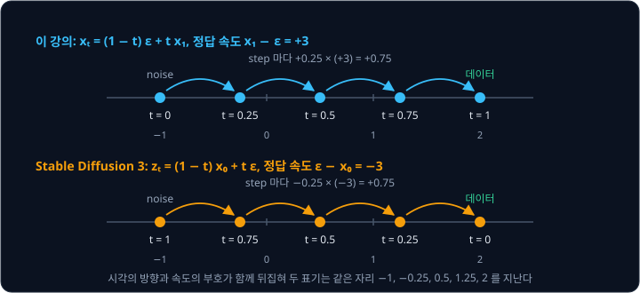
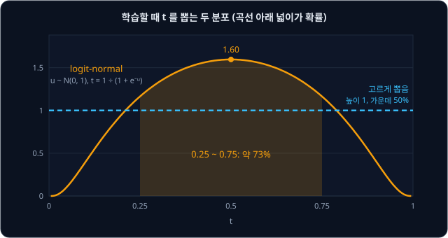

# Flow Matching

Stable Diffusion v1.5 의 U-Net 은 [DDPM](../ddpm/README.md) 처럼 noise 를 1000 단계에 걸쳐 걷어 내도록 학습했지만, 그림을 만들 때
1000 단계를 다 밟으면 너무 오래 걸려서 diffusers 의 pipeline 은 기본으로 50 단계만 밟는다. 학습은 1000 단계로 하고 쓸 때만 계산을 고쳐
단계를 건너뛰는 방식인데, 처음부터 몇 단계 만에 noise 에서 그림까지 가도록 학습할 수는 없을까?

2022 년에 발표된 flow matching 은 noise 와 데이터를 직선으로 잇고 그 직선을 따라 움직이는 속도를 network 가 맞히게 하는 방법이라, 경로가
곧은 만큼 큰 step 몇 번만으로도 데이터에 닿는다. Stability AI 의 Stable Diffusion 3(2024)는 이 방법으로 학습했고, diffusers 의 Stable
Diffusion 3 pipeline 은 기본으로 28 단계만 밟는다.

## 학습 목표

- noise 와 데이터를 잇는 직선 위의 점과 target velocity(데이터 − noise)를 계산하고, network 가 그 속도를 맞히게 하는 conditional flow
  matching loss 를 설명할 수 있다
- Euler 법으로 sample 을 만드는 과정과, 경로가 곧을수록 적은 step 으로도 정확한 이유를 설명할 수 있다
- 정답이 여럿인 데이터에서 step 이 너무 적으면 sample 이 평균으로 몰리는 이유와, flow matching 이 diffusion 보다 적은 step 으로 되는 이유를
  설명할 수 있다
- Stable Diffusion 3 가 flow matching 을 쓰는 방식(시각의 방향, 정답 속도의 부호, 학습할 때 $t$ 를 뽑는 분포)을 설명할 수 있다

## DDPM sampling 의 step 수

DDPM 은 sample(새로 만든 데이터 하나)을 만들 때 표준 정규분포 $\mathcal N(0, 1)$ 에서 뽑은 값에서 출발해 network 가 맞힌 noise 를 한
step 씩 걷어 낸다. step 하나에 network 를 한 번 쓰므로 $T = 1000$ step 이면 network 를 1000 번 쓴다.

DDPM 의 reverse step 식은 한 step 의 변화가 작다는 가정에서 나왔기 때문에 step 을 크게 건너뛰면 맞지 않고, 식 끝에 새 noise 를 더해
값을 일부러 흔들기까지 한다. 아래 그림 왼쪽은 DDPM 강의의 $T = 5$ sampling 계산표에서 0.60 이 2.00 에 닿기까지의 경로인데, step 마다
움직인 양이 제각각이다.

그림 오른쪽처럼 noise $-1$ 과 데이터 2 를 처음부터 직선으로 이어 두면 일정하게 움직이므로, 출발점에서 "속도 3 으로 시간 1 동안 간다" 는
것만 알면 중간을 건너뛰고 $-1 + 3 \times 1 = 2$ 로 한 번에 도착한다. 이 아이디어는 2022 년에 Lipman 등(Flow Matching), Liu 등(rectified
flow), Albergo 와 Vanden-Eijnden(stochastic interpolant)이 거의 같은 시기에 따로 발표했다.

**확인 문제.** network 한 번에 0.02 초가 걸린다. step 1000 번, 100 번, 10 번으로 sample 하나를 만들면 각각 몇 초가 걸릴까?

답 보기

| step 수 | 계산 | 시간 |
| --- | --- | --- |
| 1000 | $1000 \times 0.02$ | 20 초 |
| 100 | $100 \times 0.02$ | 2 초 |
| 10 | $10 \times 0.02$ | 0.2 초 |

걸리는 시간은 network 를 쓰는 횟수에 그대로 비례한다.

## 속도와 velocity field

flow matching 의 network 가 내는 값은 속도인데, 속도는 시간 1 동안 움직이는 거리라서 속도가 일정하면 나중 위치는 처음 위치에 속도 × 지난
시간을 더한 값이다. 이 강의에서 시간 $t$ 는 초가 아니라 출발(0)부터 도착(1)까지 얼마나 왔는지를 나타내는 숫자다.

flow matching 에서는 점의 위치와 시각에 따라 속도가 달라진다. 위치 $x$ 와 시각 $t$ 를 넣으면 그 자리의 속도를 정해 주는 규칙을
**velocity field** 라고 하고 $v(x, t)$ 로 적는다. field 는 물리학에서 공간의 자리마다 값이 하나씩 정해져 있는 것을 가리키는 말이다. 시각
1 에 위치 2 에 닿게 하는 규칙을 예로 들면, 지금 낼 속도는 남은 거리 $2 - x$ 를 남은 시간 $1 - t$ 로 나눈 값이다.

$$
v(x, t) = \frac{2 - x}{1 - t}
$$

velocity field 는 일기예보의 바람 지도가 지역마다 바람의 방향과 세기를 화살표로 그려 두는 것과 같다. 위치가 변하는 비율이 그 자리의 속도와
같다는 조건은 아래처럼 적는다.

$$
\frac{dx}{dt} = v(x, t)
$$

$\frac{dx}{dt}$ 는 "$x$ 가 $t$ 에 따라 변하는 비율" 로 읽는다. 변하는 비율의 규칙만 주고 위치를 구하게 하는 이런 식을 ODE(ordinary
differential equation, 상미분방정식)라고 한다. flow matching 은 network 로 $v$ 를 배우고, 이 ODE 를 $t = 0$ 부터 1 까지 풀어 noise 를
데이터로 옮긴다.

**확인 문제.** 위 규칙 $v(x, t) = (2 - x) \div (1 - t)$ 에서 $x = 0$, $t = 0.5$ 와 $x = 4$, $t = 0$ 의 속도는?

답 보기

$x = 0$, $t = 0.5$ 는 남은 거리 $2 - 0 = 2$ 를 남은 시간 $1 - 0.5 = 0.5$ 로 나눠 4 이고, $x = 4$, $t = 0$ 은 $(2 - 4) \div 1 = -2$ 다.

## 직선 경로와 target velocity

데이터를 $x_1$ 이라 하고 $\mathcal N(0, 1)$ 에서 뽑은 noise 를 $\epsilon$("엡실론")이라 할 때, 둘을 잇는 직선 위에서 시각 $t$ 의 점은
아래와 같다.

$$
x_t = (1 - t)\,\epsilon + t\,x_1
$$

두 계수의 합이 언제나 1 이라서 $t = 0$ 이면 noise 그대로이고
$t = 1$ 이면 데이터 그대로다. 그 사이의 값은 둘을 $1 - t : t$ 로 섞은 값인데, $\epsilon = -1$, $x_1 = 2$ 로 계산하면 아래 표와 같다.

| $t$ | $(1 - t) \times \epsilon$ | $t \times x_1$ | $x_t$ |
| --- | --- | --- | --- |
| 0 | $1 \times (-1) = -1$ | $0 \times 2 = 0$ | $-1$ |
| 0.25 | $0.75 \times (-1) = -0.75$ | $0.25 \times 2 = 0.5$ | $-0.25$ |
| 0.5 | $0.5 \times (-1) = -0.5$ | $0.5 \times 2 = 1$ | 0.5 |
| 1 | $0 \times (-1) = 0$ | $1 \times 2 = 2$ | 2 |

$t$ 가 0.25 늘 때마다 $x_t$ 는 0.75 씩 늘어나므로 속도는 $0.75 \div 0.25 = 3$ 이고, 이 값은 $x_1 - \epsilon = 2 - (-1)$ 과 같다. 괄호를
풀어 $t$ 가 곱해진 항끼리 묶으면 어떤 $\epsilon$, $x_1$ 에서도 그렇다.

$$
x_t = \epsilon - t\,\epsilon + t\,x_1 = \epsilon + t\,(x_1 - \epsilon)
$$

오른쪽은 "처음 위치 + 속도 × 지난 시간" 꼴이라서 처음 위치는 $\epsilon$ 이고 속도는 $x_1 - \epsilon$ 이다. 이 속도에는 $t$ 가 없어서 직선
위 어디서나 같은데, network 가 맞혀야 할 정답이 이 값이고 **target velocity** 라고 부른다.

데이터가 숫자 여러 개를 묶은 vector 이면 noise 도 같은 개수의 숫자를 따로 뽑고 자리마다 같은 계산을 한다. $\epsilon = (0.5, -1)$,
$x_1 = (2, 0)$ 이면 target velocity 는 $(2 - 0.5,\ 0 - (-1)) = (1.5,\ 1)$ 이다. Stable Diffusion v1 의 $64 \times 64 \times 4$ latent 는
숫자가 16,384 개인 vector 지만, 이처럼 자리마다 직선을 따로 그어 계산한다.

**흔한 오해.** DDPM 에서는 $x_0$ 이 원래 데이터였고 아래첨자가 클수록 noise 가 많았으니, 여기서도 $x_0$ 을 데이터로 읽기 쉽다. 이 강의는 Lipman 등의 논문을 따라 noise 를 $x_0 = \epsilon$ 으로 적고 데이터를 $x_1$ 로 적어서, $t$ 가 커질수록 데이터에
가까워진다. [Stable Diffusion 3](#stable-diffusion-3-의-rectified-flow) 의 논문과 diffusers 처럼 $t = 1$ 을 noise 로 두는 자료도 있으므로,
다른 자료를 읽을 때는 어느 쪽이 noise 인지부터 확인한다.

<b>심화: DDPM 의 섞는 식과의 차이</b>

DDPM 도 데이터와 noise 를 섞은 값에서 출발한다. 한 번에 건너뛰는 식 $x_t = \sqrt{\bar\alpha_t}\,x_0 + \sqrt{1 - \bar\alpha_t}\,\epsilon$ 은
원래 값이 남은 몫 $\bar\alpha_t$ 로 두 계수를 정하는데, 두 계수의 제곱의 합이 1 이 되게 섞어 퍼진 정도(분산)를 1 로 지킨다. 예를 들어
$\bar\alpha_t = 0.5$ 이면 두 계수가 모두 $\sqrt{0.5} \approx 0.71$ 이다. flow matching 은 두 계수 $1 - t$ 와 $t$ 의 합이 1 이 되게 섞어서, $t$ 를
바꿔 가며 찍은 점들이 한 직선 위에 놓인다. Lipman 등은 이 경로를 optimal transport(OT) 경로라고 불렀다. 논문의 식은 끝점에 아주 작은 폭 $\sigma_{\min}$ 을 남기는
$x_t = (1 - (1 - \sigma_{\min})\,t)\,\epsilon + t\,x_1$ 인데, $\sigma_{\min} = 0$ 으로 두면 이 강의의 식이 된다.

**확인 문제.** $\epsilon = 1.5$, $x_1 = 2$ 다. target velocity 와 $t = 0.4$ 의 $x_t$ 는?

답 보기

① target velocity 는 $x_1 - \epsilon = 2 - 1.5 = 0.5$ 다.

② $x_{0.4} = \epsilon + t\,(x_1 - \epsilon) = 1.5 + 0.4 \times 0.5 = 1.7$ 이다.

③ 섞는 식으로 구해도 $0.6 \times 1.5 + 0.4 \times 2 = 0.9 + 0.8 = 1.7$ 로 같다.

## conditional flow matching loss

생성할 때는 noise $\epsilon$ 만 있을 뿐 그 noise 가 어느 데이터와 짝인지 모르므로, $x_1 - \epsilon$ 을 직접 계산하지 못하고 network 가
대신 낸다. network 는 지금 위치 $x_t$ 와 시각 $t$ 를 받아 그 자리의 속도 $v_\theta(x_t, t)$ 를 내는데, $\theta$("세타")는 network 의
weight 전체를 가리킨다.

같은 위치라도 시각에 따라 맞는 속도가 달라서 시각 $t$ 도 함께 넣는다. 데이터가 2 하나뿐이어도 위치 0.5 에서 맞는 속도는 $t = 0$ 이면
$1.5 \div 1 = 1.5$ 이고, $t = 0.5$ 이면 $1.5 \div 0.5 = 3$ 이다.

학습 한 step 은 아래 순서다.

1. 데이터에서 $x_1$ 을 하나 꺼내고, $\mathcal N(0, 1)$ 에서 noise $\epsilon$ 을 뽑는다
2. 0 과 1 사이의 어느 값이든 같은 가능성으로 나오게 시각 $t$ 를 뽑는다. 이 분포를 uniform 분포라 하고 $t \sim \mathcal U[0, 1]$ 로 적는다
3. $x_t = (1 - t)\,\epsilon + t\,x_1$ 을 만들어 network 에 $x_t$ 와 $t$ 를 넣는다
4. network 의 출력과 target velocity $x_1 - \epsilon$ 의 차이를 제곱해 loss 를 구하고, gradient descent 로 loss 가 줄어드는 쪽으로 $\theta$
   를 조금 고친다

아래 그림은 $x_1 = 2$, $\epsilon = -1$, $t = 0.5$ 가 뽑히고 학습 도중의 network 가 2.5 를 낸 예다.

$t = 0$ 부터 차례로 걸어갈 필요 없이 섞는 식으로 $x_t$ 를 바로 만들고, 학습하는 동안 $t$ 를 고르게 뽑으므로 network 는 모든 시각의 속도를 배운다.
정답 $x_1 - \epsilon$ 은 쌍 $(\epsilon, x_1)$ 하나를 정해 두어야 계산되는데, Lipman 등은 이렇게 쌍 하나를 조건(condition)으로 둔다는
뜻에서 이 loss 를 **conditional flow matching loss** 라고 불렀다.

DDPM 과 나란히 놓으면 학습하는 순서는 같고 network 가 맞히는 값만 다르다.

| | DDPM | flow matching |
| --- | --- | --- |
| network 가 맞히는 값 | 섞인 noise $\epsilon$ | 직선의 속도 $x_1 - \epsilon$ |
| 시각 입력 | step 번호 (1 ~ 1000 의 정수) | $t$ (0 ~ 1 의 실수) |
| $x_t$ 를 만드는 식 | $\sqrt{\bar\alpha_t}\,x_0 + \sqrt{1 - \bar\alpha_t}\,\epsilon$ | $(1 - t)\,\epsilon + t\,x_1$ |
| $x_1 = 2$, $\epsilon = -1$ 일 때 정답 | $-1$ | 3 |

<b>심화: 여러 예의 평균과 loss 의 식</b>

여러 예를 한꺼번에 학습할 때는 각 예의 loss 를 평균한다. 아래 표의 network 출력은 학습 도중이라고 보고 정한 값이다.

| 예 | $x_1$ | $\epsilon$ | $t$ | $x_t$ | target $x_1 - \epsilon$ | 출력 | loss |
| --- | --- | --- | --- | --- | --- | --- | --- |
| 1 | 2 | $-1$ | 0.5 | $-0.5 + 1 = 0.5$ | 3 | 2.5 | $(3 - 2.5)^2 = 0.25$ |
| 2 | $-2$ | 0.5 | 0.4 | $0.3 - 0.8 = -0.5$ | $-2.5$ | $-1.5$ | $(-2.5 + 1.5)^2 = 1$ |
| 3 | 2 | 1 | 0.25 | $0.75 + 0.5 = 1.25$ | 1 | 1.2 | $(1 - 1.2)^2 = 0.04$ |

세 loss 의 평균은 $(0.25 + 1 + 0.04) \div 3 = 0.43$ 이다. 기호로는 아래처럼 쓴다.

$$
L = \frac{1}{N}\sum_{i=1}^{N} \Big\lVert (x_{1,i} - \epsilon_i) - v_\theta(x_{t_i}, t_i) \Big\rVert^2,
\qquad x_{t_i} = (1 - t_i)\,\epsilon_i + t_i\,x_{1,i}
$$

$N$ 은 예의 개수이고, $\sum$ 은 1 번째부터 $N$ 번째까지 모두 더하라는 기호이며, $\lVert \cdot \rVert^2$ 은 자리마다 제곱해 더한 값이다.
위 표라면 $N = 3$ 이고 $L = 0.43$ 이다. 숫자 2 개짜리 데이터에서 target 이 $(1.5, 1)$ 이고 network 가 $(1.2, 1.4)$ 를 냈다면 loss 는
$(1.5 - 1.2)^2 + (1 - 1.4)^2 = 0.09 + 0.16 = 0.25$ 다.

**확인 문제.** $x_1 = -2$, $\epsilon = 1$, $t = 0.5$ 이고 network 가 $-2$ 를 냈다. 이 예의 loss 는?

답 보기

① target velocity 는 $x_1 - \epsilon = -2 - 1 = -3$ 이다.

② loss 는 $(-3 - (-2))^2 = (-1)^2 = 1$ 이다.

$x_t = 0.5 \times 1 + 0.5 \times (-2) = -0.5$ 는 network 의 입력이고, loss 계산에는 직접 쓰이지 않는다.

## Euler 법

network 가 속도를 내 줘도 속도가 자리마다 바뀌기 때문에 위치를 바로 구할 수는 없다. 그래서 0 부터 1 까지를 $n$ 토막으로 잘라, 한 토막
동안은 속도가 바뀌지 않는다고 보고 직진하기를 되풀이한다. 이 방법을 **Euler 법**이라고 하는데, 18 세기 스위스 수학자 Leonhard Euler 의
이름을 땄다.

$$
x_{\text{next}} = x + \Delta t \times v(x, t), \qquad \Delta t = \frac{1}{n}
$$

$x$ 는 지금 위치, $x_{\text{next}}$ 는 다음 위치다. $\Delta t$("델타 t")는 한 토막의 길이이고, 한 번 직진하는 것을 step 이라 부른다. flow matching 에서는 $v$ 를 network 가 내므로 step 하나에
network 를 한 번 쓴다.

경로가 직선이면 Euler 법은 오차가 없다. 앞의 규칙 $v(x, t) = (2 - x) \div (1 - t)$ 를 따라 $x = -1$ 에서 출발한 점은 속도가 줄곧 3 이라서
$n = 1$ 이어도 $-1 + 1 \times 3 = 2$ 로 정확하다.

속도가 step 도중에 바뀌면 오차가 생긴다. 속도가 시각에 따라 $v = 2t$ 로 커지는 점은 실제로 $x = t^2$ 을 따라 $t = 1$ 에 위치 1 에 닿는다.
Euler 법은 step 을 시작할 때의 속도로 끝까지 직진하므로, 이 점처럼 step 도중에 빨라지면 매번 실제보다 덜 간다.

위 그림에서 Euler 법이 닿는 위치는 $1 - \frac{1}{n}$ 이라서 오차가 정확히 $\frac{1}{n}$ 이다. step 을 잘게 나눌수록 한 step 안에서 속도가 덜 바뀌어 오차가 줄지만, step 마다 network 를 한 번
쓰므로 시간은 그만큼 늘어난다. flow matching 이 경로를 직선으로 정하는 것은 step 을 늘리지 않고도 오차를 줄이기 위해서다.

**흔한 오해.** step 은 많을수록 좋다고 생각하기 쉽지만, 직선 경로에서는 step 1 번과 1000 번의 결과가 같아서 나머지 999 번은 시간만 쓴다.

<b>심화: v = 2t 의 Euler 계산표와 Heun 법</b>

$v = 2t$ 인 점을 0 에서 출발시켜 $n = 4$($\Delta t = 0.25$)로 걸으면 아래와 같다.

| step 시작 시각 $t$ | 그때 속도 $2t$ | 이동 $0.25 \times 2t$ | 새 위치 |
| --- | --- | --- | --- |
| 0 | 0 | 0 | 0 |
| 0.25 | 0.5 | 0.125 | 0.125 |
| 0.5 | 1 | 0.25 | 0.375 |
| 0.75 | 1.5 | 0.375 | 0.75 |

$n = 10$ 이면 이동량의 합이 $0.1 \times 2 \times (0 + 0.1 + \cdots + 0.9) = 0.2 \times 4.5 = 0.9$ 다. 일반적으로 $n$ step 의 결과는
$\frac{2}{n^2}(0 + 1 + \cdots + (n - 1)) = \frac{n - 1}{n} = 1 - \frac{1}{n}$ 이다.

Heun 법은 step 하나에서 속도를 두 번 구해 평균을 낸다. 먼저 Euler 법처럼 한 번 직진해 도착할 자리 $\tilde x$("$x$ 틸데")를 어림하고, 그
자리의 속도를 한 번 더 구한 뒤 두 속도의 평균으로 다시 직진한다. 이름은 독일 수학자 Karl Heun 에서 왔다.

$$
\tilde x = x + \Delta t \times v(x, t), \qquad
x_{\text{next}} = x + \Delta t \times \frac{v(x, t) + v(\tilde x, t + \Delta t)}{2}
$$

$v = 2t$ 를 Heun 법 1 step($\Delta t = 1$)으로 계산하면 출발 속도 0 과 $t = 1$ 의 속도 2 를 평균한 1 로 직진해 $0 + 1 \times 1 = 1$ 에
정확히 닿는다. Heun 법은 step 하나에 network 를 두 번 쓰므로 Euler 법과는 network 를 쓰는 횟수를 맞춰 비교한다. network 를 똑같이 2 번
쓸 때 Euler 2 step 은 0.5 에 닿고 Heun 1 step 은 1 에 닿는다. 속도가 바뀌지 않는 직선 경로에서는 두 속도가 같아서 Heun 법이 얻는 것 없이
network 만 한 번 더 쓴다.

**확인 문제.** $v = 2t$ 인 점을 0 에서 출발시켜 $n = 5$ 로 걸으면 $t = 1$ 의 위치는? 오차는 얼마일까?

답 보기

$\Delta t = 1 \div 5 = 0.2$ 이고, step 시작 시각과 속도는 아래와 같다.

| step 시작 시각 $t$ | 0 | 0.2 | 0.4 | 0.6 | 0.8 |
| --- | --- | --- | --- | --- | --- |
| 속도 $2t$ | 0 | 0.4 | 0.8 | 1.2 | 1.6 |

이동량의 합은 $0.2 \times (0 + 0.4 + 0.8 + 1.2 + 1.6) = 0.2 \times 4 = 0.8$ 이다. 답: 위치 0.8, 오차 $1 - 0.8 = 0.2 = \frac{1}{5}$ 이다.

## 엇갈리는 경로와 marginal velocity field

데이터가 $+2$ 와 $-2$ 반반인 경우를 보자. 데이터의 값이 몰린 곳을 봉우리라고 하는데, 이 데이터는 봉우리가 둘이다. 학습할 때는 noise 와
데이터를 무작위로 짝짓기 때문에 $+2$ 로 가는 직선과 $-2$ 로 가는 직선이 서로 엇갈린다.

쌍 A 가 $\epsilon = -2$ 에서 $x_1 = +2$ 로 가고 쌍 B 가 $\epsilon = 2$ 에서 $x_1 = -2$ 로 가면, 두 직선은 $t = 0.5$ 에서 같은 자리 0 을
지난다. 그런데 target velocity 는 쌍 A 가 $2 - (-2) = 4$ 이고 쌍 B 는 $-2 - 2 = -4$ 다.

network 는 $x_t = 0$, $t = 0.5$ 만 보므로 두 경우에 같은 값 $c$ 를 낸다. 두 쌍이 같은 가능성으로 나온다면 평균 loss 는 아래와 같다.

| 출력 $c$ | 쌍 A 의 loss $(4 - c)^2$ | 쌍 B 의 loss $(-4 - c)^2$ | 평균 |
| --- | --- | --- | --- |
| 4 | 0 | 64 | 32 |
| 2 | 4 | 36 | 20 |
| 0 | 16 | 16 | 16 |
| $-2$ | 36 | 4 | 20 |

평균 loss 를 가장 작게 하는 출력은 두 정답의 평균 0 이고, 그때도 loss 는 16 이라 0 이 되지 않는다. 차이의 제곱으로 학습한 network 는 같은
입력에 정답이 여럿이면 그 평균을 낸다. 일반적으로 network 가 배우는 속도는 그 자리를 지나는 쌍들의 target velocity 를 가능성으로 무게를
두어 평균한 값이고, 식으로 쓰면 아래와 같다.

$$
v(x_t, t) = \frac{\hat x_1 - x_t}{1 - t}
$$

$\hat x_1$("$x_1$ 햇")은 지금 자리를 지나는 쌍들의 데이터 $x_1$ 을 가능성으로 무게를 두어 평균한 값인데, 모자 기호는 추정한 값이라는
표시다. $t = 0$ 에서는 짝이 $+2$ 이든 $-2$ 이든 $x_0 = \epsilon$ 을 똑같이 $\mathcal N(0, 1)$ 에서 뽑으므로 가능성이 반반이고,
$\hat x_1 = 0.5 \times 2 + 0.5 \times (-2) = 0$ 이라 $v(x, 0) = -x$ 다. 처음에는 모든 점이 두 데이터의 평균 0 을 향하고, $t$ 가 커져
어느 데이터로 갈지 드러나면 $\hat x_1$ 이 $+2$ 나 $-2$ 쪽으로 기운다.

위 그림의 파란 선은 network 가 배운 속도를 따라 아주 잘게 걸은 경로다. 한 자리에서 network 가 내는 속도는 하나뿐이라서, 두 경로가 같은
자리에 오면 그 뒤로는 같은 길을 간다. 그래서 학습된 경로끼리는 엇갈리지 않는다.

쌍 하나의 조건을 이렇게 평균해 없앤 field 를 **marginal velocity field** 라고 한다. marginal 은 표의 가장자리(margin)에 행이나 열의
합을 적던 데서 온 확률 용어다. Lipman 등은 conditional flow matching loss 로 학습한 network 가 이 field 를 배우고, 이 field 를 따라가면
$\mathcal N(0, 1)$ 의 분포가 데이터의 분포로 정확히 옮겨진다는 것을 보였다. 그래서 network 가 쌍을 몰라도 데이터를 만들 수 있고, 위
그림에서 양수 noise 는 $+2$ 로 가고 음수 noise 는 $-2$ 로 가서 sample 이 반반으로 나뉜다.

**흔한 오해.** 학습의 정답이 직선이니 생성 경로도 직선이라고 생각하기 쉽다. 데이터가 하나뿐이면 그렇지만, 데이터가 여럿이면 직선들이
엇갈리는 자리에서 network 가 평균을 내므로 생성 경로는 휜다. flow matching 의 경로가 DDPM 보다 곧은 것은 맞지만 완전한 직선은 아니다.

<b>심화: 남은 거리 ÷ 남은 시간과 가능성의 계산</b>

섞는 식을 $\epsilon$ 에 대해 풀면 $\epsilon = (x_t - t\,x_1) \div (1 - t)$ 이고, 이것을 target velocity 에 넣으면 아래와 같다.

$$
x_1 - \epsilon = x_1 - \frac{x_t - t\,x_1}{1 - t} = \frac{(1 - t)\,x_1 - x_t + t\,x_1}{1 - t} = \frac{x_1 - x_t}{1 - t}
$$

target velocity 는 데이터까지 남은 거리 $x_1 - x_t$ 를 남은 시간 $1 - t$ 로 나눈 값이다. 남은 시간은 그 자리를 지나는 모든 쌍에 같으므로,
$x_1$ 을 먼저 평균해 $\hat x_1$ 로 바꾼 뒤 나눠도 결과가 같다. 앞의 velocity field 예 $(2 - x) \div (1 - t)$ 는 데이터가 2 하나뿐일 때의 답이었다.

$t = 0.5$, $x_t = 0.25$ 에서 $+2$ 쪽 가능성은 아래처럼 구한다. $x_1 = +2$ 인 쌍의 $x_{0.5} = 0.5\,\epsilon + 1$ 은 1 을 가운데로 표준편차
0.5 만큼 퍼져 있고, $x_1 = -2$ 인 쌍은 $-1$ 을 가운데로 표준편차 0.5 만큼 퍼져 있다. 0.25 는 1 에서 표준편차 1.5 개만큼 떨어져 있고 $-1$
에서는 2.5 개만큼 떨어져 있어서, 두 종 모양 곡선의 높이는 각각 0.26 과 0.035 다. 데이터가 반반이므로 가능성은 높이의 비와 같고, 합이 1 이
되게 나누면 $0.26 \div 0.295 \approx 0.88$ 과 $0.035 \div 0.295 \approx 0.12$ 다.

| $t$ | $x_t$ | $+2$ 쪽 가능성 | $\hat x_1$ | $v = (\hat x_1 - x_t) \div (1 - t)$ |
| --- | --- | --- | --- | --- |
| 0 | 0.5 | 0.50 | 0 | $(0 - 0.5) \div 1 = -0.5$ |
| 0 | $-1.2$ | 0.50 | 0 | $(0 + 1.2) \div 1 = 1.2$ |
| 0.5 | 0 | 0.50 | 0 | $0 \div 0.5 = 0$ |
| 0.5 | 0.25 | 0.88 | $0.88 \times 2 + 0.12 \times (-2) = 1.52$ | $1.27 \div 0.5 = 2.54$ |
| 0.5 | 1 | 1.00 | 2.00 | $1 \div 0.5 = 2$ |

**확인 문제.** 같은 자리를 지나는 쌍이 셋이고 target velocity 가 각각 4, 4, $-4$ 다. 세 쌍이 같은 가능성으로 나온다면 network 는 어떤
값을 배울까?

답 보기

loss 를 가장 작게 하는 출력은 세 정답의 평균이다.

$$
(4 + 4 - 4) \div 3 = 4 \div 3 \approx 1.33
$$

$+2$ 로 가는 쌍이 더 많아서 평균이 양수 쪽으로 기운다.

## step 수와 sample 품질

학습을 마친 network 로 sample 을 만들 때는 $\mathcal N(0, 1)$ 에서 뽑은 $\epsilon$ 을 $x$ 로 두고, $t = 0$ 부터
$x \leftarrow x + \Delta t \times v_\theta(x, t)$ 를 $n$ 번 되풀이한다. 화살표 $\leftarrow$ 는 오른쪽 값으로 바꾼다는 뜻이다. 아래 계산에서는
데이터가 $+2$, $-2$ 반반이고 network 가 앞 절의 평균 속도를 정확히 낸다고 둔다. $\epsilon = 0.5$ 에서 출발한 실제 경로는 $+2$ 에 닿지만,
Euler 법으로 만든 sample 은 아래 그림처럼 step 수에 따라 달라진다.

마지막 step 은 남은 시간 $1 - t$ 를 한 번에 가므로 $x + (1 - t) \times \frac{\hat x_1 - x}{1 - t} = \hat x_1$ 이 되어, 결과가 언제나 그 step
이 시작하는 자리의 $\hat x_1$ 과 같다. $n = 2$ 의 마지막 step 은 $t = 0.5$ 에서 시작하므로, 아직 $+2$ 쪽으로 다 기울지 않은
$\hat x_1 = 1.52$ 가 그대로 sample 이 된다. $n = 1$ 이면 마지막 step 이 $t = 0$ 에서 시작하고 $t = 0$ 의 $\hat x_1$ 은 두 데이터의 평균
0 이라서, 출발점과 상관없이 sample 이 모두 0 이다. Liu 등도 rectified flow 를 Euler step 한 번으로 풀면 데이터 분포의 평균이 나온다고 적었다.

0 은 데이터 어디에도 없는 값이다. [VAE](../vae/README.md) 의 colorization 예처럼 빨간 사과($+1$)와 초록 사과($-1$)가 반반인 데이터라면
1 step 으로 칠한 사과는 두 색의 평균인 회색이 된다. 정답 분포에 봉우리가 여럿인 이런 데이터를 multimodal 이라고 한다.

위 그림은 noise 20000 개로 같은 계산을 해서, 봉우리 $\pm 2$ 에서 0.3 넘게 벗어난 sample 의 비율을 step 수마다 센 결과다. 2 step 에서
벗어난 sample 은 0 근처의 noise 에서 나오는데, 이런 noise 는 $t = 0.5$ 에서도 두 봉우리의 가능성이 비슷해서 $\hat x_1$ 이 $\pm 2$ 에
못 미친다.

경로가 휘는 곳은 어느 데이터로 갈지 정하는 짧은 구간뿐이다. $n = 10$ 으로 걸으면 $t = 0.6$ 부터 $\hat x_1 = 2$ 로 정해지고, 그 뒤로는
2 를 향한 직선이라 속도가 2.61 로 바뀌지 않는다. 곧은 구간에서는 step 을 크게 잡아도 오차가 없어서, 휘는 구간만 몇 step 으로 따라가면 된다.

**흔한 오해.** 경로가 직선이니 1 step 이면 된다고 생각하기 쉽지만, 1 step 으로 되는 것은 데이터의 봉우리가 하나일 때뿐이다.

<b>심화: ε = 0.5 의 Euler 계산표</b>

표의 값은 반올림하지 않은 값으로 계산하고 소수 셋째 자리에서 반올림해 적었다. $n = 2$($\Delta t = 0.5$)는 아래와 같다.

| step | $t$ | $x$ | $+2$ 쪽 가능성 | $\hat x_1$ | $v = (\hat x_1 - x) \div (1 - t)$ | 새 $x$ |
| --- | --- | --- | --- | --- | --- | --- |
| 1 | 0 | 0.50 | 0.50 | 0 | $-0.50$ | 0.25 |
| 2 | 0.5 | 0.25 | 0.88 | 1.52 | 2.54 | 1.52 |

$n = 4$($\Delta t = 0.25$)는 마지막 step 이 시작하는 $t = 0.75$ 에서 $+2$ 쪽 가능성이 1.00 이라 sample 이 2.00 이 된다.

| step | $t$ | $x$ | $+2$ 쪽 가능성 | $\hat x_1$ | $v$ | 새 $x$ |
| --- | --- | --- | --- | --- | --- | --- |
| 1 | 0 | 0.50 | 0.50 | 0 | $-0.50$ | 0.38 |
| 2 | 0.25 | 0.38 | 0.66 | 0.64 | $0.27 \div 0.75 = 0.36$ | 0.46 |
| 3 | 0.5 | 0.46 | 0.98 | 1.90 | $1.44 \div 0.5 = 2.88$ | 1.18 |
| 4 | 0.75 | 1.18 | 1.00 | 2.00 | $0.82 \div 0.25 = 3.26$ | 2.00 |

$n = 10$($\Delta t = 0.1$)은 아래와 같다.

| $t$ | 0 | 0.1 | 0.2 | 0.3 | 0.4 | 0.5 | 0.6 | 0.7 | 0.8 | 0.9 |
| --- | --- | --- | --- | --- | --- | --- | --- | --- | --- | --- |
| $x$ | 0.50 | 0.45 | 0.42 | 0.44 | 0.51 | 0.70 | 0.96 | 1.22 | 1.48 | 1.74 |
| $\hat x_1$ | 0 | 0.22 | 0.52 | 0.98 | 1.63 | 1.99 | 2.00 | 2.00 | 2.00 | 2.00 |
| $v$ | $-0.50$ | $-0.25$ | 0.12 | 0.77 | 1.86 | 2.57 | 2.61 | 2.61 | 2.61 | 2.61 |

마지막 step 뒤의 값은 $1.74 + 0.1 \times 2.61 = 2.00$ 이다. $\epsilon = -1.2$ 에서 $n = 2$ 로 걸으면 $t = 0$ 의 속도 1.2 로
$-1.2 + 0.5 \times 1.2 = -0.6$ 에 가고, $t = 0.5$ 에서 $-2$ 쪽 가능성이 0.99 라서 $\hat x_1 \approx -1.97$ 이 그대로 sample 이 된다. 0 에서
멀리 출발한 noise 라서 $t = 0.5$ 에 이미 어느 쪽으로 갈지 거의 정해졌다.

**확인 문제.** $n = 2$ 로 걸었더니 $t = 0.5$ 에서 $x = 0.5$ 였고, 그 자리의 $+2$ 쪽 가능성이 0.98 이다. 둘째 step 의 속도와 sample 은?

답 보기

① $\hat x_1 = 0.98 \times 2 + 0.02 \times (-2) = 1.96 - 0.04 = 1.92$ 다.

② 속도는 $(\hat x_1 - x) \div (1 - t) = (1.92 - 0.5) \div 0.5 = 2.84$ 다.

③ sample 은 $0.5 + 0.5 \times 2.84 = 1.92$ 다.

답: 속도 2.84, sample 1.92 다. 마지막 step 이라 $\hat x_1$ 과 같다.

## diffusion 과의 비교

DDPM 의 reverse step 은 끝에 새 noise 를 더해서, 같은 $x_t$ 에서 출발해도 경로가 step 마다 무작위로 흔들린다. flow matching 의 Euler step 은
속도대로 직진하는 계산이라 DDPM 처럼 작은 step 을 가정하지 않고, 새 noise 도 더하지 않아서 출발점이 정해지면 경로가 하나로 정해진다.

$+2$, $-2$ 반반 데이터에서 두 방법 모두 network 대신 정확한 답(가능성을 무게로 둔 평균)을 쓰게 하고, DDPM 은 $T = 1000$ 의 linear
schedule 에서 step $n$ 개를 같은 간격으로 골라 건너뛰게 한다. 이 조건으로 noise 20000 개를 옮겨 계산하면 봉우리에서 0.3 넘게 벗어난 sample
의 비율은 아래와 같다.

| step 수 $n$ | 1 | 2 | 4 | 10 |
| --- | --- | --- | --- | --- |
| flow matching (Euler) | 100% | 47% | 1% | 0% |
| DDPM (step 을 건너뛴 reverse) | 100% | 97% | 29% | 약 0.2% |

1 step 은 둘 다 평균을 내서 실패하고 10 step 이면 둘 다 거의 맞지만, 4 step 에서는 차이가 크다. 이미지에서도 경향은 같다. Lipman 등이 같은
U-Net 을 CIFAR-10 으로 학습하고 오차 허용치에 맞춰 step 크기를 스스로 조절하는 ODE solver 로 sample 을 만들었을 때, network 를 쓴 평균
횟수는 DDPM loss 로 학습한 모델이 274 번이고 직선(OT) 경로의 flow matching 이 142 번이었다. step 수를 고정한 ImageNet 32×32 실험에서도
flow matching 은 같은 오차에 닿는 데 network 를 diffusion 경로 모델의 약 60% 만큼만 썼다.

**흔한 오해.** flow matching 이 적은 step 으로 되는 것은 network 가 속도를 더 잘 맞혀서라고 생각하기 쉽다. 위 1 차원 비교는 두 방법 모두
정확한 답을 쓰게 해서 network 의 차이가 없는데도 결과가 갈렸으므로, 차이는 경로의 모양과 그 경로를 따라가는 계산 방식에서 난다.

<b>심화: reflow</b>

Liu 등은 경로를 더 곧게 펴려고, 학습을 마친 모델로 noise $\epsilon$ 에서 sample $x_1'$ 을 만든 뒤 무작위 짝 대신 이 $(\epsilon, x_1')$ 쌍으로
같은 loss 를 한 번 더 학습했다. 이 과정을 **reflow** 라고 하고, rectify 는 곧게 편다는 뜻이다. 위 데이터에서 학습된 경로는 양수 noise 를
$+2$ 로 보내고 음수 noise 를 $-2$ 로 보냈으므로 이 짝으로 다시 그은 직선은 엇갈리지 않는다. $\epsilon = 0.5$ 는 $+2$ 와 짝이 되어 target
velocity 가 $2 - 0.5 = 1.5$ 다. 이 자리를 지나는 다른 직선이 없으니 network 는 1.5 를 그대로 배우고, 1 step 으로 $0.5 + 1 \times 1.5 = 2$
에 닿는다.

이 1 차원 예는 reflow 한 번으로 엇갈림이 모두 사라지는 쉬운 경우다. 실제 데이터에서는 reflow 를 해도 완전한 직선이 되지 않지만, 더
곧아지는 만큼 적은 step 으로 sampling 할 수 있다. Liu 등은 한 번 reflow 한 모델이 Euler step 한 번으로도 쓸 만한 이미지를 만든다고
보고했다.

**확인 문제.** 같은 noise $\epsilon = 0.5$ 에서 flow matching 으로 10 step sampling 을 두 번 하면 두 sample 은 같을까? DDPM 이라면?

답 보기

flow matching 은 새 noise 를 더하지 않아 두 번 모두 같은 경로로 가서 같은 값(이 강의의 데이터라면 2.00)이 나온다. DDPM 은 reverse step
마다 새 noise 를 뽑으므로 같은 출발점에서도 경로와 sample 이 달라질 수 있다.

## Stable Diffusion 3 의 rectified flow

Stability AI 의 Esser 등이 2024 년에 발표한 Stable Diffusion 3(이하 SD3)는 [Latent Diffusion](../latent-diffusion/README.md) 처럼 autoencoder 로
줄인 latent 위에서 그림을 만들되, DDPM 대신 flow matching 으로 학습했다. 저자들은 직선 경로를 쓰는 이 방식을 rectified flow 라고 부르고, 속도를
내는 network 로는 [ViT](../vit/README.md) 에서 본 DiT 를 고친 Transformer 를 쓴다.

이 논문과 diffusers 의 구현은 시각의 방향이 이 강의와 반대라서, $t = 0$ 이 데이터이고 $t = 1$ 이 noise 다. 이 표기에서는 데이터를 $x_0$ 로 적고 섞은 점을
$z_t$ 로 적는다. 두 표기를 나란히 놓으면 아래와 같다.

| 항목 | 이 강의 | Stable Diffusion 3 논문·diffusers |
| --- | --- | --- |
| noise 의 자리 | $t = 0$ | $t = 1$ |
| 데이터의 자리 | $t = 1$ ($x_1$) | $t = 0$ ($x_0$) |
| 섞는 식 | $x_t = (1 - t)\,\epsilon + t\,x_1$ | $z_t = (1 - t)\,x_0 + t\,\epsilon$ |
| 정답 속도 | $x_1 - \epsilon$ | $\epsilon - x_0$ |
| sampling 의 시각 | 0 에서 1 로, step 길이 $+\frac{1}{n}$ | 1 에서 0 으로, step 길이 $-\frac{1}{n}$ |

섞는 식에서 $z_t$ 는 $t$ 가 늘어난 양의 $\epsilon - x_0$ 배만큼 변하므로, 이 표기에서는 그 값이 정답 속도다. diffusers 의 SD3 학습 예제도
섞은 점을 `(1.0 - sigmas) * model_input + sigmas * noise` 로 만들고 정답을 `noise - model_input` 으로 둔다. sampling 을 맡는
`FlowMatchEulerDiscreteScheduler` 는 시각을 1 에서 0 으로 줄여 가며, 음수인 step 길이 `dt = sigma_next - sigma` 를 network 의 출력에 곱해
더한다.

[직선 경로와 target velocity](#직선-경로와-target-velocity) 의 예 $\epsilon = -1$, 데이터 2 를 이 표기로 4 step 걸어 보자. 정답 속도는
$\epsilon - x_0 = -1 - 2 = -3$ 이고 step 길이는 $-0.25$ 라서, step 마다 $-0.25 \times (-3) = 0.75$ 씩 움직인다.

| SD3 의 시각 $t$ | 1 | 0.75 | 0.5 | 0.25 | 0 |
| --- | --- | --- | --- | --- | --- |
| $z_t$ | $-1$ | $-0.25$ | 0.5 | 1.25 | 2 |
| 이 강의의 시각 | 0 | 0.25 | 0.5 | 0.75 | 1 |

시각의 방향과 속도의 부호가 함께 뒤집혀서, 두 표기는 같은 자리를 같은 순서로 지나 데이터 2 에 닿는다.

**흔한 오해.** 정답 속도를 "데이터 − noise" 로 외워 두면 SD3 의 섞는 식에도 그대로 쓰기 쉽다. 섞는 식과 sampling 의 방향을 SD3 표기로 둔 채
정답만 $x_0 - \epsilon$ 으로 학습하면, 음수 step 길이를 곱할 때 데이터에서 멀어지는 쪽으로 움직인다. 정답 속도의 부호는 외우지 말고, 섞는
식에서 $t$ 가 늘 때 섞은 점이 변하는 양으로 구한다.

**확인 문제.** SD3 표기로 데이터 $x_0 = 0.5$, noise $\epsilon = 1.5$ 다. 정답을 $\epsilon - x_0$ 으로 학습한 network 와, 부호를 잘못 써서
$x_0 - \epsilon$ 으로 학습한 network 로 각각 $t = 1$ 에서 4 step 을 밟으면 어디에 닿을까? network 는 학습한 정답을 그대로 낸다고 하자.

답 보기

| 정답 속도 | 속도 | step 마다 $-0.25 \times$ 속도 | 4 step 뒤 |
| --- | --- | --- | --- |
| $\epsilon - x_0$ | $1.5 - 0.5 = 1$ | $-0.25$ | $1.5 + 4 \times (-0.25) = 0.5$ |
| $x_0 - \epsilon$ | $0.5 - 1.5 = -1$ | $0.25$ | $1.5 + 4 \times 0.25 = 2.5$ |

답: $\epsilon - x_0$ 은 데이터 0.5 에 닿고, $x_0 - \epsilon$ 은 2.5 에 닿아 데이터에서 멀어진다.

## 학습할 때 t 를 뽑는 분포

이 강의의 학습 순서는 $t$ 를 0 과 1 사이에서 고르게 뽑았다. SD3 저자들은 양 끝보다 가운데의 $t$ 를 더 자주 뽑았다. 논문의 설명에 따르면 양
끝에서는 network 가 낼 가장 좋은 답이 noise 나 데이터 한쪽 분포의 평균으로 정해지지만, 가운데에서는 그렇지 않아 속도를 맞히기가 더 어렵다.
이 강의의 1 차원 예에서도 noise 쪽 끝 $t = 0$ 의 $\hat x_1$ 은 두 데이터의 평균 0 이었다. 그래서 저자들은 network 가 가운데 자리를 더 자주 연습하게 했다.

뽑는 방법은 $\mathcal N(0, 1)$ 에서 $u$ 를 뽑아 $t = \frac{1}{1 + e^{-u}}$ 로 바꾸는 것이다. 이 함수(logistic sigmoid)는 어떤 $u$ 든 0 과
1 사이의 값으로 바꾸고, $u = 0$ 을 0.5 로 보낸다. 이렇게 만든 $t$ 의 분포를 **logit-normal** 분포라고 한다.

| 뽑은 $u$ | $-2$ | $-1$ | 0 | 1 | 2 |
| --- | --- | --- | --- | --- | --- |
| $t = 1 \div (1 + e^{-u})$ | 0.119 | 0.269 | 0.5 | 0.731 | 0.881 |

$u$ 는 0 근처가 가장 자주 나오므로 $t$ 는 0.5 근처가 가장 자주 나온다. 직접 계산하면 $t$ 가 0.25 ~ 0.75 에 들어갈 확률은 고르게 뽑을 때
50% 이고 이 분포에서는 약 73% 다. $t$ 가 0.1 보다 작을 확률은 고르게 뽑을 때 10% 이고 이 분포에서는 약 1.4% 다.

저자들은 $t$ 의 분포와 섞는 식을 바꾼 61 가지 학습 방식을 같은 조건에서 비교했다. 이 logit-normal 분포($u$ 의 평균 0, 표준편차 1)로 학습한
rectified flow 가 여러 지표에서 꾸준히 좋았고, rectified flow 방식들은 다른 방식보다 sampling step 을 줄일 때 품질이 덜 떨어졌다. diffusers 의
SD3 학습 예제도 기본값이 `weighting_scheme: logit_normal`, `logit_mean: 0.0`, `logit_std: 1.0` 이다.

생성할 때 diffusers 의 Stable Diffusion 3 pipeline 은 `num_inference_steps` 의 기본값이 28 이라, 기본값이 50 인 Stable Diffusion v1.5 의
pipeline 보다 network 를 적게 쓴다. [step 수와 sample 품질](#step-수와-sample-품질) 에서 본 것처럼 경로는 대부분 곧고 휘는 구간이 짧아서, 그 구간만 몇 step 으로
따라가면 된다. 다만 1 차원 예에서처럼 1 step 은 데이터의 평균을 내므로, step 수를 1 까지 줄일 수는 없다.

**확인 문제.** logit-normal 분포로 $t$ 를 뽑으려고 $\mathcal N(0, 1)$ 에서 $u = 1$ 과 $u = -1$ 을 뽑았다. 두 $t$ 는 각각 얼마이고, 둘의 합은?

답 보기

① $u = 1$ 이면 $t = 1 \div (1 + e^{-1}) = 1 \div (1 + 0.368) \approx 0.731$ 이다.

② $u = -1$ 이면 $t = 1 \div (1 + e^{1}) = 1 \div (1 + 2.718) \approx 0.269$ 다.

답: 0.731 과 0.269 이고 합은 1 이다. $u$ 의 부호를 바꾸면 $t$ 는 0.5 를 가운데 두고 반대쪽으로 같은 거리만큼 간다.

## 정리

- flow matching 은 noise $\epsilon$ 과 데이터 $x_1$ 을 직선 $x_t = (1 - t)\,\epsilon + t\,x_1$ 로 잇고, 그 위의 속도 $x_1 - \epsilon$ 을
  network 가 맞히게 학습한다. $\epsilon = -1$, $x_1 = 2$ 이면 target velocity 는 3 이다. 생성할 때는 Euler 법으로 $x + \Delta t \times v$ 를
  $n$ 번 되풀이한다
- 데이터가 여럿이면 직선들이 엇갈리는 자리에서 network 가 정답 속도의 평균을 배워 생성 경로가 휘고, 1 step 은 데이터의 평균을 낸다.
  $\pm 2$ 데이터로 계산하면 봉우리를 벗어난 sample 의 비율이 step 1·2·4·10 에서 각각 100%·47%·1%·0% 였고, 같은 조건의 DDPM 은 4 step 에서
  29% 였다
- Stable Diffusion 3 는 latent 위에서 rectified flow 로 학습한다. 논문과 diffusers 는 $t = 1$ 을 noise 로 두어 섞는 식이
  $z_t = (1 - t)\,x_0 + t\,\epsilon$ 이고 정답 속도가 $\epsilon - x_0$ 이며, sampling 은 음수 step 길이로 1 에서 0 으로 간다. 방향과 부호가
  함께 뒤집혀 이 강의와 같은 경로를 지난다
- SD3 는 학습할 때 $u \sim \mathcal N(0, 1)$ 을 $t = 1 \div (1 + e^{-u})$ 로 바꾼 logit-normal 분포로 $t$ 를 뽑아 0.25 ~ 0.75 를 약 73% 의
  확률로 연습하고, diffusers pipeline 은 기본으로 28 step 을 밟는다

이 강의의 flow matching 은 숫자 하나나 몇 개를 조건 없이 만들었을 뿐, 글에 맞는 그림을 내지는 않았다. 그림을 latent 로 줄여 그 위에서
생성하는 방법은 [Latent Diffusion](../latent-diffusion/README.md) 에서, 글을 조건으로 넣는 방법은
[Cross-Attention](../cross-attention/README.md) 에서 다룬다.

## 참고 자료

- Yaron Lipman 등, [Flow Matching for Generative Modeling](https://arxiv.org/abs/2210.02747) (2022) — 쌍 하나를 조건으로 정한 경로의 loss 로
  marginal velocity field 를 배우는 원리(3 절, 정리 1·2)와 DDPM 과의 network 사용 횟수 비교(6 절 표 1, 그림 7)
- Xingchao Liu, Chengyue Gong, Qiang Liu, [Flow Straight and Fast](https://arxiv.org/abs/2209.03003) (2022) — 직선 경로의 rectified flow 와,
  모델이 만든 짝으로 다시 학습하는 reflow
- Michael S. Albergo, Eric Vanden-Eijnden, [Building Normalizing Flows with Stochastic Interpolants](https://arxiv.org/abs/2209.15571)
  (2022) — 같은 시기에 noise 와 데이터를 섞는 식(interpolant)의 관점에서 같은 아이디어를 정리한 논문
- Yaron Lipman 등, [Flow Matching Guide and Code](https://arxiv.org/abs/2412.06264) (2024) — 표기와 관례를 한데 정리한 긴 tutorial
- Peter Holderrieth, Ezra Erives, [An Introduction to Flow Matching and Diffusion Models](https://arxiv.org/abs/2506.02070) — MIT 강의
  [노트](https://diffusion.csail.mit.edu/). 3 장이 conditional·marginal vector field 와 flow matching loss 를 차례로 설명한다
- Cambridge MLG, [An introduction to Flow Matching](https://mlg.eng.cam.ac.uk/blog/2024/01/20/flow-matching.html) — 쌍마다 정한 속도와 그
  평균인 velocity field 의 관계를 그림으로 설명한 블로그
- Patrick Esser 등, [Scaling Rectified Flow Transformers for High-Resolution Image Synthesis](https://arxiv.org/abs/2403.03206) (2024) —
  Stable Diffusion 3 논문. 3 절의 섞는 식 (13), 3.1 절의 logit-normal 분포와 가운데 $t$ 를 강조하는 이유, 5.1 절의 61 가지 학습 방식 비교
- diffusers, [`scheduling_flow_match_euler_discrete.py`](https://github.com/huggingface/diffusers/blob/main/src/diffusers/schedulers/scheduling_flow_match_euler_discrete.py)
  와 [`pipeline_stable_diffusion_3.py`](https://github.com/huggingface/diffusers/blob/main/src/diffusers/pipelines/stable_diffusion_3/pipeline_stable_diffusion_3.py)
  — 음수 step 길이 `dt = sigma_next - sigma` 로 더하는 Euler step 과 `num_inference_steps = 28`
- diffusers, [`train_dreambooth_sd3.py`](https://github.com/huggingface/diffusers/blob/main/examples/dreambooth/train_dreambooth_sd3.py) 와
  [`training_utils.py`](https://github.com/huggingface/diffusers/blob/main/src/diffusers/training_utils.py) — SD3 학습의 섞는 식과 정답
  `noise - model_input`, logit-normal 로 $t$ 를 뽑는 `compute_density_for_timestep_sampling`
