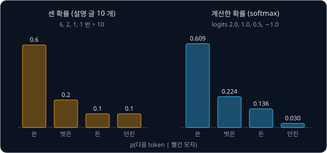
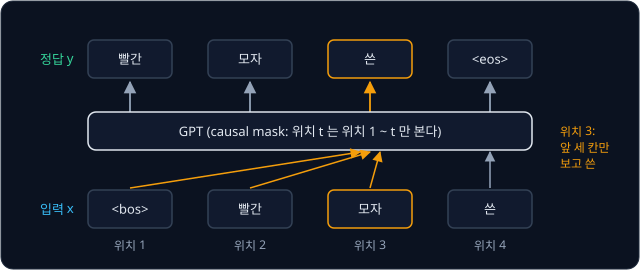
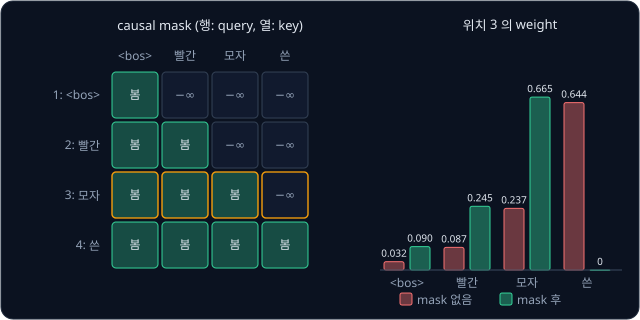
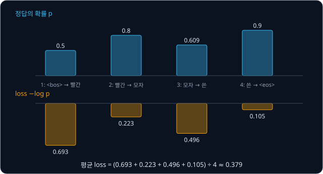
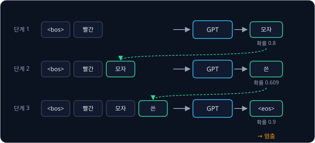
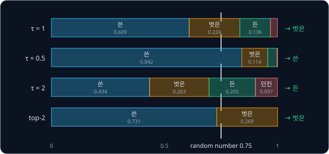
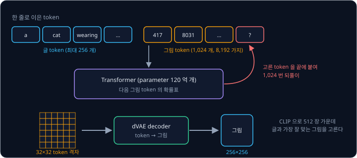

# GPT-2

글을 받아 그림을 그리는 DALL·E 에서 그림을 그리는 부분은 language model 과 같은 Transformer 다. language model 은 글을 읽으며 바로
다음에 올 조각 하나를 맞히는 연습만 한다. 다음 조각 하나를 맞힐 줄 아는 모델이 어떻게 긴 글을 쓰고 그림까지 그리게 될까?

2019 년 OpenAI 가 발표한 GPT-2 는 Transformer 의 decoder 만 쌓은 모델로, 웹 문서 약 800 만 개(40 GB)에서 다음 token 맞히기만 배웠다.
글을 쓸 때는 맞힌 token 을 입력 끝에 붙여 다시 맞히기를 되풀이하는데, DALL·E 도 같은 방식으로 그림 한 장을 그림 token 1,024 개로 하나씩
생성한다.

## 학습 목표

- 다음 token 맞히기를 사람이 정답을 달지 않은 text 로 학습할 수 있는 이유와, 위치마다 cross-entropy loss 를 구하는 방법을 설명할 수 있다
- decoder-only 구조를 설명하고, causal mask 를 쓰면 forward 한 번에 위치 수만큼의 문제를 풀 수 있는 이유를 설명할 수 있다
- greedy decoding·temperature·top-k 가 같은 확률표에서 token 을 고르는 방식을 숫자로 비교할 수 있다
- GPT-2 의 크기와 scaling 경향, DALL·E 가 같은 다음 token 생성으로 그림 token 을 내는 방식을 설명할 수 있다

## 다음 token 의 확률표

[BPE Tokenizer](../tokenizer/README.md) 에서 본 tokenizer 는 text 를 token 이라는 조각으로 자르고, token 마다 vocabulary(쓸 수 있는 token 을
모두 모아 번호를 붙인 목록) 안의 번호를 붙인다. 이 강의에서는 계산을 쉽게 하려고 단어 하나를 token 하나로 자른다.

그림 설명 글(caption) 10 개가 모두 "빨간 모자" 로 시작하고, 그 뒤에 온 token 을 세어 보니 아래와 같았다고 하자.

| "빨간 모자" 다음 token | 나온 횟수 | 비율 |
| --- | --- | --- |
| 쓴 | 6 | $6 \div 10 = 0.6$ |
| 벗은 | 2 | $2 \div 10 = 0.2$ |
| 든 | 1 | $1 \div 10 = 0.1$ |
| 던진 | 1 | $1 \div 10 = 0.1$ |

비율이 모두 0 과 1 사이이고 더하면 1 이라서 확률로 쓸 수 있다. "쓴" 의 비율은 $p(\text{쓴} \mid \text{빨간 모자}) = 0.6$ 으로 적고 "앞에
'빨간 모자' 가 주어졌을 때 다음 token 이 '쓴' 일 확률은 0.6" 이라고 읽는데, 세로 막대 $\mid$ 가 " ~ 가 주어졌을 때" 를 뜻한다. 앞에 나온
token 들을 받아 vocabulary 의 token 마다 다음에 올 확률을 매기는 모델을 **language model** 이라고 하는데, GPT-2 나 LLM(large language model,
아주 많은 text 로 학습한 큰 language model)이 내는 것도 이런 확률표 한 장이다.

앞부분마다 횟수를 세어 두는 방법은 실제 글에 쓸 수 없다. GPT-2 의 vocabulary 에는 token 이 50,257 개 있어서 token 두 개짜리 앞부분만 해도
$50{,}257 \times 50{,}257 \approx 25$ 억 가지이고, 실제 글의 앞부분은 수백 token 이라 같은 앞부분이 데이터에 두 번 나오는 일이 드물다.
그래서 확률표는 세어서 저장하지 않고 neural network 로 그때그때 계산한다. network 는 앞부분을 받아 vocabulary 의 token 마다 점수 하나를 내는데,
이 점수를 **logit** 이라고 한다. 점수마다 $e^{z}$ 를 구해 그 합으로 나누는 softmax 가 logit 을 확률로 바꾼다.

아래 logit 은 설명을 위해 정한 값이고, 나머지 token 은 빼고 네 후보만으로 계산한다. 이 logit 네 개는 뒤의 학습과 생성 절에서도 쓴다.

| 후보 token | logit $z$ | $e^{z}$ | $e^{z} \div 12.124$ |
| --- | --- | --- | --- |
| 쓴 | 2.0 | 7.389 | 0.609 |
| 벗은 | 1.0 | 2.718 | 0.224 |
| 든 | 0.5 | 1.649 | 0.136 |
| 던진 | $-1.0$ | 0.368 | 0.030 |
| 합 | | 12.124 | 1 (반올림 때문에 0.999) |

세어 둔 표와 달리 network 는 처음 보는 앞부분에도 확률표를 내는데, "빨간 털모자" 처럼 비슷한 앞부분은 network 안에서 비슷한 숫자 묶음으로
바뀌어 비슷한 확률표가 나온다.

**확인 문제.** 설명 글 20 개가 모두 "파란 공" 으로 시작하고 그 뒤에 "위의" 가 12 번, "옆의" 가 8 번 왔다. $p(\text{위의} \mid \text{파란 공})$ 은?

답 보기

$12 \div 20 = 0.6$ 이다. "옆의" 는 $8 \div 20 = 0.4$ 이고 둘을 더하면 1 이다.

## 정답이 들어 있는 text

분류 모델을 학습시키려면 사진마다 사람이 "이것은 7" 같은 정답(label)을 달아야 하지만, 다음 token 맞히기는 정답이 text 안에 이미 들어 있다.
설명 글 "빨간 모자 쓴" 의 앞에는 글의 시작 표시 `<bos>` 를 붙이고 뒤에는 끝 표시 `<eos>` 를 붙인다. 그런 다음 입력 줄을 왼쪽으로 한 칸 밀면
정답 줄이 된다. GPT-2 는 두 자리 모두에 special token `<|endoftext|>` 하나를 쓰지만, 이 강의에서는 구분하기 쉽게 둘을 따로 적는다.

| 위치 | 1 | 2 | 3 | 4 |
| --- | --- | --- | --- | --- |
| 입력 $x$ | `<bos>` | 빨간 | 모자 | 쓴 |
| 정답 $y$ | 빨간 | 모자 | 쓴 | `<eos>` |

위치 3 은 입력의 처음부터 자기 자리까지인 "`<bos>` 빨간 모자" 를 보고 "쓴" 을 맞혀야 하고, 위치 1 은 `<bos>` 만 보고 "빨간" 을 맞혀야 한다.
text 에서 길이가 $T + 1$ 인 조각을 잘라 내면 입력과 정답이 $T$ 개씩 생겨 문제도 $T$ 개 나온다.

사람이 정답을 달지 않고 데이터 안에서 정답을 만들어 학습하는 방식을 **self-supervised learning** 이라고 하는데, 이 방식이면 인터넷의 어떤
글이든 학습 데이터로 쓸 수 있다. 2018 년의 GPT(GPT-1)는 출판되지 않은 책 7,000 권 남짓을 모은 BooksCorpus 로 학습했고, GPT-2 는 Reddit
에서 사람들이 추천한 링크를 따라가 모은 웹 문서 800 만 개 남짓, 40 GB 의 text(WebText)로 학습했다.

**확인 문제.** "`<bos>` 공 을 든 `<eos>`" 는 token 5 개다. 문제는 몇 개 나오고, 마지막 문제의 입력과 정답은?

답 보기

1. 길이 5 인 조각이라 $T + 1 = 5$, $T = 4$ 이고 문제는 4 개다
2. 입력 줄은 "`<bos>` 공 을 든" 이고, 정답 줄은 한 칸 민 "공 을 든 `<eos>`" 다
3. 마지막 문제는 "`<bos>` 공 을 든" 을 보고 `<eos>` 를 맞히는 것이다

## decoder-only 구조

[Transformer](../transformer/README.md) 의 번역 모델은 입력 문장을 한꺼번에 읽는 encoder 와 출력 문장을 한 token 씩 쓰는 decoder 로 되어
있었다. decoder layer 에는 지금까지 쓴 token 끼리 참고하는 masked self-attention, encoder 의 출력을 들여다보는 cross-attention, token 마다
vector 를 가공하는 FFN(feed-forward network)이 있었다. language model 은 번역할 원문 같은 별도의 입력 없이 지금까지 쓴 text 만 보고 다음
token 을 정하므로, encoder 도 encoder 를 들여다보는 cross-attention 도 필요 없다. masked self-attention 과 FFN 만 남은 block 을 쌓은 구조를
**decoder-only Transformer** 라고 한다.

2018 년 Radford 등은 이 구조에 많은 text 로 다음 token 맞히기를 학습시킨 모델을 GPT(Generative Pre-trained Transformer)라고 불렀다.
generative 는 글을 만들어 낸다는 뜻이고, pre-trained 는 특정한 일에 쓰기 전에 많은 데이터로 먼저 학습해 두었다는 뜻이다. GPT-1 은 block 12 개를
쌓고 token 하나를 숫자 768 개로 나타내는 모델이었고, 2019 년의 GPT-2 는 구조를 조금 고치고 모델과 데이터를 키웠다.

| 항목 | 원래 Transformer (2017) | GPT-2 |
| --- | --- | --- |
| 구성 | encoder + decoder | decoder 만, cross-attention 없음 |
| 위치 정보 | sin·cos 식으로 계산한 위치 vector | 위치마다 한 행씩 두고 학습하는 표 |
| FFN 의 activation | ReLU (음수를 0 으로) | GELU (0 근처를 매끄럽게 휜 ReLU) |
| LayerNorm 위치 | sub-layer 뒤 (Post-LN) | sub-layer 앞 (Pre-LN), 마지막 block 뒤에 하나 더 |
| 출력 층 | 따로 둔 행렬 | 입력의 token embedding 표를 다시 씀 |

위치 표를 학습하고 GELU 를 쓰는 것은 GPT-1 에서 바뀌었고, LayerNorm 을 sub-layer 앞으로 옮기고 마지막에 하나 더 둔 것은 GPT-2 에서 바뀌었다.

위 그림은 GPT-2 의 가장 작은 모델에서 계산이 아래에서 위로 흐르는 모습이다. token id 로 token embedding 표(50,257 행 × 768 열)에서 행
하나를 꺼내 token 하나를 768 개 숫자의 vector 로 바꾸고, 위치마다 한 행씩 둔 position embedding 표(1,024 행 × 768 열)의 행을 더한다. 같은
"빨간" 이라도 위치 2 에 오면 위치 2 의 행을 더하고 위치 3 에 오면 위치 3 의 행을 더하므로, 모델은 token 의 순서를 구분할 수 있다. position
embedding 표가 1,024 행이라 1,025 번째 token 에 더할 행이 없으므로, 모델이 한 번에 볼 수 있는 token 의 최대 개수인 **context length** 는
1,024 다. 점선 상자의 block 을 12 번 거친 뒤 맨 위에서 앞 절의 확률표가 나온다.

<b>심화: Pre-LN block 과 GELU</b>

GPT-2 의 block 은 아래 두 줄의 계산이다. $\mathbf{x}$ 는 token 하나의 vector 이고, $\leftarrow$ 는 오른쪽 값으로 바꾼다는 뜻이다. $\mathrm{LN}_1$ 과
$\mathrm{LN}_2$ 는 숫자를 따로 학습하는 LayerNorm 두 개이고, $\mathrm{Attn}$ 은 masked self-attention 이다.

$$
\mathbf{x} \leftarrow \mathbf{x} + \mathrm{Attn}(\mathrm{LN}_1(\mathbf{x})), \qquad
\mathbf{x} \leftarrow \mathbf{x} + \mathrm{FFN}(\mathrm{LN}_2(\mathbf{x}))
$$

예를 들어 $\mathbf{x} = [1, 2]$ 이고 attention 출력이 $[0.5, -0.5]$ 면 첫 줄을 계산한 뒤 $\mathbf{x}$ 는 $[1.5, 1.5]$ 이고, FFN 출력이
$[-0.5, 1]$ 이면 둘째 줄을 계산한 뒤는 $[1, 2.5]$ 다. LayerNorm 은 attention 과 FFN 에 넣는 값에만 쓰고, 더하는 쪽의 $\mathbf{x}$ 는 그대로
둔다. 그래서 Pre-LN 에서는 첫 block 의 입력에서 마지막 block 의 출력까지 더하기만으로 이어진 길이 남는데, 더하기는 gradient 를 줄이지 않고
넘기므로 층을 많이 쌓아도 앞 층까지 gradient 가 전해진다. 다만 마지막 block 을 지난 vector 는 한 번도 정규화되지 않아서 GPT-2 는 맨 뒤에
LayerNorm 을 하나 더 둔다. GPT-2 의 저자들은 이 더하기 길에 값이 쌓이는 것을 고려해, residual 층이 $N$ 개일 때 residual 층의 처음 weight 를
$1/\sqrt{N}$ 배로 줄여 두었다.

FFN 은 vector 를 4 배 길이(768 → 3,072)로 늘리고 activation 을 거친 뒤 원래 길이로 되돌린다. GPT 가 쓰는 GELU(Gaussian Error Linear Unit)의
식은 아래와 같다.

$$
\mathrm{GELU}(x) = x \times \Phi(x)
$$

$\Phi(x)$ 는 평균 0, 표준편차 1 인 Gaussian 분포에서 값이 $x$ 이하일 확률이다. $x$ 가 클수록 1 에 다가가고 작을수록 0 에 다가가며, $x = 0$
에서는 0.5 다. 그래서 큰 양수는 거의 그대로 통과하고, 큰 음수는 0 에 가까워지며, 0 근처의 값은 일부만 통과한다.

| $x$ | $-2$ | $-1$ | $-0.5$ | $0$ | $0.5$ | $1$ | $2$ |
| --- | --- | --- | --- | --- | --- | --- | --- |
| $\Phi(x)$ | 0.023 | 0.159 | 0.309 | 0.5 | 0.691 | 0.841 | 0.977 |
| $\mathrm{GELU}(x)$ | $-0.046$ | $-0.159$ | $-0.154$ | 0 | 0.346 | 0.841 | 1.954 |
| $\mathrm{ReLU}(x)$ | 0 | 0 | 0 | 0 | 0.5 | 1 | 2 |

ReLU 는 $x = 0$ 에서 갑자기 꺾이지만 GELU 는 매끄럽게 이어지고 작은 음수도 조금은 음수로 내보낸다. 두 곡선은 $x$ 가 2 보다 크거나 $-2$ 보다
작은 곳에서는 거의 겹친다. GPT-2 는 $\Phi$ 를 계산하기 쉬운 근삿값 식으로 바꿔 쓰는데, 위 표의 값과 소수 셋째 자리까지 거의 같다.

<b>심화: weight tying</b>

마지막 LayerNorm 을 지난 vector 를 $\mathbf{h}$ 라고 하자. GPT-2 는 $\mathbf{h}$ 에서 logit 을 구할 때 행렬을 따로 두지 않고, token 마다 자기
token embedding 과 $\mathbf{h}$ 의 dot product 를 그 token 의 logit 으로 쓴다. dot product 는 두 vector 의 첫째 숫자끼리, 둘째 숫자끼리 곱해
모두 더한 값이다. "빨간 모자" 의 마지막 위치에서 $\mathbf{h} = [2, 1]$ 이 나왔고 네 token 의 embedding 이 아래와 같다고 하자(2차원으로 줄여
설명을 위해 정한 값이다).

| token | token embedding | dot product 계산 | logit |
| --- | --- | --- | --- |
| 쓴 | $[1, 0]$ | $2 \times 1 + 1 \times 0$ | 2.0 |
| 벗은 | $[0, 1]$ | $2 \times 0 + 1 \times 1$ | 1.0 |
| 든 | $[0.5, -0.5]$ | $2 \times 0.5 + 1 \times (-0.5)$ | 0.5 |
| 던진 | $[-0.5, 0]$ | $2 \times (-0.5) + 1 \times 0$ | $-1.0$ |

이 logit 이 앞에서 softmax 한 $[2.0, 1.0, 0.5, -1.0]$ 이다. 입력의 embedding 표와 출력의 행렬을 같은 숫자로 묶어 쓰는 이 방법을 weight tying
이라고 하고, 2016 년 Press 와 Wolf 가 제안했다.

![weight tying 의 계산 예. 마지막 vector h = [2, 1] 을 token embedding 표의 네 행과 dot product 해 logits 2.0, 1.0, 0.5, −1.0 을 얻고, softmax 로 확률 0.609, 0.224, 0.136, 0.030 을 만든다](figures/weight-tying.svg)

dot product 는 두 vector 의 같은 번째 숫자가 함께 클수록 커져서, 출력에서는 embedding 이 $\mathbf{h}$ 와 닮은 token 일수록 높은 logit 을
받는다. 입력에서도 뜻이 비슷한 token 일수록 닮은 embedding 을 갖도록 학습되므로, 입력과 출력이 같은 숫자 표를 함께 써도 어긋나지 않는다.
출력 행렬을 따로 두면 숫자가 $50{,}257 \times 768 = 38{,}597{,}376$ 개 더 필요하다. 가장 작은 모델의 parameter 는 묶어 쓰면 124,439,808 개이고
따로 두면 163,037,184 개라서, 묶어 쓰는 쪽이 약 24% 적다.

**확인 문제.** "모자" 의 token embedding 이 $[0, 1]$ 이고 위치 2 의 position embedding 이 $[0.2, -0.1]$ 이다. "모자" 가 위치 2 에 오면 첫 block 에
들어가는 vector 는? position embedding 표가 4 행이면 context length 는?

답 보기

1. 두 vector 의 같은 번째 숫자끼리 더한다: $[0 + 0.2,\ 1 + (-0.1)] = [0.2, 0.9]$
2. 위치 4 까지만 더할 행이 있으므로 context length 는 4 다

## causal mask 와 teacher forcing

"`<bos>` 빨간 모자 쓴" 을 넣으면 모델은 위치 4 개에서 동시에 확률표를 내는데, 위치 3 이 맞혀야 할 "쓴" 은 위치 4 의 입력으로 이미 들어와
있다. self-attention 이 모든 위치를 보게 두면 위치 3 은 정답을 그대로 베낄 수 있으므로, GPT 는 모든 block 의 self-attention 에
[Transformer](../transformer/README.md) 에서 본 causal mask 를 쓴다. causal mask 는 softmax 전에 자기보다 뒤쪽 위치의 점수를 $-\infty$ 로 바꾼다.

위치 3 의 query 와 네 위치의 key 로 구한 점수가 $[0, 1, 2, 3]$ 이라고 하자(설명을 위해 정한 값이다). mask 가 없으면 위치 3 은 정답이 들어 있는
위치 4 에 weight 의 64.4% 를 둔다. 학습 때는 이렇게 베껴서 loss 가 쉽게 내려가지만, 실제로 글을 쓸 때는 다음 token 이 아직 없어서 모델이
제대로 맞히지 못한다. 위치 4 의 점수를 $-\infty$ 로 바꾸면 $e^{-\infty} = 0$ 이라 그 weight 는 0 이 된다. 남은 세 위치의 weight 는 $e^{z}$ 를
합 $e^{0} + e^{1} + e^{2} = 11.107$ 로 나눈 0.090, 0.245, 0.665 다.

causal mask 를 쓰면 위치 $t$ 의 출력은 위치 1 부터 $t$ 까지의 입력만으로 정해진다. 첫 block 에서 위치 3 의 vector 는 위치 1, 2, 3 만 보고
고쳐진다. 둘째 block 에서 위치 3 이 참고하는 vector 도 모두 위치 3 까지의 입력으로 만든 것이라, block 을 몇 번 쌓아도 이 성질은 그대로다.
그래서 "`<bos>` 빨간 모자 쓴" 을 한 번 넣어 계산한 결과는 "`<bos>`", "`<bos>` 빨간", "`<bos>` 빨간 모자", "`<bos>` 빨간 모자 쓴" 을 따로 넣어
마지막 위치의 확률표를 얻은 결과와 같다. 정답 줄을 입력으로 한꺼번에 넣어 위치마다 다음 token 을 맞히게 하는 이 방식을 **teacher forcing**
이라고 한다. 입력을 받아 출력까지 한 번 계산하는 것을 forward 라고 하는데, GPT-2 는 길이 1,024 인 조각 512 개를 한 묶음(batch)으로
학습했으므로 forward 한 번에 다음 token 맞히기 문제를 $1{,}024 \times 512 = 524{,}288$ 개 푼다.

**확인 문제.** causal mask 를 쓴 모델에 길이 256 인 입력 하나를 넣으면 forward 한 번에 문제를 몇 개 푸는가? 위치 10 의 확률표는 위치 11 의
token 을 바꾸면 달라지는가?

답 보기

위치마다 하나씩 256 개를 푼다. 위치 10 의 확률표는 위치 1 부터 10 까지의 입력에만 따라 정해지므로, 위치 11 이후의 token 을 바꿔도 그대로다.

## cross-entropy loss

학습은 정답 token 의 확률을 높이는 쪽으로 parameter(학습으로 정하는 숫자)를 고치는 일이다. 위치마다 쓰는 loss 는 정답의 확률 $p$ 에 log 를
씌우고 부호를 바꾼 $-\log p$ 이고, 이 loss 를 **cross-entropy** 라고 한다. $\log p$ 는 $e$ 를 제곱해 $p$ 를 만드는 지수라서 $\log 1 = 0$ 이고
$\log 0.5 = -0.693$ 이다. $p$ 가 1 이하라 $\log p$ 는 0 이하이므로 마이너스를 붙인 loss 는 0 이상이고, 정답 확률이 1 에 가까울수록 0 에
가깝다.

"`<bos>` 빨간 모자 쓴" 에서 모델이 위치마다 정답에 준 확률이 아래와 같다고 하자. 위치 3 의 0.609 는 앞에서 계산한 확률표의 "쓴" 이고,
나머지는 설명을 위해 정한 값이다.

| 위치 | 보는 입력 | 정답 | 정답의 확률 $p$ | loss $-\log p$ |
| --- | --- | --- | --- | --- |
| 1 | `<bos>` | 빨간 | 0.5 | 0.693 |
| 2 | `<bos>` 빨간 | 모자 | 0.8 | 0.223 |
| 3 | `<bos>` 빨간 모자 | 쓴 | 0.609 | 0.496 |
| 4 | `<bos>` 빨간 모자 쓴 | `<eos>` | 0.9 | 0.105 |

네 loss 의 합은 $0.693 + 0.223 + 0.496 + 0.105 = 1.517$ 이고, 위치 수 4 로 나눈 평균 $1.517 \div 4 \approx 0.379$ 가 이 조각의 loss 다. 식으로는
아래와 같다.

$$
\mathcal{L} = -\frac{1}{T}\sum_{t=1}^{T} \log p(y_t \mid x_1, \dots, x_t)
$$

$T$ 는 위치의 개수이고, $x_1, \dots, x_t$ 는 위치 1 부터 $t$ 까지의 입력이며, $y_t$ 는 위치 $t$ 의 정답이다. $\sum$ 은 $t$ 를 1 부터 $T$ 까지
바꿔 가며 모두 더하라는 기호다.

학습을 시작할 때의 loss 는 미리 어림할 수 있다. 처음 parameter 는 작은 무작위 숫자라 logit 이 거의 비슷하게 나오고, softmax 가 vocabulary 의
$V$ 개 token 에 거의 같은 확률 $1/V$ 를 주므로 첫 loss 는 $-\log(1/V) = \log V$ 근처다.

| vocabulary | $V$ | 정답 확률 $1/V$ | 처음 loss $\log V$ |
| --- | --- | --- | --- |
| 이 강의의 예 (`<bos>`, `<eos>`, 빨간, 모자, 쓴, 벗은, 든, 던진) | 8 | 0.125 | 2.079 |
| Tiny Shakespeare 의 글자 | 65 | 0.0154 | 4.174 |
| GPT-2 의 BPE token | 50,257 | 0.0000199 | 10.825 |

Shakespeare 희곡 약 111 만 글자를 모은 Tiny Shakespeare 에는 서로 다른 글자가 65 개 있어서, 글자 하나를 token 하나로 쓰는 모델은 loss 4.17
근처에서 학습을 시작한다. 첫 loss 가 이보다 훨씬 크면 처음 weight 가 너무 커서 모델이 몇몇 token 에 확률을 몰아주고 있다는 뜻이다. 그래서
학습을 시작하기 전에 첫 loss 를 $\log V$ 와 비교해 모델을 제대로 만들었는지 확인한다.

<b>심화: logit 의 gradient, train loss 와 validation loss, tokenizer 가 다른 모델의 비교</b>

logit 을 어느 쪽으로 고칠지는 gradient 로 정한다. softmax 뒤에 cross-entropy 를 쓰면 logit 의 gradient 는 그 token 의 확률에서 정답 token 이면
1 을 빼고 아니면 0 을 뺀 값이다. 그래서 위치 3 에서 쓴·벗은·든·던진 의 gradient 는 $0.609 - 1 = -0.391$, $0.224$, $0.136$, $0.030$ 이다.
gradient 의 반대 방향으로 고치므로 정답 "쓴" 의 logit 은 올라가고 나머지는 내려간다.

공개 구현 nanoGPT 는 Tiny Shakespeare 의 앞 90% 를 학습에 쓰고(train set), 뒤 10% 는 학습에 쓰지 않고 loss 를 재는 데만 쓴다(validation set).
약 111 만 글자는 block 6 개짜리 모델에게도 작은 데이터라서, 오래 학습시키면 train loss 는 계속 내려가는데 validation loss 는 어느 순간부터
다시 올라간다. 모델이 일반적인 규칙을 배우지 않고 학습 text 자체를 외우기 시작했다는 신호이고, 이 현상을 overfitting 이라고 한다. 그래서
validation loss 가 가장 낮았던 때의 parameter 를 저장해 두고 쓰는데, 예를 들어 1,000 step 마다 잰 validation loss 가 2.0, 1.6, 1.5, 1.55,
1.6 이면 세 번째인 3,000 step 의 parameter 를 쓴다.

nanoGPT 의 README 에 따르면 block 6 개, vector 384 차원, context length 256 인 글자 단위 GPT 는 Tiny Shakespeare 에서 validation loss 가 1.4697
까지 내려간다. 모든 위치에서 정답 글자에 확률 0.23 을 줄 때의 loss 가 $-\log 0.23 \approx 1.47$ 이므로, 이 모델은 65 글자 중 정답 글자에
평균 0.23 정도의 확률을 준다고 볼 수 있다.

loss 는 token 하나당 평균이라서, token 을 자르는 단위가 다른 두 모델의 loss 는 숫자를 그대로 비교할 수 없다. 같은 300 byte 의 영어 text 를
두 모델이 읽는다고 하자(영어 글자 하나는 1 byte 다).

| 모델 | token 수 | token 하나당 loss | 전체 loss | byte 하나당 loss |
| --- | --- | --- | --- | --- |
| 글자 단위 | 300 | 1.5 | $300 \times 1.5 = 450$ | $450 \div 300 = 1.5$ |
| BPE (token 하나에 3 byte) | 100 | 3.0 | $100 \times 3.0 = 300$ | $300 \div 300 = 1.0$ |

token 하나당 loss 만 보면 글자 단위 모델이 좋아 보이지만, BPE 모델은 한 번에 3 글자를 맞히므로 문제 하나가 더 어렵다. 같은 text 전체의
loss 를 byte 수로 나눈 byte 하나당 loss 로 바꾸면 BPE 모델이 1.0 으로 더 낮아서, token 을 자르는 단위가 다른 모델은 이 값으로 비교한다.

**확인 문제.** token 3 개짜리 조각에서 정답의 확률이 0.5, 0.5, 1 이었다. 이 조각의 loss 는? ($\log 0.5 = -0.693$)

답 보기

| 위치 | 정답 확률 | loss $-\log p$ |
| --- | --- | --- |
| 1 | 0.5 | 0.693 |
| 2 | 0.5 | 0.693 |
| 3 | 1 | $-\log 1 = 0$ |

합은 $0.693 + 0.693 + 0 = 1.386$ 이고, 위치 수 3 으로 나누면 $1.386 \div 3 \approx 0.462$ 다.

## learning rate schedule

learning rate $\eta$ (eta)는 gradient 를 보고 parameter 를 한 번에 얼마나 고칠지 정하는 수이고, parameter 를 한 번 고치는 단위를 step 이라고
한다. GPT 는 learning rate 를 고정하지 않는다. 처음 몇 step 동안은 0 근처에서 직선으로 올리는 **warmup** 을 거치고, 그 뒤에는 cos 곡선을
따라 내리는 **cosine decay** 로 줄여 간다. GPT-1 을 학습할 때는 처음 2,000 step 동안 learning rate 를 최대값 0.00025 까지 직선으로 올린 뒤
cosine 곡선을 따라 0 까지 내렸다.

[Linear Regression](../linear-regression/README.md) 에서 본 $L = a w^2$ 예를 다시 보면, gradient 가 $2aw$ 라서 gradient descent 의 한 step 은
$w \leftarrow (1 - 2a\eta)\,w$ 이다. 곱해지는 수 $1 - 2a\eta$ 의 크기가 1 보다 크면 $w$ 가 부호를 바꾸며 커져 발산한다.

| 시점 | loss | $\eta = 0.3$ 일 때 곱해지는 수 | $\eta = 0.075$ 일 때 곱해지는 수 |
| --- | --- | --- | --- |
| 학습 초반 (가파름) | $5w^2$ | $1 - 2 \times 5 \times 0.3 = -2$ → 발산 | $1 - 2 \times 5 \times 0.075 = 0.25$ → 수렴 |
| 조금 진행된 뒤 (완만함) | $w^2$ | $1 - 2 \times 1 \times 0.3 = 0.4$ → 수렴 | $1 - 2 \times 1 \times 0.075 = 0.85$ → 느리게 수렴 |

$\eta = 0.3$ 으로 바로 시작하면 $w$ 가 $1 \to -2 \to 4 \to -8$ 로 커지며 발산하지만, 처음에는 0.075 로 작게 움직이다가 loss 가 완만한 곳에
들어선 뒤 0.3 으로 올리면 빠르면서도 안전하다. 막 학습을 시작한 모델은 parameter 가 무작위라 loss 가 parameter 에 아주 민감하게 변하는 경우가
많고, Adam 이 쓰는 gradient 의 moving average(지난 값들을 조금씩 섞어 구하는 평균)도 몇 step 의 gradient 로만 구한 값이라 아직 믿을 만하지
않다.

학습 후반에는 parameter 가 loss 바닥 근처에 와 있는데, mini-batch(데이터의 작은 묶음)마다 gradient 가 조금씩 흔들려서 parameter 는 한 step 에
대략 $\eta$ 씩 바닥 주위를 오간다. learning rate 를 0.001 에서 0.0001 로 줄이면 흔들림도 10 분의 1 이 되므로, 끝으로 갈수록 learning rate 를 줄여
바닥 가까이 머물게 한다.

위 그림은 최대 0.001, 최소 0.0001, warmup 4 step 으로 정하고 decay 를 step 8 에서 끝낸 작은 예다. 줄어드는 폭은 decay 의 처음과 끝에서 작고
가운데서 크다. nanoGPT 의 Tiny Shakespeare 설정도 최대·최소값은 같고, warmup 은 100 step 이며 decay 는 step 5,000 에서 끝난다.

**흔한 오해.** warmup 을 처음에 learning rate 가 작아 덜 배우는 구간으로만 보기 쉽다. warmup 이 막는 것은 loss 가 가파른 초반에 큰 learning
rate 가 일으키는 발산이고, 그 덕분에 나중에 큰 learning rate 를 쓸 수 있다.

<b>심화: warmup·cosine decay 의 식과 AdamW</b>

step 은 1 부터 센다. $\eta_{\max}$ 와 $\eta_{\min}$ 은 최대·최소 learning rate 이고, $W$ 는 warmup 의 step 수이며 $D$ 는 decay 가 끝나는 step 이다.

$$
\eta_t = \eta_{\max} \times \frac{t}{W} \quad (t \le W), \qquad
\eta_t = \eta_{\min} + \frac{1}{2}\left(1 + \cos\left(\pi \times \frac{t - W}{D - W}\right)\right)(\eta_{\max} - \eta_{\min}) \quad (W \le t \le D)
$$

warmup 식은 최대 learning rate 에 warmup 구간을 지난 비율 $t/W$ 를 곱한다. cosine 식의 $\frac{t - W}{D - W}$ 는 decay 구간을 지난 비율로 0 에서
1 까지 커지고, 거기에 $\pi$ 를 곱해 cos 에 넣으면 cos 가 1 에서 $-1$ 까지 내려간다. $\frac{1}{2}(1 + \cos)$ 는 그 값을 1 에서 0 까지의 비율로
바꾼다. step $D$ 가 지나면 $\eta_{\min}$ 을 그대로 쓴다. $\eta_{\max} = 0.001$, $\eta_{\min} = 0.0001$, $W = 4$, $D = 8$ 이면 최대와 최소의
차이는 0.0009 다.

| step $t$ | 계산 | $\eta_t$ |
| --- | --- | --- |
| 1 | $0.001 \times 1/4$ | 0.00025 |
| 2 | $0.001 \times 2/4$ | 0.0005 |
| 3 | $0.001 \times 3/4$ | 0.00075 |
| 4 | $0.001 \times 4/4$ | 0.001 |
| 5 | 지난 비율 1/4, $\frac{1}{2}(1 + \cos(\pi/4)) = 0.8536$, $0.0001 + 0.8536 \times 0.0009$ | 0.000868 |
| 6 | 지난 비율 2/4, $\frac{1}{2}(1 + \cos(\pi/2)) = 0.5$, $0.0001 + 0.5 \times 0.0009$ | 0.00055 |
| 7 | 지난 비율 3/4, $\frac{1}{2}(1 + \cos(3\pi/4)) = 0.1464$, $0.0001 + 0.1464 \times 0.0009$ | 0.000232 |
| 8 | 지난 비율 1, $\frac{1}{2}(1 + \cos\pi) = 0$ | 0.0001 |

nanoGPT 설정($W = 100$, $D = 5000$)에서는 decay 구간이 4,900 step 이라, 그 1/4 지점인 step 1,325, 절반인 step 2,550, 3/4 지점인 step 3,775 의
learning rate 가 위 표와 똑같이 0.000868, 0.00055, 0.000232 다. 구간의 길이가 달라도 지난 비율이 같으면 learning rate 도 같다.

GPT 를 학습시킬 때는 Adam 에 weight decay 를 따로 더한 AdamW 를 흔히 쓴다. weight decay 는 step 마다 parameter 를 자기 크기에 비례해 0 쪽으로
줄이는 계산이고, 식은 $\theta \leftarrow \theta - \eta \lambda \theta$ 다. $\theta$ 는 parameter 하나이고, $\lambda$ 는 얼마나 줄일지 정하는
수다. $\theta = 2$, $\eta = 0.1$, $\lambda = 0.1$ 이면 $2 - 0.1 \times 0.1 \times 2 = 1.98$ 이 되고, 여기에 Adam 의 원래 update 가 더해진다.
gradient 가 계속 키우지 않는 parameter 는 점점 0 에 가까워지므로 overfitting 이 줄어든다. 줄이는 몫을 gradient 에 더해 Adam 에 넣으면 Adam 이
parameter 마다 gradient 크기로 나누기 때문에 parameter 마다 줄어드는 정도가 달라진다. 그래서 2017 년 Loshchilov 와 Hutter 는 weight decay 를
Adam 의 update 와 따로 계산하는 AdamW 를 제안했다.

**확인 문제.** $\eta_{\max} = 0.002$, warmup 이 5 step 일 때 step 2 의 learning rate 는? warmup 이 끝난 뒤 $\eta_{\min} = 0.0002$ 까지 cosine decay 로
내린다면 decay 구간의 딱 절반 지점의 learning rate 는?

답 보기

1. warmup 은 최대값에 지난 비율을 곱한다: $0.002 \times 2/5 = 0.0008$
2. 절반 지점은 cos 에 $\pi/2$ 가 들어가 $\frac{1}{2}(1 + 0) = 0.5$ 다
3. 최소값에 최대와 최소의 차이의 절반을 더한다: $0.0002 + 0.5 \times (0.002 - 0.0002) = 0.0011$

## autoregressive 생성

학습을 마친 language model 로 글을 쓸 때는 token 을 하나씩 만든다. 사람이 처음 넣어 주는 앞부분인 prompt 를 넣어 마지막 위치의 확률표를
얻고, 그 표에서 고른 token 하나를 입력 끝에 붙여 다시 넣는다. 이렇게 자기가 낸 출력을 다시 입력으로 쓰는 방식을 **autoregressive** 생성이라고
한다. prompt "`<bos>` 빨간" 에서 매번 확률이 가장 큰 token 을 고르면 아래와 같다(확률은 cross-entropy 절의
표에서 쓴 값이다).

| 단계 | 넣는 입력 | 마지막 위치에서 확률이 가장 큰 token | 고른 token |
| --- | --- | --- | --- |
| 1 | `<bos>` 빨간 | 모자 (0.8) | 모자 |
| 2 | `<bos>` 빨간 모자 | 쓴 (0.609) | 쓴 |
| 3 | `<bos>` 빨간 모자 쓴 | `<eos>` (0.9) | `<eos>` → 멈춤 |

모델은 위치마다 확률표를 내지만 생성에는 마지막 위치의 표만 쓰고, `<eos>` 가 나오거나 정해 둔 길이에 닿으면 생성을 멈춘다. 학습 때는
forward 한 번에 위치 수만큼의 문제를 풀었지만, 생성은 앞에서 고른 token 이 있어야 다음 token 을 고를 수 있어서 token 하나마다 forward 를 한
번씩 차례로 해야 한다. 100 token 을 쓰려면 forward 를 100 번 하고, 그림 한 장이 token 1,024 개인 DALL·E 는 그림 한 장마다 forward 를 1,024 번 한다.
입력이 context length 보다 길어지면 position embedding 표의 행이 모자라서, 가장 최근 token 을 context length 만큼만 남겨 넣는다(GPT-2 는
1,024 개).

**확인 문제.** context length 가 3 인 모델로 token a, b, c, d, e 다음 token 을 고를 때 넣는 입력은? 이 방식으로 token 50 개를 새로 쓰려면 forward 를
몇 번 해야 할까?

답 보기

뒤의 3 개 c, d, e 를 넣는다. forward 한 번으로 token 하나를 고르므로 50 번 해야 한다.

## greedy decoding 과 sampling

매번 확률이 가장 큰 token 을 고르는 방식을 **greedy decoding** 이라고 한다. greedy decoding 은 같은 prompt 에서 언제나 같은 결과를 내지만,
긴 글에서 같은 앞부분이 다시 나오면 같은 token 을 골라 "공 든 공 든 …" 처럼 같은 구절을 끝없이 반복하기 쉽다.

확률표의 확률대로 token 을 뽑는 방법을 **sampling** 이라고 한다. 확률을 차례로 더한 누적 확률로 0 ~ 1 을 구간으로 나눠 두고, 0 이상 1 미만의
random number 하나를 뽑아 그 수가 떨어진 구간의 token 을 고른다. "빨간 모자" 의 확률표로 나눈 구간은 쓴 0 ~ 0.609, 벗은 0.609 ~ 0.834, 든
0.834 ~ 0.970, 던진 0.970 ~ 1 이라서, random number 가 0.75 면 벗은 을 고른다. sampling 은 같은 prompt 에서도 매번 다른 글을 쓰지만 확률이 낮은
token 도 가끔 뽑힌다. 확률 3% 짜리 token 이 100 번의 선택 동안 한 번도 뽑히지 않을 확률은 $0.97^{100} \approx 0.048$ 이라서, 긴 글에는 95% 가
넘는 확률로 이런 token 이 한 번은 끼어든다.

greedy decoding 과 sampling 의 중간을 고르는 방법으로는 temperature 와 top-k 가 있다. **temperature** $\tau$ (tau)를 쓰면 softmax 전에 logit 을
$\tau$ 로 나누고, **top-k** 를 쓰면 logit 이 큰 $k$ 개만 남기고 나머지 logit 을 $-\infty$ 로 바꾼 뒤 softmax 한다. 같은 logit
$[2.0, 1.0, 0.5, -1.0]$ 에서 만든 확률표는 아래와 같다.

| 설정 | softmax 에 넣는 logit | 확률 (쓴, 벗은, 든, 던진) | random number 0.75 일 때 |
| --- | --- | --- | --- |
| $\tau = 1$ | $2.0, 1.0, 0.5, -1.0$ | 0.609, 0.224, 0.136, 0.030 | 벗은 |
| $\tau = 0.5$ | $4.0, 2.0, 1.0, -2.0$ | 0.842, 0.114, 0.042, 0.002 | 쓴 |
| $\tau = 2$ | $1.0, 0.5, 0.25, -0.5$ | 0.434, 0.263, 0.205, 0.097 | 든 |
| top-k, $k = 2$ | $2.0, 1.0, -\infty, -\infty$ | 0.731, 0.269, 0, 0 | 벗은 |

softmax 의 비율은 logit 의 크기가 아니라 logit 끼리의 차이로 정해져서, $\tau = 0.5$ 로 나눠 차이가 두 배가 되면 가장 큰 token 에 확률이 몰린다.
$\tau = 2$ 로 나누면 차이가 절반으로 줄어 확률이 고르게 퍼진다. $\tau$ 를 0 에 가깝게 줄이면 가장 큰 token 의 확률이 1 에 다가가 greedy
decoding 과 같아지는데, $\tau = 0.25$ 에서 이미 쓴 이 0.980 이다. top-k 를 쓰면 상위 $k$ 개 밖의 token 은 아예 뽑히지 않아 확률 낮은 token 이
끼어들 수 없고, $k = 1$ 이면 greedy decoding 과 같다.

GPT-2 논문에 실린 생성 예시는 $k = 40$ 인 top-k sampling 으로 만들었다. 요약 실험에서는 같은 말이 반복되는 것을 줄이려고 greedy decoding 대신
$k = 2$ 를 썼다. DALL·E 저자들은 그림 token 을 temperature 1 로 sampling 해 같은 설명 글로 여러 장을 뽑고, 그 가운데 글과 가장 잘 맞는 그림을 골랐다.

**흔한 오해.** temperature 를 바꾸면 가장 그럴듯한 token 이 바뀐다고 생각하기 쉽다. 같은 양수로 나누면 logit 의 크기 순서는 그대로라서 위 표의
세 temperature 모두 쓴 > 벗은 > 든 > 던진 이고, greedy decoding 의 결과도 같다. temperature 는 순서가 아니라 확률이 몰린 정도만 바꾼다.

**확인 문제.** logit 이 $[1, 0]$ 이고 $\tau = 0.5$ 다. 두 token 의 확률은? ($e^{2} \approx 7.389$)

답 보기

1. logit 을 $\tau$ 로 나눈다: $[1 \div 0.5,\ 0 \div 0.5] = [2, 0]$
2. $e^{z}$ 는 7.389 와 1 이고 합은 8.389 다
3. 확률은 $7.389 \div 8.389 = 0.881$, $1 \div 8.389 = 0.119$ 다

$\tau = 1$ 일 때의 $[0.731, 0.269]$ 보다 확률이 첫 token 에 더 몰렸다.

## GPT-2 의 크기

GPT-2 논문에서는 같은 구조로 크기만 다른 모델 네 개를 학습시켰다. 네 모델 모두 vocabulary 는 50,257 개이고 context length 는 1,024 이며,
block 수와 token vector 의 차원 $d_\text{model}$ 만 다르다.

| 모델 | block 수 | $d_\text{model}$ | 논문에 적힌 parameter 수 | 공개된 weight 로 센 parameter 수 |
| --- | --- | --- | --- | --- |
| 가장 작은 모델 | 12 | 768 | 117M | 124,439,808 (124M) |
| 중간 | 24 | 1,024 | 345M | 354,823,168 (355M) |
| 큰 모델 | 36 | 1,280 | 762M | 774,030,080 (774M) |
| 가장 큰 모델 | 48 | 1,600 | 1,542M | 1,557,611,200 (1,558M) |

M 은 million(백만)이라서 124M 은 약 1 억 2,400 만 개이고, 가장 큰 모델은 약 15 억 개라 1.5B(billion, 10 억)로 부른다. 가장 작은 모델은 공개된
weight 로 센 숫자를 따라 흔히 GPT-2 124M 이라고 부른다.

가장 작은 모델의 parameter 는 block 12 개가 약 68% 를 차지하고 token embedding 표가 약 31% 를 차지한다. block 하나의 parameter 는 attention
행렬의 $4d^2$ 개와 FFN 행렬의 $8d^2$ 개를 더한 약 $12d^2$ 개라서($d$ 는 $d_\text{model}$), $d$ 가 두 배가 되면 block 하나의 parameter 는 네 배가
된다.

parameter 하나를 float32(숫자 하나를 4 byte 에 담는 방식)로 저장하면 가장 작은 모델은 $124{,}439{,}808 \times 4 \approx 5$ 억 byte, 약 500 MB 이고,
가장 큰 모델은 약 6.2 GB 다. token 하나를 만들 때마다 이 숫자들이 거의 모두 곱셈에 한 번씩 쓰이므로, 모델이 클수록 메모리도 많이 들고 token
하나를 만드는 시간도 길어진다. 논문에 따르면 parameter 가 120 억 개인 DALL·E 의 Transformer 는 숫자 하나에 2 byte 인
16-bit 로 저장해도 약 24 GB 라서, 메모리 16 GB 인 V100 GPU 한 장에 올라가지 않는다. 그래서 저자들은 parameter 를 여러 GPU 에 나눠 담았다.

<b>심화: GPT-2 124M 의 parameter 세기</b>

block 하나의 parameter 는 대부분 행렬의 숫자다. $d_\text{model}$ 을 $d$ 로 줄여 쓰면, attention 은 query·key·value 를 만드는 행렬 셋과 head 출력을
섞는 행렬 하나가 모두 $d \times d$ 라서 $4d^2$ 개이고, FFN 은 $d$ 를 $4d$ 로 늘리는 행렬과 되돌리는 행렬이라서 $8d^2$ 개다. 그래서 block 하나는
약 $12d^2$ 개이고, $d = 768$ 이면 $12 \times 768^2 = 7{,}077{,}888$ 개에 bias 와 LayerNorm 의 숫자 9,984 개가 붙는다.

| 부분 | 계산 | parameter 수 |
| --- | --- | --- |
| token embedding 표 | $50{,}257 \times 768$ | 38,597,376 |
| position embedding 표 | $1{,}024 \times 768$ | 786,432 |
| block 하나 | $12 \times 768^2 + 13 \times 768 = 7{,}077{,}888 + 9{,}984$ | 7,087,872 |
| block 12 개 | $12 \times 7{,}087{,}872$ | 85,054,464 |
| 마지막 LayerNorm | $2 \times 768$ | 1,536 |
| 출력 층 | token embedding 표를 다시 씀 | 0 |
| 합 | | 124,439,808 |

block 하나의 $13d$ 는 attention 의 bias $4d$(query·key·value 의 $3d$ 와 출력 행렬의 $d$), FFN 의 bias $5d$(늘리는 쪽 $4d$ 와 되돌리는 쪽 $d$),
LayerNorm 두 개의 $4d$ 를 더한 것이다. $d = 4$ 로 작게 세어 보면 attention 의 행렬은 $4 \times 16 = 64$ 개이고 FFN 의 행렬은 $8 \times 16 = 128$
개라서, 합은 $192 = 12 \times 4^2$ 개다.

**확인 문제.** parameter 가 354,823,168 개인 중간 모델을 float32 로 저장하면 약 몇 GB 일까? (1 GB = byte 10 억 개)

답 보기

parameter 하나가 4 byte 라서 $354{,}823{,}168 \times 4 = 1{,}419{,}292{,}672$ byte 이고, 10 억으로 나누면 약 1.4 GB 다.

## scaling

GPT-2 의 저자들은 네 모델 모두 WebText 를 아직 다 배우지 못했다(underfit)고 보고했다. 모델이 클수록 같은 text 의 loss 가 낮았고, 가장 큰
모델에서도 train loss 와 validation loss 가 함께 내려가고 있었다. OpenAI 가 공개한 네 모델의 validation loss 를 nanoGPT 로
OpenWebText(WebText 를 따라 만든 공개 데이터)에서 재면 아래와 같다.

| 모델 | embedding 표를 뺀 parameter 수 | validation loss |
| --- | --- | --- |
| 124M | 85,056,000 | 3.12 |
| 355M | 302,311,424 | 2.84 |
| 774M | 708,390,400 | 2.67 |
| 1.5B | 1,475,561,600 | 2.54 |

2020 년 Kaplan 등은 Transformer language model 을 여러 크기로 학습시켜, 데이터가 충분하면 loss 가 parameter 수의 거듭제곱 꼴로 줄어든다고
보고했다. 이 관계를 **scaling law** 라고 한다. embedding 표를 뺀 parameter 수가 두 배가 될 때마다 loss 는 $2^{-0.076} \approx 0.95$ 배가 되는데,
이 관계는 가장 작은 모델과 가장 큰 모델의 parameter 수가 100 만 배 넘게 차이 나는 범위에서 성립했다. parameter 수가 같으면 층 수나 vector
길이 같은 모양이 달라도 loss 는 거의 바뀌지 않았다.

124M 모델의 3.12 에서 출발해 이 비율로 계산하면, 355M 모델은 embedding 표를 뺀 parameter 가 $302 \div 85 \approx 3.55$ 배라서
$3.12 \times 3.55^{-0.076} \approx 2.83$ 이다. 같은 식으로 774M 모델은 2.66 이고 1.5B 모델은 2.51 이라서, 잰 값 2.84, 2.67, 2.54 와 가깝다.
Kaplan 등이 쓴 데이터는 OpenWebText 와 달라서, 이 계산에는 loss 의 절댓값 대신 줄어드는 비율만 썼다.

위 그림은 가로축을 log 눈금(같은 간격이 같은 배수)으로 그려서, 거듭제곱 꼴의 관계가 곧은 선에 가깝게 보인다.

<b>심화: Kaplan 의 식</b>

Kaplan 등의 식 (1.1) 은 데이터가 충분히 많을 때의 test loss 를 embedding 표를 뺀 parameter 수 $N$ 의 함수로 나타낸다.

$$
L(N) = \left(\frac{N_c}{N}\right)^{\alpha_N}, \qquad \alpha_N \approx 0.076, \quad N_c \approx 8.8 \times 10^{13}
$$

$N$ 을 $k$ 배로 키우면 $L$ 은 $k^{-\alpha_N}$ 배가 된다. $k = 2$ 면 $2^{-0.076} = 0.949$ 이고, $k = 10$ 이면 $10^{-0.076} = 0.839$ 다. 논문에
따르면 $N_c$ 의 값은 vocabulary 와 tokenizer 에 따라 달라서 그 자체로는 뜻이 없다. 데이터 양 $D$ 와 계산량 $C$ 로도 같은 꼴의 식이 성립했고,
지수는 각각 0.095 와 0.050 이었다.

**확인 문제.** scaling law 의 지수가 0.076 일 때, embedding 표를 뺀 parameter 수를 4 배로 키우면 loss 는 몇 배가 될까? ($4^{-0.076} \approx 0.90$)

답 보기

4 배는 2 배를 두 번 한 것이라 loss 는 $0.949 \times 0.949 \approx 0.90$ 배가 되고, 식으로 계산한 $4^{-0.076} \approx 0.90$ 과 같다. loss 가
3.0 이었다면 약 2.7 이 된다.

## 그림 token 을 생성하는 DALL·E

OpenAI 가 2021 년에 발표한 DALL·E 는 GPT-2 와 같은 다음 token 생성으로 그림을 그렸다. language model 은 vocabulary 의 token 을 고를 수만 있으므로,
저자들은 그림을 token 으로 바꾸는 단계를 먼저 따로 학습했다. 논문의 두 단계는 아래와 같다.

| 단계 | 하는 일 | 숫자 |
| --- | --- | --- |
| 1 단계: dVAE | 256×256 컬러 그림을 가로세로 32 칸의 token 격자로 바꾼다. 칸마다 8,192 가지 가운데 하나를 고른다 | 그림 한 장이 token $32 \times 32 = 1{,}024$ 개 |
| 2 단계: Transformer | 설명 글의 BPE token 뒤에 그림 token 을 이어 붙인 한 줄로 다음 token 맞히기를 학습한다 | 글 token 최대 256 개(vocabulary 16,384) + 그림 token 1,024 개 |

dVAE(discrete VAE)는 [VAE](../vae/README.md) 처럼 그림을 줄였다가 되살리도록 학습하는데, 줄인 결과가 실수가 아니라 8,192 개 번호 가운데 하나라서
그대로 vocabulary 의 token 이 된다. 논문에 따르면 이 단계에서 Transformer 가 볼 길이가 192 분의 1 로 준다($256 \times 256 \times 3 = 196{,}608$ 을
1,024 로 나누면 192 다).

학습도 language model 과 같다. 사진–글 쌍 2 억 5 천만 개에서 소문자로 바꾼 설명 글을 BPE token 으로 자르고, 그 뒤에 그림 token 1,024 개를 붙여
위치마다 cross-entropy 로 다음 token 을 맞히게 한다. 저자들은 그림 쪽에 관심이 있어서 글 token 의 loss 에 1/8, 그림 token 의 loss 에 7/8 을 곱해
더했다. Transformer 는 parameter 120 억 개짜리다.

그림을 그릴 때는 [autoregressive 생성](#autoregressive-생성) 에서처럼 고른 token 을 다음 forward 의 입력 끝에 붙여 가며 그림 token 을 하나씩 고른다.
그림 한 장이 token 1,024 개라서 120 억 개 parameter 의 forward 를 1,024 번 해야 한다. 저자들은 같은 설명 글로 그림을 temperature 1 로 512 장 뽑은
뒤, [CLIP](../clip/README.md) 으로 설명 글과 가장 잘 맞는 그림을 골랐다. 반면 Stable Diffusion 은 그림의 모든 자리를 step 마다 한꺼번에 고치고,
수십 step 이면 그림 한 장이 나온다.

**확인 문제.** 설명 글이 BPE token 20 개이고 그림이 DALL·E 의 token 1,024 개다. Transformer 가 다루는 한 줄의 길이는 몇 token 이고, 그림을 다
그리려면 forward 를 몇 번 해야 하는가?

답 보기

1. 한 줄의 길이: $20 + 1{,}024 = 1{,}044$ token
2. 글은 처음에 한꺼번에 넣고, 그림 token 은 하나마다 forward 를 한 번 하므로 forward 는 1,024 번이다

## 정리

- language model 은 앞의 token 들을 받아 다음 token 의 확률표를 낸다. 정답은 입력을 한 칸 민 것이라 label 없는 text 로 학습할 수
  있고(self-supervised learning), loss 는 위치마다 정답 확률의 $-\log$ 를 구해 평균한 cross-entropy 다. 학습 전의 loss 는 $\log V$ 근처다
- GPT 는 Transformer 에서 encoder 와 cross-attention 을 뺀 decoder-only 구조이고, causal mask 덕분에 forward 한 번에 위치 수만큼의 문제를 푼다.
  생성은 마지막 위치의 확률표에서 token 하나를 골라 붙이기를 되풀이하며, greedy decoding·temperature·top-k 가 고르는 방식을 정한다
- GPT-2 는 block 을 12 ~ 48 개 쌓은 parameter 124M ~ 1.5B 의 네 모델이고, scaling law 에 따르면 embedding 표를 뺀 parameter 수가 두 배가 될
  때마다 loss 가 약 0.95 배가 된다. DALL·E 는 그림을 dVAE 로 token 1,024 개로 바꾼 뒤, 120 억 개 parameter 의 Transformer 로 설명 글 뒤에
  그림 token 을 하나씩 생성한다

GPT-2 는 text 만 읽는 모델이라 사진을 보지 못한다. 사진과 설명 글을 같은 숫자 공간에 놓아 서로 맞춰 보는 모델은 [CLIP](../clip/README.md)
에서 다룬다. token 을 하나씩 고르지 않고 그림의 모든 자리를 한꺼번에 조금씩 고쳐 가며 그림을 그리는 방법은 [DDPM](../ddpm/README.md) 에서 다룬다.

## 참고 자료

- Alec Radford 등, [Language Models are Unsupervised Multitask Learners](https://cdn.openai.com/better-language-models/language_models_are_unsupervised_multitask_learners.pdf) —
  GPT-2 논문. 2.1절(WebText), 2.3절과 표 2(LayerNorm 위치, 네 가지 모델 크기), 3.6절($k = 2$ 를 쓴 요약 실험)을 본다
- Alec Radford 등, [Improving Language Understanding by Generative Pre-Training](https://cdn.openai.com/research-covers/language-unsupervised/language_understanding_paper.pdf) —
  GPT-1 논문. 4.1절에서 학습하는 position embedding, GELU, warmup 2,000 step 과 cosine schedule 을 본다
- Ofir Press, Lior Wolf, [Using the Output Embedding to Improve Language Models](https://arxiv.org/abs/1608.05859) — 입력 embedding 과 출력 행렬을
  묶는 weight tying 을 제안한 논문
- Dan Hendrycks, Kevin Gimpel, [Gaussian Error Linear Units (GELUs)](https://arxiv.org/abs/1606.08415) — GELU 의 정의와 ReLU 와의 비교
- Jared Kaplan 등, [Scaling Laws for Neural Language Models](https://arxiv.org/abs/2001.08361) — 1.2절에서 parameter 수·데이터 양·계산량에 따른
  loss 의 거듭제곱 식을 정리한다
- Aditya Ramesh 등, [Zero-Shot Text-to-Image Generation](https://arxiv.org/abs/2102.12092) — DALL·E 논문. 2 절의 두 단계(dVAE 의 32×32 token 과
  vocabulary 8,192, 글 token 256 개와 vocabulary 16,384, loss 의 1/8·7/8), 2.4 ~ 2.5 절의 16-bit 24 GB 와 parameter 나누기, 2.6 절의 CLIP 으로
  512 장 가운데 고르기를 본다
- [karpathy/nanoGPT](https://github.com/karpathy/nanoGPT) — README 의 Tiny Shakespeare 결과(validation loss 1.4697)와 GPT-2 네 모델의 OpenWebText loss 표를
  본다
- Andrej Karpathy, [Let's build GPT: from scratch, in code, spelled out.](https://www.youtube.com/watch?v=kCc8FmEb1nY) — Tiny Shakespeare 로 글자 단위 GPT 를
  만들어 학습시키는 영상. 입력을 한 칸 밀어 정답을 만드는 대목과 causal mask 대목은 이 강의의 앞 절들과 같은 내용이다
- Andrej Karpathy, [Let's reproduce GPT-2 (124M)](https://www.youtube.com/watch?v=l8pRSuU81PU) — GPT-2 124M 을 다시 학습시키며 parameter 수, weight tying,
  AdamW, warmup 과 cosine decay 를 다루는 영상
- Jay Alammar, [The Illustrated GPT-2](https://jalammar.github.io/illustrated-gpt2/) — decoder-only 구조와 한 token 씩의 생성을 그림으로 따라가는 글
