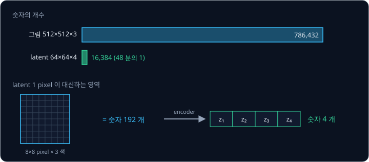
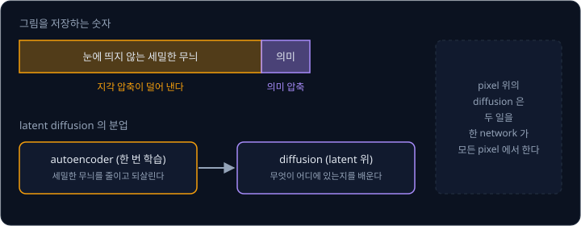
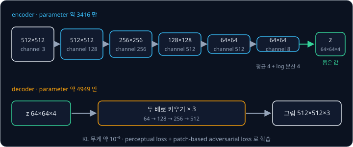
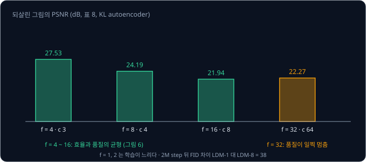
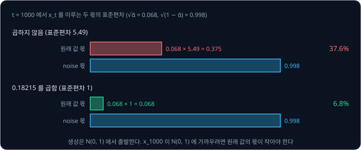
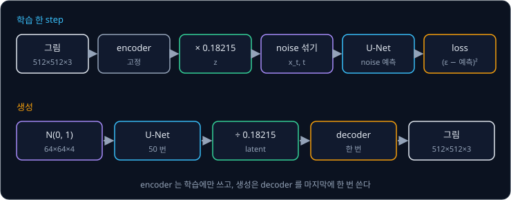
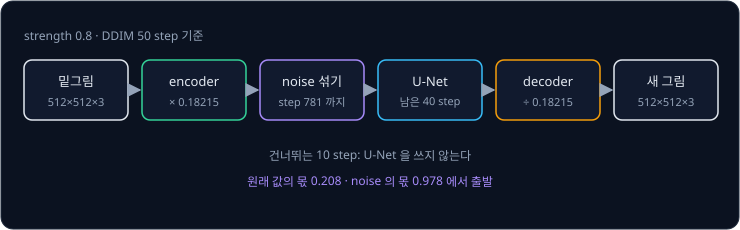

# Latent Diffusion

$512 \times 512$ 컬러 그림 한 장은 pixel 마다 빨강·초록·파랑 세 값을 가져서 숫자가 786,432 개다. [DDPM](../ddpm/README.md) 은 이 숫자 하나하나에
noise 를 섞고 걷어 내며, [U-Net](../unet/README.md) 을 sampling step 마다 한 번씩 이 크기 전체에 쓴다. 2021 년에 pixel 위에서 diffusion
을 한 가장 강한 모델들은 학습에 V100 GPU 로 150 ~ 1000 일이 걸렸고, 학습한 모델로 그림 5 만 장을 만드는 데도 A100 GPU 한 대로 약 5 일이
걸렸다. 그런데 사람 눈에 보이지도 않는 머리카락 끝의 미세한 무늬까지 diffusion 이 한 숫자씩 맞혀야 할까?

이 낭비를 줄이는 방법인 **latent diffusion** 은 먼저 autoencoder 로 그림을 작은 숫자 묶음(latent)으로 줄이고, diffusion 은 그 latent 위에서만
한다. 눈에 띄지 않는 세밀한 무늬는 autoencoder 의 decoder 가 마지막에 되살린다. Rombach 등이 2021 년에 발표한 이 방법은 Stable Diffusion 의
바탕이고, Stable Diffusion 은 $512 \times 512$ 그림을 $64 \times 64 \times 4$, 숫자 16,384 개짜리 latent 로 줄여 diffusion 을 한다.

## 학습 목표

- pixel 위의 diffusion 과 latent 위의 diffusion 에서 U-Net 이 다루는 숫자의 수와 계산량을 비교할 수 있다
- 지각 압축과 의미 압축을 나누는 생각과, 줄이는 비율 $f$ 가 너무 작거나 클 때 생기는 문제를 설명할 수 있다
- Stable Diffusion 의 VAE 가 그림을 latent 로 줄이고 되살리는 과정과, latent 에 0.18215 를 곱하는 이유를 숫자로 설명할 수 있다
- Stable Diffusion 의 학습 한 step 과 그림 한 장의 생성을 encoder, U-Net, decoder 의 순서로 따라갈 수 있다

## pixel 위의 diffusion 이 드는 비용

[U-Net](../unet/README.md) 은 입력을 받은 크기 그대로 첫 단계를 계산하므로, 입력의 가로세로가 계산량을 정한다. Stable Diffusion 과 같은
U-Net 을 $512 \times 512$ pixel 에 바로 쓴다고 하고 첫 단계의 위치 수를 세면 아래와 같다.

| 입력 | 첫 단계의 위치 수 | self-attention 의 위치 쌍 |
| --- | --- | --- |
| pixel $512 \times 512$ | 262,144 | 약 687 억 |
| latent $64 \times 64$ | 4,096 | 약 1678 만 |
| pixel ÷ latent | 64 배 | 4096 배 |

가로세로가 8 배이면 위치는 $8 \times 8 = 64$ 배이고, 위치끼리 모두 짝짓는 self-attention 은 그 제곱인 4096 배다. convolution 층의 계산은
위치 수에 비례하므로 64 배가 된다. 생성할 때는 이 계산을 그림 한 장에 50 번 되풀이하고, 학습할 때는 학습 그림마다 되풀이한다.

pixel 위에서 diffusion 을 한 모델의 비용은 Dhariwal 과 Nichol 의 ADM(2021)에서 볼 수 있다. LDM 논문은 이 모델들의 학습에 V100 GPU 로
150 ~ 1000 일이 들고, 그림 5 만 장을 만드는 데 A100 한 대로 약 5 일이 걸린다고 적었다. 같은 network 를 25 ~ 1000 step 동안 차례로 써야
하므로 학습을 마친 뒤에도 비용이 줄지 않는다.

**확인 문제.** $768 \times 512$ 그림을 가로세로 8 분의 1 로 줄인 latent 는 어떤 크기이고, channel 4 개이면 숫자 몇 개일까? 원래 그림의
숫자와 비교하면 몇 분의 1 일까?

답 보기

① 가로세로를 8 로 나누면 $96 \times 64$ 다.

② 숫자는 $96 \times 64 \times 4 = 24{,}576$ 개다.

③ 원래 그림은 $768 \times 512 \times 3 = 1{,}179{,}648$ 개라서 $1{,}179{,}648 \div 24{,}576 = 48$ 이다.

답: $96 \times 64 \times 4$ 로 숫자 24,576 개이고 48 분의 1 이다. 가로세로를 8 로, channel 을 3 에서 4 로 바꾸므로 그림 크기와 관계없이 언제나
48 분의 1 이다.

## 지각 압축과 의미 압축

LDM 의 저자들은 pixel 위에서 학습한 diffusion model 이 무엇에 숫자를 쓰는지부터 분석했다. 논문의 그림 2 는 그림을 저장하는 데 필요한 정보의
양(bit 수)과 되살린 그림이 원래와 다른 정도를 함께 그린다. 논문에 따르면 "digital 그림의 bit 대부분은 눈에 띄지 않는 세밀한 부분에 쓰인다". 그래서 생성 모델의 학습을 대략 두 단계로 나누어 볼 수 있다.

1. **지각 압축(perceptual compression)**: 눈에 띄지 않는 높은 주파수의 세밀한 무늬를 덜어 내는 단계. 그림의 뜻은 거의 바뀌지 않는다
2. **의미 압축(semantic compression)**: 무엇이 어디에 어떻게 놓이는지, 그림의 뜻과 구성을 배우는 단계. 생성 모델이 정말로 배워야 할 부분이다

높은 주파수는 pixel 하나 거리 안에서 값이 빠르게 바뀌는 성분이고, 털의 결, 모래알, 사진의 잡티가 여기에 든다. 이런 성분은 숫자를 많이
차지하지만 무엇이 그려진 그림인지는 거의 바꾸지 않는다.

pixel 위의 diffusion 은 두 단계를 한 network 가 함께 맡는다. loss 가 세밀한 무늬의 오차를 작게 보게 할 수는 있지만, 논문의 지적대로
gradient 와 U-Net 의 계산은 여전히 모든 pixel 에서 해야 한다. LDM 은 두 단계를 다른 모델에 나눠 맡긴다. 지각 압축은 한 번 학습해 두는
autoencoder 가 맡고, diffusion model 은 그 autoencoder 가 만든 latent 위에서 의미 압축만 배운다. 논문은 이 autoencoder 를 한 번만 학습해 두면 여러
diffusion model 의 학습에 다시 쓸 수 있다는 점을 장점으로 꼽는다.

**흔한 오해.** latent 로 줄이면 그림을 흐리게 줄인 썸네일 위에서 diffusion 을 한다고 생각하기 쉽다. $512 \times 512$ 그림을 $64 \times 64$
로 줄인 썸네일은 pixel 마다 색 세 개만 남기지만, latent 는 $8 \times 8$ pixel 영역마다 숫자 4 개를 학습으로 골라 담고, decoder 는 이 숫자들로
그 영역의 무늬와 경계까지 되살리도록 학습한다. [줄이는 비율 f](#줄이는-비율-f) 의 표에서 Stable Diffusion 과 같은 설정은 되살린 그림과 원래
그림의 통계 차이(R-FID)가 0.90 으로 작다.

## autoencoder 와 latent

[VAE](../vae/README.md) 에서 본 것처럼 autoencoder 는 그림을 작은 숫자 묶음으로 줄이는 **encoder** 와 그 숫자 묶음에서 그림을 되살리는
**decoder** 로 이루어진다. LDM 논문은 encoder 를 $\mathcal E$, decoder 를 $\mathcal D$ 로 적고, 그림 $x$ 를 줄인 latent 를
$z = \mathcal E(x)$ 로 적는다. Stable Diffusion 의 autoencoder 는 가로세로를 세 번 절반으로 줄여 8 분의 1 로 만들고, channel 을 4 개로 남긴다.

| 자리 | 크기 | channel |
| --- | --- | --- |
| 입력 그림 | $512 \times 512$ | 3 (빨강·초록·파랑) |
| encoder 1 단계 | $512 \times 512$ | 128 |
| encoder 2 단계 | $256 \times 256$ | 256 |
| encoder 3 단계 | $128 \times 128$ | 512 |
| encoder 4 단계 | $64 \times 64$ | 512 |
| encoder 의 출력 | $64 \times 64$ | 8 (평균 4 개, log 분산 4 개) |
| latent $z$ | $64 \times 64$ | 4 |
| decoder 의 출력 | $512 \times 512$ | 3 |

encoder 의 마지막이 channel 8 개인 것은 이 autoencoder 가 VAE 이기 때문이다. [VAE](../vae/README.md) 의 Gaussian encoder 처럼 위치마다
latent 4 개 각각의 평균과 분산(의 log)을 내고, 학습할 때는 그 정규분포에서 뽑은 값을 latent 로 쓴다. Hugging Face 의 Stable Diffusion
v1-4 설정(`vae/config.json`)에는 이 구조가 `block_out_channels: [128, 256, 512, 512]`, `latent_channels: 4` 로 적혀 있다. weight 파일의
tensor 모양으로 세어 보면 encoder 의 parameter 는 약 3416 만 개이고 decoder 의 parameter 는 약 4949 만 개라서, 둘을 합쳐도 860M 인
U-Net 의 10 분의 1 정도다.

이 VAE 는 [VAE](../vae/README.md) 강의의 VAE 와 학습 목표가 다르다. 그 강의의 VAE 는 latent 를 $\mathcal N(0, I)$ 에서 뽑아 decoder 에 넣어
새 그림을 만드는 것이 목적이라 KL 항을 크게 두었다. 여기서 새 latent 를 만드는 일은 diffusion 이 맡으므로, autoencoder 는 그림을 잘 되살리기만
하면 된다. LDM 의 저자들은 KL 항의 무게를 $10^{-6}$ 정도로 아주 작게 두어 latent 가 지나치게 커지거나 흩어지는 것만 막았다.

되살린 그림이 흐려지지 않게 하는 loss 도 다르다. pixel 마다 차이를 제곱하는 loss 만 쓰면 정답이 갈라지는 세밀한 무늬에서 평균을 배워 그림이
흐려진다. LDM 의 autoencoder 는 두 loss 를 더한다.

- **perceptual loss**: 원래 그림과 되살린 그림을 이미 학습된 분류 network 에 넣어 중간 층의 특징이 비슷한지 잰다. 이 loss 는 pixel 이 조금
  어긋나도 같은 무늬면 차이를 작게 본다
- **patch-based adversarial loss**: 그림의 작은 조각(patch)이 진짜 사진의 조각인지 되살린 것인지 가리는 network 를 함께 학습하고, decoder 는
  그 network 를 속이도록 학습한다. 이 loss 는 decoder 가 조각마다 진짜 같은 질감을 내게 만든다

**확인 문제.** Stable Diffusion 의 encoder 출력은 위치마다 숫자 몇 개이고, 그 가운데 몇 개가 latent 가 될까? $64 \times 64$ 위치 전체로는
encoder 출력과 latent 가 각각 숫자 몇 개일까?

답 보기

① encoder 출력은 위치마다 8 개(평균 4 개, log 분산 4 개)이고, 그 정규분포에서 뽑은 4 개가 latent 가 된다.

② 위치 전체로는 encoder 출력이 $64 \times 64 \times 8 = 32{,}768$ 개이고, latent 가 $64 \times 64 \times 4 = 16{,}384$ 개다.

답: 위치마다 8 개 중 4 개이고, 전체로는 32,768 개와 16,384 개다.

## 줄이는 비율 f

latent 의 가로세로가 그림의 몇 분의 1 인지를 **downsampling factor** $f$ 라고 하고, $f = 8$ 인 LDM 을 LDM-8 로 적는다. Stable Diffusion 은
$f = 8$ 이다. $f$ 가 작으면 latent 가 커서 diffusion 의 비용이 많이 들고, 크면 autoencoder 가 그림을 잘 되살리지 못한다.

LDM 논문의 표 8 에는 KL 을 쓴 autoencoder 들이 ImageNet 검증 그림을 얼마나 잘 되살리는지가 나와 있다. **PSNR** 은 되살린 그림과 원래 그림의
pixel 차이를 dB 단위로 잰 값으로 높을수록 원래와 가깝고, **R-FID** 는 되살린 그림 전체와 원래 그림 전체의 통계 차이로 낮을수록 원래와
구별하기 어렵다.

| $f$ | latent channel | latent 의 숫자 ÷ 그림의 숫자 | R-FID | PSNR (dB) |
| --- | --- | --- | --- | --- |
| 4 | 3 | 1 / 16 | 0.27 | 27.53 |
| 8 | 4 | 1 / 48 | 0.90 | 24.19 |
| 16 | 8 | 1 / 96 | 2.63 | 21.94 |
| 32 | 64 | 1 / 48 | 2.04 | 22.27 |

셋째 칸은 직접 계산한 값이다. $f = 8$, channel 4 개이면 latent 의 숫자는 그림의 $\frac{4}{8 \times 8 \times 3} = \frac{4}{192} = \frac{1}{48}$ 이다.
$f$ 를 키우면 되살린 그림이 원래에서 점점 멀어진다.

<b>심화: PSNR 과 pixel 하나의 오차</b>

PSNR 은 pixel 값의 범위가 0 ~ 255 일 때 $\text{PSNR} = 10 \log_{10}\!\big(255^2 \div \text{MSE}\big)$ 로 계산한다. MSE 는 pixel 마다 차이를 제곱해
평균한 값이고, $\log_{10}$ 은 10 을 몇 번 곱하면 그 수가 되는지를 센다. MSE 가 65.025 이면 $255^2 \div 65.025 = 1000 = 10^3$ 이라서 PSNR 은
$10 \times 3 = 30$ dB 이다. 거꾸로 표의 PSNR 에서 MSE 를 구하고 그 제곱근으로 pixel 하나의 평균적인 오차를 어림하면 아래와 같다.

| $f$ | PSNR (dB) | MSE $= 255^2 \div 10^{\text{PSNR}/10}$ | MSE 의 제곱근 | 값 범위 255 에 대한 비율 |
| --- | --- | --- | --- | --- |
| 4 | 27.53 | 114.8 | 10.7 | 4.2% |
| 8 | 24.19 | 247.8 | 15.7 | 6.2% |
| 16 | 21.94 | 416.0 | 20.4 | 8.0% |

PSNR 이 3 dB 떨어질 때마다 MSE 는 약 2 배가 된다. 다만 PSNR 은 pixel 이 조금 어긋난 같은 무늬도 큰 오차로 세므로, perceptual loss 로 학습한
autoencoder 의 품질은 R-FID 와 함께 본다.

저자들은 $f$ 를 1 부터 32 까지 바꾼 diffusion model 을 같은 A100 한 대의 예산으로 ImageNet 에서 2M step 학습해 비교했다(그림 6). $f = 1, 2$
는 학습이 느리게 나아갔는데, 논문은 지각 압축의 대부분이 diffusion model 에 남았기 때문이라고 설명한다. $f = 32$ 는 몇 step 만에 품질이 더
좋아지지 않았다. autoencoder 가 너무 많이 줄여 정보를 잃었기 때문이다. $f = 4$ ~ 16 이 효율과 품질의 균형이 좋았다. 만든 그림과 실제 그림의
통계 차이인 FID 는 낮을수록 실제 그림에 가까운데, 2M step 뒤 pixel 위의 LDM-1 과 LDM-8 은 FID 가 38 만큼 차이 났고 LDM-8 쪽이 낮았다.

그림을 다시 채우는 inpainting 실험에서도 저자들은 parameter 수를 맞춘 pixel 모델과 latent 모델을 비교했다. 논문에 따르면 latent 쪽이 학습과
sampling 이 2.7 배 넘게 빠르면서 FID 도 1.6 배 넘게 좋았다(표 6).

**확인 문제.** $f = 16$, channel 8 개인 latent 는 $512 \times 512 \times 3$ 그림의 몇 분의 1 일까? 이 latent 의 크기는?

답 보기

① 가로세로는 $512 \div 16 = 32$ 라서 latent 는 $32 \times 32 \times 8$ 이다.

② latent 의 숫자는 $32 \times 32 \times 8 = 8{,}192$ 개이고, 그림의 숫자는 786,432 개다.

$$
786{,}432 \div 8{,}192 = 96
$$

답: 96 분의 1 이고 크기는 $32 \times 32 \times 8$ 이다.

## latent 의 scaling factor

[DDPM](../ddpm/README.md) 의 forward process 는 데이터의 분산이 1 근처라고 보고 만든 것이다. noise schedule 의 끝에서 $\sqrt{\bar\alpha_T}$ 가 작아
원래 값이 거의 사라지고 $\mathcal N(0, 1)$ 만 남아야, 생성할 때 $\mathcal N(0, 1)$ 에서 뽑은 숫자로 출발할 수 있기 때문이다. 그런데 KL 무게를
$10^{-6}$ 으로 아주 작게 둔 autoencoder 의 latent 는 표준편차가 1 이라는 보장이 없다.

LDM 의 저자들은 학습 데이터의 첫 batch 에서 latent 값 전체의 표준편차 $\hat\sigma$ 를 재고, encoder 의 출력을 $\hat\sigma$ 로 나눠 표준편차를 1 로
맞췄다. Stable Diffusion 의 설정에는 이 값이 `scale_factor: 0.18215` 로 적혀 있어서, 학습할 때 latent 에 0.18215 를 곱한다. 0.18215 를
곱하는 것은 $1 \div 0.18215 \approx 5.49$ 로 나누는 것과 같으므로, 곱하기 전의 latent 는 표준편차가 약 5.49 였다는 뜻이다.

곱하지 않으면 어떻게 되는지 Stable Diffusion 의 noise schedule 로 계산해 보자. 이 schedule 은 $T = 1000$ 이고 $\sqrt{\beta_t}$ 를
$\sqrt{0.00085}$ 에서 $\sqrt{0.012}$ 까지 같은 간격으로 늘린다. 마지막 step 에서는 $\sqrt{\bar\alpha_{1000}} = 0.068$,
$\sqrt{1 - \bar\alpha_{1000}} = 0.998$ 이다.

| latent 의 표준편차 | 원래 값 몫의 표준편차 $0.068 \times$ 표준편차 | noise 몫의 표준편차 | 원래 값 몫 ÷ noise 몫 |
| --- | --- | --- | --- |
| 5.49 (곱하지 않음) | 0.375 | 0.998 | 0.376 |
| 1 (0.18215 를 곱함) | 0.068 | 0.998 | 0.068 |

곱하지 않으면 마지막 step 에도 원래 값의 몫이 noise 의 37.6% 만큼 남아서, $x_{1000}$ 이 $\mathcal N(0, 1)$ 과 다르다. 생성은 $\mathcal N(0, 1)$
에서 출발하므로 학습 때 본 적 없는 입력에서 시작하게 된다. 원래 값의 몫이 noise 몫보다 작아지는 step 도 직접 계산하면, 곱하지 않을 때는
$t = 817$ 이고 곱하면 $t = 355$ 다. 곱하지 않으면 1000 step 가운데 816 step 동안 그림의 큰 구성이 noise 에 거의 가려지지 않는다.

LDM 논문의 부록 D.1 에도 KL 을 쓴 latent 를 그대로 쓰면 신호 대 noise 비율이 매우 높아서 model 이 reverse process 의 이른 step 에 그림의
뜻을 많이 정해 버린다고 적혀 있고, 저자들은 표준편차로 나눠 맞춘 latent 와 결과를 비교했다.

생성할 때는 거꾸로, U-Net 이 만든 latent 를 0.18215 로 나눈 뒤
decoder 에 넣는다. diffusers 의 Stable Diffusion pipeline 은 `latents / self.vae.config.scaling_factor` 를 decoder 에 넣고, 학습 예제
`train_text_to_image.py` 는 encoder 의 출력에 `vae.config.scaling_factor` 를 곱한다.

**흔한 오해.** 0.18215 를 U-Net 이나 noise schedule 의 값으로 생각하기 쉽지만, 이 값은 autoencoder 에 딸린 값이다. 같은 U-Net 이라도 다른
autoencoder 로 바꾸면 그 latent 의 표준편차에 맞춰 이 값을 다시 정해야 하고, 학습 때 곱한 값과 생성 때 나누는 값이 다르면 decoder 는 학습 때
본 적 없는 크기의 latent 를 받는다.

<b>심화: 원래 값의 몫과 noise 의 몫</b>

$x_t = \sqrt{\bar\alpha_t}\, z + \sqrt{1 - \bar\alpha_t}\, \epsilon$ 에서 $z$ 의 표준편차가 $s$ 이면 원래 값의 몫의 표준편차는 $\sqrt{\bar\alpha_t}\, s$
이고 noise 의 몫은 $\sqrt{1 - \bar\alpha_t}$ 다. 둘의 제곱의 비 $\bar\alpha_t s^2 / (1 - \bar\alpha_t)$ 를 신호 대 noise 비율(SNR)이라고 한다.
$s$ 를 5.49 배 키우면 SNR 은 모든 step 에서 $5.49^2 \approx 30$ 배가 된다. Stable Diffusion schedule 의 몇 step 에서 두 몫을 계산하면
아래와 같다.

| $t$ | $\sqrt{\bar\alpha_t}$ | $\sqrt{1 - \bar\alpha_t}$ | $s = 1$ 의 원래 값 몫 | $s = 5.49$ 의 원래 값 몫 |
| --- | --- | --- | --- | --- |
| 250 | 0.822 | 0.570 | 0.822 | 4.51 |
| 500 | 0.527 | 0.850 | 0.527 | 2.89 |
| 750 | 0.238 | 0.971 | 0.238 | 1.31 |
| 1000 | 0.068 | 0.998 | 0.068 | 0.375 |

$s = 5.49$ 이면 $t = 750$ 에서도 원래 값의 몫(1.31)이 noise 의 몫(0.971)보다 크다.

**확인 문제.** U-Net 이 만든 latent 의 어떤 값이 0.5 였다. decoder 에 넣는 값은 얼마일까?

답 보기

학습 때 0.18215 를 곱했으므로 생성 때는 0.18215 로 나눈다.

$$
0.5 \div 0.18215 \approx 2.74
$$

답: 약 2.74.

## Stable Diffusion 의 학습과 생성

autoencoder 는 먼저 따로 학습해 두고, diffusion model 을 학습하는 동안에는 고정한다. Stable Diffusion 의 학습 한 step 은 [DDPM](../ddpm/README.md)
의 학습 순서에 encoder 와 scaling factor 가 앞에 붙은 것이다.

1. 학습 그림 $512 \times 512 \times 3$ 을 encoder 에 넣어 latent $64 \times 64 \times 4$ 를 뽑는다
2. latent 에 0.18215 를 곱한다
3. 1000 개의 step 가운데 $t$ 하나를 뽑고(diffusers 는 0 ~ 999 로 센다), latent 와 같은 모양의 $\epsilon$ 을 뽑아 $x_t = \sqrt{\bar\alpha_t}\, z + \sqrt{1 - \bar\alpha_t}\,\epsilon$ 을 만든다
4. U-Net 에 $x_t$ 와 $t$(그리고 그림을 설명하는 글)를 넣어 noise 를 맞히게 하고, $\epsilon$ 과의 차이를 제곱해 loss 를 구한다
5. U-Net 의 weight 만 고친다. encoder 와 decoder 는 바꾸지 않는다

생성할 때는 encoder 가 필요 없다. $\mathcal N(0, 1)$ 에서 $64 \times 64 \times 4$ 를 뽑아 U-Net 으로 step 마다 noise 를 걷어 낸 뒤, 마지막에 한 번만
0.18215 로 나눠 decoder 에 넣는다.

decoder 는 $512 \times 512$ 크기에서 계산하지만 그림 한 장에 한 번만 쓰고, step 마다 50 번 되풀이해 쓰는 U-Net 은 $64 \times 64$ 에서
계산한다. latent 의 크기는 그림의 가로세로를 8 로 나눈 값이라서, diffusers 의 Stable Diffusion pipeline 은 그림의
가로세로가 8 로 나누어떨어지지 않으면 오류를 낸다. 기본 크기는 U-Net 설정의 `sample_size: 64` 에 8 을 곱한 $512 \times 512$ 다.

Stable Diffusion v1 은 LAION-5B 라는 인터넷 사진–글 쌍 dataset 의 일부로 학습했다. 공식 리포의 README 에 따르면 v1-1 은 $256 \times 256$ 에서
237k step, $512 \times 512$ 에서 194k step 을 학습했고, v1-2 ~ v1-4 는 그 뒤로 $512 \times 512$ 에서 학습을 이어 갔다. 학습 그림의 크기는
바뀌었지만 autoencoder 는 같은 $f = 8$ 이라서, $256 \times 256$ 그림은 $32 \times 32 \times 4$ latent 가 된다.

**확인 문제.** Stable Diffusion 으로 그림 한 장을 50 step 으로 만든다. encoder, U-Net, decoder 를 각각 몇 번 쓸까?

답 보기

① encoder 는 생성에 쓰지 않으므로 0 번이다.

② U-Net 은 step 마다 한 번이라 50 번이다.

③ decoder 는 마지막에 한 번이다.

답: encoder 0 번, U-Net 50 번, decoder 1 번.

## 그림에서 출발하는 생성

글만으로 그림을 만들 때는 encoder 를 쓰지 않지만, 가지고 있는 그림을 고쳐 그릴 때는 생성에도 encoder 를 쓴다. 손으로 그린 밑그림이나 사진을
encoder 로 latent 로 줄이고, 그 latent 에 forward process 의 noise 를 중간 step 까지만 섞은 뒤, 거기서부터 reverse process 를 밟는다. noise 를
덜 섞을수록 원래 그림의 구성이 많이 남고, 많이 섞을수록 새로 그리는 부분이 많아진다. Meng 등이 SDEdit(2021)에서 제안한 이 방법은 diffusers
에 `StableDiffusionImg2ImgPipeline` 으로 들어 있다.

이 pipeline 은 noise 를 섞는 정도를 `strength` 로 받고, `strength` 의 기본값은 0.8 이다. sampling 을 50 step 으로 정했다면 $50 \times 0.8 = 40$ 이라서 처음
$50 - 40 = 10$ step 을 건너뛰고, 원래 그림의 latent 에 11 번째 step 의 noise 를 섞은 뒤 남은 40 step 만 밟는다.

DDIM scheduler 로 50 step 을 밟으면 step 번호는 981, 961, …, 1 로 20 씩 줄어든다. 이 설정으로 출발하는 step 과 그 step 의 계수를 직접
계산하면 아래와 같다.

| `strength` | 밟는 step | 건너뛰는 step | 출발하는 step 번호 | 원래 값의 몫 $\sqrt{\bar\alpha_t}$ | noise 의 몫 $\sqrt{1 - \bar\alpha_t}$ |
| --- | --- | --- | --- | --- | --- |
| 0.3 | 15 | 35 | 281 | 0.789 | 0.615 |
| 0.8 | 40 | 10 | 781 | 0.208 | 0.978 |
| 1.0 | 50 | 0 | 981 | 0.076 | 0.997 |

`strength` 0.3 에서는 원래 latent 의 몫이 noise 보다 커서 구성이 대부분 남고, 1.0 에서는 7.6% 만 남아 글만으로 만드는 생성과 거의 같다.

이 계산도 latent 위에서 하므로 encoder 를 한 번, U-Net 을 남은 step 수만큼, decoder 를 한 번 쓴다. 섞는 noise 의 양은 앞 절의 schedule 을 그대로
따르고, encoder 의 출력에는 학습 때처럼 0.18215 를 곱한 뒤 섞는다.

**확인 문제.** sampling 30 step, `strength` 0.5 로 그림을 고쳐 그리면 U-Net 을 몇 번 쓸까?

답 보기

① $30 \times 0.5 = 15$ 라서 15 step 을 밟는다.

② U-Net 은 밟는 step 마다 한 번 쓴다.

답: 15 번. 처음 15 step 은 건너뛴다.

## 정리

- pixel 위의 diffusion 은 $512 \times 512 \times 3$, 숫자 786,432 개 위에서 U-Net 을 step 마다 쓰고, 그 숫자 대부분은 눈에 띄지 않는 세밀한
  무늬다. latent diffusion 은 이 지각 압축을 autoencoder 에 맡기고, diffusion 은 $64 \times 64 \times 4$, 숫자 16,384 개(48 분의 1)의
  latent 위에서 그림의 뜻만 배운다. U-Net 첫 단계의 위치는 64 분의 1, self-attention 의 위치 쌍은 4096 분의 1 이 된다
- Stable Diffusion 의 autoencoder 는 KL 무게를 $10^{-6}$ 정도로 작게 둔 VAE 이고, perceptual loss 와 patch-based adversarial loss 로 흐리지 않게
  되살린다. 줄이는 비율 $f$ 는 너무 작으면 학습이 느리고 너무 크면 정보를 잃어서, LDM 논문에서는 $f = 4$ ~ 16 이 좋았고 Stable Diffusion 은
  $f = 8$ 을 쓴다
- latent 의 표준편차를 1 로 맞추려고 학습할 때 0.18215 를 곱하고 생성할 때 나눈다. 곱하지 않으면 $t = 1000$ 에서도 원래 값의 몫이 noise 의
  37.6% 남는다

지금까지의 U-Net 은 무엇을 그릴지 정하지 않고 latent 를 만든다. 학습 순서 4 번에서 U-Net 에 함께 넣는 글이 어떻게 그림을 정하는지,
CLIP 의 text encoder 가 낸 단어별 vector 를 U-Net 이 cross-attention 으로 읽는 방법은 [Cross-Attention](../cross-attention/README.md) 에서 다룬다.

## 참고 자료

- Robin Rombach 등, [High-Resolution Image Synthesis with Latent Diffusion Models](https://arxiv.org/abs/2112.10752) (2022) — latent diffusion 의
  원 논문. 서론의 pixel diffusion 비용, 그림 2 의 지각·의미 압축, 3.1 절의 autoencoder, 4.1 절과 그림 6 의 $f$ 비교, 표 6 의 속도, 표 8 의
  autoencoder 목록, 부록 D.1 과 G 의 latent 표준편차 맞추기를 본다
- Prafulla Dhariwal, Alex Nichol, [Diffusion Models Beat GANs on Image Synthesis](https://arxiv.org/abs/2105.05233) (2021) — LDM 논문이 pixel
  diffusion 의 비용을 예로 든 ADM
- Hugging Face, [CompVis/stable-diffusion-v1-4](https://huggingface.co/CompVis/stable-diffusion-v1-4) — `vae/config.json` 의 구조와
  `scaling_factor: 0.18215`, `scheduler/scheduler_config.json` 의 noise schedule
- CompVis, [stable-diffusion](https://github.com/CompVis/stable-diffusion) — README 의 학습 과정(v1-1 ~ v1-4)과
  `configs/stable-diffusion/v1-inference.yaml` 의 `scale_factor`
- diffusers, [pipeline_stable_diffusion.py](https://github.com/huggingface/diffusers/blob/main/src/diffusers/pipelines/stable_diffusion/pipeline_stable_diffusion.py)
  와 [train_text_to_image.py](https://github.com/huggingface/diffusers/blob/main/examples/text_to_image/train_text_to_image.py) — 생성 때 나누고
  학습 때 곱하는 scaling factor, 8 로 나누어떨어져야 하는 그림 크기
- Chenlin Meng 등, [SDEdit](https://arxiv.org/abs/2108.01073) (2021) — 그림에 noise 를 섞은 뒤 reverse process 로 되돌려 고쳐 그리는 방법.
  diffusers 의 [pipeline_stable_diffusion_img2img.py](https://github.com/huggingface/diffusers/blob/main/src/diffusers/pipelines/stable_diffusion/pipeline_stable_diffusion_img2img.py)
  에서 `strength` 로 건너뛰는 step 을 정하는 `get_timesteps` 를 본다
