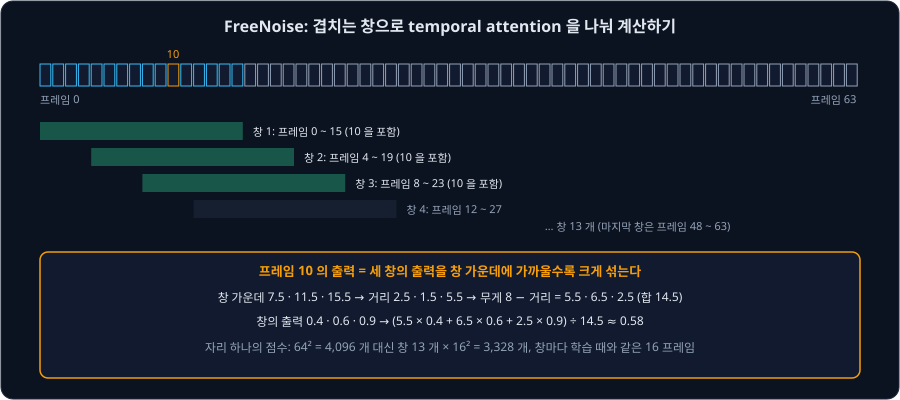
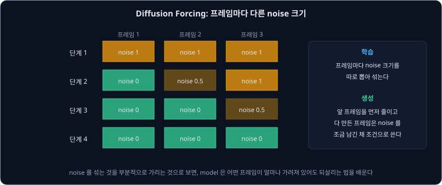
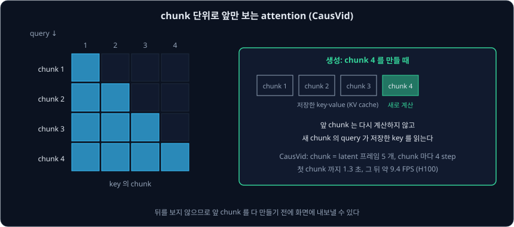
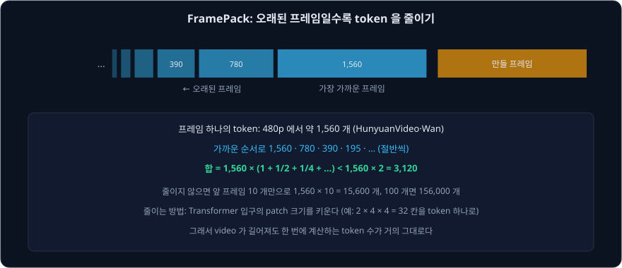

# Long Video Generation

앞 강의들의 model 은 몇 초짜리 video 를 만들었다. Wan 2.1 의 기본값은 81 프레임, 16 fps 로 약 5 초이고, SVD-XT 는 25 프레임이다. 1 분짜리 video 를 만들려면
어떻게 해야 할까? 가장 쉬운 생각은 프레임 수를 늘려 한 번에 만드는 것이다. [Video Diffusion Transformer](../video-dit/README.md) 의 Wan 1.3B 로 세어 보자.

| 길이 | latent 프레임 | token 수 | attention 점수 (기본값 대비) |
| --- | --- | --- | --- |
| 81 프레임 (약 5 초) | 21 | 32,760 | 1 |
| 801 프레임 (약 50 초) | 201 | 313,560 | 약 92 배 |

길이가 10 배가 되면 token 은 약 10 배가 되고, full attention 점수는 token 비율의 제곱인 약 92 배가 된다. 게다가 model 은 몇 초짜리 video 로만 학습했으므로,
학습 때보다 훨씬 긴 sequence 를 받으면 품질이 떨어진다. 그래서 긴 video 는 학습한 길이의 조각을 여러 번 만들어 잇는다. 이 강의에서는 조각을 잇는 네 가지
방법과, 그때 생기는 두 문제(앞 내용을 잊는 것, 오차가 쌓여 화면이 망가지는 것)를 다룬다.

## 학습 목표

- 길이가 늘 때 token 수와 attention 점수가 늘어나는 양을 계산하고, 학습한 길이를 넘기면 생기는 문제를 설명할 수 있다
- FreeNoise 가 겹치는 창으로 temporal attention 을 나눠 계산하고 창의 출력을 무게로 섞는 방식을 숫자로 따라갈 수 있다
- 앞 조각을 조건으로 다음 조각을 만들 때 오차가 쌓이는(drift) 이유와, Diffusion Forcing 이 프레임마다 다른 noise 크기로 이를 줄이는 방식을 설명할 수 있다
- CausVid 의 chunk 단위 causal attention 과 KV cache 가 첫 프레임까지의 시간을 줄이는 방식을 설명할 수 있다
- FramePack 이 오래된 프레임의 token 을 절반씩 줄여 context 를 고정하는 계산과, 끝 프레임을 먼저 정해 drift 를 막는 방법을 따라갈 수 있다

## 겹치는 창으로 나눠 계산하기: FreeNoise

[Video Diffusion](../video-diffusion/README.md) 강의에서 다룬 AnimateDiff 같은 model 은 16 프레임으로 학습했다. 64 프레임의 noise 를 한 번에 넣으면 temporal
attention 이 학습 때 본 적 없는 64 프레임을 서로 읽게 되고, Qiu 등은 이때 내용이 덜 그려지거나 프레임이 떨리는 결과가 나온다고 적었다. 16 프레임 창을
옮겨 가며 따로 만들면 창마다 학습 때와 같은 길이를 보지만, 창마다 noise 가 달라 앞쪽과 뒤쪽의 주인공과 배경이 서로 다른 모습이 된다.

2023 년 Qiu 등의 FreeNoise 는 noise 다시 쓰기와 창으로 나눈 attention, 두 장치로 학습 없이 이 두 문제를 함께 푼다.

**noise 다시 쓰기.** FreeNoise 는 처음 16 프레임의 noise 를 뽑고, 그 뒤 프레임에는 새 noise 를 뽑는 대신 같은 16 개의 noise 를 4 개씩 묶어 묶음 안에서 순서만
섞어 다시 쓴다. 저자들은 실험에서 프레임마다 넣는 noise 가 전체 모습의 바탕을 정하고, noise 의 순서가 그 위의 내용을 바꾼다는 것을 관찰했다. 같은 noise 를 다시 쓰면
멀리 떨어진 프레임도 같은 주인공과 배경을 갖고, 순서를 섞으면 움직임이 달라진다.

**창으로 나눈 attention.** temporal attention 만 16 프레임 창 안에서 계산하고, 창을 4 프레임씩 옮긴다. 64 프레임이면 창은 0, 4, 8, … , 48 에서 시작하는
13 개다. 한 프레임은 여러 창에 들어가므로, 프레임이 창 가운데에 가까울수록 그 창의 출력에 큰 무게를 주어 섞는다. 무게는 창 길이의 절반(8)에서 창 가운데까지의 거리를 뺀
값이다. 프레임 10 으로 계산하면 아래와 같다.

| 창 | 창 가운데 | 거리 | 무게 | 창의 출력 (예) |
| --- | --- | --- | --- | --- |
| 프레임 0 ~ 15 | 7.5 | 2.5 | 5.5 | 0.4 |
| 프레임 4 ~ 19 | 11.5 | 1.5 | 6.5 | 0.6 |
| 프레임 8 ~ 23 | 15.5 | 5.5 | 2.5 | 0.9 |
| 섞은 출력 | | | 합 14.5 | $(5.5 \times 0.4 + 6.5 \times 0.6 + 2.5 \times 0.9) \div 14.5 \approx 0.58$ |

저자들은 단순히 평균을 내면 창의 경계에서 내용이 갑자기 바뀌었다고 적었다. 창으로 나누는 것은 temporal attention 뿐이고, 이미지 layer 는 원래대로 프레임마다
계산한다. 창 하나가 4 프레임씩 옮겨 가므로 각 창에는 처음 16 개 noise 가 순서만 바뀐 채 모두 들어 있고, 학습 때처럼 서로 다른 noise 16 개를 보게 된다.

저자들은 VideoCrafter 로 64 프레임을 만들어 FVD(작을수록 좋음)를 비교했다(표 1). 한 번에 만들면 737.61 이었고, 창만 옮기면 224.55 였고, 겹친 조각을 평균하는
Gen-L-Video 는 177.63 이었고, FreeNoise 는 85.83 이었다. A100 에서 걸린 시간은 각각 21.97 초, 36.76 초, 77.89 초, 25.75 초라서, FreeNoise 는 한 번에 만들기보다
20% 가 안 되게 더 걸렸다. diffusers 의 AnimateDiff pipeline 에서는 `enable_free_noise(context_length=16, context_stride=4)` 로 이 방법을 켠다.

FreeNoise 는 여러 글로 내용이 바뀌는 video 도 만든다. 프레임 번호마다 글을 정하고, 그 사이 프레임에는 두 글의 embedding 을 선형으로 섞어 쓴다. 저자들은 구도를
정하는 처음 step 에서는 첫 글을 쓰고 물체의 모양을 정하는 step 에서만 다음 글을 넣어, 장면은 유지한 채 동작만 바꾸게 했다.

**확인 문제.** 같은 설정(창 16, 간격 4)에서 프레임 30 은 어느 창들에 들어가고, 무게는 각각 얼마일까?

답 보기

① 창은 4 의 배수에서 시작하고 16 프레임을 덮으므로, 프레임 30 을 포함하려면 시작점이 $30 - 15 = 15$ 이상 30 이하여야 한다. 이 범위의 4 의 배수인 16, 20,
24, 28 에서 시작하는 창이 프레임 30 을 포함한다.

② 창 가운데는 23.5, 27.5, 31.5, 35.5 이고 거리는 6.5, 2.5, 1.5, 5.5 다.

답: 무게 $8 - 6.5 = 1.5$, $8 - 2.5 = 5.5$, $8 - 1.5 = 6.5$, $8 - 5.5 = 2.5$. 가운데에 가장 가까운 창(24 ~ 39)의 무게가 가장 크다.

## 앞 조각을 조건으로 이어 붙이기와 drift

FreeNoise 는 모든 조각을 동시에 만들지만, 조각을 차례로 만드는 방법도 있다. Video Diffusion 강의에서 다룬 Video LDM 은 앞 sequence 의 마지막 두 프레임을
조건으로 다음 sequence 를 만들었고, SVD 와 LTX-Video 도 앞 조각의 마지막 프레임을 조건 그림으로 주면 이어서 만들 수 있다. 이렇게 앞에서 만든 결과를 다음 생성의 입력으로
쓰는 방식을 autoregressive 라고 한다. 언어 model 이 앞 token 을 보고 다음 token 을 만드는 것과 같다.

이 방식에는 오차가 쌓이는 문제가 있다. 조각을 만들 때마다 작은 오차가 생기고, 다음 조각은 이 오차가 섞인 프레임을 조건으로 받는다. 예를 들어 조각마다 화면이
2% 씩 나빠진다고 가정하면 아래처럼 쌓인다.

| 이어 붙인 조각 수 | 10 | 25 | 50 |
| --- | --- | --- | --- |
| 쌓인 배율 ($1.02^n$) | 약 1.22 | 약 1.64 | 약 2.69 |

실제 오차가 이렇게 일정하게 곱해지지는 않지만, 뒤로 갈수록 학습 때 본 적 없는 입력을 받아 더 크게 틀린다는 점은 같다. Diffusion Forcing 의 저자들은 video 를
학습 길이보다 길게 autoregressive 로 만들면 프레임 사이의 작은 오차가 쌓여 model 이 망가진다(diverge)고 적었다. FramePack 의 저자들은 이 문제를 drift 라고 부르고,
반대쪽 문제인 forgetting(앞 내용을 잊는 것)과 함께 다룬다. 두 문제는 한쪽을 줄이면 다른 쪽이 커지는 trade-off 관계다. 기억을 늘리면 오차도 더 많이 기억해
drift 가 빨라지고, 오차를 끊으려고 앞 프레임에 덜 의지하면 앞 내용을 잊는다.

**확인 문제.** 조각마다 오차가 1% 씩 쌓인다고 가정하면, 쌓인 배율이 처음의 2 배를 넘는 것은 몇 번째 조각부터일까?

답 보기

① $1.01^{69} \approx 1.987$ 이고 $1.01^{70} \approx 2.007$ 이다.

답: 70 번째 조각. 2% 일 때는 $1.02^{35} \approx 1.9999$ 이고 $1.02^{36} \approx 2.04$ 라서 36 번째이므로, 조각마다 생기는 오차가 절반이면 2 배에 이르기까지 약 2 배 오래 걸린다.

## 프레임마다 다른 noise 크기: Diffusion Forcing

보통의 video diffusion 은 모든 프레임에 같은 크기의 noise 를 섞어 학습한다. autoregressive 로 쓰려면 앞 프레임은 깨끗하고 뒤 프레임만 noise 인 입력을 받아야
하는데, 이는 학습 때 보지 못한 모양이다. 2024 년 Chen 등의 Diffusion Forcing 은 학습할 때 프레임마다 noise 크기를 따로 뽑는다. 어떤 프레임은 깨끗하고, 어떤
프레임은 절반쯤 noise 이고, 어떤 프레임은 완전히 noise 다. 저자들은 noise 를 섞는 것을 부분적으로 가리는(masking) 것으로 본다. noise 크기 0 은 다 보이는
상태이고, noise 크기 1 은 다 가린 상태다. 이렇게 학습하면 model 은 어떤 프레임이 얼마나 가려져 있어도 되살리는 법을 배운다.

생성할 때는 프레임마다 noise 크기를 다르게 줄여 갈 수 있다. 세 프레임으로 예를 들면 아래와 같다.

| 단계 | 프레임 1 | 프레임 2 | 프레임 3 |
| --- | --- | --- | --- |
| 1 | 1 | 1 | 1 |
| 2 | 0 | 0.5 | 1 |
| 3 | 0 | 0 | 0.5 |
| 4 | 0 | 0 | 0 |

저자들은 이를 zig-zag sampling 이라고 부르고, 가까운 미래를 먼 미래보다 더 확실하게 두는 방식이라고 설명했다. 이렇게 하면 프레임을 한 개씩 끝내면서도, 아직 끝나지
않은 뒤 프레임이 앞 프레임에 맞춰 함께 다듬어진다.

이 학습 방식으로 drift 도 줄일 수 있다. Diffusion Forcing 은 다 만든 프레임을 다음 프레임의 조건으로 쓸 때, 완전히 깨끗한 프레임이 아니라 noise 를 조금 섞은
프레임으로 다룬다. model 은 조금 가려진 프레임에서도 되살리는 법을 배웠으므로, 앞 프레임에 작은 오차가 있어도 그 오차를 그대로 이어 가지 않는다. 저자들에
따르면 Minecraft 와 DMLab 같은 게임 화면 video 로 학습한 model 은 학습 길이를 훨씬 넘어(예를 들어 1000 프레임) 안정되게 이어졌다. 같은 구조를 다음 프레임
예측(teacher forcing)으로 학습하거나 모든 프레임에 같은 noise 를 섞어 학습한 비교 model 은 금방 망가졌다(4.1 절, 그림 3).

**확인 문제.** 네 프레임에서 한 단계마다 앞 프레임부터 noise 를 0.5 씩 줄이되, 뒤 프레임은 바로 앞 프레임보다 0.5 많게 둔다(1 보다 크면 1). 처음 모두 1 에서 시작해 모두 0 이 될 때까지 몇 단계가 필요할까?

답 보기

① 단계별 noise 는 (1, 1, 1, 1) → (0.5, 1, 1, 1) → (0, 0.5, 1, 1) → (0, 0, 0.5, 1) → (0, 0, 0, 0.5) → (0, 0, 0, 0) 이다.

답: 처음 상태 뒤로 5 단계. 프레임 하나를 끝내는 데 2 단계가 걸리지만, 프레임들이 겹쳐 진행되므로 4 프레임에 $4 + 1 = 5$ 단계다.

## 앞만 보고 흘려 내보내기: CausVid

앞 강의들의 video model 은 모든 프레임이 서로를 보는 bidirectional attention 을 쓴다. 첫 프레임을 만들 때도 마지막 프레임을 보므로, video 전체가 끝나야 첫 프레임을
볼 수 있다. MIT 와 Adobe 의 Yin 등이 2024 년 12 월 발표한 CausVid 는 attention 을 앞만 보게 바꿔, 만든 조각부터 바로 내보낸다.

**chunk 단위의 causal attention.** CausVid 는 latent 프레임 5 개를 chunk 하나로 묶는다. 같은 chunk 안의 token 은 서로를 보지만, 다른 chunk 의 token 은 앞
chunk 의 것만 본다. 언어 model 처럼
앞만 보므로, 생성할 때는 앞 chunk 의 key 와 value 를 저장해 두는 KV cache 를 쓴다. 새 chunk 를 만들 때는 새 chunk 의 query 만 계산해 저장한 key 를 읽으면 되고,
앞 chunk 를 다시 계산하지 않는다.

KV cache 로 아끼는 계산을 attention 점수의 개수로 어림해 보자. 예를 들어 chunk 하나가 token $N$ 개이고 chunk 10 개를 차례로 만든다고 하자. cache 없이 $k$ 번째
chunk 를 만들 때마다 앞 chunk 까지 모두 다시 넣으면 attention 점수가 $(kN)^2$ 개다. cache 를 쓰면 새 chunk 의 query $N$ 개가 key $kN$ 개를 읽으므로 $N \times kN$
개다.

| | $k = 1$ | $k = 2$ | $k = 3$ | … | 10 개의 합 |
| --- | --- | --- | --- | --- | --- |
| cache 없이 ($k^2 N^2$) | $1 N^2$ | $4 N^2$ | $9 N^2$ | … | $385 N^2$ |
| KV cache ($k N^2$) | $1 N^2$ | $2 N^2$ | $3 N^2$ | … | $55 N^2$ |

$1^2 + 2^2 + \cdots + 10^2 = 385$ 이고 $1 + 2 + \cdots + 10 = 55$ 라서 점수는 7 분의 1 이다. chunk 가 많을수록 차이가 커진다. 다만 cache 도 앞 chunk 의 key 와 value 를
모두 저장하므로, video 가 길어질수록 메모리와 chunk 하나를 만드는 계산이 계속 는다. FramePack 이 이 문제를 다르게 푸는 방식은 뒤 절에서 다룬다.

**bidirectional 선생님에서 causal 학생으로.** 앞만 보는 model 은 보통 모든 프레임을 보는 model 보다 품질이 낮다. 저자들은 모든 프레임을 보는 50 step
선생님을 앞만 보는 4 step 학생으로 바로 distillation 해서, 앞만 보는 선생님을 따로 만들 필요가 없게 했다. distillation 방법으로는
[Diffusion Distillation](../distillation/README.md) 강의에서 다룬 방법들처럼 step 수를 줄이는 DMD(distribution matching distillation)를 썼다. DMD 는 학생이 만든
결과의 분포를 선생님이 아는 data 의 분포에 맞추도록 학생을 학습한다. 저자들은 선생님과 학생의 attention 방향이 다른 이 비대칭 distillation 이 autoregressive 생성의
오차 누적을 크게 줄였다고 적었다. 학생을 바로 DMD 로 학습하면 불안정해서, 저자들은 먼저 선생님이 noise 에서 sampling 경로(ODE 해)를 따라 만든 결과와 그 noise 를 짝지은 쌍 1000 개로 학생을 초기화했다.

저자들은 공개한 model 을 $352 \times 640$, 12 fps, 10 초 video 로 학습했고, 이 model 은 chunk 마다 시각 `[999, 748, 502, 247]` 의 4 step 으로 video 를 만든다. H100 에서 120 프레임 10 초 video 를
만들 때의 결과(표 3)는 아래와 같다.

| 방법 | 첫 프레임까지 (latency) | 처리량 |
| --- | --- | --- |
| CogVideoX-5B | 208.6 초 | 0.6 FPS |
| Pyramid Flow | 6.7 초 | 2.5 FPS |
| bidirectional 선생님 | 219.2 초 | 0.6 FPS |
| CausVid | 1.3 초 | 9.4 FPS |

CausVid 에서는 첫 chunk 가 1.3 초 만에 나오고, 그 뒤로는 1 초에 9.4 프레임씩 나와 1 초에 12 프레임을 재생하는 것에 가깝다. 저자들은 10 초 video 로 학습했지만
30 초까지 좋은 품질로 만들 수 있었고, 그보다 훨씬 길면 여전히 품질이 떨어진다고 적었다. 또 VAE 가 latent 프레임 5 개를 한꺼번에 되돌려야 해서 첫 프레임까지의
시간이 이보다 줄지 않는다고 했다.

앞만 보는 구조 덕분에 다른 쓰임도 생긴다. 중간에 글을 바꾸면 그 뒤 chunk 부터 새 글을 따르고(dynamic prompting), 조건 그림을 첫 chunk 로 주면 따로 학습하지 않아도 image-to-video
가 된다고 저자들은 적었다.

**확인 문제.** 10 초, 12 fps video 를 CausVid 로 만든다. 첫 chunk 까지 1.3 초이고 그 뒤 9.4 FPS 로 나온다면, 전체를 만드는 데 약 몇 초가 걸릴까? 재생 시간과 비교하면?

답 보기

① 프레임은 $10 \times 12 = 120$ 개다.

② 첫 chunk 의 프레임 수만큼은 빼야 하지만, 간단히 120 프레임 모두를 9.4 FPS 로 만든다고 어림하면 $120 \div 9.4 \approx 12.8$ 초이고, 1.3 초를 더하면 약 14 초다.

답: 약 14 초. 재생 시간 10 초보다 조금 길지만, 1.3 초 뒤부터 보기 시작할 수 있다. bidirectional 선생님으로는 219.2 초를 기다려야 첫 프레임을 볼 수 있다.

## 오래된 프레임을 줄여 context 고정하기: FramePack

autoregressive 로 다음 조각을 만들 때 앞 프레임을 많이 보여 줄수록 앞 내용을 덜 잊는다. 그런데 앞 프레임을 그대로 다 넣으면 token 이 길이에 비례해 늘어난다.
2025 년 Stanford 의 Zhang 등이 발표한 FramePack 은 오래된 프레임일수록 token 을 줄여, 앞 프레임이 몇 개든 context 의 합이 정해진 값을 넘지 않게 한다.

저자들에 따르면 HunyuanVideo 와 Wan 에서 480p 프레임 하나는 token 약 1,560 개다. FramePack 은 만들 프레임에 가장 가까운 앞 프레임에는
token 1,560 개를 그대로 쓰고, 그 앞 프레임은 780 개로 줄이고, 그 앞은 390 개로 줄여 가며 절반씩 줄인다. token 을 줄이려면 Transformer 입구의 patch 크기를
키운다. 논문의 예는 latent 의 (시간 × 세로 × 가로) $2 \times 4 \times 4 = 32$ 칸을 token 하나로 묶는 patch 다. 보통의 $1 \times 2 \times 2$
patch 는 4 칸을 묶으므로, 이보다 token 이 8 분의 1 이 된다.

| 앞 프레임 | 1 번째 (가장 가까움) | 2 번째 | 3 번째 | 4 번째 | … | 합 |
| --- | --- | --- | --- | --- | --- | --- |
| token 수 | 1,560 | 780 | 390 | 195 | … | $< 1{,}560 \times 2 = 3{,}120$ |
| 줄이지 않을 때 | 1,560 | 1,560 | 1,560 | 1,560 | … | 10 개면 15,600 |

$1 + \frac{1}{2} + \frac{1}{4} + \cdots$ 는 아무리 더해도 2 를 넘지 않으므로, 앞 프레임의 token 합은 3,120 개 아래에 머문다. 그래서 video 가 길어져도 한 번에 계산하는
token 수가 거의 그대로다. 저자들은 이 방식으로 13B model 이 수천 프레임을 처리할 수 있다고 적었다. 저자들은 시간의 가까움 대신 latent 의 비슷함으로 중요한 프레임을 고르는
방법도 다뤘다.

<b>심화: 줄이는 비율을 바꿀 때의 합</b>

FramePack 논문의 식 1 에서는 $i$ 번째로 중요한 앞 프레임의 token 수를 $L_f / \lambda^i$ 로 둔다($i = 0$ 이 가장 가까운 프레임). 앞 프레임이 $T$ 개, 만들 프레임이 $S$ 개면
식 2 처럼 전체 context 는 등비수열의 합이다.

$$
L = S \cdot L_f + L_f \left(1 + \frac{1}{\lambda} + \cdots + \frac{1}{\lambda^{T-1}}\right) = S \cdot L_f + L_f \cdot \frac{1 - 1/\lambda^T}{1 - 1/\lambda}
$$

$T$ 가 아무리 커져도 괄호 안은 $\frac{\lambda}{\lambda - 1}$ 을 넘지 않는다.

| $\lambda$ | 앞 프레임 합의 상한 | $L_f = 1560$ 일 때 |
| --- | --- | --- |
| 2 | $2 L_f$ | 3,120 |
| 4 | $\frac{4}{3} L_f$ | 2,080 |
| 1.5 | $3 L_f$ | 4,680 |

$\lambda$ 가 클수록 오래된 프레임을 빨리 줄여 context 가 짧지만 먼 과거를 더 흐리게 기억한다. 저자들은 하드웨어가 2 의 거듭제곱 크기를 잘 다루므로 주로 $\lambda = 2$
를 쓰고, 2 가 아닌 비율은 몇몇 항을 두 번 넣거나 빼서 만든다고 적었다.

**drift 막기.** FramePack 의 저자들은 생성 순서도 바꿨다. 보통은 처음부터 끝으로 차례로 만들지만(그림 2a), 첫 단계에서 처음과 끝 조각을 함께 만들고 그 사이를 채우는 방법(그림
2b)은 끝이 먼저 정해져 있어 오차가 한쪽으로 계속 쌓이지 않는다. image-to-video 에서는 이 순서를 뒤집는다(그림 2c). 사용자가 준 첫 프레임은 정답이지만 만든 끝
프레임은 그렇지 않으므로, 끝에서 시작해 사용자의 그림 쪽으로 거꾸로 채워 가면 매번 품질이 높은 그림에 다가가게 된다. HunyuanVideo 로 설정을 하나씩 바꿔 비교한 실험(ablation, 표 1)에서 이 뒤집은
순서가 drift 를 재는 지표 모두에서 가장 좋았지만, 움직임의 폭은 비교적 작았다.

**내 컴퓨터에서.** FramePack 의 GitHub 설명에 따르면 13B model 로 1 분(60 초) 30 fps, 1,800 프레임 video 를 만드는 데 GPU 메모리 6GB 면 되고, 노트북 GPU 로도
만들 수 있다. 프레임 하나를 만드는 데 RTX 4090 에서 최적화 없이 2.5 초가 걸리고, TeaCache 라는 caching 방법을 켜면 1.5 초가 걸린다. 노트북 GPU 에서는 4 ~ 8 배
느리다. 최적화 없이 1,800 프레임을 만들면 $1800 \times 2.5 = 4500$ 초가 걸리고, 이는 75 분이다. 같은 설명에서는 TeaCache 가 결과를 꽤 바꿀 수 있으므로 아이디어를
시험할 때 쓰고 최종 결과는 전체 diffusion 으로 만들라고 권한다.

**확인 문제.** 프레임 하나가 token 1,560 개이고 앞 프레임을 절반씩 줄인다. 만들 프레임 1 개(1,560 개)와 앞 프레임 3 개를 함께 넣으면 token 은 모두 몇 개이고, 줄이지 않을 때보다 얼마나 적을까?

답 보기

① 앞 프레임 3 개는 $1{,}560 + 780 + 390 = 2{,}730$ 개다.

② 만들 프레임을 더하면 $1{,}560 + 2{,}730 = 4{,}290$ 개다.

답: 4,290 개. 줄이지 않으면 $1{,}560 \times 4 = 6{,}240$ 개라서 1,950 개 적다.

## 방법 고르기

네 방법은 다시 학습해야 하는지, 무엇을 기억하는지, 언제부터 볼 수 있는지가 다르다.

| 방법 | 새로 학습 | 조각을 만드는 방식 | 앞 내용을 기억하는 방식 | 첫 프레임을 보는 때 |
| --- | --- | --- | --- | --- |
| FreeNoise | 필요 없음 | 모든 창을 동시에 | 같은 noise 를 다시 씀 | 전체가 끝난 뒤 |
| 앞 조각을 조건으로 | 대개 필요 없음 (image-to-video model) | 차례로 | 마지막 프레임 몇 개 | 첫 조각이 끝난 뒤 |
| Diffusion Forcing | 필요 (프레임별 noise) | 겹쳐 가며 차례로 | causal model 의 앞 프레임 | 첫 프레임이 끝난 뒤 |
| CausVid | 필요 (distillation) | chunk 씩 차례로 | KV cache 의 모든 앞 chunk | 첫 chunk 뒤 (1.3 초) |
| FramePack | 필요 (기존 model 미세조정) | 조각씩, 순서를 바꿔 | 오래될수록 줄인 앞 프레임 | 첫 조각이 끝난 뒤 |

이미 가진 short video model 로 곧바로 길이를 늘리고 싶다면 FreeNoise 처럼 학습이 필요 없는 방법이 쉽다. 다만 모든 창을 함께 계산하므로 길이에 비례해 메모리가
는다. diffusers 문서에 따르면 FreeNoise 는 여러 프레임을 함께 다뤄 보통의 GPU 메모리를 넘는 부분이 있어서, diffusers 는 나눠 계산하는
`enable_free_noise_split_inference` 를 따로 두었다. 1 분 넘는 video 를 작은 GPU 로 만들고 싶다면 context 가 고정된 FramePack 처럼 조각씩 만드는 방법이 맞고, 화면을
바로바로 보고 싶다면 CausVid 처럼 앞만 보는 model 이 맞다. 어느 쪽이든 차례로 만드는 방법에서는 drift 를 어떻게 막는지가 품질을 가른다.

**확인 문제.** 16 프레임 창의 FreeNoise 로 256 프레임을 만들면 창은 몇 개이고, latent 의 가로세로 자리 하나에서 계산하는 temporal attention 점수는 한 번에 계산할 때의 몇 분의 1 일까? (창 간격 4)

답 보기

① 창은 0, 4, … , 240 에서 시작하므로 $240 \div 4 + 1 = 61$ 개다.

② 창으로 나누면 $61 \times 16^2 = 15{,}616$ 개이고, 한 번에 계산하면 $256^2 = 65{,}536$ 개다.

답: 61 개, 약 4.2 분의 1. 길이가 길수록 창으로 나누는 쪽이 더 유리하다.

## 정리

- 길이가 10 배면 token 은 10 배가 되고, full attention 점수는 약 100 배(Wan 1.3B 에서 81 → 801 프레임이면 약 92 배)가 된다. 그래서 긴 video 는 학습한 길이의 조각으로 나눠 만든다
- FreeNoise 는 같은 noise 를 순서만 섞어 다시 쓰고, temporal attention 을 16 프레임 창 13 개로 나눠 창 가운데까지의 거리로 섞는다. VideoCrafter 로 64
  프레임을 만들 때 학습 없이 FVD 85.83 을 얻었고, 걸린 시간은 한 번에 만들기보다 20% 가 안 되게 늘었다
- 앞 조각을 조건으로 이어 붙이면 오차가 쌓이는 drift 와 앞 내용을 잊는 forgetting 사이에 trade-off 가 있다
- Diffusion Forcing 은 프레임마다 noise 크기를 따로 뽑아 학습해, 앞 프레임부터 먼저 끝내는 zig-zag sampling 과 noise 를 조금 남긴 조건으로 길게 이어 만드는 생성(rollout)을 안정시킨다
- CausVid 는 chunk 단위로 앞만 보는 4 step 학생을 bidirectional 선생님에서 distillation 하고 KV cache 를 써, 첫 프레임까지 1.3 초, 그 뒤 9.4 FPS 로 흘려 내보낸다
- FramePack 은 오래된 프레임의 token 을 절반씩 줄여 앞 context 를 3,120 개 아래로 고정하고, 끝을 먼저 정하거나 순서를 뒤집어 drift 를 막는다. 6GB GPU 로 1 분
  video 를 만들 수 있다

이 강의로 Video branch 를 마친다. 여기서 다룬 앞만 보는 생성과 짧은 지연은 사용자의 입력에 따라 화면이 바로 이어지는 interactive video 와 게임 화면 생성의 바탕이 된다.

## 참고 자료

- Haonan Qiu 등, [FreeNoise: Tuning-Free Longer Video Diffusion via Noise Rescheduling](https://arxiv.org/abs/2310.15169) (2023) — 3.1 절의 attentive-scope
  sensitivity 와 noise 에 따른 drift(그림 1·2), 3.2 절의 local noise shuffle(식 7)과 창 기반 attention 융합(식 8·9), 3.3 절의 motion injection, 4 절의 VideoCrafter
  16 → 64 프레임, $U = 16$, $S = 4$ 와 표 1 의 FVD·시간
- Boyuan Chen 등, [Diffusion Forcing: Next-token Prediction Meets Full-Sequence Diffusion](https://arxiv.org/abs/2407.01392) (2024) — 1 절의 teacher forcing 이
  연속 data 에서 망가지는 문제, 3.1 절의 noise 를 부분적 masking 으로 보는 관점, 3.2·3.3 절의 프레임별 noise·zig-zag sampling·조금 noise 를 남긴 조건, 4.1 절과
  그림 3 의 Minecraft·DMLab video rollout
- Tianwei Yin 등, [From Slow Bidirectional to Fast Autoregressive Video Diffusion Models](https://arxiv.org/abs/2412.07772) (2024) — 4.1 절의 chunk 단위 causal
  attention, 4.2 절의 비대칭 DMD distillation, 4.3 절의 ODE 초기화, 4.4 절의 KV cache, 5 절의 설정(chunk 당 latent 5 개, $352 \times 640$, 12 fps, 4 step 시각),
  표 3 의 latency·처리량, 그림 1, 한계 절의 30 초와 VAE 지연
- Lvmin Zhang 등, [Frame Context Packing and Drift Prevention in Next-Frame-Prediction Video Diffusion Models](https://arxiv.org/abs/2504.12626) (2025) — 1 절의
  forgetting·drifting trade-off, 3 절의 1,560 token·절반씩 줄이기(식 1·2)와 patch 크기, 4.1 절과 그림 2 의 끝점 계획·뒤집은 순서, 표 1 의 ablation
- FramePack, [GitHub README](https://github.com/lllyasviel/FramePack) — 6GB 로 1 분 30 fps 1,800 프레임, RTX 4090 에서 프레임당 2.5 초·TeaCache 1.5 초, 노트북 4 ~ 8 배
  느림, TeaCache 가 결과를 바꿀 수 있다는 설명
- diffusers, [AnimateDiff 문서](https://github.com/huggingface/diffusers/blob/main/docs/source/en/api/pipelines/animatediff.md) — `enable_free_noise(context_length=16, context_stride=4)`,
  여러 글을 프레임 번호로 주는 방법, `enable_free_noise_split_inference`
