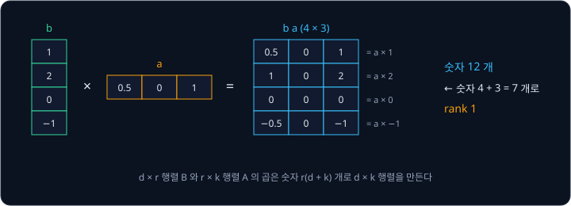
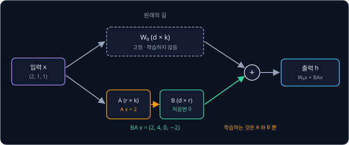
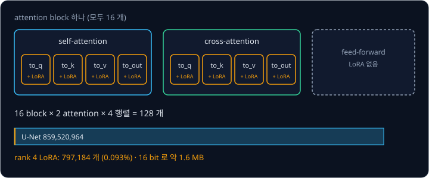
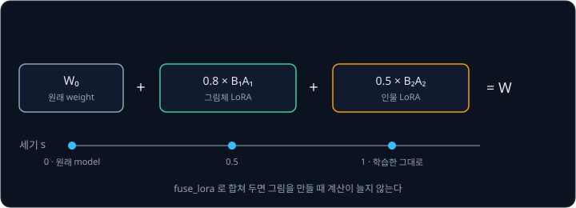

# LoRA

내 그림체로 그린 그림 20 장을 Stable Diffusion 에 가르치고 싶다고 하자. [Samplers](../samplers/README.md) 까지 본 Stable Diffusion 의 U-Net 은
parameter 가 약 8 억 6 천만 개이고, 이것을 전부 다시 학습하면 그림체 하나마다 같은 크기의 model 이 하나씩 생긴다. 16 bit 로 저장해도 U-Net 만
1.7 GB 이고, 학습하는 동안에는 parameter 마다 gradient 와 optimizer 의 기록까지 GPU 에 올려야 한다. 그림 20 장의 그림체를 담는 데 정말로 숫자
8 억 개를 모두 바꿔야 할까?

이 물음에 답하는 방법이 **LoRA**(Low-Rank Adaptation)다. 학습한 weight 는 고정하고, weight 에 더할 변화량을 얇은 행렬 두 개의 곱으로 만들어
그 두 행렬만 학습한다. Hu 등이 2021 년에 GPT-3 같은 언어 모델을 위해 제안했는데, GPT-3 175B 에서 학습하는 parameter 를 1 만 분의 1 로, 학습에
드는 GPU memory 를 3 분의 1 로 줄였다. Stable Diffusion 에서는 attention 층에 붙인 LoRA 하나가 몇 MB 의 파일이 되어, 그림체나 인물을 하나씩
담는 데 쓰인다.

## 학습 목표

- U-Net 전체를 미세조정할 때 드는 저장 공간과 학습 memory 를 parameter 수로 계산할 수 있다
- 행렬의 rank 와, 두 행렬의 곱 $BA$ 로 변화량을 만들면 parameter 가 $r(d + k)$ 개로 줄어드는 이유를 숫자로 설명할 수 있다
- $B$ 를 0 으로 두고 시작하는 이유와 $\alpha / r$ 로 변화량의 크기를 맞추는 방법을 설명할 수 있다
- Stable Diffusion 의 attention 에 LoRA 를 붙였을 때의 parameter 수, 원래 weight 에 합치는 방법, 여러 LoRA 를 섞는 방법을 설명할 수 있다

## 미세조정의 비용

이미 학습한 model 을 새 데이터로 조금 더 학습시키는 일을 **미세조정**(fine-tuning)이라고 한다. Stable Diffusion 을 미세조정할 때는
[Latent Diffusion](../latent-diffusion/README.md) 의 학습 순서를 그대로 쓰되, 데이터만 새 그림과 그 설명 글로 바꾼다. 모든 parameter 를 고치는
**전체 미세조정**의 비용은 parameter 수로 어림할 수 있다.

숫자 하나를 32 bit(4 byte)로 저장한다고 하자. 학습에 흔히 쓰는 optimizer Adam 은 parameter 마다 gradient 하나와 함께, 지금까지의 gradient 의
평균과 제곱의 평균을 하나씩 기억한다. 그래서 parameter 하나에 숫자가 네 개(weight, gradient, 평균 둘) 필요하다. Stable Diffusion v1 U-Net 의
parameter 859,520,964 개로 계산하면 아래와 같다.

| 항목 | 계산 | 크기 |
| --- | --- | --- |
| 미세조정한 U-Net 하나를 16 bit 로 저장 | $859{,}520{,}964 \times 2$ byte | 약 1.72 GB |
| 학습 중 weight·gradient·Adam 기록 (32 bit) | $859{,}520{,}964 \times 4 \times 4$ byte | 약 13.8 GB |

둘째 줄은 layer 를 지나며 생기는 중간 값(activation)을 빼고 셈한 값이라, 실제로는 이보다 많이 든다. 그림체 10 개를 담으려면 1.72 GB 짜리 파일이
10 개 필요하다.

그런데 그림체를 배우는 일은 Stable Diffusion 이 처음 배운 일에 비하면 아주 작은 변화다. 글을 읽고 noise 를 걷어 내는 능력은 그대로 두고, 그림의
선과 색을 조금 바꾸면 된다. LoRA 논문의 저자들은 이런 적응에서 weight 의 변화량이 낮은 **intrinsic rank**("본래의 rank")를 가진다는 가설에서
출발했다. 변화량을 적은 숫자로 나타낼 수 있다면 그 적은 숫자만 학습하면 된다.

**확인 문제.** parameter 가 1 억 개인 model 을 Adam 으로 전체 미세조정한다. weight·gradient·Adam 기록을 모두 32 bit 로 두면 memory 가 얼마나
필요할까(activation 제외)?

답 보기

parameter 하나에 숫자 4 개, 숫자 하나에 4 byte 이므로 16 byte 다.

$$
100{,}000{,}000 \times 16 = 1{,}600{,}000{,}000 \text{ byte} = 1.6 \text{ GB}
$$

답: 약 1.6 GB.

## 행렬의 rank

[Vectors & Matrices](../vectors-matrices/README.md) 에서 본 행렬 곱셈으로, 세로 vector 하나와 가로 vector 하나를 곱하면 행렬이 된다. 숫자가 4 개인
$b = (1, 2, 0, -1)$ 를 세로로 세우고 숫자가 3 개인 $a = (0.5, 0, 1)$ 을 가로로 눕혀 곱하면 $4 \times 3$ 행렬이 나온다.

$$
b\,a = \begin{pmatrix} 1 \\ 2 \\ 0 \\ -1 \end{pmatrix} \begin{pmatrix} 0.5 & 0 & 1 \end{pmatrix} =
\begin{pmatrix} 0.5 & 0 & 1 \\ 1 & 0 & 2 \\ 0 & 0 & 0 \\ -0.5 & 0 & -1 \end{pmatrix}
$$

이 행렬의 숫자는 12 개지만, 만드는 데 쓴 숫자는 $4 + 3 = 7$ 개다. 모든 행이 $a$ 에 1, 2, 0, $-1$ 을 곱한 것이라 서로 독립적인 방향이 하나뿐이다.
이렇게 행렬 안에서 서로 독립인 방향의 수를 **rank** 라고 하고, 이 행렬의 rank 는 1 이다.

세로 vector 를 $r$ 개 나란히 놓은 $d \times r$ 행렬 $B$ 와, 가로 vector 를 $r$ 개 쌓은 $r \times k$ 행렬 $A$ 를 곱하면 rank 가 $r$ 이하인
$d \times k$ 행렬 $BA$ 가 된다. 숫자의 수는 아래처럼 바뀐다.

| | 이 예의 값 | 기호로 쓴 값 |
| --- | --- | --- |
| 행렬의 크기 | $4 \times 3$ | $d \times k$ |
| 행렬을 그대로 적은 숫자 | 12 | $d\,k$ |
| rank | 1 | $r$ |
| $B$ 와 $A$ 의 숫자 | $4 \times 1 + 1 \times 3 = 7$ | $d\,r + r\,k = r(d + k)$ |

$d$ 와 $k$ 가 클수록 차이가 커진다. Stable Diffusion U-Net 1 단계의 cross-attention 에서 key 를 만드는 행렬은 $320 \times 768$ 이라 숫자가
245,760 개인데, rank 4 로 만들면 $4 \times (320 + 768) = 4{,}352$ 개로 1.8% 다.

**확인 문제.** $1280 \times 768$ 행렬의 변화량을 rank 8 의 $BA$ 로 만들면 숫자가 몇 개 필요할까? 행렬을 그대로 적을 때의 몇 % 일까?

답 보기

① $B$ 와 $A$ 의 숫자는 $8 \times (1280 + 768) = 8 \times 2048 = 16{,}384$ 개다.

② 행렬을 그대로 적으면 $1280 \times 768 = 983{,}040$ 개다.

$$
16{,}384 \div 983{,}040 \approx 0.0167
$$

답: 16,384 개로 약 1.7%.

## LoRA 의 식

LoRA 는 학습한 weight $W_0$($d \times k$)를 고정하고, 변화량 $\Delta W$("델타 W")를 $BA$ 로 만들어 더한다. 입력 $x$ 에 대한 출력은 아래와
같다(LoRA 논문의 식 (3)).

$$
h = W_0\,x + \Delta W\,x = W_0\,x + B\,A\,x
$$

$x$ 를 $W_0$ 에 곱한 값과 $A$, $B$ 를 차례로 곱한 값을 자리마다 더한다는 뜻이다. 앞 절의 $b$, $a$ 를 $B$, $A$ 로 쓰고 $x = (2, 1, 1)$ 을 넣어 보자.
$A\,x = 0.5 \times 2 + 0 \times 1 + 1 \times 1 = 2$ 로 숫자 하나가 되고, 여기에 $B$ 를 곱하면 $(2, 4, 0, -2)$ 다. $W_0\,x$ 에 이 값을 더한 것이
LoRA 를 붙인 층의 출력이다. $x$ 를 숫자 $r$ 개(여기서는 1 개)로 줄였다가 다시 숫자 $d$ 개로 늘린다.

학습을 시작할 때 $A$ 는 정규분포에서 뽑은 작은 값으로, $B$ 는 모두 0 으로 둔다. $B = 0$ 이면 $BA = 0$ 이라서 처음의 model 은 원래 Stable Diffusion
과 정확히 같다. 원래 model 에서 출발해 조금씩 바뀌므로, 학습 초기에 그림이 망가지지 않는다.

$A$ 와 $B$ 가 모두 0 이면 둘 다 영영 바뀌지 않는데, 그 이유는 loss 의 gradient 를 보면 알 수 있다. $B$ 의 숫자 하나가 받는 gradient 는 그 숫자에
곱해지는 값 $A\,x$ 에 비례한다. 그래서 $A$ 를 0 으로 두면 $A\,x = 0$ 이라 gradient 도 0 이다. $A$ 의 숫자 하나가 받는 gradient 는 $B$ 를 거쳐 오므로 $B = 0$ 이면 역시
0 이다. 그래서 둘 중 하나만 0 으로 둔다. $A$ 가 0 이 아니면 첫 step 에서 $B$ 의 gradient 가 0 이 아니어서 $B$ 가 먼저 움직이고, $B$ 가 0 에서
벗어나면 $A$ 도 gradient 를 받기 시작한다.

<b>심화: B 와 A 의 gradient</b>

출력 $h$ 의 숫자 $d$ 개 각각에 대한 loss 의 gradient 를 모은 vector 를 $g$ 라고 하자. $h = W_0 x + B(Ax)$ 이고, 숫자 $r$ 개인 $Ax$ 를 $u$ 라고 두면

$$
\frac{\partial L}{\partial B} = g\,u^\top, \qquad \frac{\partial L}{\partial A} = (B^\top g)\,x^\top
$$

이다. $B$ 의 $(i, j)$ 자리 숫자의 gradient 는 $g_i u_j$ 라서 $u$ 가 0 이면 0 이고, $A$ 의 gradient 는 $B^\top g$ 를 곱하므로 $B = 0$ 이면 0 이다. 처음에
$B = 0$, $A \neq 0$ 이면 $B$ 만 gradient 를 받는다. 예를 들어 $g = (1, 0, 0, 0)$, $u = 2$ 면 $B$ 의 첫 숫자의 gradient 는 $1 \times 2 = 2$ 로 $+$ 다. 그 숫자를
키우면 loss 가 늘므로, gradient descent 는 그 숫자를 줄인다.

LoRA 논문은 이렇게 학습한 $BA$ 를 실제로 쓸 때 $W_0$ 에 더해 $W = W_0 + BA$ 하나로 합칠 수 있다는 점을 강조한다. 합치고 나면 층의 모양이 원래와
같아서 그림을 만드는 계산이 전혀 늘지 않는다. 층 사이에 작은 network 를 끼워 넣는 adapter 방법은 끼운 network 만큼 계산이 늘어난다는 점에서
LoRA 와 다르다.

**흔한 오해.** LoRA 를 쓰면 model 이 작아져 그림을 만들 때 memory 를 덜 쓴다고 생각하기 쉽지만, 고정한 $W_0$ 는 그대로 있어야 한다. LoRA 가 줄이는
것은 학습할 parameter 와, 학습한 결과를 저장하는 파일의 크기다. LoRA 논문에 따르면 GPT-3 를 쓰려면 여전히 350 GB 의 model 이 필요하지만, 학습한
결과 100 개를 저장하는 데는 350 GB 씩 100 개 대신 35 MB 씩 100 개가 든다.

**확인 문제.** $A = (1, -1, 0)$($1 \times 3$), $B = (0.5, 0, 1, 2)^\top$($4 \times 1$), $x = (3, 1, 2)$ 일 때 $BAx$ 는?

답 보기

① $Ax = 1 \times 3 + (-1) \times 1 + 0 \times 2 = 2$ 다.

② $B$ 에 2 를 곱하면 $(1, 0, 2, 4)$ 다.

답: $(1, 0, 2, 4)$. 이 값을 $W_0 x$ 에 더한다.

## α 와 rank

LoRA 논문의 식에서는 $BAx$ 에 $\alpha / r$ 을 곱해 더한다. $\alpha$("알파")는 미리 정해 두는 상수다.

$$
h = W_0\,x + \frac{\alpha}{r}\,B\,A\,x
$$

rank 를 바꾸면 $BA$ 에 더해지는 항의 수가 바뀌어 변화량의 크기도 바뀐다. 논문의 설명에 따르면 $\alpha / r$ 을 곱해 두면 rank 를 4 에서 8 로 바꿔도
learning rate 를 다시 맞출 필요가 줄어든다. 저자들은 $\alpha$ 를 처음 시도한 $r$ 값으로 정하고 따로 조절하지 않았다. diffusers 의 Stable
Diffusion LoRA 학습 예제(`train_text_to_image_lora.py`)는 기본 rank 가 4 이고 `lora_alpha` 를 rank 와 같게 두므로 $\alpha / r = 1$ 이다.
PEFT 의 LoRA 층도 `lora_alpha / r` 을 곱한다.

rank 는 얼마나 커야 할까? LoRA 논문의 저자들은 GPT-3 175B 를 WikiSQL(글을 SQL 로 바꾸기)에 적응시키며 rank 를 바꿔 정확도를 쟀다(표 6).

| 적응시킨 weight | $r = 1$ | $r = 2$ | $r = 4$ | $r = 8$ | $r = 64$ |
| --- | --- | --- | --- | --- | --- |
| $W_q$ 만 | 68.8 | 69.6 | 70.5 | 70.4 | 70.0 |
| $W_q$, $W_v$ | 73.4 | 73.3 | 73.7 | 73.8 | 73.5 |
| $W_q$, $W_k$, $W_v$, $W_o$ | 74.1 | 73.7 | 74.0 | 74.0 | 73.9 |

$W_q$, $W_k$, $W_v$, $W_o$ 는 [Cross-Attention](../cross-attention/README.md) 에서 본 query, key, value 를 만드는 행렬과 attention 의 출력을
바꾸는 행렬이다. query 와 value 두 행렬에 붙이면 rank 1 로도 rank 64 와 비슷했고, query 하나에만 붙이면 rank 가 더 커야 했다. 저자들은 이를
변화량의 intrinsic rank 가 아주 작다는 증거로 보았다. 같은 parameter 수로 비교한 7.1 절의 표 5 에서도, 한 종류의 행렬에 큰 rank 를 주는 것보다
여러 행렬에 rank 4 정도를 나눠 붙이는 편이 나았다.

rank 를 키우면 LoRA 는 전체 미세조정에 가까워진다. $d \times k$ 행렬의 rank 는 $d$ 와 $k$ 가운데 작은 값을 넘지 못하므로, $r$ 을 그 값까지 키우면 $BA$ 는
어떤 변화량이든 만들 수 있다. 논문도 모든 weight 행렬에 LoRA 를 붙이고 rank 를 원래 행렬의 rank 로 두면 전체 미세조정의 표현력을 대략 되찾는다고
적었다. LoRA 에서는 rank 1 과 그 최댓값 사이에서 필요한 만큼만 rank 를 고른다.

**확인 문제.** $\alpha = 8$, $r = 4$ 인 LoRA 에서 $BAx = (0.5, -0.25)$ 였다. 층의 출력에 더해지는 값은?

답 보기

$\alpha / r = 8 \div 4 = 2$ 를 곱한다.

$$
2 \times (0.5, -0.25) = (1.0, -0.5)
$$

답: $(1.0, -0.5)$.

## Stable Diffusion 의 attention 에 붙이기

`cloneofsimo/lora` 는 LoRA 를 Stable Diffusion 의 미세조정에 쓴 초기 리포 가운데 하나인데, 이 리포에는 transformer 의 attention 층(Q, K, V,
O)만 조절해도 충분하다고 적혀 있다. diffusers 의 학습 예제도 U-Net 의 attention 에서 query·key·value·출력 행렬(`to_q`, `to_k`, `to_v`, `to_out.0`)에만 LoRA 를
붙이고, U-Net 과 VAE 와 text encoder 의 원래 weight 는 모두 고정한다.

[Cross-Attention](../cross-attention/README.md) 에서 본 것처럼 Stable Diffusion v1 의 U-Net 에는 attention block 이 16 개 있고, block 마다
self-attention 과 cross-attention 이 하나씩 있다. 둘 다 행렬이 넷이라 LoRA 를 붙일 행렬은 $16 \times 2 \times 4 = 128$ 개다. v1-4 weight 파일의
tensor 모양으로 이 128 개 행렬에 붙인 LoRA 의 parameter 를 세면 아래와 같다.

| rank $r$ | LoRA parameter | U-Net 전체 대비 | 16 bit 로 저장한 크기 |
| --- | --- | --- | --- |
| 1 | 199,296 | 0.023% | 약 0.4 MB |
| 4 | 797,184 | 0.093% | 약 1.6 MB |
| 8 | 1,594,368 | 0.19% | 약 3.2 MB |
| 16 | 3,188,736 | 0.37% | 약 6.4 MB |
| 64 | 12,754,944 | 1.5% | 약 25.5 MB |

rank 4 LoRA 는 parameter 가 약 80 만 개라 전체 미세조정의 1000 분의 1 이 안 되고, 파일은 1.6 MB 쯤이다. `cloneofsimo/lora` 의 README 가 결과 파일을
"1MB ~ 6MB" 라고 적은 것과 맞는다. 고정한 weight 에는 gradient 와 Adam 기록이 필요 없으므로 학습 memory 도 줄어든다. 앞 절의 13.8 GB 가운데
대부분이 빠지고 고정한 weight 자체(16 bit 면 약 1.72 GB)와 activation 이 남는다.

글을 읽는 쪽을 바꾸고 싶으면 CLIP text encoder 에도 LoRA 를 붙일 수 있다. `cloneofsimo/lora` 에서는 `--train_text_encoder` 로 이를 켤 수 있고, attention
밖의 ResNet 층이나 feed-forward 층에 붙이는 설정도 있다.

**확인 문제.** cross-attention 의 key 행렬은 3 단계와 가장 아래에서 $1280 \times 768$ 이다. 이 행렬 하나에 rank 16 LoRA 를 붙이면 parameter 는 몇 개일까?

답 보기

$$
16 \times (1280 + 768) = 16 \times 2048 = 32{,}768
$$

답: 32,768 개로, 원래 행렬의 숫자 $983{,}040$ 개의 3.3% 다.

## 적은 그림으로 대상을 가르치기

그림체가 아니라 내 강아지처럼 특정한 대상 하나를 가르칠 때는 그림이 훨씬 적어도 된다. Ruiz 등은 DreamBooth(2022)에서 대상의 사진 3 ~ 5 장으로
text-to-image model 을 미세조정했다. 사진마다 "a [V] dog" 처럼 드문 token 으로 만든 식별자 [V] 와 대상의 종류(dog)를 붙인 글을 짝지어 학습해, model 이 [V] 를
그 강아지와 묶게 한다. "special" 같은 흔한 영어 단어를 식별자로 쓰면 model 이 그 단어의 원래 뜻과 새 대상을 떼어 내야 해서, 드문 token 을 쓴다.

사진 몇 장만으로 학습하면 model 이 "dog" 라는 단어 자체를 그 강아지와 묶어 버려, 다른 강아지를 그리지 못하게 될 수 있다. 저자들은 이 현상을 language
drift 라고 부르고, **prior preservation loss** 를 더해 막았다. 학습 전의 model 로 "a dog" 그림을 미리 만들어 두고, 미세조정하는 동안 이 그림들에 대해서도 원래
loss 를 함께 줄이게 한다.

$$
L = L_\text{대상} + \lambda\, L_\text{prior}
$$

$L_\text{대상}$ 은 "a [V] dog" 와 대상 사진으로 구한 noise 오차이고, $L_\text{prior}$ 는 "a dog" 와 미리 만든 그림으로 구한 noise 오차다. $\lambda$("람다")는
두 loss 의 비율이다. 예를 들어 한 step 에서 $L_\text{대상} = 0.12$, $L_\text{prior} = 0.08$ 이고 $\lambda = 1$ 이면 $L = 0.20$ 이다. 저자들은 $\lambda = 1$,
learning rate $5 \times 10^{-6}$ 으로 Stable Diffusion 을 약 1000 번 학습했고, 이때 "a dog" 그림은 약 1000 장 만들었다. 논문에 따르면 A100 GPU 한 대로
약 5 분이 걸렸다.

![DreamBooth 의 학습. 대상 사진 3 ~ 5 장은 a [V] dog 와 짝지어 L_대상 을, 학습 전 model 이 만든 a dog 그림은 a dog 와 짝지어 L_prior 를 구하고, L = L_대상 + λ L_prior 를 줄인다](figures/dreambooth.svg)

DreamBooth 의 저자들은 U-Net 전체를 미세조정했지만, 같은 학습을 LoRA 로 할 수도 있다. diffusers 의 `train_dreambooth_lora.py` 는 rank 4 LoRA 로
DreamBooth 를 한다. 기본값은 learning rate 가 $5 \times 10^{-4}$ 이고, `prior_loss_weight` 가 1.0 이고, prior 용 그림이 100 장이다. 이 learning rate 는
저자들이 전체 미세조정에 쓴 $5 \times 10^{-6}$ 의 100 배다.

**확인 문제.** DreamBooth 학습의 한 step 에서 $L_\text{대상} = 0.30$, $L_\text{prior} = 0.10$ 이다. $\lambda = 0.5$ 이면 줄일 loss 는 얼마이고, prior preservation
loss 를 쓰지 않으면($\lambda = 0$) 얼마일까?

답 보기

$$
0.30 + 0.5 \times 0.10 = 0.35, \qquad 0.30 + 0 \times 0.10 = 0.30
$$

답: 0.35 와 0.30. $\lambda = 0$ 이면 대상 사진만 보고 학습해 language drift 가 생기기 쉽다.

## 합치기와 세기 조절

학습한 LoRA 는 그림을 만들 때 두 방법으로 쓸 수 있다. 하나는 층마다 $W_0 x$ 와 $BAx$ 를 따로 계산해 더하는 것이고, 다른 하나는 미리 $W = W_0 + BA$ 로
합쳐 두는 것이다. diffusers 에서는 `load_lora_weights` 로 LoRA 를 붙이고, `fuse_lora` 로 원래 weight 에 합치며, `unfuse_lora` 로 다시 뺀다. 합친 뒤에는
LoRA 가 없는 model 과 계산량이 같다.

더할 때 크기 $s$ 를 곱하면 LoRA 의 효과를 조절할 수 있다. $W = W_0 + s \cdot BA$ 에서 $s = 0$ 이면 원래 model 이고, $s = 1$ 이면 학습한 그대로다.
`fuse_lora` 의 `lora_scale` 이 이 $s$ 이고 기본값은 1.0 이다. `cloneofsimo/lora` 의 README 는 1 보다 조금 큰 값도 쓸 수 있고, U-Net 과 text encoder 에
다른 크기를 주는 편이 나을 때도 있다고 적었다. 그 README 의 예에서는 U-Net 에 0.6 을 주고 text encoder 에 0.9 를 준 결과가 둘 다 1.0 으로 둔 결과보다 나았다.

변화량은 더하기만 하므로 LoRA 여러 개를 한 model 에 함께 붙일 수도 있다. 그림체 LoRA $B_1 A_1$ 과 인물 LoRA $B_2 A_2$ 를 세기 0.8 과 0.5 로 섞으면
$W = W_0 + 0.8\,B_1 A_1 + 0.5\,B_2 A_2$ 다. diffusers 에서는 `set_adapters` 로 LoRA 마다 이름과 세기를 정한다. 두 LoRA 가 같은 행렬을 서로 다른 방향으로
바꾸도록 학습했다면 더한 결과가 둘 중 어느 것과도 다를 수 있어서, 세기를 줄여 가며 맞춘다.

**확인 문제.** 어떤 행렬의 한 자리 숫자가 $W_0$ 에서 0.30 이고, LoRA 의 $BA$ 에서 같은 자리 숫자가 0.10 이다. 세기 0.5 로 합치면 그 자리 숫자는 얼마가 될까? 세기 0 과 1 이면?

답 보기

$W = W_0 + s \times BA$ 이므로

$$
0.30 + 0.5 \times 0.10 = 0.35
$$

답: 0.35. 세기 0 이면 0.30 그대로이고, 세기 1 이면 0.40 이다.

## 정리

- Stable Diffusion U-Net 을 전체 미세조정하면 결과가 16 bit 로도 1.72 GB 이고, 학습 중 weight·gradient·Adam 기록만 약 13.8 GB 다. LoRA 는 원래 weight
  $W_0$ 를 고정하고 변화량을 $d \times r$ 행렬 $B$ 와 $r \times k$ 행렬 $A$ 의 곱으로 만들어, parameter 를 $d\,k$ 개에서 $r(d + k)$ 개로 줄인다
- 출력은 $h = W_0 x + \frac{\alpha}{r} BAx$ 이고, $B = 0$ 에서 시작해 처음 model 이 원래와 같다. LoRA 논문에서는 query·value 에 붙이면 rank 1 로도
  충분했고, diffusers 의 Stable Diffusion 예제는 attention 행렬 128 개에 rank 4($\alpha / r = 1$)를 붙여 parameter 797,184 개(약 1.6 MB)를 학습한다
- 특정 대상은 DreamBooth 처럼 사진 3 ~ 5 장과 식별자 [V] 로 가르치고, prior preservation loss 로 종류 이름의 뜻을 지킨다. 학습한 $BA$ 는 $W_0$ 에 합쳐
  계산을 늘리지 않고 쓸 수 있고, 세기 $s$ 로 효과를 조절하며, 여러 LoRA 를 각자의 세기로 더해 섞는다

LoRA 로는 Stable Diffusion 이 그리는 대상과 그림체를 바꿀 수 있지만, 그림의 배치는 여전히 글과 noise 가 정한다. 사람의 자세나 윤곽선 같은 그림을
조건으로 넣어 배치를 직접 정하는 방법은 다음 강의인 [ControlNet](../controlnet/README.md) 에서 다룬다.

## 참고 자료

- Edward J. Hu 등, [LoRA: Low-Rank Adaptation of Large Language Models](https://arxiv.org/abs/2106.09685) (2021) — LoRA 의 원 논문. 4.1 절의 식 (3),
  $B = 0$ 과 $A$ 의 정규분포 초기화, $\alpha / r$, 합쳐서 계산이 늘지 않는 점, 4.2 절의 GPT-3 memory·저장 공간, 7.1 절 표 5 의 어느 행렬에 붙일지, 7.2 절 표 6 의 rank 실험
- [cloneofsimo/lora](https://github.com/cloneofsimo/lora) — LoRA 를 Stable Diffusion 에 붙인 리포. attention 층만 조절하는 설정, 1 ~ 6 MB 의
  결과 파일, U-Net 과 text encoder 의 세기 조절
- diffusers, [train_text_to_image_lora.py](https://github.com/huggingface/diffusers/blob/main/examples/text_to_image/train_text_to_image_lora.py) —
  rank 4, `lora_alpha` = rank, `to_q`·`to_k`·`to_v`·`to_out.0` 에만 붙이고 나머지를 고정하는 기본 설정.
  [lora_base.py](https://github.com/huggingface/diffusers/blob/main/src/diffusers/loaders/lora_base.py) 에 `fuse_lora`(`lora_scale` 기본값 1.0),
  `unfuse_lora`, `set_adapters` 가 있다
- Nataniel Ruiz 등, [DreamBooth](https://arxiv.org/abs/2208.12242) (2022) — 사진 3 ~ 5 장과 식별자 [V] 로 대상을 가르치는 미세조정. 3.3 절의 prior
  preservation loss 와 학습 설정($\lambda = 1$, 약 1000 번, Stable Diffusion 에서 A100 으로 약 5 분). diffusers 의
  [train_dreambooth_lora.py](https://github.com/huggingface/diffusers/blob/main/examples/dreambooth/train_dreambooth_lora.py) 가 이를 LoRA 로 한다
- PEFT, [tuners/lora/layer.py](https://github.com/huggingface/peft/blob/main/src/peft/tuners/lora/layer.py) — `lora_alpha / r` 의 크기 조절과 $B$ 를 0 으로
  두는 초기화
