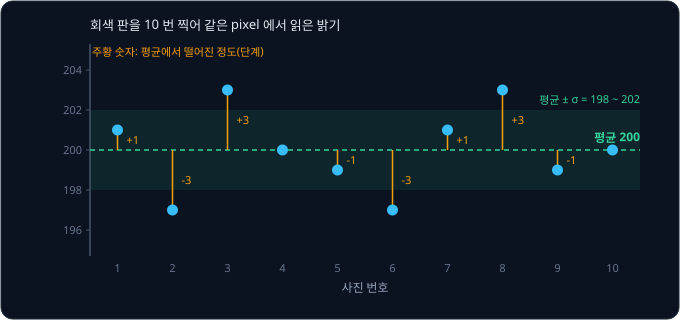
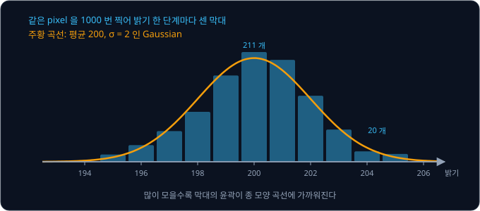
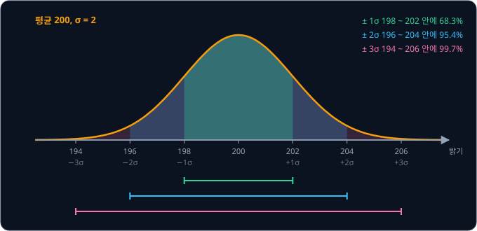
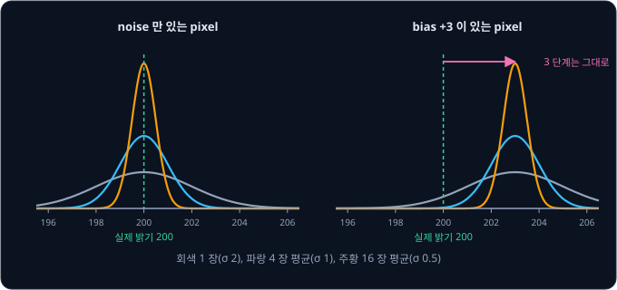
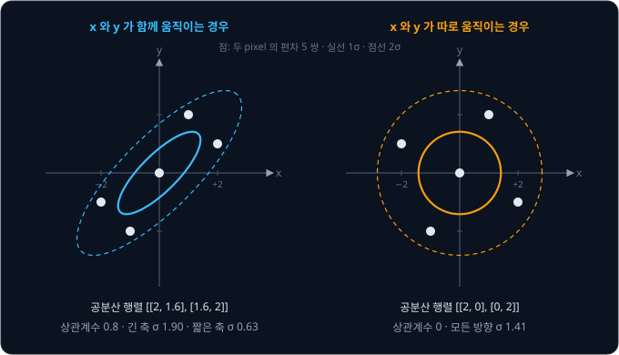
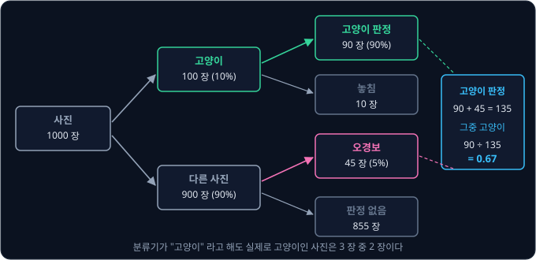
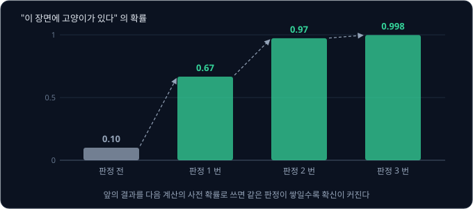
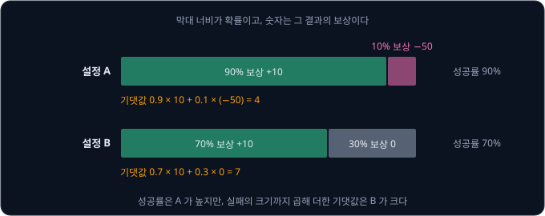

# Probability & Gaussians

회색 판을 삼각대에 고정한 카메라로 열 번 찍고 같은 자리 pixel 의 밝기를 읽으면 201, 197, 203, 200 처럼 찍을 때마다 다른 값이 나온다.
판도 카메라도 그대로인데 값이 이렇게 흔들린다면, 다음 사진에서 이 pixel 이 몇 단계 이상 바뀌어야 "누가 지나갔다" 고 판단할 수 있을까?

이 문제를 푸는 좋은 방법은 확률을 쓰는 것인데, 확률로는 흔들리는 값을 "가장 그럴듯한 값" 과 "흔들리는 폭" 두 숫자로 적고 계산할 수
있다. 폭을 표준편차 σ 로 적었을 때 값이 흩어진 모양이 Gaussian 이면, σ 의 몇 배 안에 값이 얼마나 들어오는지가 정해져 있어서 판단 기준을
숫자로 정할 수 있다. OpenCV 의 배경 분리 함수 `createBackgroundSubtractorMOG2` 는 pixel 마다 밝기 분포를 Gaussian 몇 개로 기억해 두고, 기본
설정에서는 새 값이 그 평균에서 σ 의 4 배보다 멀면 움직인 물체로 판단한다. Stable Diffusion 이 그림을 그리기 시작하는 출발점도 Gaussian 에서
뽑은 noise 다.

## 학습 목표

- pixel 값의 평균·분산·표준편차를 계산하고, Gaussian 과 68-95-99.7 규칙으로 판단 기준을 정하는 방법을 설명할 수 있다
- 독립인 측정 $N$ 개를 평균하면 표준편차가 $\sqrt N$ 분의 1 로 줄지만 bias 는 줄지 않는 이유를 설명할 수 있다
- 두 값의 공분산·상관계수와, 공분산 행렬이 오차 타원을 그리는 방식을 설명할 수 있다
- Bayes rule 로 판정 뒤의 믿음을 계산하고, 기댓값으로 선택지를 비교할 수 있다

## 평균과 표준편차

회색 판을 열 번 찍어 같은 자리 pixel 에서 읽은 밝기(0 ~ 255)가 아래 표의 둘째 열이다. 가장 그럴듯한 값으로는 값을 모두 더해 개수로 나눈
**평균**(mean)을 쓴다. 열 개 값의 합이 2000 이라서 평균은 $2000 \div 10 = 200$ 이고, 평균은 그리스 문자 $\mu$("뮤")로 적는다.

| 번호 | 밝기 | 편차 | 편차² |
| --- | --- | --- | --- |
| 1 | 201 | +1 | 1 |
| 2 | 197 | −3 | 9 |
| 3 | 203 | +3 | 9 |
| 4 | 200 | 0 | 0 |
| 5 | 199 | −1 | 1 |
| 6 | 197 | −3 | 9 |
| 7 | 201 | +1 | 1 |
| 8 | 203 | +3 | 9 |
| 9 | 199 | −1 | 1 |
| 10 | 200 | 0 | 0 |
| 합 | 2000 | 0 | 40 |

셋째 열의 **편차**(deviation)는 측정값에서 평균을 뺀 값으로, 각 값이 평균에서 몇 단계 떨어져 있는지를 적었다. 흔들림의 크기를 숫자
하나로 나타내고 싶은데, 편차를 그대로 평균하면 +와 −가 서로 지워져 언제나 0 이 된다. 그래서 편차를 제곱해 부호를 없앤 뒤 평균하고, 이 값을
**분산**(variance)이라고 부른다. 이 pixel 의 분산은 $40 \div 10 = 4$ 다.

분산은 편차를 제곱했으니 단위도 "단계²" 라서 "몇 단계 흔들린다" 로 읽기 어렵다. 분산의 제곱근을 구하면 원래 단위로 돌아오는데, 이 값이
**표준편차**(standard deviation)이고 그리스 문자 $\sigma$("시그마")로 적는다. 제곱근 $\sqrt{\ }$ 은 제곱해서 그 수가 되는 양수라서
$\sigma = \sqrt 4 = 2$ 이고, 거꾸로 분산은 $\sigma^2$ 으로 적는다. $\sigma = 2$ 는 이 pixel 을 한 번 찍은 값이 평균에서 2 단계 안팎 벗어난다는
뜻이다.

<b>심화: 분산의 식과 N − 1</b>

측정값을 $x_1, x_2, \dots, x_N$ 이라고 하면 평균과 분산은 아래와 같다. $\sum$ 은 $i = 1$ 부터 $N$ 까지 모두 더하라는 기호다.

$$
\mu = \frac{1}{N} \sum_{i=1}^{N} x_i, \qquad \sigma^2 = \frac{1}{N} \sum_{i=1}^{N} (x_i - \mu)^2
$$

$N$ 대신 $N - 1$ 로 나누는 식도 자주 쓴다. 평균을 바로 그 값들로 구했기 때문에 값들은 진짜 평균보다 자기들로 구한 평균에 조금 더 가깝게
모이고, 그래서 $N$ 으로 나누면 분산이 실제보다 조금 작게 나온다. 위 예를 $N - 1$ 로 나누면 $40 \div 9 \approx 4.44$ 라 차이가 크지 않다.
그래도 NumPy 의 `np.std` 는 기본으로 $N$ 으로 나누고 pandas 의 `std` 는 $N - 1$ 로 나누므로, 데이터가 적을 때는 어느 쪽인지 확인한다.

## 분포와 Gaussian

**확률**(probability)은 어떤 일이 얼마나 자주 일어나는지를 0 과 1 사이의 숫자로 적은 것이다. 0 은 일어나지 않는다는 뜻이고 1 은 반드시
일어난다는 뜻이며, 일어날 수 있는 모든 경우의 확률을 더하면 1 이다. 같은 판을 1000 번 찍어 밝기 한 단계마다 몇 번 나왔는지 세면,
200 에 211 번, 204 에 20 번이 나온다. 개수를 1000 으로 나누면 "한 번 찍었을 때 그 밝기가 나올 확률" 이 된다. 이렇게 값의 구간마다 개수를 세어
막대로 그린 그림을 histogram 이라고 한다.

값을 많이 모을수록 막대의 윤곽은 매끄러운 곡선 하나에 가까워진다. 이 곡선처럼 값마다 얼마나 자주 나오는지를 빠짐없이 적은 것을
**확률분포**(probability distribution)라고 한다. 곡선 아래의 넓이가 확률이라서, 198 ~ 202 사이의 넓이가 그 범위의 값이 나올
확률이고 곡선 아래 전체의 넓이는 1 이다. 곡선의 높이는 확률 자체가 아니라 그 근처에 값이 얼마나 몰려 있는지를 나타낸다.

센서 noise 의 분포는 위 그림처럼 가운데가 가장 높고 양쪽으로 똑같이 낮아지는 종 모양인 경우가 많다. 이 모양을 **Gaussian** 또는
정규분포(normal distribution)라고 하고, 평균 $\mu$ 와 표준편차 $\sigma$ 두 숫자만 알면 모양 전체가 정해져서 $\mathcal N(\mu, \sigma^2)$ 으로
적는다. 위 pixel 은 $\mathcal N(200, 2^2)$ 이다. 서로 무관한 작은 값을 많이 더하면 각 값이 어떤 분포를 따르든 그 합은 종 모양에 가까워지는데,
이것을 central limit theorem 이라고 한다. 센서의 noise 도 전기 신호의 흔들림이나 온도처럼 작은 원인 여러 개가 더해진 것이라 종 모양에
가까운 경우가 많다. 이름은 Gauss 가 1809 년 천체의 궤도를 관측값으로 계산하면서 관측 오차를 이 분포로 다룬 데서 왔다.

모든 오차가 Gaussian 인 것은 아니다. Wikipedia 의 Dark-frame subtraction 항목이 설명하듯 센서에는 주변보다 늘 밝게 찍히는 hot pixel 이
섞여 있기도 하다. 이런 pixel 은 실제 장면과 전혀 다른 값을 내는데, 이렇게 동떨어진 값을 outlier 라고 한다. Gaussian 으로 계산하면 이런
값이 나올 확률이 거의 0 이라서, outlier 는 평균을 내기 전에 따로 걸러야 한다.

<b>심화: Gaussian 의 식</b>

$\mathcal N(\mu, \sigma^2)$ 의 곡선을 나타내는 확률밀도함수(probability density function, pdf)는 아래와 같다.

$$
p(x) = \frac{1}{\sigma \sqrt{2\pi}} \exp\!\left( -\frac{(x - \mu)^2}{2\sigma^2} \right)
$$

$\exp(a)$ 는 $e^a$ 이고 $e \approx 2.718$ 이다. $x$ 가 평균에서 $\sigma$ 의 $k$ 배 떨어져 있으면 지수 부분이 $-k^2 / 2$ 가 되므로,
곡선의 높이는 평균에서 가장 높고 $\pm 1\sigma$ 에서 그 $e^{-1/2} \approx 0.61$ 배, $\pm 2\sigma$ 에서 $e^{-2} \approx 0.14$ 배,
$\pm 3\sigma$ 에서 $e^{-4.5} \approx 0.011$ 배로 빠르게 낮아진다. 앞의 $\frac{1}{\sigma\sqrt{2\pi}}$ 는 곡선 아래 넓이를 1 로 맞추는
숫자다. 위 pixel 은 가운데 높이가 $1 \div (2 \times 2.507) \approx 0.20$ 이라 밝기 200 한 단계에 약 20% 가 들어가고, 1000 번 중 200 이
211 번 나온 것과 비슷하다.

## 68-95-99.7 규칙과 판단 기준

Gaussian 은 평균에서 $\sigma$ 의 몇 배 안에 값이 얼마나 들어오는지가 $\mu$ 와 $\sigma$ 의 값과 상관없이 정해져 있다. 위 pixel($\sigma$ = 2)에
대입하면 아래와 같다.

| 범위 | 이 pixel 의 범위 | 안에 들어올 확률 | 밖으로 나갈 확률 |
| --- | --- | --- | --- |
| $\mu \pm 1\sigma$ | 198 ~ 202 | 68.3% | 31.7% (3 번에 1 번꼴) |
| $\mu \pm 2\sigma$ | 196 ~ 204 | 95.4% | 4.6% (22 번에 1 번꼴) |
| $\mu \pm 3\sigma$ | 194 ~ 206 | 99.7% | 0.27% (370 번에 1 번꼴) |

세 확률의 앞자리를 따서 68-95-99.7 규칙이라고 부른다. 문서나 논문이 오차를 "±3σ" 로 적으면 값의 99.7% 가 그 안에 들어온다는 뜻이고,
"σ" 만 적었다면 세 번에 한 번은 그 범위를 벗어난다는 뜻이다.

서론의 질문에 답해 보자. 이 pixel 이 194 ~ 206 밖으로 나갔을 때만 "바뀌었다" 고 판단하면, 아무것도 지나가지 않았는데 noise 만으로
바뀌었다고 잘못 판단하는 일이 0.27% 로 줄어든다. 판단 기준을 $3\sigma = 6$ 단계로 잡은 것이다. OpenCV 의 MOG2 는 `varThreshold` 라는 값으로
이 기준을 정하는데, 문서에 따르면 이 값은 "pixel 과 배경 model 사이 거리의 제곱" 에 대한 기준이고 기본값이 16 이다. 거리를 $\sigma$ 단위로
잰다면 $\sqrt{16} = 4\sigma$ 가 기준이라, $3\sigma$ 보다 조금 더 넉넉하다.

0.27% 는 작아 보이지만 pixel 수를 곱하면 달라진다. 가로 1920, 세로 1080 pixel 인 사진에는 pixel 이 $1920 \times 1080 = 2{,}073{,}600$ 개 있다.
모든 pixel 이 Gaussian 을 따른다고 해도 $3\sigma$ 밖으로 나간 pixel 이 사진 한 장에 $2{,}073{,}600 \times 0.0027 \approx 5{,}600$ 개 나온다.
그래서 pixel 하나가 기준을 넘었다고 바로 물체로 판단하기보다, 이웃한 pixel 과 다음 사진을 함께 보고 판단해야 한다.

**확인 문제.** 표준편차가 1.5 단계인 pixel 이 있다. noise 의 99.7% 를 "바뀌지 않음" 으로 판단하려면 평균에서 몇 단계까지를 기준으로 잡아야 할까?

답 보기

문제의 표준편차가 $\sigma = 1.5$ 다. 위 표에서 99.7% 는 $\mu \pm 3\sigma$ 이므로 기준은 평균에서 $3 \times 1.5 = 4.5$ 단계다.

## 평균 내기와 bias

한 번 찍은 값은 2 단계쯤 흔들리지만, 여러 장을 찍어 평균하면 +쪽 오차와 −쪽 오차가 서로 상쇄되어 평균값은 덜 흔들린다. 다만 다
상쇄되지는 않아서, 서로 영향을 주지 않는(독립인) 측정 $N$ 개의 평균은 표준편차가 $N$ 분의 1 이 아니라 $\sqrt N$ 분의 1 로 줄어든다. 1 초에
30 장을 찍는 카메라로 계산하면 아래와 같다.

| 평균한 장수 $N$ | 평균값의 표준편차 $2 \div \sqrt N$ | 찍는 데 걸리는 시간 |
| --- | --- | --- |
| 1 | 2 | 0.033 초 |
| 4 | 1 | 0.13 초 |
| 16 | 0.5 | 0.53 초 |
| 100 | 0.2 | 3.3 초 |

표준편차를 반으로 줄이려면 측정이 네 배 필요한데, 100 장을 모으는 3.3 초 동안 장면 속 사람이 움직이면 평균한 사진에는 흐릿한 잔상이 남는다.
그래서 여러 장을 평균하는 방법은 밤하늘처럼 멈춘 장면을 삼각대에 고정한 카메라로 찍을 때 주로 쓴다.

$\sqrt N$ 규칙은 측정끼리 독립일 때만 맞아서, 연속한 사진이 같은 쪽으로 틀리면 평균해도 그 오차는 남는다. 어떤 pixel 이 매번 실제보다
3 단계 밝게 찍히는 것처럼 평균 자체가 어긋난 오차를 **bias**(치우침)라고 하는데, bias 도 평균으로는 지워지지 않는다. 이 pixel 의 값을
100 장 평균하면 203 근처에 0.2 단계 폭으로 모일 뿐 3 단계는 그대로 남는다.

| 성질 | noise (random error) | bias (systematic error) |
| --- | --- | --- |
| 찍을 때마다 | 크기와 부호가 바뀐다 | 같은 쪽으로 같은 만큼 틀린다 |
| $N$ 개를 평균하면 | $\sqrt N$ 분의 1 로 준다 | 그대로 남는다 |
| 줄이는 방법 | 평균, filter | calibration |

bias 는 실제 값을 알고 재야 드러난다. 밝기를 아는 기준 판을 100 장 찍은 평균이 3 단계 밝게 나오면 이 pixel 이 3 단계 밝게 찍히는 것이므로,
이후 사진마다 3 을 빼면 된다. 이렇게 알려진 기준으로 bias 를 재서 빼는 일을 **calibration** 이라고 한다. 빛이 전혀 없을 때의 bias 는
셔터를 닫고 찍은 dark frame 으로 재는데, Wikipedia 의 Dark-frame subtraction 항목은 dark frame 을 원래 사진과 같은 ISO 감도와 노출 시간으로
찍어야 한다고 적는다. 그 bias 의 크기가 두 조건에 따라 달라지기 때문이다.

**흔한 오해.** "사진을 충분히 많이 평균하면 오차가 0 에 가까워진다." 평균으로 줄어드는 것은 측정마다 독립으로 바뀌는 noise 뿐이다. bias
는 몇 번을 평균해도 그대로이고, calibration 으로 재서 빼야 한다.

**확인 문제.** 표준편차가 4 단계인 pixel 로 평균값의 표준편차를 1 단계로 줄이려면 독립인 사진을 몇 장 평균해야 할까?

답 보기

평균값의 표준편차는 $4 \div \sqrt N$ 이다. 이 값이 1 이 되려면 $\sqrt N = 4$ 여야 하므로 $N = 4 \times 4 = 16$ 장이다. 표준편차가 $N$ 이
아니라 $\sqrt N$ 에 반비례해서 4 장이 아니라 16 장이 필요하다.

<b>심화: 합의 분산과 noise 를 거듭 더할 때</b>

두 값 $X$, $Y$ 를 더한 값의 분산은 아래와 같다. $\mathrm{Var}$ 는 분산, $\mathrm{Cov}$ 는 다음 절의 공분산이다.

$$
\mathrm{Var}(X + Y) = \mathrm{Var}(X) + \mathrm{Var}(Y) + 2\,\mathrm{Cov}(X, Y)
$$

둘이 독립이면 공분산이 0 이라 분산이 그대로 더해진다. 분산이 $\sigma^2$ 인 독립 측정 $N$ 개를 더하면 분산은 $N\sigma^2$ 이다. 평균은 그 합을
$N$ 으로 나눈 값이라 분산이 $N^2$ 으로 나뉘어 $N\sigma^2 \div N^2 = \sigma^2 / N$ 이 되고, 제곱근을 씌우면 표준편차 $\sigma / \sqrt N$ 이다.

사진에 독립인 noise 를 거듭 더할 때도 같은 식이 쓰인다. 분산 1 인 noise 를 100 번 더하면 분산은 $100 \times 1 = 100$ 이고 표준편차는
$\sqrt{100} = 10$ 이라, noise 는 더한 횟수가 아니라 그 제곱근에 비례해 커진다. [DDPM](../ddpm/README.md) 은 사진에 Gaussian noise 를 1000 번에
나눠 더하는데, 더할 때마다 원래 사진 쪽을 조금씩 줄여서 전체 분산이 1 근처에 머물게 한다.

## 공분산과 상관계수

값이 두 개인 측정은 각자의 흔들림 말고도 둘이 함께 움직이는지를 따로 봐야 한다. 사진에서 나란히 붙은 두 pixel 을 여러 곳에서 골라, 왼쪽
pixel 의 밝기 $x$ 와 오른쪽 pixel 의 밝기 $y$ 가 평균에서 몇 단계 떨어졌는지 적으면 아래와 같다.

| 번호 | $x$ 편차 | $y$ 편차 | $x$ 편차 × $y$ 편차 |
| --- | --- | --- | --- |
| 1 | +2 | +1 | +2 |
| 2 | −2 | −1 | +2 |
| 3 | +1 | +2 | +2 |
| 4 | −1 | −2 | +2 |
| 5 | 0 | 0 | 0 |
| 제곱의 평균 또는 곱의 평균 | $(4+4+1+1+0) \div 5 = 2$ | $(1+1+4+4+0) \div 5 = 2$ | $8 \div 5 = 1.6$ |

$x$ 와 $y$ 의 분산은 둘 다 2 인데, 표를 보면 $x$ 가 +쪽으로 벗어날 때는 $y$ 도 +쪽으로 벗어나고 $x$ 가 −쪽일 때는 $y$ 도 −쪽으로 벗어난다.
두 편차를 곱하면 같은 쪽으로 벗어난 경우 +, 반대쪽으로 벗어난 경우 − 가 되므로, 곱의 평균을 보면 둘이 함께 움직이는지 알 수 있다. 이 값을
**공분산**(covariance)이라고 하고 위 예에서는 1.6 이다. 공분산이 0 이면 둘이 따로 움직이고, 음수면 반대로 움직인다.

공분산은 값의 크기에 따라 커져서 "얼마나 강하게 함께 움직이는지" 를 바로 읽기 어렵다. 공분산을 두 표준편차의 곱으로 나눈 값을
**상관계수**(correlation coefficient)라고 하는데, 언제나 −1 과 1 사이에 있다. 위 예는 $1.6 \div (\sqrt 2 \times \sqrt 2) = 0.8$ 로 꽤 강하게
함께 움직인다. 상관계수가 1 이면 점들이 오른쪽 위로 기운 직선 하나 위에 놓이고, −1 이면 오른쪽 아래로 기운 직선 위에 놓인다.

나란한 두 pixel 이 함께 움직이는 까닭은 둘이 대개 같은 물체의 같은 면을 찍기 때문이다. 하늘을 찍은 자리라면 두 pixel 이 함께 밝고, 그늘을
찍은 자리라면 함께 어둡다. 두 pixel 이 크게 다른 곳은 물체의 경계(edge)를 지나는 드문 자리뿐이다. 반대로 pixel 마다 따로 생기는 noise
라면 이웃끼리 상관이 없어서, 같은 판을 찍은 사진에서 나란한 두 pixel 의 noise 를 모으면 상관계수가 0 에 가깝다.

## 공분산 행렬과 오차 타원

$x$ 의 분산, $y$ 의 분산, 둘의 공분산을 2 × 2 행렬 하나에 모은 것을 **공분산 행렬**(covariance matrix)이라고 하고 $\Sigma$ 로 적는다.
대각선에는 각자의 분산이 들어가고, 대각선 밖에는 공분산이 들어간다.

$$
\Sigma = \begin{bmatrix} \mathrm{Var}(x) & \mathrm{Cov}(x, y) \\ \mathrm{Cov}(x, y) & \mathrm{Var}(y) \end{bmatrix} = \begin{bmatrix} 2 & 1.6 \\ 1.6 & 2 \end{bmatrix}
$$

세 숫자를 행렬로 묶으면 어느 방향으로 값이 얼마나 퍼지는지를 행렬 곱 한 번으로 구할 수 있다. 길이가 1 인 방향 vector $\mathbf u$ 를
정하면 그 방향의 분산은 $\mathbf u^\top \Sigma \mathbf u$ 다. $\mathbf u^\top$ 은 세로 vector $\mathbf u$ 를 가로로 눕힌 transpose 이고, transpose 와 행렬·vector 의 곱은 [Vectors & Matrices](../vectors-matrices/README.md) 에서 다룬다. 방향 몇 개를 넣어 보면 아래와 같다.

| 방향 | $\mathbf u$ | 분산 $\mathbf u^\top \Sigma \mathbf u$ | 표준편차 |
| --- | --- | --- | --- |
| 왼쪽 pixel 만 | $[1, 0]$ | 2 | 1.41 |
| 두 pixel 이 함께 밝아지는 쪽 | $[0.707, 0.707]$ | $(2 + 1.6 + 1.6 + 2) \div 2 = 3.6$ | 1.90 |
| 한쪽만 밝아지는 쪽 | $[-0.707, 0.707]$ | $(2 - 1.6 - 1.6 + 2) \div 2 = 0.4$ | 0.63 |

함께 밝아지는 쪽으로는 1.90, 한쪽만 밝아지는 쪽으로는 0.63 으로 방향마다 세 배 가까이 다르다. 실제 다섯 점을 $[0.707, 0.707]$ 직선에
비춰 거리를 재 보면 $\pm 2.12$ 가 넷, 0 이 하나라 제곱의 평균이 $4.5 \times 4 \div 5 = 3.6$ 으로 표의 값과 같다. 분산이 가장 큰 쪽을 긴
축(반지름 1.90)으로, 가장 작은 쪽을 짧은 축(반지름 0.63)으로 하는 타원을 그리면 값이 퍼진 모양과 같아지는데, 이 타원을 **오차 타원**(error
ellipse)이라고 한다. 다른 방향의 표준편차는 타원을 그 방향의 직선에 비춘 그림자 길이의 절반과 같아서, 가로로 비춘 그림자의 절반이 1.41 이다.
공분산이 0 이면 어느 방향으로나 분산이 2 라서 반지름 1.41 인 원이 된다.

타원의 두 축 방향을 공분산 행렬의 eigenvector 라고 하고, 축 방향의 분산 3.6 과 0.4 를 eigenvalue 라고 한다. 이 예에서 긴 축은 두 pixel
의 평균 밝기가 바뀌는 쪽이고 짧은 축은 두 pixel 의 차이가 바뀌는 쪽이다. 두 pixel 을 $(x, y)$ 대신 "평균" 과 "차이" 로 바꿔 적으면 대부분의
흔들림이 평균 쪽에 몰리고 차이 쪽 숫자는 작게 남는다. 데이터의 공분산 행렬에서 eigenvector 를 찾아 이렇게 축을 바꾸는 방법을 PCA(principal
component analysis)라고 한다.

값이 둘일 때는 68-95-99.7 규칙을 그대로 쓸 수 없다. 두 방향으로 동시에 범위 안에 들어와야 해서, 1σ 타원 안에는 값의 39% 만 들어간다. 2σ
타원 안에는 86% 가 들어가고, 3σ 타원 안에는 98.9% 가 들어간다. "1σ 타원" 을 보고 68% 라고 읽으면 값이 실제보다 좁게 모여 있다고 착각하게 된다.

**확인 문제.** 공분산 행렬이 $\begin{bmatrix} 4 & 1 \\ 1 & 1 \end{bmatrix}$ 이다. $x$ 와 $y$ 의 표준편차와 상관계수는?

답 보기

대각선이 분산이라 $x$ 의 분산은 4 이고 $y$ 의 분산은 1 이며, 표준편차는 각각 $\sqrt 4 = 2$, $\sqrt 1 = 1$ 이다. 대각선 밖의 1 이 공분산이므로
상관계수는 공분산 ÷ 두 표준편차의 곱 $= 1 \div (2 \times 1) = 0.5$ 다.

## 조건부 확률과 Bayes rule

사진에 고양이가 있으면 "고양이" 라고 판정하는 분류기가 있다. 이 사진 모음에서 고양이가 찍힌 사진은 전체의 10% 이고, 분류기는 고양이
사진의 90% 를 "고양이" 로 판정하며(놓칠 확률 10%), 고양이가 없는 사진도 5% 의 확률로 잘못 "고양이" 로 판정한다(오경보). 분류기가
"고양이" 라고 판정한 사진에 정말 고양이가 있을 확률은 얼마일까?

사진 1000 장으로 세면 고양이 사진은 100 장이고 그중 90 장이 "고양이" 로 판정되며, 다른 사진 900 장 중 $900 \times 0.05 = 45$ 장이
오경보로 판정된다. "고양이" 판정은 모두 $90 + 45 = 135$ 장이고 그중 실제 고양이 사진은 90 장이므로 확률은 $90 \div 135 \approx 0.67$ 이다.

"B 가 일어난 경우만 놓고 볼 때 A 의 확률" 을 **조건부 확률**(conditional probability)이라고 하고 $P(A \mid B)$ 로 적는다. $P$ 는
probability 의 첫 글자다. 식에서는 실제 고양이 사진인 경우를 cat, "고양이" 로 판정된 경우를 detected 로 적는다. 분류기의 90% 는 고양이 사진 100 장만 놓고 센 $P(\text{detected} \mid \text{cat}) = 90 \div 100$ 이고, 알고 싶은 것은
"고양이" 로 판정된 135 장만 놓고 센 $P(\text{cat} \mid \text{detected}) = 90 \div 135$ 다. 두 값은 같은 90 장을 서로 다른 범위로 나눈 것이라
다르다. 이 셈을 확률 기호로 적은 식이 **Bayes rule** 이다.

$$
P(\text{cat} \mid \text{detected}) = \frac{P(\text{detected} \mid \text{cat}) \, P(\text{cat})}{P(\text{detected})} = \frac{0.9 \times 0.1}{0.9 \times 0.1 + 0.05 \times 0.9} = \frac{0.09}{0.135} \approx 0.67
$$

판정 전의 믿음 $P(\text{cat}) = 0.1$ 을 prior(사전 확률)라고 하고, 분류기가 상황마다 어떤 판정을 내는지 적은
$P(\text{detected} \mid \text{cat})$ 를 likelihood 라고 한다. 판정 뒤의 믿음 0.67 은 posterior(사후 확률)다. 분모 $P(\text{detected})$ 은
"고양이" 판정이 나올 전체 확률로, 고양이 사진에서 나오는 판정과 다른 사진에서 나오는 오경보를 더한 값이다. 이름은 영국의 목사 Thomas Bayes
에서 왔다. 이 계산을 다룬 그의 글은 그가 1761 년에 죽은 뒤 친구 Richard Price 가 정리해 1763 년 Royal Society 에 발표했다.

posterior 는 prior 에 크게 좌우된다. 같은 분류기를 고양이 사진이 드문 모음과 흔한 모음에 쓰면 아래와 같다.

| 고양이 사진의 비율 (prior) | 판정 뒤 고양이일 확률 (posterior) |
| --- | --- |
| 1% | $0.009 \div (0.009 + 0.0495) \approx 0.15$ |
| 10% | $0.09 \div (0.09 + 0.045) \approx 0.67$ |
| 50% | $0.45 \div (0.45 + 0.025) \approx 0.95$ |

고양이 사진이 1% 뿐인 모음에서는 "고양이" 판정의 85% 가 오경보인데, 찾는 대상이 드물수록 오경보율이 조금만 높아도 판정 대부분이 오경보가 된다.

**흔한 오해.** "적중률 90% 인 분류기가 고양이로 판정하면 90% 의 확률로 고양이다." 90% 는 고양이가 있을 때 판정이 나올 확률
$P(\text{detected} \mid \text{cat})$ 이고, 판정이 나왔을 때 고양이일 확률 $P(\text{cat} \mid \text{detected})$ 은 prior 와 오경보율까지 넣어
Bayes rule 로 따로 구해야 한다.

**확인 문제.** 같은 사진 모음(고양이 10%)에서 분류기를 바꿔 적중률은 90% 로 두고 오경보율만 1% 로 낮췄다. "고양이" 판정이 나온 사진에 고양이가 있을 확률은?

답 보기

사진 1000 장으로 세면 고양이 사진 100 장 중 $100 \times 0.9 = 90$ 장에서 판정이 나오고, 다른 사진 900 장 중 $900 \times 0.01 = 9$ 장에서도 판정이 나온다. 판정이
나온 99 장 중 고양이 사진은 90 장이므로 $90 \div 99 \approx 0.91$ 이다. 오경보율을 5% 에서 1% 로 낮추자 posterior 가 0.67 에서 0.91 로 올랐다.

<b>심화: Bayes rule 의 유도</b>

"A 와 B 가 함께 일어날 확률" $P(A, B)$ 는 두 순서로 쪼갤 수 있다. B 가 일어날 확률에 B 일 때 A 일 확률을 곱해도 되고, A 가 일어날 확률에
A 일 때 B 일 확률을 곱해도 된다.

$$
P(A, B) = P(A \mid B)\,P(B) = P(B \mid A)\,P(A)
$$

가운데와 오른쪽을 $P(B)$ 로 나누면 Bayes rule 이 나온다.

$$
P(A \mid B) = \frac{P(B \mid A)\,P(A)}{P(B)}, \qquad P(B) = P(B \mid A)\,P(A) + P(B \mid \text{not } A)\,P(\text{not } A)
$$

분모는 B 가 일어나는 경우를 "A 이면서 B" 와 "A 가 아니면서 B" 로 나눠 더한 것이다. 고양이 예에서
$P(\text{cat}, \text{detected}) = 0.9 \times 0.1 = 0.09$ 가 1000 장 중 90 장이고, 분모 0.135 가 135 장이다.

## 반복 판정과 믿음

같은 장면을 찍은 동영상에서 다른 frame 을 하나 더 분류기에 넣었더니 또 "고양이" 가 나왔다고 하자. 첫 판정의 posterior 0.67 을 새 prior 로
놓고 같은 계산을 하면 $0.67 \times 0.9 \div (0.67 \times 0.9 + 0.33 \times 0.05) \approx 0.97$ 이 되고, 세 번째 frame 도 "고양이" 면 0.998 이
된다.

| 판정 | prior | 결과 | posterior |
| --- | --- | --- | --- |
| 1 번째 | 0.10 | 고양이 | 0.67 |
| 2 번째 | 0.67 | 고양이 | 0.97 |
| 3 번째 | 0.97 | 고양이 | 0.998 |
| 1 번째 뒤 고양이 대신 놓침 | 0.67 | 판정 없음 | $\frac23 \times 0.1 \div (\frac23 \times 0.1 + \frac13 \times 0.95) \approx 0.17$ |

마지막 줄처럼 판정이 나오지 않는 것도 정보다. 고양이가 있는데 판정이 나오지 않을 확률은 10% 뿐이라서, 한 번 판정된 장면이라도 다음 frame
에서 판정이 나오지 않으면 고양이일 확률이 0.17 로 떨어진다. 다만 이 계산은 판정마다 오류가 독립이라고 가정한다. 오경보가 벽에 걸린 고양이 그림 때문이라면
같은 장면의 frame 을 몇 번 넣어도 같은 오경보가 나오므로, bias 처럼 반복 판정으로 지워지지 않는다.

<b>심화: 두 Gaussian 의 곱</b>

prior 와 likelihood 가 둘 다 Gaussian 이면 Bayes rule 의 곱도 Gaussian 이 되어 평균과 분산만 계산하면 된다. prior 가
$\mathcal N(\mu_1, \sigma_1^2)$ 이고 측정이 $\mathcal N(\mu_2, \sigma_2^2)$ 이면 posterior 는 아래와 같다.

$$
\mu = \frac{\sigma_2^2 \mu_1 + \sigma_1^2 \mu_2}{\sigma_1^2 + \sigma_2^2}, \qquad \sigma^2 = \frac{\sigma_1^2 \sigma_2^2}{\sigma_1^2 + \sigma_2^2}
$$

어떤 pixel 의 밝기를 사진 한 장으로 200(분산 2)으로 어림하고 다른 사진 한 장으로 210(분산 2)으로 어림했다면 $\mu = (2 \times 200 + 2 \times 210) \div 4 = 205$,
$\sigma^2 = 4 \div 4 = 1$ 이다. 분산이 같으니 평균은 두 값의 가운데다. 서로 독립인 정보 두 개를 합쳤기 때문에 분산이 어느 쪽보다도 작아진다.

## 기댓값

그림 생성 설정 두 가지 중 하나를 고른다고 하자. 어느 설정이든 쓸 만한 그림이 나오면 보상 10 을 받는다. 설정 A 는 90% 로 쓸 만한 그림을
내지만, 실패하면 손가락이 망가진 그림처럼 사람이 직접 고쳐야 하는 그림이 나와 보상이 −50 이다. 설정 B 는 70% 만 쓸 만한 그림을 내지만
실패하면 한눈에 버릴 그림이 나와 다시 뽑으면 그만이라 보상이 0 이다. 성공률만 보면 A 가 낫다.

결과마다 "보상 × 그 결과의 확률" 을 구해 모두 더한 값을 **기댓값**(expected value)이라고 한다. A 의 기댓값은 $0.9 \times 10 + 0.1 \times (-50) = 4$ 이고
B 는 $0.7 \times 10 + 0.3 \times 0 = 7$ 이다. 100 번 뽑는다고 세면 A 는 90 번 성공해 900 을 얻고 10 번 실패해 500 을 잃어 합이 400 이다.
B 는 70 번 성공해 700 이다. 한 번으로 나누면 4 와 7 이므로, 기댓값은 아주 여러 번 했을 때 한 번에 평균으로 얻는 값이다. 실패했을 때 잃는
크기까지 넣어 계산하면 성공률이 낮은 B 가 더 낫다.

앞에서 본 평균도 기댓값이다. pixel 값의 분포에서 값마다 "값 × 확률" 을 더하면 분포의 평균 $\mu$ 가 되고, 열 번 찍어 구한 평균 200 은 이
기댓값을 측정으로 어림한 값이다. 같은 방식으로 분산은 편차² 의 기댓값이다. 기댓값이 같아도 결과가 퍼진 정도는 다를 수 있다. 실패했을 때
보상이 −20 이면 A 의 기댓값도 $9 - 2 = 7$ 로 B 와 같아지지만, A 만 가끔 큰 손해를 낸다.

neural network 를 학습시킬 때 줄이는 loss 도 기댓값이다. training 사진 하나하나에서 loss 가 다르게 나오므로, 데이터 전체에서 loss 의 평균인
기댓값을 줄인다. [DDPM](../ddpm/README.md) 의 loss 는 사진뿐 아니라 무작위로 뽑은 noise 와 시점에 대해서도 평균한 기댓값이다.

**확인 문제.** 설정 C 는 60% 로 쓸 만한 그림을 내 보상 10 을 받고, 40% 로 실패해 보상 −5 를 받는다. 기댓값은 얼마이고, A·B 와 비교하면 어떤가?

답 보기

$0.6 \times 10 + 0.4 \times (-5) = 6 - 2 = 4$ 다. A 의 기댓값 4 와 같고 B 의 7 보다 작다.

## sampling

분포에서 값을 하나씩 뽑는 것을 **sampling** 이라고 한다. 컴퓨터는 0 과 1 사이에서 고르게 퍼진 무작위 수 $u$ 를 낼 수 있는데, 이 수로 어떤
분포의 값이든 뽑을 수 있다. 설정 A 의 성공·실패를 흉내 내려면 $u$ 가 0.9 보다 작으면 성공, 아니면 실패로 정한다. 결과마다 확률만큼의 길이로
0 ~ 1 구간을 잘라 두면, $u$ 가 떨어진 구간이 뽑힌 결과가 된다.

Gaussian 에서 값을 뽑을 때는 평균 0, 표준편차 1 인 표준 정규분포 $\mathcal N(0, 1)$ 에서 $\epsilon$("엡실론")을 뽑은 뒤 $x = \mu + \sigma \epsilon$ 으로
옮긴다. 회색 판 pixel $\mathcal N(200, 2^2)$ 을 흉내 내려면 $\epsilon = 1.5$ 가 뽑히면 $200 + 2 \times 1.5 = 203$ 을 내고,
$\epsilon = -0.5$ 가 뽑히면 $200 - 1 = 199$ 를 낸다. torchvision 의 `GaussianNoise` 변환도 pixel 값이 0 ~ 1 인 사진에 평균 0, 표준편차 0.1 을
기본값으로 하는 Gaussian noise 를 pixel 마다 새로 뽑아 더한다.

생성 모델도 같은 방법으로 값을 뽑는다. [VAE](../vae/README.md) 의 reparameterization trick 은 $\mu + \sigma \epsilon$ 으로 값을 뽑고,
[DDPM](../ddpm/README.md) 이 데이터에 조금씩 더하는 noise 도 $\mathcal N(0, 1)$ 에서 뽑은 $\epsilon$ 에 정해진 수를 곱해 만든다.

## 정리

- 측정값의 흔들림은 평균 $\mu$ 와 표준편차 $\sigma$ 로 적는다. 분산은 편차² 의 평균이고 표준편차는 그 제곱근이다. 회색 판을 열 번 찍은 pixel
  은 평균 200, 분산 4, 표준편차 2 였다
- Gaussian 은 $\mu \pm 1\sigma, 2\sigma, 3\sigma$ 안에 68.3%, 95.4%, 99.7% 가 들어가므로 "바뀌었다" 는 판단 기준을 $3\sigma$ 처럼 정한다.
  독립인 측정 $N$ 개의 평균은 표준편차가 $\sigma / \sqrt N$ 로 줄지만, 늘 같은 쪽으로 틀리는 bias 는 calibration 으로 재서 빼야 한다
- 값이 둘 이상이면 공분산 행렬이 각 방향의 퍼짐을 담고($\mathbf u^\top \Sigma \mathbf u$), 그 모양이 오차 타원이다. 공분산 1.6, 분산 2 인
  나란한 두 pixel 은 함께 밝아지는 쪽 σ 1.90, 한쪽만 밝아지는 쪽 σ 0.63 으로 기운 타원이었다
- Bayes rule 은 prior 와 likelihood 로 posterior 를 구한다. 적중률 90%, 오경보 5% 인 분류기를 고양이 사진이 10% 인 모음에 쓰면 고양이일 확률이
  판정 한 번 뒤 0.67, 두 번 뒤 0.97 이다. 기댓값은 "결과 × 확률" 의 합이고, sampling 은 분포에서 값을 뽑는 일이다

이 강의에서는 흔들리는 값을 평균과 분산으로 적고 Gaussian 에서 값을 뽑았다. [VAE](../vae/README.md) 는 사진을 숫자 몇 개의 Gaussian(평균과
표준편차)으로 줄여 적었다가 sampling 으로 새 사진을 만들고, [DDPM](../ddpm/README.md) 은 사진에 Gaussian noise 를 조금씩 더했다가 거꾸로
걷어 내며 새 그림을 그린다.

## 참고 자료

- Brown University, [Seeing Theory](https://seeing-theory.brown.edu/) — 기댓값·분산, 조건부 확률, central limit theorem, Bayes 추론을 움직이는
  그림으로 직접 바꿔 보는 사이트. 1 ~ 3장과 5장이 이 강의의 범위다
- 3Blue1Brown, [Bayes' theorem](https://www.3blue1brown.com/lessons/bayes-theorem) — 사람 수를 세는 방식과 넓이 그림으로 Bayes rule 을
  설명한다. 이 강의의 [조건부 확률과 Bayes rule](#조건부-확률과-bayes-rule) 절에서 사진 1000 장을 센 것과 같은 방식이다
- OpenCV, [`createBackgroundSubtractorMOG2`](https://docs.opencv.org/4.x/de/de1/group__video__motion.html) — pixel 마다 Gaussian 으로 배경을
  기억하는 배경 분리 함수. `varThreshold` 가 거리의 제곱에 대한 기준이고 기본값이 16 이다
- Wikipedia, [Dark-frame subtraction](https://en.wikipedia.org/wiki/Dark-frame_subtraction) — hot pixel 과 dark current 처럼 찍을 때마다 같게
  나타나는 오차를 셔터를 닫고 찍은 사진으로 빼는 방법과, 같은 ISO·노출 시간으로 찍어야 하는 이유
- torchvision, [`transforms.v2.GaussianNoise`](https://github.com/pytorch/vision/blob/main/torchvision/transforms/v2/_misc.py) — 사진에
  Gaussian noise 를 더하는 변환. 평균 0, 표준편차 0.1 이 기본값이다
