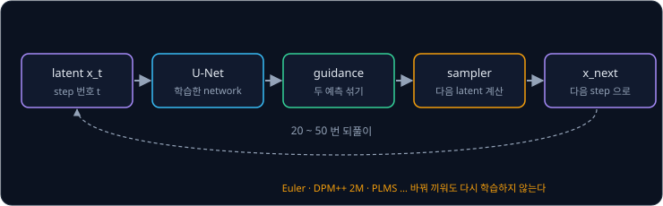
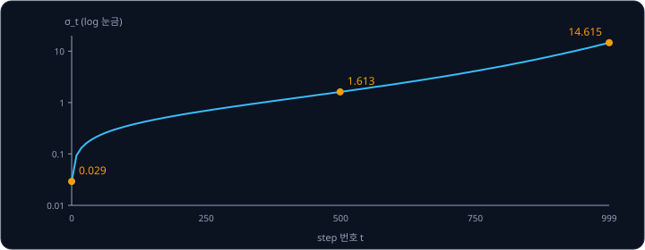
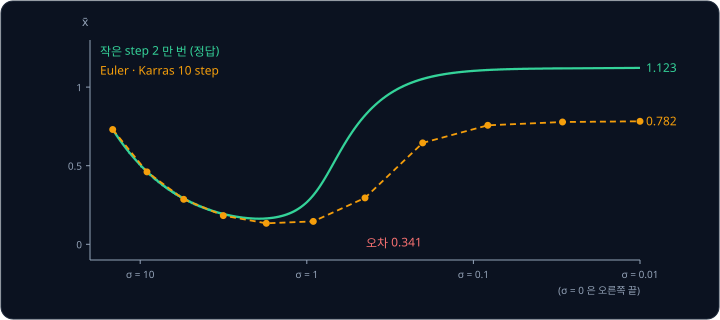
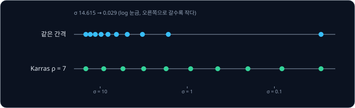
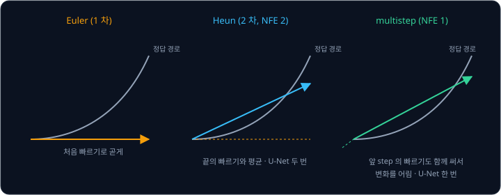
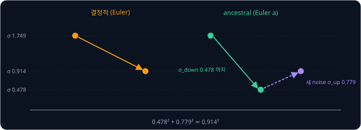

# Samplers

Stable Diffusion 은 1000 개의 step 으로 학습했지만, 그림을 만들 때는 기본으로 50 step 만 밟는다. 그림을 만드는 프로그램의 설정 화면에는 Euler,
Euler a, DPM++ 2M Karras, PLMS, DDIM 처럼 이름이 다른 sampler 가 여럿 있고, 같은 글과 같은 seed 로도 sampler 에 따라 그림이 조금씩 달라진다.
U-Net 은 하나이고 다시 학습하지도 않았는데, sampler 들은 무엇이 다를까? 그리고 왜 어떤 sampler 는 20 step 으로도 충분하고 어떤 sampler 는 50 step
을 밟아도 부족할까?

이 물음에 답하려면 sampler 가 하는 일부터 봐야 한다. **sampler** 는 U-Net 이 맞힌 noise 를 받아 다음 latent 를 계산하는 규칙이다.
[DDPM](../ddpm/README.md) 의 reverse step 과 DDIM 도 sampler 이고, noise 를 걷어 내는 과정을 미분방정식으로 보면 다른 sampler 들은 그 방정식을 푸는
다른 수치 해법이다. 해법이 정확할수록 U-Net 을 적게 계산해도 되어서, 2022 년의 DPM-Solver 는 CIFAR-10 에서 U-Net 계산 10 번만으로 FID 4.70 을
냈다. FID 는 만든 그림과 실제 그림의 통계 차이로, 낮을수록 실제 그림에 가깝다.

## 학습 목표

- sampler 가 U-Net 의 noise 예측으로 다음 latent 를 정하는 규칙이라는 것과, sampler 를 바꿔도 다시 학습할 필요가 없는 이유를 설명할 수 있다
- latent 를 원래 값과 크기 σ 의 noise 의 합으로 다시 쓰고, DDIM 이 그 위의 Euler 법이라는 것을 숫자로 따라갈 수 있다
- step 의 간격(Karras schedule)과 고차 방법(Heun, PLMS, DPM-Solver++)이 같은 U-Net 계산 횟수에서 오차를 줄이는 방식을 설명할 수 있다
- 매 step 새 noise 를 넣는 ancestral sampler 와 새 noise 를 넣지 않는 결정적 sampler 의 차이를 설명할 수 있다

## sampler 와 U-Net 계산 횟수

[Latent Diffusion](../latent-diffusion/README.md) 의 생성 순서에서 U-Net 은 step 마다 noise 를 맞히고, [Classifier-Free Guidance](../classifier-free-guidance/README.md)
가 두 예측을 섞는다. 그 결과로 다음 latent 를 만드는 일이 sampler 의 몫이다. diffusers 는 이 부분을 **scheduler** 라고 부르고, pipeline 의
scheduler 만 바꿔 끼워 sampler 를 바꾼다.

sampler 를 바꿔도 다시 학습하지 않는 것은 U-Net 이 배운 것이 주어진 latent 에 섞인 noise 를 맞히는 일 하나뿐이기 때문이다.
[DDPM](../ddpm/README.md) 의 학습에서는 어느 step 의 학습 예든 원래 그림에서 한 번에 건너뛰어 만들었고, step 을 차례로 밟는 부분이 없었다. 그래서 sampling 할 때 1000 개 가운데 어느 step 들을
어떤 규칙으로 밟을지는 학습과 상관없이 정할 수 있다.

step 하나에 U-Net 을 두 번 쓰는 sampler 도 있어서, sampler 를 비교할 때는 step 수보다 U-Net 을 몇 번 계산하는지를 센다. 이 횟수를
**NFE**(number of function evaluations)라고 한다. sampler 자체의 계산은 숫자 몇 개를 곱하고 더하는 것이라 860M parameter 의 U-Net 에 비하면 아주
작아서, 같은 NFE 에서 더 정확한 sampler 가 더 좋은 sampler 다. guidance 를 쓰면 NFE 마다 조건부와 무조건 예측을 함께 하므로 U-Net 의 계산은 그
두 배다.

| sampler (diffusers 이름) | step 하나의 NFE | 새 noise | Stable Diffusion 에서 |
| --- | --- | --- | --- |
| DDPM (`DDPMScheduler`) | 1 | 넣음 | 1000 step 을 다 밟는 원래 방법 |
| DDIM (`DDIMScheduler`) | 1 | 넣지 않음 | [DDPM](../ddpm/README.md) 강의의 건너뛰기 |
| PLMS (`PNDMScheduler`) | 1 | 넣지 않음 | v1-4 의 기본 scheduler |
| Euler (`EulerDiscreteScheduler`) | 1 | 넣지 않음 | |
| Euler a (`EulerAncestralDiscreteScheduler`) | 1 | 넣음 | |
| Heun (`HeunDiscreteScheduler`) | 2 | 넣지 않음 | |
| DPM++ 2M (`DPMSolverMultistepScheduler`) | 1 | 넣지 않음 | |

v1-4 의 `scheduler/scheduler_config.json` 에는 `PNDMScheduler` 가 기본으로 적혀 있고, CompVis 의 `txt2img.py` 도 기본으로 PLMS 50 step 을 쓴다.

**확인 문제.** Heun sampler 로 25 step, guidance scale 7.5 로 그림 한 장을 만든다. NFE 와 U-Net 이 계산하는 latent 의 수는? (마지막 step 의 예외는
무시한다)

답 보기

① Heun 은 step 하나에 NFE 2 라서 $25 \times 2 = 50$ 이다.

② guidance 를 쓰면 NFE 마다 latent 두 장(조건부, 무조건)을 계산하므로 $50 \times 2 = 100$ 장이다.

답: NFE 는 50 이고 latent 는 100 장 분량이다. Euler 50 step 과 계산량이 같다.

## noise 의 크기 σ 로 보기

[DDPM](../ddpm/README.md) 의 식 $x_t = \sqrt{\bar\alpha_t}\, x_0 + \sqrt{1 - \bar\alpha_t}\, \epsilon$ 의 양변을 $\sqrt{\bar\alpha_t}$ 로 나누면, 원래 값에
곱한 계수가 1 이 된다.

$$
\frac{x_t}{\sqrt{\bar\alpha_t}} = x_0 + \sigma_t\, \epsilon, \qquad \sigma_t = \sqrt{\frac{1 - \bar\alpha_t}{\bar\alpha_t}}
$$

$x_t / \sqrt{\bar\alpha_t}$ 를 $\bar x$ 로 적자. 이렇게 쓰면 $\bar x$ 는 언제나 원래 값에 크기 $\sigma$ 의 noise 를 더한 값이고, sampling 은 $\sigma$ 를 큰
값에서 0 으로 줄여 가는 일이 된다. DDIM 논문의 4.3 절과 Karras 등(2022)이 이 표기를 쓴다. Stable Diffusion 의 noise schedule 로 $\sigma$ 를
계산하면 아래와 같다.

| step 번호 $t$ (0 ~ 999) | 0 | 99 | 249 | 499 | 749 | 999 |
| --- | --- | --- | --- | --- | --- | --- |
| $\sqrt{\bar\alpha_t}$ | 0.9996 | 0.947 | 0.822 | 0.527 | 0.238 | 0.068 |
| $\sigma_t$ | 0.029 | 0.342 | 0.693 | 1.613 | 4.082 | 14.615 |

$\sigma$ 는 [Latent Diffusion](../latent-diffusion/README.md) 강의에서 본 원래 값의 몫과 noise 의 몫의 비이기도 하다. 그 강의의 마지막 step 에서
원래 값의 몫 0.068 과 noise 의 몫 0.998 의 비가 $0.998 \div 0.068 \approx 14.6$ 이었고, 이것이 $\sigma_{999}$ 다. diffusers 의 Euler 계열 scheduler
는 처음 뽑은 $\mathcal N(0, 1)$ 의 latent 에 약 14.6 을 곱해 출발한다. 이 곱하는 값이 `init_noise_sigma` 이고, step 간격 설정에 따라
$\sigma_\text{max}$ 나 $\sqrt{\sigma_\text{max}^2 + 1}$ 이 된다. U-Net 에 넣을 때는 매번 $\sqrt{\sigma^2 + 1}$ 로 나눠 학습 때의 $x_t$ 크기로
되돌린다(`scale_model_input`).

이 표기에서 U-Net 의 noise 예측 $\hat\epsilon$ 은 $\bar x$ 의 noise 방향이다. 원래 값의 추정은 $\hat x_0 = \bar x - \sigma \hat\epsilon$ 이고,
$\sigma$ 를 조금 줄이면 $\bar x$ 는 $\hat\epsilon$ 에 줄인 양을 곱한 만큼 바뀐다. 이 관계를 기호로 쓰면 $\bar x$ 가 $\sigma$ 에 따라 바뀌는
빠르기가 $\hat\epsilon$ 이라는 미분방정식(ODE, ordinary differential equation)이 된다.

$$
\frac{d\bar x}{d\sigma} = \hat\epsilon(\bar x, \sigma)
$$

Song 등(2021)은 이런 방정식을 probability flow ODE 라고 부르고, 이 방정식을 따라 $\sigma$ 를 줄이면 DDPM 의 sampling 과 같은 분포의 sample 이 나온다는
것을 보였다. 이 방정식에는 무작위로 뽑는 값이 없어서 같은 출발점에서는 언제나 같은 그림이 나온다.

**확인 문제.** $\sqrt{\bar\alpha_t} = 0.6$ 인 step 의 $\sigma_t$ 는 얼마일까?

답 보기

① $\bar\alpha_t = 0.36$ 이라 $1 - \bar\alpha_t = 0.64$ 다.

② $\sigma_t = \sqrt{0.64 \div 0.36} = 0.8 \div 0.6 \approx 1.33$ 이다.

답: 약 1.33.

## Euler 법과 DDIM

[Flow Matching](../flow-matching/README.md) 에서 본 Euler 법은 지금 위치의 빠르기를 구해 그 빠르기로 한 step 을 곧게 가는 방법이다. Euler 법을
위 방정식에 쓰면 아래와 같다.

$$
\bar x_\text{next} = \bar x + (\sigma_\text{next} - \sigma) \times \hat\epsilon(\bar x, \sigma)
$$

$\sigma$ 와 $\bar x$ 는 지금 step 의 값이고, 아래 첨자 next 를 붙인 $\sigma_\text{next}$ 와 $\bar x_\text{next}$ 는 다음 step 의 값이다.
$\sigma_\text{next} < \sigma$ 라서 $(\sigma_\text{next} - \sigma)$ 는 음수이고, 맞힌 noise 방향의 반대로 간다. 이 식은 DDIM 의 식과 같다. DDIM 의
한 step 은 $\hat x_0$ 를 구한 뒤 같은 $\hat\epsilon$ 으로 작은 $\sigma$ 의 값을 만드는 것이었는데, 그 값은 $\hat x_0 + \sigma_\text{next}\hat\epsilon =
\bar x - \sigma\hat\epsilon + \sigma_\text{next}\hat\epsilon$ 으로 위 식과 같다. DDIM 논문은 4.3 절에서 이 관계를 적었고, Karras 등과 DPM-Solver
논문도 DDIM 을 이 방정식의 1 차 해법으로 본다.

예를 들어 1 차원 데이터가 $+2$ 와 $-2$ 에 표준편차 0.5 로 퍼진 두 무리(반반)라고 하자. U-Net 대신 이 데이터에서 noise 를 정확히 맞히는 값을
직접 계산해 쓴다. $\sigma = 14.615$, $\bar x = 0.731$ 에서 출발해, 작은 $\sigma$ 쪽에 step 을 촘촘히 두는 Karras schedule 의 값 10 개로 $\sigma$ 를
줄이는 Euler 법의 처음 세 step 은 아래와 같다.

| $\sigma$ | $\sigma_\text{next}$ | $\bar x$ | $\hat x_0$ | $\hat\epsilon = (\bar x - \hat x_0) \div \sigma$ | $\sigma_\text{next} - \sigma$ | $\bar x_\text{next}$ |
| --- | --- | --- | --- | --- | --- | --- |
| 14.615 | 9.103 | 0.731 | 0.015 | 0.049 | $-5.512$ | 0.461 |
| 9.103 | 5.478 | 0.461 | 0.023 | 0.048 | $-3.625$ | 0.287 |
| 5.478 | 3.169 | 0.287 | 0.040 | 0.045 | $-2.310$ | 0.183 |

$\sigma$ 가 클 때는 어느 무리로 갈지 아직 정해지지 않아서 $\hat x_0$ 가 0 근처이고, $\bar x$ 는 0 쪽으로 줄어들기만 한다. 이 방정식을 아주
작은 step 2 만 번으로 풀면 끝값은 1.123 으로 $+2$ 쪽 무리에 들어가는데, 위 Euler 10 step 의 끝값은 0.782 라서 0.341 만큼 모자란다.

Euler 법은 step 안에서 빠르기가 바뀌지 않는다고 보고 직선으로 가므로, 경로가 휘는 곳에서 바깥으로 벗어난다. 이 예에서 $\hat\epsilon$ 은
$\sigma$ 가 1 아래로 내려올 때 크게 바뀌어(위 표 뒤의 step 들에서 0.034 → $-0.015$ → $-0.319$ → $-1.426$), 큰 step 으로 지나가면 오차가 생긴다.
sampler 들은 step 을 경로가 휘는 곳에 촘촘히 두거나, step 안에서 빠르기가 바뀌는 것까지 계산에 넣어 이 오차를 줄인다.

**확인 문제.** $\sigma = 2$, $\bar x = 1.0$ 에서 U-Net 이 $\hat\epsilon = 0.3$ 을 냈다. Euler 법으로 $\sigma_\text{next} = 1.5$ 로 간 값과, 이때의
$\hat x_0$ 는?

답 보기

① $\bar x_\text{next} = 1.0 + (1.5 - 2) \times 0.3 = 1.0 - 0.15 = 0.85$ 다.

② $\hat x_0 = \bar x - \sigma\hat\epsilon = 1.0 - 2 \times 0.3 = 0.4$ 다.

답: $\bar x_\text{next} = 0.85$ 이고 $\hat x_0 = 0.4$ 다. $\hat x_0 + 1.5 \times 0.3 = 0.85$ 라서 DDIM 의 계산과도 같다.

## step 의 간격

50 step 을 밟을 때 $\sigma$ 를 어떤 간격으로 줄일지도 sampler 의 설정이다. $\sigma$ 를 14.615 에서 0.029 까지 같은 간격으로 줄이면 큰 $\sigma$ 쪽에
step 을 많이 쓰는데, 위 예처럼 경로가 크게 휘는 곳은 $\sigma$ 가 작은 쪽이다. Karras 등은 $\sigma^{1/\rho}$ 를 같은 간격으로 줄이는 schedule 을
제안했다(식 5). $\rho$("로")가 클수록 작은 $\sigma$ 근처의 step 이 짧아진다. 논문에 따르면 $\rho = 3$ 이면 step 하나하나의 오차가 거의 같아지지만
그림은 $\rho$ 가 5 ~ 10 일 때 훨씬 좋았고, 저자들은 $\rho = 7$ 을 썼다. Stable Diffusion 의 $\sigma$ 범위로 10 step 의 두 schedule 을 계산하면 아래와 같다.

| step | 1 | 2 | 3 | 4 | 5 | 6 | 7 | 8 | 9 | 10 |
| --- | --- | --- | --- | --- | --- | --- | --- | --- | --- | --- |
| 같은 간격 | 14.615 | 12.994 | 11.373 | 9.753 | 8.132 | 6.512 | 4.891 | 3.270 | 1.650 | 0.029 |
| Karras ($\rho = 7$) | 14.615 | 9.103 | 5.478 | 3.169 | 1.749 | 0.914 | 0.447 | 0.201 | 0.082 | 0.029 |

같은 간격은 $\sigma = 1.650$ 에서 0.029 로 한 번에 뛰어 경로가 휘는 구간을 한 step 으로 지나간다. 앞의 예에서 Euler 10 step 의 오차를 계산해 비교하면
같은 간격은 0.945 이고 Karras schedule 은 0.341 이다. 설정 화면의 "DPM++ 2M Karras" 같은 이름에 붙은 Karras 는 이 schedule 을 가리키고, diffusers 에서는
`use_karras_sigmas=True` 로 켠다. diffusers 의 `EulerDiscreteScheduler` 도 이 schedule 을 계산할 때 소스 코드의 주석대로 논문의 값 $\rho = 7$ 을 쓴다.

<b>심화: Karras schedule 의 식</b>

$N$ 개의 $\sigma$ 가운데 $i$ 번째($i = 0, 1, \ldots, N - 1$)는

$$
\sigma_i = \Big(\sigma_\text{max}^{1/\rho} + \frac{i}{N - 1}\big(\sigma_\text{min}^{1/\rho} - \sigma_\text{max}^{1/\rho}\big)\Big)^{\rho}
$$

이고 마지막에 $\sigma_N = 0$ 을 붙인다. $\rho = 1$ 이면 같은 간격이다. Stable Diffusion 은 $\sigma_\text{max} = 14.615$, $\sigma_\text{min} = 0.029$
이라서 $\rho = 7$ 이면 $14.615^{1/7} \approx 1.467$ 에서 $0.029^{1/7} \approx 0.603$ 까지 같은 간격으로 내려간 뒤 7 제곱한다. 2 번째 값은
$(1.467 - 0.096)^7 \approx 9.10$ 이다.

## 고차 방법

Euler 법은 step 처음의 빠르기 하나만 쓰고, step 을 절반으로 줄이면 오차도 대략 절반으로 줄어서 **1 차 방법**이라고 한다. step 안에서 빠르기가
바뀌는 것을 반영하는 고차 방법은 step 을 줄일 때 오차가 훨씬 빨리 준다. 빠르기를 더 얻는 길은 둘이다.

- **Heun 법**(2 차): Euler 로 step 끝까지 가 보고 거기서 빠르기를 한 번 더 구한 뒤, 처음과 끝의 빠르기를 평균해 처음부터 다시 간다. step 마다 U-Net 을
  두 번 쓴다. Karras 등은 Heun 법이 Euler 법과 같은 FID 에 훨씬 적은 NFE 로 닿는다고 보고했고, 학습 방법까지 고친 model 에 Heun 법과 $\rho = 7$
  schedule 을 써서 CIFAR-10 FID 1.79 를 NFE 35 로 얻었다
- **multistep**(다단계): 앞 step 들에서 이미 구한 빠르기를 함께 써서 빠르기의 변화를 어림한다. U-Net 을 새로 쓰지 않으므로 step 마다 NFE 1 이다.
  Liu 등이 PNDM(2022)에서 제안한 PLMS 가 이 방법이고, diffusers 의 `PNDMScheduler` 는 앞의 빠르기를 최대 넷까지 모아
  $\frac{1}{24}(55\,\hat\epsilon_0 - 59\,\hat\epsilon_{-1} + 37\,\hat\epsilon_{-2} - 9\,\hat\epsilon_{-3})$ 처럼 섞는다($\hat\epsilon_0$ 이 지금,
  $\hat\epsilon_{-1}$ 이 한 step 앞)

앞의 1 차원 예에서 NFE 를 10 안팎으로 맞추고 Karras schedule 로 오차를 계산하면 아래와 같다. 2 차 multistep 은 PLMS 의 방식을 앞 step 의 빠르기
하나만 쓰도록 줄인 $\frac12(3\hat\epsilon_0 - \hat\epsilon_{-1})$ 이다.

| sampler (이 강의의 계산) | step | NFE | 끝값 | 오차 (정답 1.123) |
| --- | --- | --- | --- | --- |
| Euler, 같은 간격 | 10 | 10 | 0.178 | 0.945 |
| Euler | 10 | 10 | 0.782 | 0.341 |
| 2 차 multistep | 10 | 10 | 0.989 | 0.134 |
| Heun | 5 | 9 | 1.141 | 0.018 |
| DPM-Solver++(2M) | 10 | 10 | 1.109 | 0.014 |

같은 NFE 10 에서도 Euler(Karras schedule)의 오차 0.341 과 DPM-Solver++(2M) 의 오차 0.014 는 20 배 넘게 차이 난다. Liu 등은 PNDM 이 2 차로 수렴하고 DDIM 은 1 차로 수렴한다는 것을 보이고, CIFAR-10 과 CelebA 에서 품질을
잃지 않고 20 배 빨라졌다고 적었다.

**흔한 오해.** step 수가 같으면 sampler 끼리 계산 시간도 같다고 생각하기 쉽지만, Heun 은 step 하나에 NFE 2 라서 같은 step 수의 Euler 보다 두 배 걸린다.
sampler 는 step 수가 아니라 NFE 를 맞춰 비교해야 한다.

## DPM-Solver

Lu 등은 diffusion 의 방정식이 두 부분으로 이루어져 있다는 점을 이용해 DPM-Solver(2022)를 만들었다. 하나는 $x$ 에 계수를 곱한 단순한 선형
부분이고, 다른 하나는 U-Net 이 맞힌 noise 가 들어가는 부분이다. DPM-Solver 는 선형 부분을 정확히 풀어 두고 network 가 들어가는 부분만 근사한다.
1 차 DPM-Solver 는 DDIM 과 정확히 같고(4.1 절), 2 차와 3 차로 갈수록 적은 step 에서 정확해진다. 저자들은 CIFAR-10 에서 NFE 10 으로 FID 4.70, NFE 20 으로 2.87 을 얻었다.

guidance scale 이 큰 Stable Diffusion 에서는 다른 문제가 생긴다. [Classifier-Free Guidance](../classifier-free-guidance/README.md) 에서 본 것처럼 큰
guidance 는 원래 값의 추정을 데이터 범위 밖으로 밀어낸다. DPM-Solver++ 논문에 따르면 이전의 고차 sampler 는 guidance scale 이 클 때
불안정해져 DDIM 보다도 느려진다. DPM-Solver++ 는 두 가지를 바꿨다.

- noise $\hat\epsilon$ 대신 원래 값의 추정 $\hat x_0$ 로 방정식을 푼다. $\hat x_0$ 는 데이터 범위 근처의 값이라 다루기 쉽다
- 한 step 안에서 U-Net 을 여러 번 쓰는 대신 앞 step 의 $\hat x_0$ 를 함께 쓰는 multistep 으로 바꿔, 실제로 나아가는 step 을 짧게 만든다. 이름의 2M 은
  2 차 multistep 을 뜻한다

논문에 따르면 DPM-Solver++ 는 pixel 과 latent 의 diffusion model 모두에서 guidance 를 쓴 sampling 을 15 ~ 20 step 만에 해낸다. diffusers 의
`DPMSolverMultistepScheduler` 는 기본값이 `algorithm_type="dpmsolver++"`, `solver_order=2` 라서 기본 설정이 이 2M 이다.

<b>심화: DPM-Solver++(2M) 의 한 step</b>

$\bar x$ 표기에서 1 차 DPM-Solver++ 는 $\bar x_\text{next} = \frac{\sigma_\text{next}}{\sigma}\bar x + \big(1 - \frac{\sigma_\text{next}}{\sigma}\big)\hat x_0$ 다.
$\hat x_0 = \bar x - \sigma\hat\epsilon$ 을 넣으면 $\bar x + (\sigma_\text{next} - \sigma)\hat\epsilon$ 으로 Euler·DDIM 과 같다. 2M 은 $\hat x_0$ 자리에 지금과
한 step 앞의 추정을 섞은 $D = \big(1 + \frac{1}{2r}\big)\hat x_0 - \frac{1}{2r}\hat x_0^{\text{prev}}$ 을 넣는다. $r$ 은 앞 step 과 이번 step 의 길이를
$-\log\sigma$ 로 잰 비다. 첫 step 은 앞의 추정이 없어 1 차로 간다. 본문 표의 DPM-Solver++(2M) 은 이 식으로 계산했고, 마지막 $\sigma = 0$ 으로 가는
step 은 $\bar x = \hat x_0$ 로 두었다.

**확인 문제.** DPM-Solver++ 의 1 차 식으로 $\sigma = 2$, $\bar x = 1.0$, $\hat x_0 = 0.4$ 에서 $\sigma_\text{next} = 1.5$ 로 간 값은? 앞 절 Euler 의 확인
문제와 비교해 보자.

답 보기

$$
\frac{1.5}{2} \times 1.0 + \Big(1 - \frac{1.5}{2}\Big) \times 0.4 = 0.75 + 0.1 = 0.85
$$

답: 0.85. 같은 상태에서 Euler 법의 답과 같다. 1 차 DPM-Solver++ 는 DDIM·Euler 와 같은 계산이다.

## ancestral sampler

DDPM 의 reverse step 은 step 마다 새 noise $\sigma_t z$($z$ 는 $\mathcal N(0, 1)$ 에서 새로 뽑은 값)를 더했다. Euler a 는 이 방식을 Euler 법에
붙인 sampler 이고, 이름의 a 는 ancestral 의 줄임이다. step 마다
$\sigma$ 를 목표보다 더 줄였다가, 그만큼 새 noise 를 더해 목표 $\sigma$ 로 되돌린다. diffusers 의 `EulerAncestralDiscreteScheduler` 는 $\sigma$ 에서
$\sigma_\text{next}$ 으로 갈 때 아래 두 값을 쓴다.

$$
\sigma_\text{up} = \sqrt{\frac{\sigma_\text{next}^2\,(\sigma^2 - \sigma_\text{next}^2)}{\sigma^2}}, \qquad \sigma_\text{down} = \sqrt{\sigma_\text{next}^2 - \sigma_\text{up}^2}
$$

Euler 법으로 $\sigma_\text{down}$ 까지 간 뒤 표준편차 $\sigma_\text{up}$ 의 새 noise 를 더한다. Karras schedule 의 $\sigma = 1.749 \to 0.914$ step 이면
$\sigma_\text{up} \approx 0.779$, $\sigma_\text{down} \approx 0.478$ 이라서, $\sigma$ 를 0.478 까지 줄였다가 0.779 만큼의 noise 를 다시 넣는다.
$0.478^2 + 0.779^2 \approx 0.914^2$ 이라 noise 의 크기는 목표대로다.

새 noise 는 step 마다 앞 step 의 오차를 조금씩 섞어 지우는 효과가 있지만, 결과가 방정식 하나의 답에 모이지 않는다. 새 noise 를 넣지 않는 결정적
sampler 는 step 을 늘리면 같은 그림에 점점 가까워지지만, ancestral sampler 는 step 수를 바꾸면 새 noise 의 순서가 바뀌어 다른 그림이 된다. Karras
등도 noise 를 더 넣는 확률적 sampling 이 앞 step 의 오차를 바로잡는 데 효과가 있지만, noise 를 지나치게 넣고 빼면 만든 그림의 세부가 점점 사라지고
색이 포화되는 쪽으로 흐른다고 적었다.

**확인 문제.** ancestral sampler 가 $\sigma = 2$ 에서 $\sigma_\text{next} = 1$ 로 갈 때 $\sigma_\text{up}$ 과 $\sigma_\text{down}$ 은?

답 보기

① $\sigma_\text{up} = \sqrt{1^2 \times (4 - 1) \div 4} = \sqrt{0.75} \approx 0.866$ 이다.

② $\sigma_\text{down} = \sqrt{1 - 0.75} = 0.5$ 다.

답: $\sigma_\text{up} \approx 0.866$ 이고 $\sigma_\text{down} = 0.5$ 다. $\sigma$ 를 0.5 까지 줄였다가 0.866 의 noise 를 더해 1 로 돌아온다.

## 정리

- sampler 는 U-Net 이 맞힌 noise 로 다음 latent 를 만드는 규칙이다. U-Net 은 어느 step 의 noise 든 맞히도록 학습했으므로 다시 학습하지 않고 sampler 를
  바꿀 수 있고, sampler 는 step 수가 아니라 U-Net 계산 횟수(NFE)로 비교한다
- latent 를 $\bar x = x_0 + \sigma\epsilon$ 으로 쓰면 sampling 은 $\sigma$ 를 14.615 에서 0 으로 줄이는 미분방정식 $d\bar x / d\sigma = \hat\epsilon$ 을
  푸는 일이고, DDIM 은 그 위의 Euler 법이다. Karras schedule($\rho = 7$)은 경로가 휘는 작은 $\sigma$ 쪽에 step 을 모으고, Heun·PLMS·DPM-Solver++ 같은
  고차 방법은 step 안의 빠르기 변화를 반영해, 이 강의의 예에서 NFE 10 의 오차를 0.945(같은 간격 Euler)에서 0.014(DPM-Solver++ 2M)로 줄였다
- DPM-Solver++ 는 $\hat x_0$ 로 풀고 multistep 으로 step 을 짧게 만들어 큰 guidance 에서도 15 ~ 20 step 으로 충분하다. ancestral sampler 는 step
  마다 새 noise 를 넣어 결과가 step 수에 따라 달라진다

이 강의로 Stable Diffusion 의 부품이 모두 모였다. 글은 CLIP text encoder 가 $77 \times 768$ 로 바꾸고, U-Net 은 $64 \times 64 \times 4$ latent 위에서
cross-attention 으로 글을 읽으며 noise 를 맞힌다. classifier-free guidance 가 두 예측을 섞으면 sampler 가 20 ~ 50 step 동안 latent 를 고치고,
마지막에 VAE 의 decoder 가 $512 \times 512$ 그림으로 되살린다. 이렇게 학습한 Stable Diffusion 에 새 그림체를 가르칠 때 U-Net 전체를 다시 학습하지
않고 parameter 0.1% 만 학습하는 방법은 [LoRA](../lora/README.md) 에서 다룬다.

## 참고 자료

- Jiaming Song, Chenlin Meng, Stefano Ermon, [Denoising Diffusion Implicit Models](https://arxiv.org/abs/2010.02502) (2020) — 4.3 절에서 DDIM 을
  $\sigma = \sqrt{1 - \bar\alpha}/\sqrt{\bar\alpha}$, $\bar x = x/\sqrt{\bar\alpha}$ 로 다시 쓴 Euler 법으로 본다
- Yang Song 등, [Score-Based Generative Modeling through Stochastic Differential Equations](https://arxiv.org/abs/2011.13456) (2021) — 같은 분포의
  sample 을 주는 probability flow ODE
- Tero Karras 등, [Elucidating the Design Space of Diffusion-Based Generative Models](https://arxiv.org/abs/2206.00364) (2022) — $\sigma$ 표기, 식 5 의
  step 간격과 $\rho = 7$, Heun 법(Algorithm 1), 확률적 sampling. 부록 C.3.1 에 DDIM 과 Euler 의 관계가 있다
- Luping Liu 등, [Pseudo Numerical Methods for Diffusion Models on Manifolds](https://arxiv.org/abs/2202.09778) (2022) — PNDM 과 PLMS. 2 차 수렴과
  20 배의 속도
- Cheng Lu 등, [DPM-Solver](https://arxiv.org/abs/2206.00927) (2022) — 선형 부분을 정확히 푸는 diffusion ODE 해법, DDIM 과 같은 1 차(4.1 절), NFE
  10·20 의 FID
- Cheng Lu 등, [DPM-Solver++](https://arxiv.org/abs/2211.01095) (2022) — guidance 를 쓴 sampling 의 불안정, $\hat x_0$ 로 푸는 방법과 multistep(2M)
- diffusers, [schedulers](https://github.com/huggingface/diffusers/tree/main/src/diffusers/schedulers) — `scheduling_pndm.py` 의 PLMS 계수,
  `scheduling_euler_discrete.py` 의 `init_noise_sigma`·`scale_model_input`·$\rho = 7$, `scheduling_euler_ancestral_discrete.py` 의
  $\sigma_\text{up}$·$\sigma_\text{down}$, `scheduling_dpmsolver_multistep.py` 의 기본값
