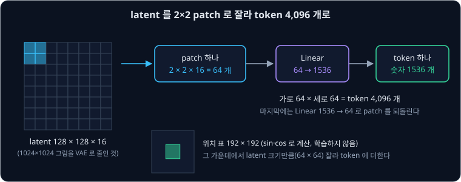
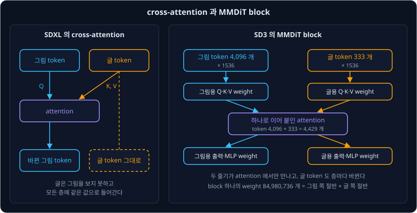
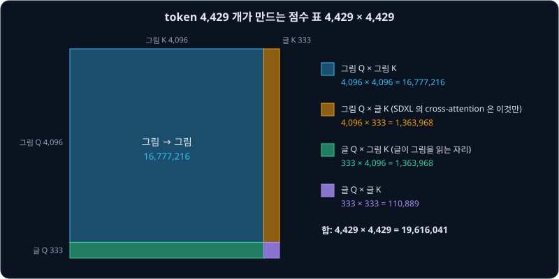
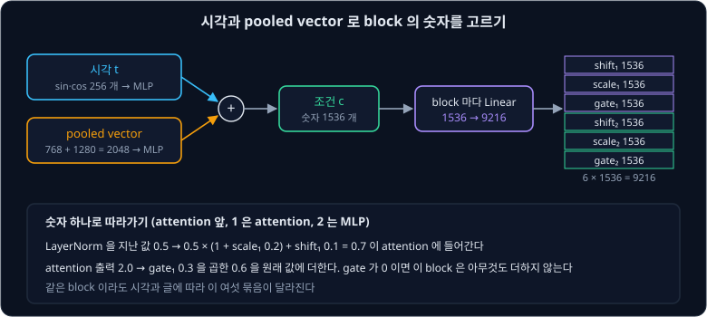
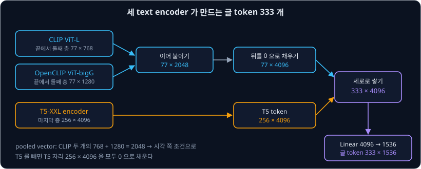
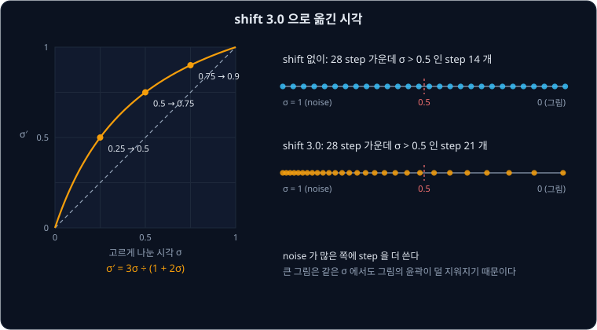
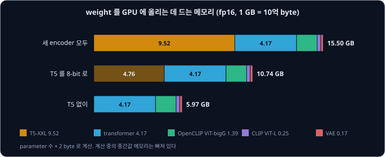

# Stable Diffusion 3

[SDXL](../sdxl/README.md) 은 글을 [Cross-Attention](../cross-attention/README.md) 으로 넣는다. 그림 쪽 token 이 글 쪽 token 을 읽어 자기 값을 바꾸고,
글 쪽 token 은 text encoder 가 낸 값 그대로 모든 층에 들어간다. 글은 그림이 지금 어떻게 그려지고 있는지 끝까지 보지 못한다. Stable Diffusion 3 의
저자들도 고정한 글 표현을 cross-attention 으로 넣는 이 방식이 가장 좋은 방식은 아니라고 지적했다. 글 쪽 token 도 그림을 읽고 층마다 바뀌게 하면 어떨까?

**Stable Diffusion 3**(이하 SD3)는 Stability AI 의 Esser 등이 2024 년에 발표한 model 이다. 바꾼 것은 세 가지다. [Flow Matching](../flow-matching/README.md)
에서 본 rectified flow 로 학습하고, U-Net 대신 글과 그림의 token 을 한 sequence 로 이어 처리하는 Transformer 인 **MMDiT** 를 쓰며, text encoder 를
셋 쓴다. GenEval 은 글이 요구한 물체의 수·색·위치가 그림에 맞는지 자동으로 채점하는 benchmark 다. 논문의 표 5 에서 가장 큰 8B model 은 이 점수가
0.74 로, SDXL 의 0.55 와 DALL-E 3 의 0.67 보다 높았다.

## 학습 목표

- latent 를 2×2 patch 로 잘라 token 4,096 개를 만들고 위치 표를 더하는 과정을 숫자로 따라갈 수 있다
- MMDiT 가 글과 그림의 token 을 각자의 weight 로 바꾼 뒤 attention 하나에 함께 넣는 방식을 cross-attention 과 비교하고, 점수 표의 크기를 계산할 수 있다
- 시각과 pooled vector 가 block 마다 shift·scale·gate 숫자를 만드는 adaLN 을 숫자 예로 계산할 수 있다
- CLIP 두 개와 T5-XXL 의 출력을 글 token 333 개로 합치는 과정과, encoder 마다 출력을 따로 지우는 학습이 T5 를 빼고 생성할 수 있게 하는 이유를 설명할 수 있다
- 큰 그림에서 시각을 옮기는 shift 3.0 과 QK-normalization 이 왜 필요한지 설명할 수 있다
- 내 컴퓨터에서 SD3 를 돌릴 때 메모리와 시간을 정하는 요인을 계산하고 줄이는 방법을 고를 수 있다

## latent 를 patch token 으로

SD3 의 autoencoder 는 그림의 가로세로를 8 분의 1 로 줄이고 channel 을 16 개로 만든다. $1024 \times 1024$ 그림의 latent 는 $128 \times 128 \times 16$
이다. [ViT](../vit/README.md) 의 DiT 처럼 SD3 는 이 latent 를 $2 \times 2$ 조각으로 잘라 token 으로 만든다. 조각 하나에는 숫자가
$2 \times 2 \times 16 = 64$ 개 있고, linear 층 하나가 이 64 개를 1536 개로 바꾼다. 조각은 가로 64 개, 세로 64 개라서 token 은
$64 \times 64 = 4096$ 개다.

Transformer 는 token 의 순서를 모르므로 자리마다 다른 위치 값을 더한다. SD3 는 가로세로 192 칸짜리 위치 표를 sin·cos 로 미리 계산해 두고,
latent 의 크기만큼 가운데를 잘라 쓴다. diffusers 의 `PatchEmbed` 는 이 표를 학습하지 않는 buffer 로 두고 `cropped_pos_embed` 에서
`top = (192 - height) // 2` 처럼 가운데를 자른다. 위치 표의 192 칸은 latent 로 $192 \times 2 = 384$ 칸이고, 그림으로 $384 \times 8 = 3072$ pixel 이다. 논문은
가로세로 비율이 다른 그림을 학습할 때 위치 격자를 늘이고 줄인 뒤 가운데를 잘라 쓴다고 설명한다.

마지막 block 뒤에서는 linear 층이 token 하나의 1536 개를 다시 64 개로 바꾸고, 조각을 원래 자리에 늘어놓아 $128 \times 128 \times 16$ 크기의 속도를
낸다. 공개된 SD3 Medium 의 weight 파일에서 patch 를 token 으로 바꾸는 층은 $1536 \times 16 \times 2 \times 2$ 이고, 되돌리는 층은 $64 \times 1536$ 이다.

SDXL 의 U-Net 도 가운데 단계에서는 token 4,096 개를 다뤘다. 다만 U-Net 은 그림을 줄였다 키우며 단계마다 token 수가 바뀌었지만, SD3 의 Transformer 는
24 개 block 모두에서 token 4,096 개를 그대로 다룬다.

**확인 문제.** $768 \times 1344$ 그림을 만들면 latent 의 크기와 그림 token 의 수는 얼마일까?

답 보기

① latent 는 $768 \div 8 = 96$, $1344 \div 8 = 168$ 이라 $96 \times 168 \times 16$ 이다.

② $2 \times 2$ 조각은 세로 $96 \div 2 = 48$ 개, 가로 $168 \div 2 = 84$ 개다.

답: latent $96 \times 168 \times 16$, token $48 \times 84 = 4032$ 개.

## 글과 그림이 함께 쓰는 attention

cross-attention 에서는 그림 token 이 query 를 만들고 글 token 이 key 와 value 를 만든다. 그림 token 은 글을 읽어 바뀌지만, 글 token 은 처음 값 그대로
다음 층에 들어간다. SD3 의 MMDiT(Multimodal Diffusion Transformer) block 은 글 token 과 그림 token 을 한 줄로 이어 붙여 self-attention 을 한 번
한다. 그래서 그림 token 이 글을 읽을 뿐 아니라 글 token 도 그림을 읽고 바뀐다.

이어 붙이기 전에 두 종류의 token 은 각자의 weight 로 query·key·value 를 만든다. 논문은 글과 그림의 성질이 크게 달라서 weight 를 따로 둔다고 설명하고,
이 구조가 두 개의 Transformer 를 나란히 두고 attention 에서만 sequence 를 합친 것과 같다고 적었다. attention 뒤에는 다시 둘로 나뉘어 각자의 출력 층과
MLP 를 지난다.

숫자 하나짜리 token 셋으로 차이를 보자. 예를 들어 그림 token 둘의 value 가 2 와 4 이고 글 token 의 value 가 0 이다. 글 token 의 query 가 세 key 와 맞는 정도를
softmax 로 바꾼 비율이 0.25, 0.25, 0.5 라고 하자.

| 방식 | 글 token 의 attention 출력 |
| --- | --- |
| cross-attention | 계산하지 않는다. 글 token 은 0 그대로 |
| MMDiT | $0.25 \times 2 + 0.25 \times 4 + 0.5 \times 0 = 1.5$ |

MMDiT 에서는 글 token 이 그림 token 의 값 1.5 만큼을 받아 다음 층으로 간다. 같은 글이라도 그림이 어떻게 그려지고 있는지에 따라 층마다 다른 글 token 이
그림 쪽에 key 와 value 를 건넨다.

diffusers 의 SD3 pipeline 은 글 token 을 333 개 만든다(다음 절). $1024 \times 1024$ 그림이면 attention 에 들어가는 token 은 $4096 + 333 = 4429$
개이고 점수는 $4429^2 = 19{,}616{,}041$ 개다. 이 점수 표를 네 구역으로 나누면 SDXL 의 cross-attention 이 계산하던 부분이 어디인지 보인다.

점수 19,616,041 개 가운데 16,777,216 개(86%)는 그림끼리의 점수라서, 글을 이어 붙여 늘어난 계산은 크지 않다. diffusers 의 `JointAttnProcessor2_0` 은 두 종류의
query·key·value 를 `torch.cat` 으로 sequence 방향으로 이어 붙여 attention 을 한 번 계산한 뒤, 출력을 다시 그림 몫과 글 몫으로 나눈다.

SD3 Medium 의 weight 파일에서 block 하나의 weight 는 84,980,736 개이고, 그림 쪽과 글 쪽이 거의 절반씩이다. 24 개 block 을 모두 더하면 그림 쪽이
1,019,768,832 개, 글 쪽이 989,082,624 개다. 글 쪽이 조금 적은 것은 마지막 block 의 글 쪽에 출력 층과 MLP 가 없어서다. 마지막 block 뒤에서는 그림
token 만 속도로 바꾸므로, 마지막 block 의 글 token 은 key 와 value 만 내면 된다.

저자들은 CC12M dataset 에서 네 구조를 같은 조건으로 학습해 비교했다(그림 4). 글과 그림의 token 을 이어 붙이고 weight 한 벌을 함께 쓰는 DiT,
cross-attention 으로 글을 읽는 CrossDiT, U-Net 과 Transformer 를 섞은 UViT, 그리고 MMDiT 다. validation loss, CLIP score, FID 모두에서 MMDiT 가 가장
좋았다. CLIP 과 T5 의 token 에 weight 를 하나씩 더 주어 세 벌로 나누어도 이득이 작아서, 저자들은 두 벌을 골랐다.

**확인 문제.** $512 \times 512$ 그림을 만들면 attention 에 들어가는 token 은 몇 개이고, 점수 가운데 그림끼리의 점수는 몇 % 일까? 글 token 은 333 개다.

답 보기

① latent 는 $64 \times 64 \times 16$ 이고, 그림 token 은 $32 \times 32 = 1024$ 개다.

② 전체 token 은 $1024 + 333 = 1357$ 개이고 점수는 $1357^2 = 1{,}841{,}449$ 개다.

③ 그림끼리의 점수는 $1024^2 = 1{,}048{,}576$ 개라서 $1{,}048{,}576 \div 1{,}841{,}449 \approx 57\%$ 다.

답: 1,357 개, 약 57%. 그림이 작아지면 글 token 이 차지하는 몫이 커진다.

## 시각과 pooled vector 로 block 조절하기

SDXL 은 pooled vector 를 time embedding 에 더해 U-Net 의 모든 residual block 에 보냈다. SD3 도 시각 $t$ 와 글 전체를 줄인 pooled vector 를
하나로 합쳐 모든 block 에 보낸다. 다만 이 값을 token 에 더하지 않고, ViT 강의의 DiT 처럼 LayerNorm 뒤의 값을 늘리고 옮기는 숫자로 쓴다. 이 방식을
adaLN(adaptive LayerNorm)이라고 한다.

diffusers 의 `CombinedTimestepTextProjEmbeddings` 는 시각을 sin·cos 값 256 개로 늘려 MLP 로 1536 개로 바꾸고, 두 CLIP 의 pooled vector 를 이은
2048 개도 MLP 로 1536 개로 바꾼 뒤 둘을 더한다. 이 1536 개를 조건 $c$ 라고 하자. block 마다 있는 linear 층이 $c$ 를 $6 \times 1536 = 9216$ 개로
늘리고, 이를 1536 개씩 여섯 묶음으로 나눈다. 여섯 묶음은 attention 앞에서 쓰는 shift₁·scale₁·gate₁ 과 MLP 앞에서 쓰는 shift₂·scale₂·gate₂ 다.

token 의 숫자 하나를 따라가 보자. 예를 들어 LayerNorm 을 지난 값이 0.5 이고, 이번 시각과 글에서 scale₁ 이 0.2 이고 shift₁ 이 0.1 이고 gate₁ 이 0.3 이다.
attention 이 이 자리에 2.0 을 냈다고 하자.

| 단계 | 이 예의 값 | 기호로 쓴 값 |
| --- | --- | --- |
| LayerNorm 을 지난 값 | 0.5 | $\hat x$ |
| attention 에 넣는 값 | $0.5 \times (1 + 0.2) + 0.1 = 0.7$ | $\hat x \times (1 + \text{scale}_1) + \text{shift}_1$ |
| attention 의 출력 | 2.0 | $a$ |
| 원래 값에 더하는 양 | $0.3 \times 2.0 = 0.6$ | $\text{gate}_1 \times a$ |

gate 가 0 이면 이 block 의 attention 은 아무것도 더하지 않는다. 같은 weight 라도 시각과 글에 따라 여섯 묶음이 달라지므로, noise 가 많을 때와 적을
때 block 이 하는 일을 다르게 조절할 수 있다. 이 계산은 diffusers 의 `AdaLayerNormZero` 가 맡는다. 글 쪽 줄기에도 같은 크기의 linear 층이 따로 있는데,
마지막 block 의 글 쪽은 MLP 가 없어서 shift 와 scale 두 묶음($2 \times 1536 = 3072$ 개)만 만든다.

이 조절 숫자를 만드는 linear 층은 작지 않다. 층 하나의 weight 가 $1536 \times 9216 + 9216 = 14{,}164{,}992$ 개이고, 두 줄기의 24 개 block 과 마지막 출력 앞의
층까지 더하면 675,197,952 개로 transformer 전체 weight 의 약 32% 다. weight 파일에서 셈한 값이다.

**확인 문제.** LayerNorm 을 지난 값이 $-1.0$ 이고 scale₂ 가 $-0.5$ 이고 shift₂ 가 0.3 이다. MLP 에 들어가는 값은 얼마일까? MLP 가 4.0 을 내고 gate₂ 가 0 이면
원래 값은 얼마나 바뀔까?

답 보기

① MLP 에 들어가는 값은 $-1.0 \times (1 - 0.5) + 0.3 = -0.2$ 다.

② 더하는 양은 $0 \times 4.0 = 0$ 이다.

답: $-0.2$ 가 MLP 에 들어가고, 원래 값은 바뀌지 않는다.

## 세 text encoder

SD3 는 SDXL 이 쓴 CLIP 두 개에 T5-XXL 의 encoder 를 더한다. T5 는 Google 이 글만으로 학습한 language model 이고, Cross-Attention 강의에서 본 Imagen
도 이 encoder 를 썼다. 공개된 SD3 Medium 의 weight 파일에서 셈한 parameter 수는 아래와 같다.

| encoder | 쓰는 출력 | pooled vector | parameter |
| --- | --- | --- | --- |
| CLIP ViT-L | 끝에서 둘째 층 $77 \times 768$ | 768 | 123,650,304 |
| OpenCLIP ViT-bigG | 끝에서 둘째 층 $77 \times 1280$ | 1280 | 694,659,840 |
| T5-XXL encoder | 마지막 층 $256 \times 4096$ | 없음 | 4,762,310,656 |

T5 하나가 세 encoder parameter 의 85% 이고, 논문도 T5-XXL 을 parameter 4.7B 로 적었다. diffusers 의 pipeline 은 SDXL 처럼 두 CLIP 의 끝에서 둘째 층
출력(`hidden_states[-2]`)을 이어 붙여 $77 \times 2048$ 을 만들고, 뒤를 0 으로 채워 T5 와 같은 4096 개로 맞춘다. 여기에 T5 의 출력 $256 \times 4096$ 을
세로로 쌓으면 $333 \times 4096$ 이 되고, linear 층(`context_embedder`)이 이를 글 token $333 \times 1536$ 으로 바꾼다. 두 CLIP 의 pooled vector 를 이은
$768 + 1280 = 2048$ 개는 앞 절의 조건 $c$ 로 간다.

T5 의 token 수는 pipeline 의 `max_sequence_length` 가 정한다. 기본값은 256 이다. 논문의 부록 B.2 는 T5 도 77 개로 두어 글 token 을 154 개로 적었다.
diffusers 문서는 `max_sequence_length=512` 로 T5 에 긴 글을 넣는 예를 들고, 그래도 CLIP 쪽은 77 개에서 글이 잘린다고 적었다.

학습할 때 저자들은 세 encoder 의 출력을 encoder 마다 따로 46.4% 의 확률로 0 으로 바꿨다(부록 B.3). 셋이 모두 0 이 될 확률은
$0.464^3 \approx 0.0999$ 라서, 약 10% 의 step 은 글 없이 학습한다. 이 10% 가 [Classifier-Free Guidance](../classifier-free-guidance/README.md) 의
무조건 쪽을 맡는다. 또 일부 encoder 만 0 인 경우도 학습하므로, 생성할 때 세 encoder 가운데 일부만 써도 된다. 논문은 T5 를 빼고 그 자리를 0 으로
채워도 대부분의 글에서 성능이 조금만 떨어진다고 보고했다. 사람 평가에서 T5 를 뺀 model 의 승률은 그림의 아름다움에서 50% 였고, 글을 따르는 정도에서
46% 였고, 그림 속 글자 쓰기에서 38% 였다. 50% 는 비겼다는 뜻이다. 길고 자세한 글이나 그림 속 글자에서는 T5 가 특히 필요했다.

**확인 문제.** 학습 step 하나에서 T5 의 출력만 0 이 되고 두 CLIP 의 출력은 남을 확률은 얼마일까?

답 보기

① T5 가 0 이 될 확률은 0.464 다.

② CLIP 하나가 남을 확률은 $1 - 0.464 = 0.536$ 이고, 둘 다 남을 확률은 $0.536^2 \approx 0.287$ 이다.

답: $0.464 \times 0.287 \approx 0.133$, 약 13% 의 step 이 T5 없이 CLIP 만으로 학습한다.

## 16 channel autoencoder 와 다시 쓴 설명 글

[Latent Diffusion](../latent-diffusion/README.md) 과 SDXL 의 autoencoder 는 latent 의 channel 이 4 개였다. SD3 의 저자들은 channel 을 4·8·16 개로
바꾼 autoencoder 의 복원 품질을 비교했다(표 3). 가로세로를 8 분의 1 로 줄이는 것은 같다.

| channel | FID (작을수록 좋다) | PSNR (클수록 좋다) | SSIM (클수록 좋다) |
| --- | --- | --- | --- |
| 4 | 2.41 | 25.12 | 0.75 |
| 8 | 1.56 | 26.40 | 0.79 |
| 16 | 1.06 | 28.62 | 0.86 |

PSNR 과 SSIM 은 복원한 그림이 원래 그림과 pixel 단위로 얼마나 같은지 재는 값이다. channel 이 늘면 latent 에 담기는 정보가 늘어 복원이 좋아진다. 대신
생성 model 이 맞혀야 할 숫자도 는다. 부록 그림 10 에서 작은 model 은 16 channel 에서 FID 가 더 나빴고, block 이 22 개인 model 에서는 8 channel 과의 차이가 거의
없어졌다. 저자들은 model 을 크게 키울 계획이라 16 channel 을 골랐다.

latent 의 숫자 범위도 맞춘다. SDXL 의 VAE 는 latent 에 `scaling_factor` 0.13025 만 곱했지만, SD3 의 VAE 는 0.0609 를 빼고 1.5305 를 곱한다.
diffusers 의 SD3 변환 script 가 `scaling_factor=1.5305`, `shift_factor=0.0609` 를 넣고, pipeline 은 그림으로 되돌리기 전에
`latents / scaling_factor + shift_factor` 로 거꾸로 계산한다. 논문은 학습 데이터 일부에서 구한 평균과 표준편차로 latent 를 맞춘다고 설명한다.

설명 글도 바꿨다. 인터넷 그림에 붙은 설명은 주로 주인공만 짧게 적고 배경이나 배치, 그림 속 글자를 빠뜨린다. 저자들은 DALL-E 3 를 따라
그림을 보고 글을 쓰는 model 인 CogVLM 으로 설명을 새로 쓰고, 원래 설명과 반씩 섞었다. 새 설명만 쓰면 생성 model 이 CogVLM 이 모르는 개념을 잊을 수 있어서다.
같은 크기의 model 을 250k step 학습해 GenEval 로 비교하면 전체 점수는 43.27 에서 49.78 로 올랐고, 색을 맞는 물체에 칠하는 항목은 11.75 에서
24.75 로 올랐고, 위치 항목은 6.50 에서 18.00 으로 올랐다(표 4).

**확인 문제.** $1024 \times 1024$ 의 RGB 그림은 숫자 몇 개이고, 4 channel latent 와 16 channel latent 는 각각 몇 배로 줄인 것일까?

답 보기

① 그림은 $1024 \times 1024 \times 3 = 3{,}145{,}728$ 개다.

② 4 channel latent 는 $128 \times 128 \times 4 = 65{,}536$ 개이고, 16 channel latent 는 $128 \times 128 \times 16 = 262{,}144$ 개다.

답: 4 channel 은 48 분의 1 로 줄였고, 16 channel 은 12 분의 1 로 줄였다.

## 큰 그림에서 시각 옮기기

Flow Matching 강의의 SD3 표기에서 섞은 점은 $z_t = (1 - t)\,x_0 + t\,\epsilon$ 이다. 같은 $t$ 라도 그림이 크면 noise 가 그림을 덜 지운다. 이웃한 pixel
들은 비슷한 값을 가지지만 noise 는 pixel 마다 따로 뽑히므로, pixel 이 많을수록 여러 pixel 의 평균을 내어 원래 값을 더 정확히 짐작할 수 있다.

저자들은 모든 pixel 이 같은 값 $c$ 인 그림으로 이를 계산했다. pixel 이 $n$ 개면 섞은 값의 평균을 $1 - t$ 로 나눠 $c$ 를 짐작할 수 있고, 이 짐작이
흔들리는 정도(표준편차)는 $\frac{t}{(1 - t)\sqrt{n}}$ 이다. $t = 0.5$ 에서 계산하면 아래와 같다.

| pixel 수 | 이 예의 값 | 기호로 쓴 값 |
| --- | --- | --- |
| 1 개 | $0.5 \div (0.5 \times 1) = 1.0$ | $\frac{t}{(1 - t)\sqrt{1}}$ |
| 4 개 (가로세로 2 배) | $0.5 \div (0.5 \times 2) = 0.5$ | $\frac{t}{(1 - t)\sqrt{4}}$ |
| $n$ 개 | | $\frac{t}{(1 - t)\sqrt{n}}$ |

가로세로를 2 배로 키우면 같은 $t$ 에서 짐작이 흔들리는 정도가 절반이 된다. 작은 그림에 맞춰 둔 시각을 큰 그림에 그대로 쓰면, 큰 그림에서는 noise 가
많은 쪽 시각에서도 윤곽이 이미 드러나 있다. 그래서 큰 그림에서는 시각을 noise 쪽으로 옮겨, 흔들리는 정도가 작은 그림과 같아지게 한다. 이 옮기기를
timestep shift 라고 한다.

옮긴 시각은 $t' = \frac{\alpha t}{1 + (\alpha - 1) t}$ 이다. 논문은 pixel 수의 비의 제곱근을 $\alpha$ 로 두어 이 식을 얻었다. 다만 모든 pixel 이 같은
그림은 현실적이지 않으므로, $1024 \times 1024$ 로 학습한 model 에 여러 $\alpha$ 를 넣어 사람 평가를 했다. 평가자들은 1.5 보다 큰 값을 뚜렷이 선호했고
그보다 큰 값들끼리는 차이가 작아서, 저자들은 $1024 \times 1024$ 에서 학습과 생성 모두 $\alpha = 3.0$ 을 썼다.

diffusers 의 `FlowMatchEulerDiscreteScheduler` 는 시각을 `sigma` 라고 부르고, `shift * sigmas / (1 + (shift - 1) * sigmas)` 로 같은 식을 계산한다.
SD3 Medium 의 scheduler 설정이 `shift: 3.0` 이다. 고르게 나눈 시각 0.25, 0.5, 0.75 는 각각 0.5, 0.75, 0.9 로 옮겨진다. 기본 28 step 의 시각을
계산해 0.5 보다 큰 step 을 세면, shift 가 없을 때는 14 개이고 shift 3.0 에서는 21 개다.

<b>심화: 흔들리는 정도를 같게 하는 시각</b>

pixel $n$ 개에서 시각 $t_n$ 일 때와 pixel $m$ 개에서 시각 $t_m$ 일 때 흔들리는 정도가 같으려면

$\frac{t_m}{(1 - t_m)\sqrt{m}} = \frac{t_n}{(1 - t_n)\sqrt{n}}$

이다. $\alpha = \sqrt{m / n}$ 으로 두면 $\frac{t_m}{1 - t_m} = \alpha \frac{t_n}{1 - t_n}$ 이고, $t_m$ 에 대해 풀면 $t_m = \frac{\alpha t_n}{1 + (\alpha - 1) t_n}$ 이다.

가로세로를 2 배로 키운 경우($\alpha = 2$)에 $t_n = 0.5$ 를 넣으면 $t_m = 1 \div 1.5 \approx 0.667$ 이다. 확인하면
$0.667 \div (0.333 \times \sqrt{4}) \approx 1.0$ 으로, pixel 1 개의 $t = 0.5$ 에서 구한 1.0 과 같다.

양쪽에 log 를 씌우면 $\log \frac{t_m}{1 - t_m} = \log \frac{t_n}{1 - t_n} + \log \alpha$ 다. 시각을 logit 으로 본 값을 $\log \alpha$ 만큼 옮긴 것이라서,
논문은 이 식이 log-SNR(신호와 noise 의 세기 비의 log)을 $\log \frac{m}{n}$ 만큼 옮기는 것과 같다고 적었다.

**확인 문제.** shift 3.0 에서 고르게 나눈 시각 0.1 은 어디로 옮겨질까? $256 \times 256$ 에서 $512 \times 512$ 로 갈 때 논문의 식이 주는 $\alpha$ 는?

답 보기

① $3 \times 0.1 \div (1 + 2 \times 0.1) = 0.3 \div 1.2 = 0.25$ 다.

② pixel 수는 4 배이고 $\alpha = \sqrt{4} = 2$ 다.

답: 0.25, $\alpha = 2$.

## model 크기와 QK-normalization

저자들은 model 의 크기를 block 수 하나로 정했다. block 이 $d$ 개면 token 하나의 숫자는 $64d$ 개이고 attention head 도 $d$ 개다. 공개된 SD3 Medium 은
$d = 24$ 라서 token 하나가 $64 \times 24 = 1536$ 개이고, diffusers 의 SD3 변환 script 도 head 수를 block 수와 같게 둔다. 논문에서 가장 큰 model 은
$d = 38$ 이고 parameter 가 8B 다.

| $d$ | token 하나의 숫자 | GenEval ($512 \times 512$) |
| --- | --- | --- |
| 18 | 1152 | 0.58 |
| 24 | 1536 | 0.62 |
| 30 | 1920 | 0.64 |
| 38 | 2432 | 0.68 |

GenEval 은 논문 표 5 의 값이다. 같은 $d = 38$ 을 $1024 \times 1024$ 에서 더 학습하고 사람의 선호로 다듬으면 0.74 가 되었다. 저자들은 model 과 학습
step 을 키울수록 validation loss 가 고르게 줄고, 이 loss 가 GenEval 과 사람 평가와도 잘 맞는다고 보고했다. 큰 model 은 step 을 줄여도 덜 나빠졌다. 50 step 의 CLIP score 에 비해 5 step 의
CLIP score 가 떨어진 비율은 $d = 15$ 에서 4.30% 였고 $d = 38$ 에서 2.71% 였다(표 6). 저자들은 큰 model 이 직선 경로를 더 잘 학습해 경로가 짧아졌기
때문으로 본다.

<b>심화: parameter 수와 d 의 세제곱</b>

token 하나의 숫자를 $h$ 라고 하자. 줄기 하나에서 query·key·value·출력 층은 $h \times h$ 가 4 개이고, MLP 는 $h \times 4h$ 와 $4h \times h$ 라서 $8h^2$ 이고,
adaLN 의 linear 층은 $h \times 6h$ 라서 $6h^2$ 다. 줄기 둘이면 block 하나가 약 $2 \times (4 + 8 + 6)h^2 = 36h^2$ 이다.

| 항목 | $d = 24$ | 기호로 쓴 값 |
| --- | --- | --- |
| $h$ | $64 \times 24 = 1536$ | $64d$ |
| block 하나 | $36 \times 1536^2 \approx 84{,}934{,}656$ | $36h^2$ |
| block 전체 | $24 \times 84{,}934{,}656 \approx 2.04$B | $36 \times 64^2 \times d^3 = 147{,}456\,d^3$ |

$d = 38$ 을 넣으면 $147{,}456 \times 38^3 \approx 8.09$B 로 논문의 8B 와 맞는다. weight 파일의 실제 block 하나는 bias 를 더해 84,980,736 개다.

저자들이 $256 \times 256$ 으로 먼저 학습한 뒤 큰 그림으로 넘어가자, 16 bit 숫자로 계산하는 mixed precision 학습에서 loss 가
발산했다. attention 의 점수(query 와 key 의 내적)가 끝없이 커져서 softmax 의 비율이 거의 한 token 에만 몰렸기 때문이다(그림 5).
32 bit 로 학습하면 막을 수 있지만 약 2 배 느리다. 저자들은 ViT 연구에서 쓰던 방법을 따라 query 와 key 를 attention 앞에서 RMSNorm 으로 맞췄다. 이를
**QK-normalization** 이라고 한다.

RMSNorm 은 vector 를 숫자들의 제곱 평균의 제곱근(RMS)으로 나눈다. query 가 $(30, 40)$ 이면 RMS 는 $\sqrt{(900 + 1600) \div 2} \approx 35.36$ 이고
나눈 값은 $(0.85, 1.13)$ 이다. 나눈 뒤에는 제곱 평균이 늘 1 이라, head 의 숫자가 64 개일 때 query 와 key 의 내적은 64 를 넘지 못하고 $\sqrt{64} = 8$
로 나눈 점수는 8 을 넘지 못한다. 학습하는 배율을 곱하더라도 점수가 끝없이 자라지는 않는다. 저자들은 두 줄기 모두에 RMSNorm 을 넣어 bf16 mixed
precision 으로 학습할 수 있었다.

공개된 SD3 Medium 의 weight 파일에는 query·key 의 norm weight 가 없다. 이후의 SD3.5 는 QK-normalization 을 넣었고, diffusers 의 SD3 변환 script 는
weight 에 `ln_q` 가 있으면 `qk_norm="rms_norm"` 으로 설정한다.

**확인 문제.** key 가 $(3, -4)$ 다. RMSNorm 으로 나눈 값은 얼마일까?

답 보기

① 제곱 평균은 $(9 + 16) \div 2 = 12.5$ 이고 RMS 는 $\sqrt{12.5} \approx 3.54$ 다.

② $3 \div 3.54 \approx 0.85$, $-4 \div 3.54 \approx -1.13$ 이다.

답: $(0.85, -1.13)$. 제곱 평균은 $(0.72 + 1.28) \div 2 = 1$ 이다.

## 내 컴퓨터에서 빠르게 돌리기

SD3 를 내 GPU 에서 돌릴 때는 두 가지가 문제다. weight 가 GPU 메모리에 들어가야 하고, 그림 한 장에 transformer 를 몇 번 실행하는지가 시간을 정한다.

먼저 메모리다. weight 하나를 16 bit(2 byte)로 두면, 앞에서 센 parameter 수에 2 를 곱한 만큼 메모리가 든다. 세 encoder 를 모두 올리면 15.50 GB 이고
그 가운데 T5 가 9.52 GB 다. diffusers 문서도 T5 때문에 GPU 메모리가 24GB 보다 작으면 fp16 으로도 돌리기 어렵다고 적었다.

diffusers 문서가 드는 방법은 세 가지다.

- T5 를 빼기: `text_encoder_3=None` 으로 pipeline 을 만들면 5.97 GB 로 줄고, pipeline 은 T5 자리를 0 으로 채운다. 앞 절의 사람 평가처럼 글을 따르는
  정도는 조금 나빠지고, 그림 속 글자는 더 많이 나빠진다
- T5 를 8 bit 로 줄이기: `bitsandbytes` 로 T5 의 weight 를 1 byte 로 두면 T5 가 약 4.76 GB 가 되고 세 encoder 를 모두 쓸 수 있다
- 쓸 때만 GPU 에 올리기: `enable_model_cpu_offload()` 는 각 부품을 실행할 때만 GPU 로 옮긴다. 메모리는 줄지만 옮기는 시간만큼 느려진다

T5 를 빼도 transformer 의 계산은 그대로다. T5 자리의 0 도 글 token 256 개로 attention 에 들어가기 때문이다.

다음은 시간이다. pipeline 의 기본값은 28 step 에 `guidance_scale` 7.0 이다. classifier-free guidance 를 쓰면 step 마다 글이 있는 쪽과 빈 글 쪽을 함께
계산하므로, 그림 한 장에 transformer 를 $28 \times 2 = 56$ 번 실행한다. transformer 한 번의 곱셈 수를 weight 의 모양으로 세면 아래와 같다. token 마다
자기 줄기의 weight 와 곱하는 양에 attention 점수를 더해 계산한 값이다.

| 그림 크기 | token 수 | 곱셈 수 (곱하고 더하기) | $1024 \times 1024$ 와의 비 |
| --- | --- | --- | --- |
| $1024 \times 1024$ | $4096 + 333 = 4429$ | 약 4.45 조 | 1 |
| $768 \times 768$ | $2304 + 333 = 2637$ | 약 2.30 조 | 0.52 |
| $512 \times 512$ | $1024 + 333 = 1357$ | 약 1.05 조 | 0.24 |

시간을 줄이는 방법은 이 곱셈의 횟수를 줄이는 것이다.

- step 을 줄이기: rectified flow 는 step 을 줄여도 다른 방식보다 품질이 덜 떨어진다(Flow Matching 강의, 논문 그림 3). 28 step 을 14 step 으로 줄이면
  계산이 절반이다
- 그림을 작게 만들기: $512 \times 512$ 는 계산이 약 4 분의 1 이다. 다만 SD3 는 $1024 \times 1024$ 에 맞춰 마지막 학습을 했다
- guidance 를 끄기: `guidance_scale` 을 1 이하로 두면 pipeline 이 빈 글 쪽을 계산하지 않아 step 마다 한 번만 실행한다. 대신 글을 따르는 힘이
  약해진다(Classifier-Free Guidance 강의)
- 같은 계산을 빠르게 하기: diffusers 문서는 transformer 와 VAE decoder 를 `torch.compile` 로 compile 하면 최대 4 배 빨라진다고 적었다
- T5 token 줄이기: `max_sequence_length` 를 77 로 줄이면 token 이 4,250 개가 되어 계산이 약 5% 준다. 대신 긴 글은 잘린다

step 수와 guidance 를 함께 줄이려면 model 을 그렇게 다시 학습해야 한다. 많은 step 으로 만든 결과를 적은 step 으로 흉내 내게 학습하는 방법을
distillation 이라고 한다. diffusers 문서가 SD3 계열의 공식 model 로 드는 셋 가운데에도 `stable-diffusion-3.5-large-turbo` 가 있다.

**확인 문제.** $1024 \times 1024$ 그림을 20 step, guidance 7.0 으로 만들면 transformer 를 몇 번 실행할까? 같은 설정으로 $512 \times 512$ 를 만들면
$1024 \times 1024$ 의 몇 번에 해당하는 계산일까?

답 보기

① guidance 를 쓰므로 step 마다 두 번이고 $20 \times 2 = 40$ 번이다.

② $512 \times 512$ 는 한 번의 계산이 0.24 배라서 $40 \times 0.24 \approx 9.6$ 번에 해당한다.

답: 40 번, $1024 \times 1024$ 의 약 9.6 번.

## 정리

- SD3 는 16 channel latent 를 $2 \times 2$ patch 로 잘라 token 을 만든다. $1024 \times 1024$ 그림이면 token 4,096 개이고, 192 칸 위치 표의 가운데를
  잘라 더한다. Transformer 는 24 개 block 모두에서 같은 token 수를 다룬다
- MMDiT 는 글 token 333 개와 그림 token 4,096 개가 각자의 weight 로 query·key·value 를 만든 뒤 attention 하나에 함께 넣는다. 그래서 글 token 도 층마다
  그림을 읽고 바뀐다. 점수 19,616,041 개 가운데 86% 가 그림끼리의 점수다
- 시각과 pooled vector 를 더한 조건 1536 개를 block 마다 9216 개로 늘려 shift·scale·gate 두 벌을 만들고, LayerNorm 뒤의 값을 $\hat x(1 + \text{scale}) + \text{shift}$
  로 바꾸고 출력에 gate 를 곱한다
- text encoder 는 CLIP ViT-L, OpenCLIP ViT-bigG, T5-XXL 이다. 학습 때 encoder 마다 46.4% 로 출력을 지워 약 10% 는 글 없이 학습하고, 생성할 때 T5 를
  빼도 대부분의 글에서 조금만 나빠진다
- 큰 그림에서는 같은 시각에서도 noise 가 그림을 덜 지우므로 시각을 $3t \div (1 + 2t)$ 로 옮긴다. 큰 model 의 큰 그림 학습에서 attention 점수가 커지는 문제는 query 와
  key 의 RMSNorm 으로 막았다
- SD3 Medium 의 fp16 weight 는 15.50 GB 이고 T5 가 9.52 GB 다. T5 를 빼거나 8 bit 로 줄이면 메모리가 줄고, step·그림 크기·guidance 를 줄이면 시간이 준다

이 강의의 방법들은 model 을 그대로 두고 덜 계산하는 방법이었다. 다음 강의에서는 SDXL-Turbo 처럼 model 을 다시 학습해, 몇 step 만에 guidance 없이
그림을 만들게 하는 distillation 을 다룬다.

## 참고 자료

- Patrick Esser 등, [Scaling Rectified Flow Transformers for High-Resolution Image Synthesis](https://arxiv.org/abs/2403.03206) (2024) — SD3 논문.
  1 절의 cross-attention 에 대한 지적, 4 절과 그림 2 의 MMDiT, 5.2.1 절과 표 3·그림 10 의 autoencoder, 5.2.2 절과 표 4 의 설명 글, 5.2.3 절과 그림 4 의
  구조 비교, 5.3.2 절과 그림 5·6 의 QK-normalization·위치 격자·timestep shift, 5.3.3 절과 표 5·6 의 크기별 결과와 T5 를 뺀 평가, 부록 B.2·B.3 의
  text 표현과 출력 지우기 확률
- diffusers, [`transformer_sd3.py`](https://github.com/huggingface/diffusers/blob/main/src/diffusers/models/transformers/transformer_sd3.py),
  [`attention.py`](https://github.com/huggingface/diffusers/blob/main/src/diffusers/models/attention.py) 의 `JointTransformerBlock`,
  [`attention_processor.py`](https://github.com/huggingface/diffusers/blob/main/src/diffusers/models/attention_processor.py) 의 `JointAttnProcessor2_0`,
  [`embeddings.py`](https://github.com/huggingface/diffusers/blob/main/src/diffusers/models/embeddings.py) 의 `PatchEmbed`·`CombinedTimestepTextProjEmbeddings`,
  [`normalization.py`](https://github.com/huggingface/diffusers/blob/main/src/diffusers/models/normalization.py) 의 `AdaLayerNormZero`·`RMSNorm`
- diffusers, [`pipeline_stable_diffusion_3.py`](https://github.com/huggingface/diffusers/blob/main/src/diffusers/pipelines/stable_diffusion_3/pipeline_stable_diffusion_3.py) —
  기본값 28 step·`guidance_scale` 7.0·`max_sequence_length` 256, CLIP 출력의 이어 붙이기와 0 채우기, T5 가 없을 때의 0, guidance 가 1 이하일 때의 처리.
  [`scheduling_flow_match_euler_discrete.py`](https://github.com/huggingface/diffusers/blob/main/src/diffusers/schedulers/scheduling_flow_match_euler_discrete.py)
  의 `shift` 계산
- diffusers, [`convert_sd3_to_diffusers.py`](https://github.com/huggingface/diffusers/blob/main/scripts/convert_sd3_to_diffusers.py) — head 수를 block
  수와 같게 두는 설정, SD3.5 의 `qk_norm`, VAE 의 `scaling_factor=1.5305`·`shift_factor=0.0609`.
  [`single_file_utils.py`](https://github.com/huggingface/diffusers/blob/main/src/diffusers/loaders/single_file_utils.py) 는 SD3 의 위치 표를
  $36864 = 192^2$ 칸으로 알아본다
- diffusers, [Stable Diffusion 3 문서](https://github.com/huggingface/diffusers/blob/main/docs/source/en/api/pipelines/stable_diffusion/stable_diffusion_3.md) —
  SD3 계열의 공식 model 목록, CPU offload, T5 빼기와 8 bit T5, `torch.compile` 로 최대 4 배, 긴 글과 `max_sequence_length`
- Hugging Face, [v2ray/stable-diffusion-3-medium-diffusers](https://huggingface.co/v2ray/stable-diffusion-3-medium-diffusers) — 공식 저장소
  `stabilityai/stable-diffusion-3-medium-diffusers` 가 동의를 받고 여는 gated 저장소라서, 같은 파일을 옮겨 올린 공개 사본에서 `transformer`·`scheduler`·`vae`
  설정(`num_layers: 24`, `shift: 3.0`, `latent_channels: 16`)과 weight 파일의 tensor 모양으로 parameter 수를 셌다. 설정값은 위의 diffusers 코드와 맞춰 확인했다
