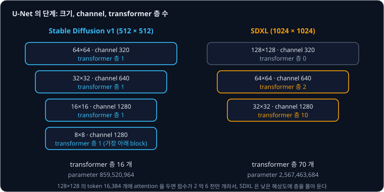
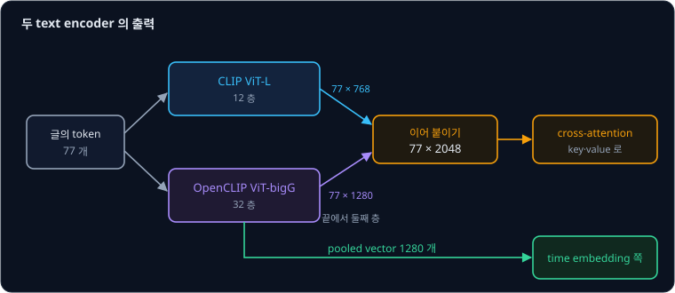
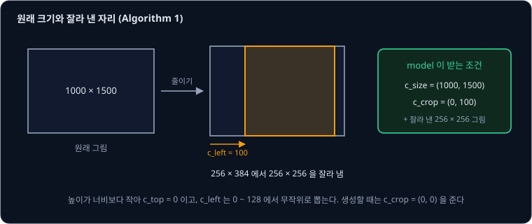
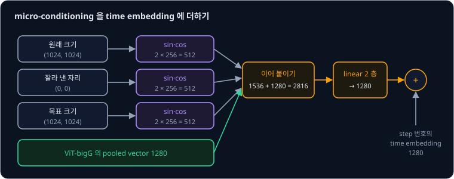
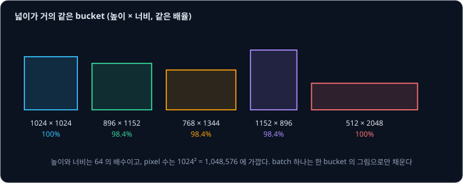
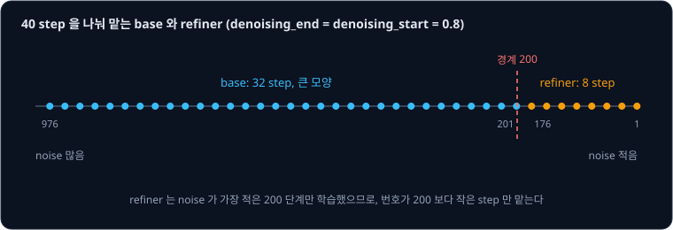

# SDXL

Stable Diffusion v1.5 로 $1024 \times 1024$ 그림을 만들면 latent 가 $128 \times 128$ 이 되어, 학습 때 본 $64 \times 64$ 보다 가로세로가 두 배다.
그렇다고 U-Net 을 그대로 키워 큰 그림으로 다시 학습하면 계산이 크게 는다. [U-Net](../unet/README.md) 의 가장 위 단계에 있는 self-attention 은
위치끼리 모두 짝을 지어 점수를 매기는데, latent 의 위치 수가 4 배가 되면 짝의 수는 16 배가 된다. 큰 그림을 잘 그리려면 무엇을 어떻게 키워야
할까?

**SDXL** 은 Stability AI 의 Podell 등이 2023 년에 발표한 model 로, Stable Diffusion 을 크게 키웠다. U-Net 을 약 3 배인 parameter 26 억 개로
키우고 text encoder 를 두 개 쓴다. 또 그림의 원래 크기와 잘라 낸 자리를 조건으로 넣고, 마지막에 세부를 다듬는 model 인 refiner 를 붙인다. 저자들이
사용자에게 네 model 의 그림 가운데 가장 좋은 것을 고르게 했더니 refiner 를 붙인 SDXL 이 48.44%, SDXL 만 36.93%, Stable Diffusion 1.5 가 7.91%, 2.1 이 6.71% 의
선택을 받았다.

## 학습 목표

- SDXL U-Net 이 transformer 층을 낮은 해상도에 몰아 둔 이유를 self-attention 의 짝 수로 계산하고, parameter 수를 v1 과 비교할 수 있다
- 두 text encoder 의 출력을 이어 붙인 $77 \times 2048$ 조건과, 글 전체를 vector 하나로 줄인 pooled vector 를 time embedding 에 더하는 방식을
  설명할 수 있다
- 원래 크기·잘라 낸 자리·목표 크기를 넣는 micro-conditioning 과, 그림을 가로세로 비율별 묶음(bucket)으로 나눠 학습하는 방식이 무엇을 고치는지
  설명할 수 있다
- SDXL 본체인 base model 과 refiner 가 sampling step 을 나눠 맡는 방식을 step 수로 계산할 수 있다

## 낮은 해상도로 옮긴 attention

SDXL 은 기본으로 $1024 \times 1024$ 그림을 만들고, VAE 가 가로세로를 8 분의 1 로 줄이므로 latent 는 $128 \times 128 \times 4$ 다. U-Net 의
self-attention 은 latent 의 위치 하나하나를 token 으로 보고 모든 token 쌍의 점수를 계산하므로, token 이 $n$ 개면 점수가 $n^2$ 개다. latent 크기마다
점수의 수를 계산하면 아래와 같다.

| 크기 | token 수 $n$ | 점수의 수 $n^2$ |
| --- | --- | --- |
| $128 \times 128$ | 16,384 | 268,435,456 |
| $64 \times 64$ | 4,096 | 16,777,216 |
| $32 \times 32$ | 1,024 | 1,048,576 |

$128 \times 128$ 에 attention 층을 하나 두면 $64 \times 64$ 에 둔 것보다 점수 계산이 16 배 많다. 저자들은 효율을 위해 가장 높은 해상도에서는
transformer block 을 빼고, 그 아래 두 단계에는 transformer 층을 각각 2 개와 10 개 쌓은 block 을 두었다. v1 에서 latent 를 가로세로 8 분의 1 로 줄였던 가장 아래 단계는 아예 없앴다. 논문의 표 1
과 diffusers 의 U-Net 설정(`block_out_channels`, `transformer_layers_per_block`)을 나란히 놓으면 아래와 같다.

| 항목 | Stable Diffusion 1.4/1.5 | SDXL |
| --- | --- | --- |
| 기본 그림 크기 | $512 \times 512$ | $1024 \times 1024$ |
| latent 크기 | $64 \times 64$ | $128 \times 128$ |
| 단계마다 channel | 320, 640, 1280, 1280 | 320, 640, 1280 |
| 단계마다 transformer block 의 층 수 (논문의 표 1) | 1, 1, 1, 1 | 0, 2, 10 |
| transformer 층의 수 (weight 파일에서 셈) | 16 | 70 |
| U-Net parameter (weight 파일에서 셈) | 859,520,964 | 2,567,463,684 |
| attention block 의 parameter 비율 | 약 31% | 약 86% |

v1 의 넷째 숫자 1 은 $8 \times 8$ 크기의 가장 아래 block 에 있는 transformer 층이다. SDXL 의 단계는 $128 \times 128$, $64 \times 64$, $32 \times 32$ 셋이고, attention 은 $64 \times 64$ 와 $32 \times 32$ 에만 있다. transformer
층은 block 하나에 층 10 개를 쌓은 셋째 단계와 가장 아래 block 에 몰려 있다. 70 개를 자리별로 세면 줄이는 길에 $2 \times 2 + 2
\times 10 = 24$ 개가 있고, 가장 아래에 10 개가 있고, 키우는 길에 $3 \times 10 + 3 \times 2 = 36$ 개가 있다.

parameter 는 $2{,}567{,}463{,}684 \div 859{,}520{,}964 \approx 2.99$ 배라서 논문의 "세 배 큰 U-Net" 과 맞는다. attention block 의 parameter 는
v1 의 267,239,360 개에서 2,209,201,920 개로 늘었다. 이 늘어난 양이 U-Net 전체가 늘어난 양보다 커서, attention 밖의 부분은 오히려 약 5 억 9 천만 개에서 약 3 억 6 천만 개로
줄었다. 논문이 밝힌 대로 U-Net 이 커진 몫은 대부분 attention 에서 나왔다.

**확인 문제.** $896 \times 1152$ 그림의 latent 에서 가장 위 단계의 token 수는 몇 개일까? 이 단계에 self-attention 을 두면 점수는 몇 개일까?

답 보기

① latent 는 $896 \div 8 = 112$, $1152 \div 8 = 144$ 라서 token 은 $112 \times 144 = 16{,}128$ 개다.

② 점수는 $16{,}128^2 = 260{,}112{,}384$ 개다.

답: 16,128 개와 약 2 억 6 천만 개. SDXL 은 이 단계에 attention 을 두지 않는다.

## 두 text encoder

[Cross-Attention](../cross-attention/README.md) 에서 본 v1 은 CLIP ViT-L 의 text encoder 하나가 낸 $77 \times 768$ 을 cross-attention 에 넣었다.
SDXL 은 여기에 훨씬 큰 OpenCLIP ViT-bigG 의 text encoder 를 더한다. OpenCLIP 은 [CLIP](../clip/README.md) 의 공개 구현이고, ViT-bigG 는
그 구현으로 학습한 큰 model 의 이름이다. Hugging Face 에 올라 있는 SDXL 의 설정과 weight 파일로 두 encoder 를 비교하면 아래와 같다.

| text encoder | 층 수 | token 하나의 vector | parameter |
| --- | --- | --- | --- |
| CLIP ViT-L | 12 | 768 | 123,060,480 |
| OpenCLIP ViT-bigG | 32 | 1280 | 694,659,840 |

두 encoder 의 parameter 를 합하면 817,720,320 개라서 논문이 적은 817M(M 은 백만)과 같다. 두 encoder 는 모두 [Tokenizer](../tokenizer/README.md) 에서
본 token 77 개를 입력으로 받는다.

SDXL 은 두 encoder 의 마지막 층이 아니라 끝에서 둘째 층(penultimate layer)의 출력을 쓰고, 같은 token 자리의 두 vector 를 channel 방향으로 이어 붙인다.
token 하나에 숫자 $768 + 1280 = 2048$ 개가 되어 조건은 $77 \times 2048$ 이다. diffusers 의 SDXL pipeline 도 두 encoder 에서 `hidden_states[-2]`
를 꺼내 이어 붙인다. cross-attention 에서 key 를 만드는 행렬도 숫자 2048 개를 받도록 크기를 맞춰서, $64 \times 64$ 단계에서는 $640 \times 2048$, $32 \times 32$
단계에서는 $1280 \times 2048$ 이다.

SDXL 은 글 전체를 vector 하나로 줄인 **pooled** text embedding 도 쓴다. pooled text embedding 은 text encoder 가 글 끝 token 자리의 vector 를
한 번 더 변환해, 글 전체를 나타내는 vector 하나로 낸 것이다. SDXL 은 OpenCLIP ViT-bigG 의 pooled vector(숫자 1280 개)를 cross-attention 이 아니라
time embedding 쪽에 더한다. 위치마다 다른 단어를 고르는 cross-attention 과 달리, time embedding 에 더한 값은 그림의 모든 위치에 똑같이 들어간다.
다음 두 절에서 볼 크기 조건도 이 길로 함께 들어간다.

**확인 문제.** 글의 token 77 개 가운데 셋째 token 자리에서 CLIP ViT-L 이 낸 vector 와 OpenCLIP ViT-bigG 가 낸 vector 를 이어 붙이면 숫자가 몇 개일까?
cross-attention 의 key 행렬이 $1280 \times 2048$ 이면 이 token 의 key 는 숫자 몇 개일까?

답 보기

① $768 + 1280 = 2048$ 개다.

② $1280 \times 2048$ 행렬에 숫자 2048 개짜리 vector 를 곱하면 숫자 1280 개가 나온다.

답: 2048 개와 1280 개.

## 원래 크기와 잘라 낸 자리를 조건으로

저자들은 latent diffusion model 을 학습하려면 그림이 일정한 크기 이상이어야 한다는 점을 약점으로 꼽는다. 논문에 따르면 Stable Diffusion 1.4/1.5 를 학습할 때는 한 변이라도 512 pixel 보다 작은
그림을 모두 버렸다. SDXL 의 첫 학습 크기인 $256 \times 256$ 에 같은 규칙을 쓰면, 저자들의 dataset 에서는 한 변이 256 보다 작은 그림이 39% 라서
그만큼을 버려야 한다. 작은 그림을 키워서 쓰면 확대할 때 생긴 흐릿함을 model 이 그대로 배울 수 있다.

SDXL 은 작은 그림도 키워서 쓰되, 키우기 전의 원래 높이와 너비 $c_\text{size} = (h_\text{original}, w_\text{original})$ 를 조건으로 함께 넣는다.
그러면 model 은 원래 작았던 그림의 생김새를 작은 크기 값과 묶어 배우므로, 생성할 때 이 값을 크게 주면 원래부터 컸던 그림처럼 선명한 그림이 나온다.
저자들은 ImageNet 의 class 이름을 조건으로 $512 \times 512$ 그림을 만드는 실험으로 이 효과를 쟀다(표 2). model 이름의 CIN 은 class 조건 ImageNet
model 을 뜻하고, FID 는 낮을수록 좋다.

| model | 학습 데이터 | FID-5k |
| --- | --- | --- |
| CIN-512-only | 한 변이라도 512 보다 작은 그림을 버림 (7 만 장만 남음) | 43.84 |
| CIN-nocond | 모든 그림, 크기 조건 없음 | 39.76 |
| CIN-size-cond | 모든 그림, 크기 조건 있음 | 36.53 |

저자들은 그림을 버린 model 은 데이터가 적어 overfitting 이 생겼고, 조건 없이 모두 쓴 model 은 흐릿한 sample 이 섞였다고 해석했다.

둘째 문제는 잘라 낸 그림이다. 학습할 때는 batch 의 그림 크기를 맞추려고, 짧은 변을 학습 크기에 맞춰 줄인 뒤 긴 변 쪽에서 무작위 자리를 잘라 낸다.
그러면 고양이의 머리가 잘린 그림도 학습 데이터가 된다. 저자들은 v1.5 와 2.1 이 머리가 잘린 고양이를 그리는 것도 이 때문이라고 본다. SDXL 은 잘라 낸
자리의 왼쪽 위 좌표 $c_\text{crop} = (c_\text{top}, c_\text{left})$ 를 조건으로 넣는다. 예를 들어 높이 1000, 너비 1500 인 그림을
$256 \times 256$ 학습에 쓰는 과정을 논문의 Algorithm 1 대로 따라가면 아래와 같다.

| 단계 | 값 |
| --- | --- |
| 원래 크기 $c_\text{size}$ | $(1000, 1500)$ |
| 짧은 변을 256 에 맞춰 줄인 크기 | $256 \times 384$ |
| 높이가 너비보다 작으므로 | $c_\text{top} = 0$, $c_\text{left}$ 는 0 ~ $384 - 256 = 128$ 에서 무작위 |
| 예를 들어 뽑은 값 | $c_\text{crop} = (0, 100)$, 가로 100 ~ 355 pixel 을 잘라 냄 |

생성할 때는 $c_\text{crop} = (0, 0)$ 을 넣는다. 저자들은 큰 dataset 의 그림이 대체로 대상을 가운데 두므로, 잘라 내지 않은 그림의 조건을 주면 대상이
가운데 온 그림이 나온다고 설명한다. diffusers 의 SDXL pipeline 에서도 잘라 낸 자리를 정하는 `crops_coords_top_left` 의 기본값은 $(0, 0)$
이다. 원래 크기를 정하는 `original_size` 와, 만들 그림의 크기를 알리는 목표 크기 `target_size` 는 주지 않으면 만들 그림의 크기로 정해진다.

## 조건을 time embedding 에 더하기

크기와 자리 조건은 숫자 몇 개라서 cross-attention 대신 time embedding 처럼 넣는다. 세 조건은 원래 크기 2 개, 잘라 낸 자리 2 개, 목표 크기(만들 그림의
크기) 2 개로 모두 숫자 6 개다. [U-Net](../unet/README.md) 의 time embedding 이 step 번호를 여러 주기의 sin·cos 값으로 늘린 것처럼, 숫자 하나하나도
같은 방법으로 늘린다. 논문은 이 방법을 Fourier feature encoding 이라고 부른다. diffusers 의 SDXL U-Net 설정에서는 숫자 하나를 256 개로 늘린다
(`addition_time_embed_dim: 256`).

| 값 | 숫자의 수 |
| --- | --- |
| 크기·자리 조건 6 개를 하나에 256 개씩 | $6 \times 256 = 1536$ |
| ViT-bigG 의 pooled vector | 1280 |
| 이어 붙인 값 | $1536 + 1280 = 2816$ |
| linear 층 2 개(`add_embedding`)를 지난 값 | 1280 |

마지막 값 1280 개는 step 번호의 time embedding(숫자 1280 개)에 더한 뒤 U-Net 의 모든 residual block 으로 보낸다. weight 파일에서
`add_embedding` 첫 층의 행렬이 $1280 \times 2816$ 이라서 이 계산과 맞는다. 저자들은 이 조건들을 묶어 **micro-conditioning** 이라고 부른다.

이 조건들은 [Classifier-Free Guidance](../classifier-free-guidance/README.md) 의 무조건 쪽에도 따로 넣을 수 있다. diffusers 의 SDXL 문서는
`negative_original_size=(512, 512)` 처럼 빈 글 쪽에 작은 크기를 주어, 작은 그림처럼 보이는 쪽에서 멀어지게 하는 예를 든다.

**흔한 오해.** `original_size` 를 $(256, 256)$ 으로 주면 $256 \times 256$ 그림이 나온다고 생각하기 쉽다. 그림의 크기는 latent 의 크기가 정하고,
이 조건은 그림을 원래 작았던 그림처럼 보이게 할 뿐이다. diffusers 문서도 이 값을 낮추면 $1024 \times 1024$ 그림이 나오되 저해상도 그림처럼 단순하고
흐릿해진다고 적었다.

**확인 문제.** 높이 600, 너비 400 인 그림을 $256 \times 256$ 학습에 쓴다. Algorithm 1 에서 $c_\text{size}$ 는 무엇이고, 짧은 변을 256 에 맞춘 뒤
$c_\text{top}$ 과 $c_\text{left}$ 는 어느 범위에서 정해질까?

답 보기

① $c_\text{size} = (600, 400)$ 이다.

② 짧은 변인 너비 400 을 256 에 맞추면 높이는 $600 \times 256 \div 400 = 384$ 라서 $384 \times 256$ 이 된다.

③ 높이가 너비보다 크므로 $c_\text{left} = 0$ 이고, $c_\text{top}$ 은 0 ~ $384 - 256 = 128$ 에서 무작위로 뽑는다.

답: $(600, 400)$, $c_\text{left} = 0$, $c_\text{top}$ 은 0 ~ 128.

## 가로세로 비율별 bucket

실제 그림에는 16:9 가로 그림도 있고 세로로 긴 그림도 있어서, 정사각형만 만드는 model 은 쓰임이 좁다. SDXL 은 마지막 학습 단계에서 그림들을 가로세로
비율별 **bucket**(묶음)으로 나눠 학습한다. 논문의 부록 I 에는 bucket 40 개가 실려 있다. 저자들은 bucket 마다 pixel 수를 $1024^2 = 1{,}048{,}576$ 에 최대한 가깝게 두고,
높이와 너비를 64 의 배수로 정했다. 몇 개를 골라 pixel 수를 계산하면 아래와 같다.

| 높이 × 너비 | 비율 (높이 ÷ 너비) | pixel 수 | $1024^2$ 대비 |
| --- | --- | --- | --- |
| $1024 \times 1024$ | 1.0 | 1,048,576 | 100% |
| $896 \times 1152$ | 0.78 | 1,032,192 | 98.4% |
| $768 \times 1344$ | 0.57 | 1,032,192 | 98.4% |
| $1152 \times 896$ | 1.29 | 1,032,192 | 98.4% |
| $512 \times 2048$ | 0.25 | 1,048,576 | 100% |

학습 batch 하나는 한 bucket 의 그림으로만 채우고, step 마다 bucket 을 바꾼다. 그 bucket 의 크기(목표 크기) $c_\text{ar} = (h_\text{tgt}, w_\text{tgt})$
도 앞 절의 방법으로 조건에 넣는다. 저자들은 $256 \times 256$ 에서 batch 2048 로 60 만 step 을 학습하고, 이어서 $512 \times 512$ 에서 20 만 step 을 학습했다. 그 뒤
이 bucket 학습으로 약 $1024 \times 1024$ 넓이의 여러 비율에서 fine-tuning 했다. diffusion 의 schedule 은 1000 step 이고, Hugging Face 에 올라 있는
scheduler 설정은 v1.5 와 같은 `scaled_linear`(β 범위 0.00085 ~ 0.012)다.

**확인 문제.** $832 \times 1216$ bucket 의 pixel 수는 $1024^2$ 의 몇 % 일까? 이 bucket 의 latent 크기는?

답 보기

① $832 \times 1216 = 1{,}011{,}712$ 이고 $1{,}011{,}712 \div 1{,}048{,}576 \approx 0.965$ 다.

② latent 는 $832 \div 8 = 104$, $1216 \div 8 = 152$ 라서 $104 \times 152$ 다.

답: 약 96.5% 와 $104 \times 152$.

## 새로 학습한 VAE

저자들은 v1 과 같은 구조의 autoencoder 를 처음부터 다시 학습했다. batch 를 9 에서 256 으로 키우고, weight 의 지수 이동 평균(EMA)을 썼다. EMA 는
학습하는 동안 바뀌어 온 weight 를 최근 값일수록 크게 쳐서 평균한 것이다. 사진 dataset 인 COCO2017 의 validation 그림($256 \times 256$)을 VAE 로
줄였다가 되살린 결과는 아래와 같다(논문의 표 3). PSNR 은 pixel 값의 차이로 잰 점수이고, SSIM 은 밝기·대비·구조가 닮은 정도를 잰 점수다. LPIPS 는
신경망 feature 의 차이로 잰 거리이고, rFID 는 되살린 그림들과 원래 그림들 사이의 FID 다. PSNR 과 SSIM 은 높을수록 원래 그림에 가깝고, LPIPS 와
rFID 는 낮을수록 원래 그림에 가깝다.

| VAE | PSNR | SSIM | LPIPS | rFID |
| --- | --- | --- | --- | --- |
| SDXL-VAE | 24.7 | 0.73 | 0.88 | 4.4 |
| SD-VAE 1.x | 23.4 | 0.69 | 0.96 | 5.0 |
| SD-VAE 2.x | 24.5 | 0.71 | 0.92 | 4.7 |

latent 의 퍼진 정도도 달라져서, [Latent Diffusion](../latent-diffusion/README.md) 에서 본 scaling factor 가 v1 의 0.18215 에서 SDXL VAE 설정의 0.13025
로 바뀌었다. 같은 VAE 설정에는 `force_upcast: true` 도 있다. diffusers 의 설명에 따르면 이 설정은 SDXL 같은 고해상도 pipeline 에서 VAE 를 32 bit 숫자로
계산하라는 뜻이다. 값의 범위가 더 작아지도록 다시 학습한 VAE 를 쓰면 이 설정을 끌 수 있다.

## 낮은 noise 만 맡는 refiner

저자들은 SDXL 이 만든 그림의 세부가 가끔 떨어진다고 보고, 같은 latent 공간에서 고해상도·고품질 그림만으로 학습한 별도의 model 인 **refiner** 를
만들었다. refiner 는 1000 개의 noise 단계 가운데 noise 가 가장 적은 200 단계에서만 학습했다. base model 이 만든 latent 에 noise 를 조금 다시 섞고
refiner 로 그 noise 를 걷어 내는 방식으로, [Latent Diffusion](../latent-diffusion/README.md) 에서 본 img2img 와 같은 방법(SDEdit)이다. 논문에 따르면 이
단계가 꼭 필요하지는 않지만 배경과 얼굴의 세부가 좋아진다.

[DDPM](../ddpm/README.md) 에서 본 것처럼 큰 모양은 noise 가 많은 step 에서 정해지고, 세부는 noise 가 적은 step 에서 정해진다. diffusers 문서는 이 성질을
이용해 두 model 이 step 을 나눠 맡는 방법도 보여 준다. 문서의 예는 40 step 가운데 base 에 `denoising_end=0.8` 을 주고, refiner 에
`denoising_start=0.8` 을 준다. pipeline 의 code 는 $1000 - 0.8 \times 1000 = 200$ 을 경계로 삼아, step 번호가 200 이상인 step 은 base 가 맡고
200 보다 작은 step 은 refiner 가 맡게 한다. SDXL 의 기본 설정으로
40 step 의 번호를 계산하면 976, 951, …, 1 이다.

| 맡는 model | step 번호 | step 수 |
| --- | --- | --- |
| base | 976, 951, …, 201 | 32 |
| refiner | 176, 151, …, 1 | 8 |

Hugging Face 에 올라 있는 refiner 의 설정과 weight 파일을 보면, refiner 의 U-Net 은 parameter 가 2,259,526,660 개이고 text encoder 로 OpenCLIP
ViT-bigG 하나만 써서 cross-attention 이 받는 token 하나의 vector 가 숫자 1280 개다. 또 time embedding 쪽 조건으로 그림이 얼마나 보기 좋은지를 매긴
미학 점수(aesthetic score)를 하나 더 받는다. diffusers 의 refiner pipeline 은 기본값으로 글 쪽에는 6.0 을 주고, 빈 글 쪽에는 2.5 를 준다. 저자들은
refiner 를 쓰면 두 큰 model 을 memory 에 올려야 해서 느리고 쓰기 어렵다는 점을 앞으로의 과제로 꼽았다.

**확인 문제.** 50 step 을 같은 간격(20 씩)으로 나눠 step 번호가 981, 961, …, 1 이다. `denoising_end=0.9` 이면 경계는 얼마이고, base 와 refiner 는 각각
몇 step 을 맡을까?

답 보기

① 경계는 $1000 - 0.9 \times 1000 = 100$ 이다.

② 100 이상인 번호는 981 부터 101 까지 $(981 - 101) \div 20 + 1 = 45$ 개다.

③ 나머지 81, 61, 41, 21, 1 의 5 개는 refiner 가 맡는다.

답: 경계 100, base 45 step, refiner 5 step.

## 정리

- SDXL 은 $1024 \times 1024$(latent $128 \times 128$)를 만든다. token 이 16,384 개인 가장 위 단계에서는 attention 을 빼고 $64 \times 64$ 와
  $32 \times 32$ 에 transformer 층을 2 개, 10 개씩 쌓아 모두 70 개를 두었다. U-Net 은 parameter 2,567,463,684 개로 v1 의 약 3 배이고, 그 86% 가
  attention block 이다
- 두 text encoder(CLIP ViT-L 768, OpenCLIP ViT-bigG 1280)의 끝에서 둘째 층 출력을 이어 붙인 $77 \times 2048$ 이 cross-attention 의 조건이다.
  ViT-bigG 의 pooled vector 1280 개는 time embedding 쪽에 더한다
- 원래 크기·잘라 낸 자리·목표 크기의 숫자 6 개를 256 개씩 늘리고 pooled vector 와 이어 붙인 2816 개를 1280 개로 바꿔 time embedding 에 더한다.
  이 micro-conditioning 으로 dataset 의 39% 인 작은 그림을 버리지 않고 쓰고, 생성할 때 잘라 내지 않은 $(0, 0)$ 을 줘서 대상이 잘리지 않게 한다
- 마지막 학습은 pixel 수가 $1024^2$ 에 가까운 가로세로 비율별 bucket 으로 한다. VAE 는 다시 학습해 scaling factor 가 0.13025 이고, noise 가 적은
  200 단계만 학습한 refiner 가 세부를 다듬는다. diffusers 예의 40 step 에서는 base 가 32 step, refiner 가 8 step 을 맡는다

SDXL 은 U-Net 과 DDPM 의 noise 예측을 그대로 쓰면서 크기를 키웠다. 다음 강의인 [Stable Diffusion 3](../sd3/README.md) 는 U-Net 대신 Transformer 를 쓰고, noise 예측 대신
[Flow Matching](../flow-matching/README.md) 의 속도 예측을 쓴다.

## 참고 자료

- Dustin Podell 등, [SDXL: Improving Latent Diffusion Models for High-Resolution Image Synthesis](https://arxiv.org/abs/2307.01952) (2023) —
  SDXL 논문. 2.1 절과 표 1 의 U-Net 구조와 두 text encoder, 2.2 절의 크기·자리 조건(그림 2 의 39%, 표 2, Algorithm 1), 2.3 절과 부록 I 의 bucket,
  2.4 절과 표 3 의 VAE, 2.5 절의 학습 단계·refiner·사용자 평가, 3 절의 앞으로의 과제
- Hugging Face, [stabilityai/stable-diffusion-xl-base-1.0](https://huggingface.co/stabilityai/stable-diffusion-xl-base-1.0) — `unet/config.json`
  (`transformer_layers_per_block: [1, 2, 10]`, `addition_time_embed_dim: 256`, `projection_class_embeddings_input_dim: 2816`), `vae/config.json`
  (`scaling_factor: 0.13025`, `force_upcast: true`), 두 text encoder 의 설정과 weight 파일의 tensor 모양
- Hugging Face, [stabilityai/stable-diffusion-xl-refiner-1.0](https://huggingface.co/stabilityai/stable-diffusion-xl-refiner-1.0) — refiner U-Net 의
  설정(`cross_attention_dim: 1280`)과 weight 파일
- diffusers, [`pipeline_stable_diffusion_xl.py`](https://github.com/huggingface/diffusers/blob/main/src/diffusers/pipelines/stable_diffusion_xl/pipeline_stable_diffusion_xl.py)
  와 [`pipeline_stable_diffusion_xl_img2img.py`](https://github.com/huggingface/diffusers/blob/main/src/diffusers/pipelines/stable_diffusion_xl/pipeline_stable_diffusion_xl_img2img.py) —
  `hidden_states[-2]` 와 pooled vector, `original_size`·`crops_coords_top_left`·`target_size` 의 기본값, `denoising_end`·`denoising_start` 의 경계 계산,
  미학 점수 기본값 6.0 과 2.5. [`autoencoder_kl.py`](https://github.com/huggingface/diffusers/blob/main/src/diffusers/models/autoencoders/autoencoder_kl.py)
  에 `force_upcast` 의 설명이 있다
- diffusers, [Stable Diffusion XL 문서](https://github.com/huggingface/diffusers/blob/main/docs/source/en/api/pipelines/stable_diffusion/stable_diffusion_xl.md) —
  base 와 refiner 를 `denoising_end=0.8`·`denoising_start=0.8` 로 잇는 예, micro-conditioning 과 `negative_original_size` 의 설명
