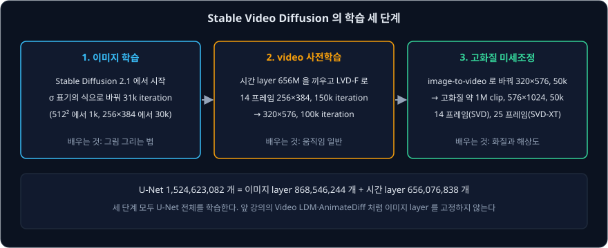
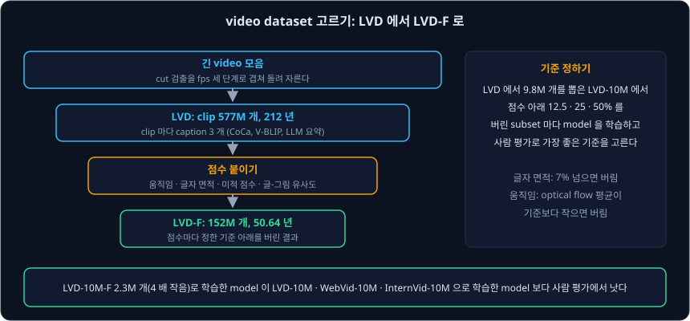
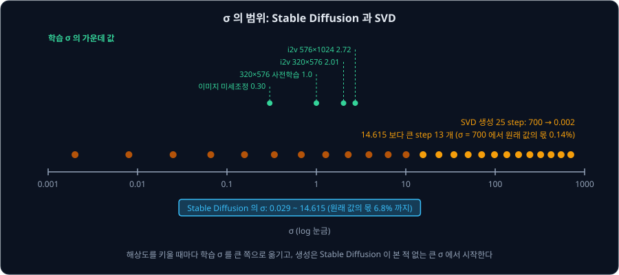
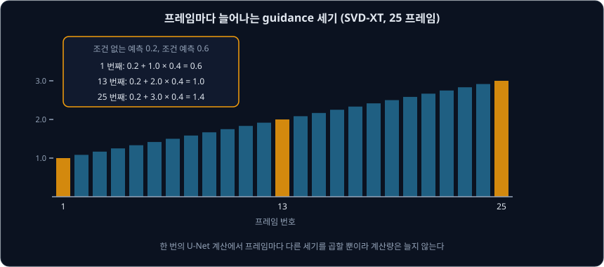

# Stable Video Diffusion

[Video Diffusion](../video-diffusion/README.md) 강의의 model 들은 글에서 video 를 만들었다. 그런데 "바닷가의 등대" 라고 적어 video 를 만들면 등대의
모양과 하늘의 색은 model 이 정한다. 이미 마음에 드는 사진이나 Stable Diffusion 으로 만든 그림이 있다면, 그 그림을 그대로 첫 장면으로 두고 파도와 구름만
움직이게 하고 싶다. 이렇게 그림 한 장을 받아 이어지는 프레임을 만드는 일을 image-to-video 라고 한다.

2023 년 11 월 Stability AI 의 Blattmann 등이 공개한 **Stable Video Diffusion**(SVD)은 이 일을 하는 공개 model 이다. Video LDM 을 만든 저자들이
같은 구조를 다시 쓰되, 이번에는 구조보다 데이터와 학습 순서에 집중했다. 공개한 checkpoint 는 $576 \times 1024$ 그림 한 장에서 14 프레임(SVD) 또는
25 프레임(SVD-XT)을 만든다. 이 강의는 SVD 가 어떤 데이터로 어떤 순서로 학습했는지, 그림 한 장을 어떻게 U-Net 에 넣는지, 그리고 내 컴퓨터에서 돌릴 때
무엇이 메모리와 시간을 쓰는지를 숫자로 따라간다.

## 학습 목표

- SVD 의 세 단계 학습(그림, 많은 video, 좋은 video)이 각각 무엇을 맡는지와, 앞 강의의 model 들과 달리 U-Net 전체를 학습한다는 점을 설명할 수 있다
- 긴 video 모음을 cut 검출과 점수(움직임, 글자 면적, 미적 점수)로 걸러 사전학습 dataset 을 만드는 과정과, 기준을 사람 평가로 고르는 방법을 설명할 수 있다
- 조건 그림이 CLIP vector 하나와 channel 방향으로 이어 붙인 latent 두 길로 들어가는 모양을 숫자로 따라갈 수 있다
- fps, 움직임 크기(motion bucket), noise 세기를 숫자 조건으로 넣는 방식과 각 값이 결과를 어떻게 바꾸는지 설명할 수 있다
- 해상도가 클수록 학습 noise 를 큰 쪽으로 옮기는 이유와, 프레임마다 늘어나는 guidance 의 계산을 숫자로 따라갈 수 있다

## 세 단계로 나눈 학습

SVD 논문은 video model 을 무엇부터 어떤 순서로 학습할지부터 묻는다. 저자들은 학습을 세 단계로 나눴다.

| 단계 | 하는 일 | 데이터 |
| --- | --- | --- |
| 1. 이미지 학습 | text-to-image model 을 가져온다 | Stable Diffusion 2.1 |
| 2. video 사전학습 | 낮은 해상도에서 많은 video 로 움직임을 배운다 | 걸러 낸 LVD-F, 152M clip |
| 3. 고화질 미세조정 | 높은 해상도에서 좋은 video 로 다듬는다 | 고화질 video 약 1M 개 |

1 단계는 [Video LDM](../video-diffusion/README.md) 처럼 이미 학습한 이미지 model 에서 시작하는 것이다. 저자들은 이 단계가 정말 필요한지 확인하려고
같은 video model 을 두 번 학습했다. 하나는 Stable Diffusion 2.1 의 weight 에서 시작했고, 다른 하나는 아무것도 배우지 않은 weight 에서 시작했다. 사람 평가에서는
이미지 weight 에서 시작한 쪽이 화질과 글 따르기 모두에서 뽑혔다(그림 3a).

2 단계와 3 단계를 나눈 것이 이 논문의 주장이다. model 은 많은 video 를 낮은 해상도로 먼저 보며 움직임 일반을 배우고, 그 뒤 적은 수의 좋은 video 로 해상도와 화질을
올린다. 이미지 model 에서도 큰 dataset 으로 사전학습하고 작은 고화질 dataset 으로 미세조정하면 좋아진다는 것이 알려져 있었는데, 저자들은 video 에서는
이 순서가 따로 연구되지 않았다고 적었다.

부록 D.2 의 실제 설정은 아래와 같다. iteration 은 parameter 를 한 번 고치는 학습 step 이고, batch size 는 그 한 번에 쓰는 video 의 수다.

| 학습 | 해상도, 프레임 | iteration | batch size |
| --- | --- | --- | --- |
| 이미지 model 을 새 noise 표기로 미세조정 | $512 \times 512$ 1k, $256 \times 384$ 30k | 31k | |
| video 사전학습 | $256 \times 384$, 14 프레임 | 150k | 1536 |
| 해상도 올리기 | $320 \times 576$, 14 프레임 | 100k | 768 |
| image-to-video 로 바꾸기 | $320 \times 576$ | 50k | 768 |
| 고화질 미세조정 | $576 \times 1024$, 14 또는 25 프레임 | 50k | 768 |

구조는 Video LDM 을 그대로 따랐다. 이미지 layer 의 convolution 과 attention 뒤마다 시간 방향의 convolution 과 attention 을 넣고, 이 때문에 parameter 가
656M 늘어 U-Net 이 1521M 이 되었다고 논문은 적었다. 공개한 weight 파일을 세면 U-Net 의 숫자는 1,524,623,082 개이고, 그 가운데 이름에 시간 layer 가 붙은 tensor 의 숫자가 656,076,838 개,
나머지가 868,546,244 개다. 나머지는 Stable Diffusion 2.1 과 같은 구조인 SD-Turbo 의 U-Net 865,910,724 개에, 뒤에서 볼 숫자 조건의 linear 층 2,624,000 개와 입력
channel 이 늘어 생긴 convolution weight 11,520 개를 더한 수와 정확히 같다. 이미지 layer 와 시간 layer 의 출력을 섞는 Video LDM 의 학습하는 숫자 $\alpha$ 도 그대로 있어 weight 파일에 38 개가 들어 있다.

다른 점이 하나 있다. 앞 강의의 Video LDM 과 AnimateDiff 는 이미지 layer 를 고정하고 시간 layer 만 학습했지만, SVD 는 U-Net 전체를 학습한다. 논문은
시간 layer 만 학습하는 방법과 학습 없이 쓰는 방법을 들고 "이와 달리 우리는 model 전체를 미세조정한다" 고 적었다. 이미지 layer 도 함께 바뀌므로, AnimateDiff 의 motion module 처럼
시간 layer 만 떼어 다른 model 에 끼울 수 있다고 기대할 근거는 없다.

**확인 문제.** video 사전학습의 두 단계에서 iteration 마다 쓰는 video 수를 iteration 수에 곱하면 각각 몇 개일까? (같은 video 를 여러 번 쓸 수 있다)

답 보기

① $256 \times 384$ 단계는 $150{,}000 \times 1536 = 230{,}400{,}000$ 개다.

② $320 \times 576$ 단계는 $100{,}000 \times 768 = 76{,}800{,}000$ 개다.

답: 230,400,000 개와 76,800,000 개. 첫 단계만으로도 LVD-F 의 152M clip 보다 많아, 같은 clip 을 평균 한 번 넘게 본다.

## video dataset 고르기

논문의 3 절은 2 단계에 쓸 dataset 을 만드는 과정을 다룬다. 저자들은 먼저 긴 video 를 모았다. 그대로 쓰면 장면이 바뀌는 cut 이 video 안에 남고, model 은 cut 이
있는 video 를 만드는 법까지 배운다. 그래서 장면 전환을 찾는 도구(PySceneDetect)를 서로 다른 fps 와 기준으로 세 번 겹쳐 돌려, 갑자기 바뀌는 cut 뿐 아니라
천천히 어두워지는 fade 까지 찾아 잘랐다. 그림 2 에서 video 하나당 clip 수는 자르기 전 2.65 개에서 자른 뒤 11.09 개로 4 배쯤 늘었다. video 의
metadata 에 적힌 cut 말고도 숨은 cut 이 많았다는 뜻이다.

clip 마다 글도 붙였다. 사람이 수억 개에 글을 달 수는 없으므로 model 이 글을 만든다. 가운데 프레임 한 장을 그림 설명 model(CoCa)로 설명한 글, video 설명
model(V-BLIP)이 쓴 글, 이 두 글을 가벼운 LLM(large language model, 대형 언어 model)으로 합친 글의 세 가지다. 부록 그림 13 에서 CoCa 는 "바닥의 나무 조각 옆에 줄자가 있다" 처럼 자리의
세부를 적었고, V-BLIP 는 "사람이 자로 나무 조각을 잰다" 처럼 움직임을 적었다. 이렇게 만든 Large Video Dataset(LVD)은 clip 577M 개이고, 다 이으면 212 년
분량이다(표 1).

LVD 에는 학습을 방해하는 clip 도 많아서, 저자들은 clip 마다 점수를 붙였다.

| 점수 | 재는 방법 | 거르는 것 |
| --- | --- | --- |
| 움직임 | 2 fps 로 뽑은 프레임 사이의 optical flow(pixel 마다 다음 프레임에서 어디로 갔는지) 크기를 평균 | 거의 멈춘 장면 |
| 글자 면적 | 처음·가운데·끝 프레임에서 글자 영역 상자를 찾아 면적의 비율을 계산 | 자막과 글이 많은 화면 |
| 미적 점수 | 처음·가운데·끝 프레임의 CLIP embedding 으로 계산 | 보기 좋지 않은 화면 |
| 글-그림 유사도 | 같은 프레임과 caption 의 CLIP 유사도 | 글이 내용과 맞지 않는 clip |

그림 2 의 오른쪽을 보면 LVD 일부에서 움직임 점수가 0 근처인 clip 이 많다. 이런 clip 으로 학습하면 model 이 멈춘 video 를 자주 만든다. 부록 C 의
글자 면적 기준은 7% 라서, 글자 상자가 프레임 넓이의 7% 넘게 덮으면 버린다. 예를 들어 $1000 \times 1000$ pixel 프레임에서 글자 상자의 넓이가 모두 80,000 pixel 이면 8% 라서
버리고, 50,000 pixel 이면 5% 라서 남긴다.

어디까지 버릴지는 사람 평가로 정했다. LVD 에서 무작위로 9.8M 개를 뽑은 LVD-10M 을 두고, 점수 하나마다 아래쪽 12.5%, 25%, 50% 를 버린 subset 을 만든 뒤
각 subset 으로 같은 설정의 model 을 학습했다. 그리고 같은 글로 만든 video 를 두 개씩 사람에게 보여 더 나은 쪽을 고르게 했다. 이렇게 모은 승패를 chess 의
등급 점수와 같은 Elo 점수로 바꿔 점수마다 가장 좋은 기준을 골랐다. 이 기준들을 LVD 전체에 적용한 결과가 152M clip, 50.64 년 분량의 LVD-F 다.

거르는 효과는 컸다. 같은 기준으로 LVD-10M 을 거른 LVD-10M-F 는 2.3M 개로 4 배 작지만, 이것으로 학습한 model 이 거르지 않은 LVD-10M 으로 학습한 model 보다
화질과 글 따르기 모두에서 뽑혔다(그림 3b). 연구에 많이 쓰는 WebVid-10M 과 미적 점수로 거른 InternVid-10M 보다도 나았다(그림 4a·4b). 50M 개 규모에서도
거른 쪽이 나았고(그림 4c), 거른 데이터끼리는 50M 개가 10M 개보다 나았다(그림 4d).

저자들은 마지막으로 이 차이가 3 단계 뒤에도 남는지 확인했다. 이미지 model 에서 바로 고화질 미세조정을 한 model, 거르지 않은 50M 개로 사전학습한 model, 거른 50M 개로
사전학습한 model 을 같은 고화질 데이터로 50k step 미세조정했다. 미세조정 뒤에도 거른 데이터로 사전학습한 model 이 가장 높았고, video 사전학습을 건너뛴 model 이 가장
낮았다(그림 4e). 저자들은 사전학습의 차이가 미세조정 뒤에도 남으므로, 사전학습은 크고 잘 거른 dataset 에서 해야 한다고 결론 내렸다.

**확인 문제.** clip 8 개의 움직임 점수가 0.02, 0.9, 0.05, 1.4, 0.6, 0.01, 0.8, 1.1 이다. 아래쪽 25% 를 버리면 어떤 clip 이 남을까?

답 보기

① 8 개의 25% 는 2 개다.

② 작은 순서로 놓으면 0.01, 0.02, 0.05, 0.6, 0.8, 0.9, 1.1, 1.4 라서 0.01 과 0.02 를 버린다.

답: 0.05, 0.6, 0.8, 0.9, 1.1, 1.4 의 6 개. 50% 를 버리는 기준이었다면 0.05 도 버리고 0.8 이상의 4 개만 남는다.

## 그림 한 장을 U-Net 에 넣기

3 단계에서 저자들은 글로 video 를 만드는 base model 을 image-to-video model 로 바꿨다(4.3 절, 부록 D.4). 조건 그림은 두 길로 들어간다.

첫째 길은 cross-attention 이다. [Cross-Attention](../cross-attention/README.md) 에서 본 대로 Stable Diffusion 2.1 은 text encoder 가 만든 vector 들을
key·value 로 읽는다. SVD 는 글 대신 조건 그림을 CLIP 의 image encoder 로 바꾼 vector 를 넣는다. 공개 model 의 image encoder 는 ViT-H/14 구조이고,
그림을 $224 \times 224$ 로 줄여 1024 개 숫자의 vector 하나를 만든다. Stable Diffusion 2.1 의 cross-attention 도 1024 개짜리 vector 를 받으므로 모양이 맞는다.
weight 파일을 세면 image encoder 의 숫자는 632,076,800 개다.

이 vector 는 token 하나뿐이다. attention 은 query 와 key 들의 점수를 softmax 로 바꿔 비율을 정하는데, key 가 하나면 점수가 무엇이든 비율은 1 이다. 그래서
latent 의 모든 자리가 같은 value 를 받는다. 이 길로는 그림 속에 무엇이 있는지를 전체에 똑같이 전할 수 있을 뿐, 등대가 왼쪽에 있는지 오른쪽에 있는지 같은 자리
정보는 전할 수 없다.

| key 의 수 | 점수 | softmax 로 바꾼 비율 |
| --- | --- | --- |
| 2 개 | 1.0, 3.0 | 약 0.12, 0.88 |
| 1 개 | 3.0 | 1 |
| 1 개 | −5.0 | 1 |

자리 정보는 둘째 길이 맡는다. 조건 그림을 VAE encoder 로 latent 로 바꾸고, 이 latent 를 프레임 수만큼 복사해 noise 를 섞은 latent 옆에 channel 방향으로
이어 붙인다. $576 \times 1024$ 그림의 latent 는 $4 \times 72 \times 128$ 이다. 25 프레임 video 의 noise latent 는 $25 \times 4 \times 72 \times 128$ 이고,
그림 latent 를 붙이면 U-Net 의 입력은 $25 \times 8 \times 72 \times 128$ 이 된다. 그래서 U-Net 의 첫 convolution weight 는 $320 \times 8 \times 3 \times 3$
이다. 이미지 model 의 $320 \times 4 \times 3 \times 3$ 보다 $320 \times 4 \times 9 = 11{,}520$ 개 많고, 앞 절의 11,520 개가 이것이다. 논문은 따로 가리는 표시
없이 그림을 시간 축으로 복사만 한다고 적었다.

VAE 로 들어가는 그림에는 noise 를 조금 섞는데, 이것을 noise augmentation 이라고 한다. 학습할 때는 noise 크기 $\sigma$ 를 $\log\sigma$ 가 평균 −3.0,
표준편차 0.5 인 정규분포에서 뽑는다(부록 D.4). 가운데 값은 $e^{-3} \approx 0.05$ 다. diffusers 의 `StableVideoDiffusionPipeline` 은 pixel 값을 −1 ~ 1 로 둔 그림에
`noise_aug_strength` 기본값 0.02 를 곱한 noise 를 더한다. CLIP 쪽에는 noise 를 섞지 않은 그림을 쓴다.

논문은 이 noise 를 넣는 이유를 따로 설명하지 않았지만, model 을 쓰는 쪽의 문서에는 설명이 있다. diffusers 문서는 이 값을 키우면 video 가 처음 그림과 덜 닮고 움직임이
커진다고 적었다. Stability AI 의 sampling script 는 조건 그림이 $576 \times 1024$ 가 아니면 학습한 크기가 아니라 결과가 나빠질 수 있다며 이 값을 키워 보라고
경고한다.

guidance 를 위한 조건 없는 예측은 두 길을 모두 비워서 만든다. diffusers pipeline 은 CLIP vector 와 그림 latent 를 모두 0 으로 채운 입력을 함께 계산한다.
[Classifier-Free Guidance](../classifier-free-guidance/README.md) 에서 빈 글을 넣었던 자리에 빈 그림을 넣는다.

**확인 문제.** SVD(14 프레임)로 $576 \times 1024$ video 를 만든다. U-Net 에 들어가는 숫자는 몇 개이고, 그 가운데 조건 그림에서 온 숫자는 몇 개일까?

답 보기

① 입력은 $14 \times 8 \times 72 \times 128 = 1{,}032{,}192$ 개다.

② 그림 latent 는 channel 8 개 가운데 4 개라서 $14 \times 4 \times 72 \times 128 = 516{,}096$ 개다.

답: 1,032,192 개와 516,096 개. 그림 latent 는 $4 \times 72 \times 128 = 36{,}864$ 개를 14 번 복사한 것이다.

## fps 와 움직임의 크기를 숫자로 주기

학습 video 는 fps 도 움직임의 크기도 제각각이다. 저자들은 base model 부터 image-to-video model 까지 모두 video 의 frame rate 와 움직임 점수를 조건으로
받게 했고(부록 D.2), 이 덕분에 생성할 때 움직임의 양을 바꿀 수 있다고 적었다. Stability AI 의 공개 설정을 보면 숫자 조건은 세 개다.

| 조건 | diffusers 이름 | 기본값 | 뜻 |
| --- | --- | --- | --- |
| frame rate | `fps` | 7 (U-Net 에는 6) | 1 초에 보여 줄 프레임 수 |
| 움직임 크기 | `motion_bucket_id` | 127 | 클수록 움직임이 크다 |
| noise 세기 | `noise_aug_strength` | 0.02 | 앞 절의 noise augmentation |

`fps` 는 1 을 빼서 넣는다. diffusers 의 주석은 SVD 의 U-Net 이 학습할 때 fps − 1 을 받았다고 적었고, Stability AI 의 script 도 기본값이 `fps_id: 6` 이다.
그 script 는 `fps_id` 가 5 보다 작거나 30 보다 크면, 그리고 `motion_bucket_id` 가 255 보다 크면 결과가 나빠질 수 있다고 경고한다. 움직임 점수를 어떻게 0 ~ 255 의
묶음(bucket) 번호로 바꿨는지는 논문에 나오지 않는다.

세 숫자는 시각 $t$ 처럼 sin·cos 로 늘려 넣는다. 숫자 하나를 256 개로 늘리므로 세 숫자는 $3 \times 256 = 768$ 개가 되고, 이 768 개를 linear 층 두 개로
1280 개로 바꿔 시각 $t$ 의 embedding 에 더한다. 첫 층의 weight 가 $1280 \times 768$ 이고 둘째 층의 weight 가 $1280 \times 1280$ 이라, bias 를 합치면
$983{,}040 + 1{,}280 + 1{,}638{,}400 + 1{,}280 = 2{,}624{,}000$ 개로 첫 절의 수와 맞는다. [SDXL](../sdxl/README.md) 이 원래 크기와 잘라 낸 자리를 넣은
micro-conditioning 과 같은 방법이다.

| 단계 | 이 예의 값 | 기호로 쓴 값 |
| --- | --- | --- |
| 숫자 조건 | fps 6, motion 127, noise 0.02 | $(c_1, c_2, c_3)$ |
| sin·cos 로 늘리기 | $3 \times 256 = 768$ 개 | $[\gamma(c_1), \gamma(c_2), \gamma(c_3)]$ |
| linear 2 층 | 1280 개 | $e_c = \text{MLP}([\gamma(c_1), \gamma(c_2), \gamma(c_3)])$ |
| 시각 embedding 에 더하기 | 1280 개 | $e_t + e_c$ |

fps 는 1 초에 보여 줄 프레임 수를 정할 뿐 아니라 U-Net 에 들어가는 조건이기도 해서, 이 값을 바꾸면 만들어지는 프레임 자체가 달라진다. 25 프레임을 기본값 fps 7 로
재생하면 $25 \div 7 \approx 3.6$ 초다. Hugging Face 의 model card 는
만든 video 가 4 초 이하로 짧고, 움직임이 없거나 아주 느린 카메라 이동만 있는 video 가 나올 수 있다고 적었다. 이럴 때 `motion_bucket_id` 와 `noise_aug_strength`
를 올린다. diffusers 문서의 예는 이 두 값을 180 과 0.1 로 올려 움직임을 키운다.

**확인 문제.** SVD-XT 의 기본 25 프레임을 6 초 길이로 재생하려면 fps 를 얼마로 두어야 할까? 그때 U-Net 에 들어가는 fps 조건은?

답 보기

① $25 \div 6 \approx 4.2$ 라서 fps 를 4 로 두면 $25 \div 4 = 6.25$ 초다.

② U-Net 에는 1 을 뺀 3 이 들어간다.

답: fps 4, 조건 3. 다만 Stability AI 의 script 는 `fps_id` 가 5 보다 작으면 결과가 나빠질 수 있다고 경고하므로, 프레임을 늘리지 않고 길게 만들기는 어렵다.

## 해상도가 클수록 noise 를 크게

[Samplers](../samplers/README.md) 에서 latent 를 원래 값에 크기 $\sigma$ 의 noise 를 더한 값으로 보았다. Stable Diffusion 의 1000 단계를 $\sigma$ 로 바꾸면
0.029 ~ 14.615 이다. 가장 큰 $\sigma = 14.615$ 에서도 원래 값의 몫이 0.068 남는다. 부록 D.2 는 Stable Diffusion 2.1 의 이 schedule 이 마지막 단계에서도
원래 값이 꽤 남아 아주 어두운 그림을 만들기 어려운 문제가 있다고 적었다. SVD 는 1 단계에서 Stable Diffusion 2.1 을 이산적인 1000 단계 대신 연속적인
$\sigma$ 로 학습하도록 미세조정하고, 학습 $\sigma$ 의 분포를 바꿨다.

학습할 때 $\sigma$ 는 $\log\sigma$ 가 평균 $P_\text{mean}$, 표준편차 $P_\text{std}$ 인 정규분포에서 뽑는다. 이것은 [Samplers](../samplers/README.md) 의
참고 자료인 Karras 등(EDM)의 방법이다. 가운데 값은 $e^{P_\text{mean}}$ 이고, 저자들은 해상도가 커질 때마다 이 평균을 큰 쪽으로 옮겼다.

| 학습 | $P_\text{mean}$, $P_\text{std}$ | $\sigma$ 의 가운데 값 | $\sigma > 1$ 의 비율 |
| --- | --- | --- | --- |
| 이미지 미세조정 | −1.2, 1 | 0.30 | 11.5% |
| video $320 \times 576$ | 0, 적지 않음 | 1.0 | 50% |
| image-to-video $320 \times 576$ | 0.7, 1.6 | 2.01 | 66.9% |
| image-to-video $576 \times 1024$ | 1.0, 1.6 | 2.72 | 73.4% |
| text-to-video $576 \times 1024$ | 0.5, 1.4 | 1.65 | 64.0% |

가운데 값과 비율은 이 정규분포로 계산한 값이다. 논문은 $320 \times 576$ 단계에서 $P_\text{mean}$ 을 0 으로 올렸다고만 적었는데, 평균이 0 이면
$P_\text{std}$ 와 상관없이 가운데 값은 $e^0 = 1$ 이고 $\sigma > 1$ 의 비율은 50% 다. $\sigma > 1$ 이면 noise 가 원래 값보다 크다. 이미지 미세조정에서는 학습의 11.5% 만 이런 큰 noise 였지만, $576 \times 1024$ image-to-video 에서는
73.4% 다. 저자들은 noise 를 큰 쪽으로 옮기는 것이 고해상도 학습에 꼭 필요했다고 적었고, image-to-video 에서는 조건 그림이 매우 강한 신호라서 한 번 더
옮겼다고 했다.

왜 해상도가 크면 noise 가 더 필요할까? SVD 가 인용한 Hoogeboom 등은 simple diffusion 논문에서 그 이유를 계산했다. 이웃한 pixel 들은 원래 값이 비슷하지만
noise 는 pixel 마다 따로 뽑는다. 이웃한 $2 \times 2$ 개 pixel 을 평균하면 원래 값은 그대로이고 noise 의 표준편차는 절반이 된다. 예를 들어 원래 값이 모두
0.5 이고 noise 표준편차가 1 이면, 4 개의 평균은 원래 값 0.5 에 표준편차 0.5 의 noise 다. 해상도가 가로세로 2 배인 그림에서 이렇게 평균을 내어 본 큰 구도는
noise 가 절반뿐이라서, 같은 $\sigma$ 에서도 큰 구도가 이미 보인다. 그러면 생성 과정에서 구도를 정할 시간이 짧아진다. 같은 만큼 구도를 가리려면 $\sigma$ 를
2 배로 키워야 한다. 논문은 가로세로를 $s$ 배 줄여 평균하면 원래 값과 noise 의 비가 $s$ 배가 되고, 그 제곱인 신호 대 잡음비(SNR)가 $s^2$ 배가 된다고 정리했다.

| 해상도 | 평균한 pixel | 평균의 noise 표준편차 | 큰 구도를 같은 만큼 가리는 $\sigma$ |
| --- | --- | --- | --- |
| 기준 | 1 개 | $\sigma$ | $\sigma$ |
| 가로세로 2 배 | $2 \times 2 = 4$ 개 | $\sigma \div 2$ | $2\sigma$ |
| 가로세로 $s$ 배 | $s \times s$ 개 | $\sigma \div s$ | $s\,\sigma$ |

생성도 큰 $\sigma$ 에서 시작한다. 공개 model 의 scheduler 설정은 `EulerDiscreteScheduler` 에 `sigma_max: 700.0`, `sigma_min: 0.002`, `use_karras_sigmas: true`
다. Samplers 강의의 Karras schedule($\rho = 7$)로 25 step 의 $\sigma$ 를 계산하면 700, 545.7, 421.6, … , 15.6, 10.1, … , 0.008, 0.002 이고, 25 개 가운데 13 개가
Stable Diffusion 의 가장 큰 값 14.615 보다 크다. $\sigma = 700$ 에서 원래 값의 몫은 $1 \div \sqrt{1 + 700^2} \approx 0.0014$ 라서 사실상 noise 만 있다.
$\sigma = 14.615$ 의 몫은 $1 \div \sqrt{1 + 14.615^2} \approx 0.068$ 로 Latent Diffusion 강의의 값과 같다.

<b>심화: SVD 의 network 가 내는 값</b>

부록 D.2 는 EDM 의 표기로 denoiser 를 $D(x; \sigma) = c_\text{skip}(\sigma)\,x + c_\text{out}(\sigma)\,F(c_\text{in}(\sigma)\,x;\ c_\text{noise}(\sigma))$
로 둔다. $F$ 가 U-Net 이고 $D$ 는 원래 값의 추정이다. SVD 는 아래 계수를 쓴다.

| 계수 | 식 | $\sigma = 1$ 의 값 | $\sigma = 700$ 의 값 |
| --- | --- | --- | --- |
| $c_\text{skip}$ | $1 / (\sigma^2 + 1)$ | 0.5 | 약 0.000002 |
| $c_\text{out}$ | $-\sigma / \sqrt{\sigma^2 + 1}$ | 약 −0.707 | 약 −1 |
| $c_\text{in}$ | $1 / \sqrt{\sigma^2 + 1}$ | 약 0.707 | 약 0.0014 |
| $c_\text{noise}$ | $0.25 \log\sigma$ | 0 | 약 1.64 |

$c_\text{in}$ 은 U-Net 에 넣는 값의 크기를 1 근처로 맞추고, $c_\text{noise}$ 는 U-Net 이 시각 대신 받는 숫자다. 이 조합은 U-Net 이 noise 대신
v(noise 와 원래 값을 $\sigma$ 에 따라 섞은 값)를 맞히는 v-prediction 과 같다. diffusers 의 scheduler 설정도 `prediction_type: v_prediction`, `timestep_type: continuous`
이고, `EulerDiscreteScheduler` 는 이때 시각을 `0.25 * sigma.log()` 로 계산하고 원래 값의 추정을 `model_output * (-sigma / (sigma**2 + 1) ** 0.5) + sample / (sigma**2 + 1)`
로 계산한다. 위 표의 $c_\text{out}$ 과 $c_\text{skip}$ 이다.

$\sigma = 700$ 에서는 $c_\text{skip}$ 이 거의 0 이라 입력 $x$ 를 거의 쓰지 않고 U-Net 의 출력 $F$ 에 $-1$ 을 곱한 값이 곧 원래 값의 추정이다. noise 를 맞히는
model 이라면 $x - \sigma\hat\epsilon$ 에서 $\sigma = 700$ 이 noise 예측의 작은 오차를 700 배로 키우겠지만, 이 표기에서는 큰 $\sigma$ 에서도 U-Net 이 원래 값을
직접 낸다. 부록 D.2 는 이 계수들이 [Diffusion Distillation](../distillation/README.md) 에서 다룬 progressive distillation 논문(Salimans·Ho)에서 처음
제안한 것이라고 적었다.

**확인 문제.** $\log\sigma$ 가 평균 1.0, 표준편차 1.6 인 정규분포에서, 가운데의 약 95% 가 들어가는 범위(평균 ± 2 × 표준편차)의 $\sigma$ 는 얼마부터 얼마까지일까?

답 보기

① $\log\sigma$ 의 범위는 $1.0 - 3.2 = -2.2$ 부터 $1.0 + 3.2 = 4.2$ 까지다.

② $e^{-2.2} \approx 0.11$ 이고 $e^{4.2} \approx 66.7$ 이다.

답: 약 0.11 부터 66.7 까지. 생성의 처음 $\sigma = 700$ 은 이 범위 밖이다.

## 프레임마다 늘어나는 guidance

guidance 는 조건 없는 예측에서 조건 있는 예측 쪽으로 세기 $w$ 만큼 간다. SVD 의 저자들은 하나의 $w$ 를 모든 프레임에 쓰면 문제가 생긴다고 적었다(부록 D.4.1).
$w$ 가 작으면 video 가 조건 그림과 어긋나고, 크면 색이 지나치게 진해진다(oversaturation). 그래서 프레임 축을 따라 $w$ 를 작은 값에서 큰 값으로 고르게
늘린다. 논문의 그림 15 에는 이것을 `torch.linspace(min_scale, max_scale, num_frames)` 로 구현한 코드가 있다.

SVD-XT 의 공개 기본값은 1.0 에서 3.0 이다. diffusers 는 두 model 모두 `min_guidance_scale` 1.0, `max_guidance_scale` 3.0 이 기본값이고, Stability AI 의
script 설정은 14 프레임 SVD 를 1.0 에서 2.5 로 둔다. 25 프레임에서 1.0 부터 3.0 까지 고르게 늘리면 프레임마다 $2 \div 24 \approx 0.083$ 씩 커진다.

자리 하나의 값으로 계산해 보자. 조건 없는 예측이 0.2 이고 조건 있는 예측이 0.6 이면, 결과는 0.2 에서 출발해 차이 0.4 에 $w$ 를 곱한 만큼 간다.

| 프레임 | $w$ | 이 예의 값 | 기호로 쓴 값 |
| --- | --- | --- | --- |
| 1 번째 | 1.0 | $0.2 + 1.0 \times 0.4 = 0.6$ | |
| 13 번째 | 2.0 | $0.2 + 2.0 \times 0.4 = 1.0$ | |
| 25 번째 | 3.0 | $0.2 + 3.0 \times 0.4 = 1.4$ | $\hat x_u + w_i\,(\hat x_c - \hat x_u)$ |

$w = 1$ 인 1 번째 프레임은 조건 있는 예측 그대로이고, 뒤로 갈수록 조건 쪽으로 더 민다. 여기서 $\hat x_u$ 는 조건 없는 예측을 나타내고, $\hat x_c$ 는 조건 있는 예측을 나타내고,
$w_i$ 는 $i$ 번째 프레임의 세기를 나타낸다. SVD 는 원래 값을 예측하므로 noise 예측이 아니라 원래 값의 예측끼리 섞는다(논문의 식 4).

프레임마다 다른 $w$ 를 곱할 뿐이므로 U-Net 계산 횟수는 보통의 guidance 와 같다. 조건 있는 입력과 조건 없는 입력을 함께 넣어 step 마다 두 벌을 계산한다.

**확인 문제.** 14 프레임 SVD 를 Stability AI 의 설정(1.0 에서 2.5)으로 만든다. 8 번째 프레임의 $w$ 는 얼마이고, 위의 예측 0.2 와 0.6 이면 결과는?

답 보기

① 14 프레임 사이의 간격은 13 개라 프레임마다 $1.5 \div 13 \approx 0.115$ 씩 커진다.

② 8 번째 프레임은 처음에서 간격 7 개 뒤라 $1.0 + 7 \times 0.115 \approx 1.81$ 이다.

③ 결과는 $0.2 + 1.81 \times 0.4 \approx 0.92$ 다.

답: $w \approx 1.81$, 결과 약 0.92.

## SVD 위에 쌓은 model 들

저자들은 SVD 가 움직임을 잘 배운 출발점이라는 것을 여러 실험으로 보였다. 먼저 base model 을 글로 video 를 만드는 시험에 그대로 썼다. UCF-101 은 사람의 동작
101 종류로 나눈 video clip 13,320 개의 dataset 이다. 저자들은 "PlayingPiano" 같은 동작 이름을 그대로 글로 넣어 같은 수의 video 를 만든 뒤 FVD 를 쟀다(부록 E.4). FVD 는 만든 video 들이 진짜 video 들과 얼마나 다른지 재는 값이라
작을수록 좋다(표 2).

| model | FVD |
| --- | --- |
| CogVideo (영어) | 701.59 |
| Video LDM | 550.61 |
| Make-A-Video | 367.23 |
| PYOCO | 355.20 |
| SVD (base model) | 242.02 |

image-to-video model 을 바탕으로 한 쓰임도 있다.

- **카메라 움직임 LoRA.** 시간 attention 에 rank 16 의 [LoRA](../lora/README.md) 를 붙여 5k iteration 학습했다(부록 D.4.2). 카메라 움직임이 "가로로 이동",
  "zoom", "멈춤" 으로 분류된 작은 dataset 으로 세 LoRA 를 만들었고, 같은 그림에 서로 다른 카메라 움직임을 줄 수 있다(그림 7)
- **프레임 보간.** text-to-video model 을 5 프레임 model 로 바꿔, 처음과 끝 프레임을 주고 가운데 3 장을 채운다(부록 D.5). 입력은 noise latent 4 channel,
  처음·끝 프레임의 latent(가운데 3 장 자리는 학습하는 mask embedding) 4 channel, 조건 프레임인지 알리는 표시 1 channel 을 이어 붙인 9 channel 이다.
  두 프레임 사이에 3 장을 채우므로 frame rate 가 4 배가 된다. 저자들은 약 10k iteration 만으로 좋은 model 을 얻었다
- **여러 방향에서 본 그림(multi-view).** 25 프레임 image-to-video model 을 물체 주위를 한 바퀴 도는 21 프레임 render video 로 미세조정한 SVD-MV 다. Objaverse 의
  3D 물체 150K 개로 $576 \times 576$ 을 학습했고, A100 GPU 8 개로 12k iteration, 16 시간이 걸렸다. Google Scanned Objects 의 물체 50 개로 잰 결과(그림 9a)는
  아래와 같다. PSNR 은 만든 그림과 정답 그림의 pixel 차이로 잰 값이고, LPIPS 는 사람이 느끼는 차이에 가깝게 잰 값이며, CLIP-S 는 두 그림의 CLIP 유사도다

| 방법 | LPIPS (작을수록 좋음) | PSNR (클수록 좋음) | CLIP-S (클수록 좋음) |
| --- | --- | --- | --- |
| Zero123XL | 0.20 | 14.51 | 0.87 |
| SyncDreamer | 0.18 | 15.29 | 0.88 |
| SD2.1-MV (이미지 model 에서 시작) | 0.18 | 15.06 | 0.83 |
| Scratch-MV (처음부터 학습) | 0.22 | 14.20 | 0.76 |
| SVD-MV | 0.14 | 16.83 | 0.89 |

같은 설정에서 이미지 model 에서 시작한 SD2.1-MV 보다 video model 에서 시작한 SVD-MV 가 세 값 모두 나았다. 저자들은 물체 주위를 도는 카메라의 video 와 같은 여러 방향의
그림을 만들 때, video 에서 배운 프레임끼리의 일관성이 도움이 된다고 보았다.

VAE 도 바꿨다. Video LDM 처럼 decoder 에 시간 layer 를 넣어 프레임 사이의 깜빡임을 줄였다. 공개 model 의 decoder 에는 시간 layer 의 숫자가 14,089,004 개
더 있다. model card 는 프레임마다 따로 되돌리는 원래 decoder 의 weight 도 함께 공개한다고 적었다.

**확인 문제.** 프레임 보간 model 을 두 번 거치면, 처음 프레임 9 개가 몇 개가 될까?

답 보기

① 9 프레임 사이의 간격은 8 개이고, 간격마다 3 장을 채우면 $9 + 8 \times 3 = 33$ 개다.

② 33 프레임 사이의 간격 32 개에 3 장씩 채우면 $33 + 32 \times 3 = 129$ 개다.

답: 129 개. frame rate 는 한 번에 4 배라 두 번이면 16 배다.

## 내 컴퓨터에서 돌리기

weight 메모리부터 세자. fp16 은 숫자 하나를 2 byte 로 두므로 weight 파일의 숫자 수에 2 를 곱하면 된다.

| 부분 | 숫자 수 | fp16 메모리 |
| --- | --- | --- |
| U-Net | 1,524,623,082 | 약 3.05 GB |
| CLIP image encoder | 632,076,800 | 약 1.26 GB |
| VAE | 97,742,847 | 약 0.20 GB |
| 합 | 2,254,442,729 | 약 4.51 GB |

계산 중간값의 메모리가 더 문제다. diffusers 문서는 video 를 만드는 일이 큰 batch 로 그림을 여러 장 만드는 것과 비슷해 메모리를 많이 쓴다고 적었다.
diffusers 의 기본값은 25 step 이고, guidance 때문에 step 마다 U-Net 을 두 번 계산한다. 한 번에 25 프레임을 함께 다루므로, 그림 한 장 기준으로 세면 아래와 같다.

| 항목 | 값 |
| --- | --- |
| U-Net 실행 횟수 | $25 \times 2 = 50$ |
| 한 번에 계산하는 프레임 | 25 |
| 그림 한 장 기준의 이미지 layer 계산 | $50 \times 25 = 1250$ |
| latent 한 장의 자리 수 | $72 \times 128 = 9216$ |

자리 수가 $512 \times 512$ 그림($64 \times 64 = 4096$)의 2.25 배다. 앞 강의의 AnimateDiff 기본값(1,600 장 분)보다 장 수는 적지만 한 장이 그만큼 크다. 가장 큰 해상도 단계에서 attention 점수를
세면, 프레임 안의 self-attention 은 $25 \times 9216^2 = 2{,}123{,}366{,}400$ 개이고 프레임끼리의 attention 은 $9216 \times 25^2 = 5{,}760{,}000$ 개다. 점수의
대부분은 여전히 프레임 안의 self-attention 에서 나온다. model card 에 따르면 공개 당시 기본 설정으로 A100 80GB GPU 에서 SVD 는 약 100 초, SVD-XT 는 약 180 초가
걸렸다.

diffusers 문서는 메모리를 줄이는 방법 세 가지를 든다.

- `enable_model_cpu_offload()`: 쓰지 않는 부분(CLIP, VAE, U-Net)을 CPU 로 옮겨 둔다
- `unet.enable_forward_chunking()`: feed-forward 층을 큰 batch 한 번 대신 여러 번에 나눠 계산한다
- `decode_chunk_size` 를 줄인다: VAE 가 프레임을 몇 개씩 되돌릴지 정한다. 기본값은 프레임 수 전체이고, 1 이면 메모리가 가장 적지만 깜빡임이 생길 수 있다

문서는 이 셋을 함께 쓰면 8GB 보다 적은 VRAM 에서 돌아간다고 적었다. `decode_chunk_size` 를 줄이면 깜빡이는 이유는 decoder 의 시간 layer 가 한 번에 받은
프레임끼리만 이어 주기 때문이다. 반대로 메모리가 넉넉하면 `torch.compile` 로 U-Net 을 compile 해 20 ~ 25% 빠르게 할 수 있다고 문서는 적었다.

저자들도 한계를 적었다(부록 A). video diffusion model 은 sampling 이 느리고 VRAM 을 많이 쓰며, SVD 도 예외가 아니다. 저자들은
[Diffusion Distillation](../distillation/README.md) 강의의 방법들을 빠른 생성의 유망한 후보로 들었다. 또 여러 key frame 을 한꺼번에 만드는 방식은 긴 video
에서 학습과 생성 모두 비싸므로, 앞으로는 아주 거친 프레임부터 만드는 단계적 방법이나 video 전용 tokenizer 를 만들어야 한다고 적었다.

**확인 문제.** SVD(14 프레임)를 diffusers 기본값 25 step 과 guidance 로 만들면, 그림 한 장 기준으로 이미지 layer 의 계산은 몇 장 분이고 SVD-XT 의 몇 배일까?

답 보기

① U-Net 실행은 $25 \times 2 = 50$ 번이고, 한 번에 14 프레임이라 $50 \times 14 = 700$ 장 분이다.

② SVD-XT 는 1,250 장 분이다.

답: 700 장 분, SVD-XT 의 $700 \div 1250 = 0.56$ 배. model card 의 시간 100 초와 180 초의 비 약 0.56 과도 비슷하다.

## 정리

- SVD 는 Stable Diffusion 2.1 에서 시작해, 걸러 낸 많은 video 로 낮은 해상도 사전학습을 하고, 적은 고화질 video 로 $576 \times 1024$ 미세조정을 한다.
  구조는 Video LDM 과 같지만(U-Net 1,524,623,082 개 가운데 시간 layer 656,076,838 개) U-Net 전체를 학습한다
- 긴 video 를 cut 검출로 577M clip 으로 자르고, 움직임·글자 면적·미적 점수·글-그림 유사도로 걸러 152M clip 의 LVD-F 를 만든다. 버리는 기준은 작은 subset
  으로 model 을 학습해 사람 평가로 골랐고, 4 배 작은 걸러 낸 dataset 이 거르지 않은 dataset 보다 나았다
- 조건 그림은 CLIP vector 하나(token 1 개라 자리 정보가 없음)로 cross-attention 에 들어가고, noise 를 조금 섞은 VAE latent 를 프레임마다 복사해
  channel 방향으로 이어 붙여 4 + 4 = 8 channel 로 들어간다
- fps − 1, motion bucket, noise 세기의 세 숫자를 256 개씩 sin·cos 로 늘린 768 개를 1280 개로 바꿔 시각 embedding 에 더한다
- 해상도가 클수록 학습 $\sigma$ 를 큰 쪽으로 옮긴다($576 \times 1024$ image-to-video 의 가운데 값 2.72). 가로세로 $s$ 배인 그림에서 $s \times s$ 개 pixel 을
  평균하면 noise 표준편차가 $1/s$ 로 줄기 때문이다. 생성은 $\sigma = 700$ 에서 시작하고, guidance 세기는 프레임마다 1.0 에서 3.0 까지 늘린다
- SVD-XT 의 weight 는 fp16 으로 약 4.51 GB 이고, 기본값으로 그림 1,250 장 분의 이미지 layer 계산을 한다. CPU offload, feed-forward 나눠 계산하기,
  `decode_chunk_size` 로 8GB 아래에서 돌릴 수 있다

SVD 는 U-Net 과 프레임마다 따로 줄이는 이미지 VAE 위에 시간 layer 를 더한 model 이다. 다음 강의는 시간 축까지 함께 줄이는 3D VAE 와,
U-Net 대신 Transformer 로 공간과 시간을 한꺼번에 attention 하는 video model 을 다룬다.

## 참고 자료

- Andreas Blattmann 등, [Stable Video Diffusion: Scaling Latent Video Diffusion Models to Large Datasets](https://arxiv.org/abs/2311.15127) (2023) —
  3 절의 세 단계 학습과 data 처리(그림 2·3·4, 표 1), 3.3 절의 12.5·25·50% 기준과 Elo, 4.1 절과 표 2 의 UCF-101 FVD, 4.3 절과 부록 D.4 의 image-to-video
  조건과 noise augmentation($\log\sigma \sim \mathcal N(-3.0, 0.5^2)$), 부록 D.4.1 과 그림 15 의 프레임마다 늘어나는 guidance, 부록 D.4.2 의 rank 16
  카메라 LoRA, 부록 D.5 의 보간 model(9 channel), 4.5 절·부록 D.6·그림 9 의 SVD-MV, 부록 A 의 한계, 부록 C 의 cut 검출·optical flow·caption·7% 글자
  기준, 부록 D.2 의 EDM 계수와 $P_\text{mean}$·$P_\text{std}$, 656M·1521M parameter
- Emiel Hoogeboom 등, [simple diffusion: End-to-end diffusion for high resolution images](https://arxiv.org/abs/2301.11093) (2023) — 3.1 절의 $2 \times 2$
  평균과 식 4 의 $\text{SNR}_{d/s} = \text{SNR}_d \cdot s^2$
- Hugging Face, [stabilityai/stable-video-diffusion-img2vid-xt](https://huggingface.co/stabilityai/stable-video-diffusion-img2vid-xt) — model card(25 프레임
  $576 \times 1024$, 14 프레임 SVD 에서 미세조정, 시간 decoder 와 프레임별 decoder, 4 초 이하·움직임이 없을 수 있음 같은 한계, A100 80GB 에서 약 100 초·180 초),
  `unet/config.json`(`in_channels: 8`, `num_frames: 25`, `addition_time_embed_dim: 256`, `projection_class_embeddings_input_dim: 768`, `cross_attention_dim: 1024`),
  `scheduler/scheduler_config.json`(`sigma_max: 700.0`, `sigma_min: 0.002`, `use_karras_sigmas: true`, `prediction_type: v_prediction`, `timestep_type: continuous`),
  `image_encoder/config.json`(ViT-H/14, `projection_dim: 1024`)과 weight 파일의 tensor 모양.
  [stabilityai/stable-video-diffusion-img2vid](https://huggingface.co/stabilityai/stable-video-diffusion-img2vid) 의 `unet/config.json`(`num_frames: 14`)
- Hugging Face, [stabilityai/sd-turbo](https://huggingface.co/stabilityai/sd-turbo) — Stable Diffusion 2.1 과 같은 구조의 U-Net weight 파일(865,910,724 개)
- Stability AI, [generative-models](https://github.com/Stability-AI/generative-models) — `configs/inference/svd.yaml`(`VScalingWithEDMcNoise`, 숫자 조건마다
  `outdim: 256`, `merge_strategy: learned_with_images`), `scripts/sampling/simple_video_sample.py`(`fps_id: 6`, `motion_bucket_id: 127`, `cond_aug: 0.02`, fps·motion
  bucket·해상도 경고), `scripts/sampling/configs/svd.yaml`·`svd_xt.yaml`(`sigma_max: 700.0`, `LinearPredictionGuider` 의 `max_scale` 2.5·3.0)
- diffusers, [`pipeline_stable_video_diffusion.py`](https://github.com/huggingface/diffusers/blob/main/src/diffusers/pipelines/stable_video_diffusion/pipeline_stable_video_diffusion.py) —
  기본값(25 step, `min_guidance_scale` 1.0, `max_guidance_scale` 3.0, `fps` 7, `motion_bucket_id` 127, `noise_aug_strength` 0.02), fps − 1 주석, 0 으로 채운 조건 없는
  입력, `torch.linspace` 로 만든 프레임별 세기, `decode_chunk_size`. [`scheduling_euler_discrete.py`](https://github.com/huggingface/diffusers/blob/main/src/diffusers/schedulers/scheduling_euler_discrete.py)
  의 `0.25 * sigma.log()` 와 v_prediction 계산. [Stable Video Diffusion 문서](https://huggingface.co/docs/diffusers/main/en/using-diffusers/svd) 의 메모리
  줄이기(8GB 미만), `torch.compile` 20 ~ 25%, micro-conditioning 설명과 180·0.1 예
