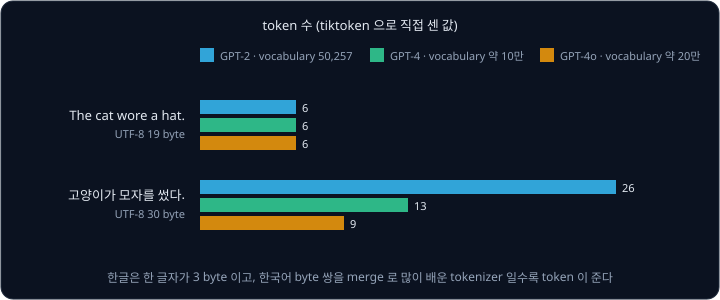
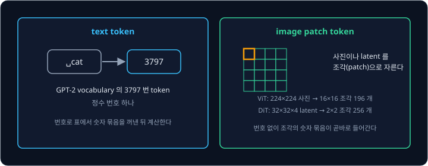

# BPE Tokenizer

그림 생성 모델에 "고양이가 모자를 썼다." 라는 prompt 를 넣으면, 모델은 이 문장을 먼저 숫자 몇 개로 바꿔 받는다. 글을
읽고 쓰는 language model 인 GPT-2 의 규칙으로 바꾸면 영어 "The cat wore a hat." 은 숫자 6 개인데 같은 뜻의 한국어 문장은 26 개가 된다. 같은
뜻인데 한국어에는 왜 숫자가 네 배 넘게 필요할까?

문장을 숫자로 바꾸는 규칙은 학습 text 에서 자주 붙어 나오는 조각 쌍을 하나씩 합쳐 가며 만드는데, 이 방법이 BPE(byte pair encoding)다.
GPT-2 가 쓰는 조각 50,257 개 가운데 50,000 개가 이렇게 만들어졌고, 학습 text 가 대부분 영어였던 만큼 영어 조각이 많이 생겼다. Stable
Diffusion 이 prompt 를 읽을 때 쓰는 CLIP 의 tokenizer 도 같은 BPE 로 만들었고, 이 tokenizer 는 prompt 를 token 77 자리에 맞춰 넣는다.

## 학습 목표

- language model 이 text 를 token id 열로 바꿔 받는 이유와, 자르는 단위가 클수록 vocabulary 는 커지고 sequence 는 짧아지는 이유를 설명할 수 있다
- 짧은 corpus 에서 쌍의 빈도를 세어 merge 하는 BPE 학습과, 배운 merge 로 하는 encode·decode 를 손으로 계산할 수 있다
- vocabulary 크기를 정할 때 맞바꾸는 것과, 한국어 text 가 영어보다 token 을 많이 쓰는 이유를 숫자로 설명할 수 있다
- Stable Diffusion 이 쓰는 CLIP tokenizer 가 GPT-2 와 다른 점과, 77 token 한도가 prompt 의 길이를 제한하는 방식을 설명할 수 있다

## 숫자 열로 바꾼 text

모델이 하는 일은 입력에 숫자를 곱하고 더하는 계산이다. 직선 모델 $\hat y = wx + b$ 는 입력 $x$ 가 2 ms 같은 숫자여야 계산할 수 있다.
prompt 를 받아 그림을 그리는 큰 모델도 안에서는 곱하기와 더하기만 하므로, "빨간 모자" 라는 글자를 그대로 넣을 수는 없다. 그래서 글자를 다루는
모델은 모두 첫 단계에서 문장을 숫자 열로 바꾸고, 계산이 끝나면 나온 숫자 열을 다시 글자로 되돌린다. 사람이 읽는 글자로 된 데이터를
text 라고 하고, 다음에 올 글자를 예측하는 식으로 text 를 다루는 모델을 language model 이라고 한다.

컴퓨터는 원래 글자마다 번호를 정해 두고 그 번호를 저장한다. 이 약속을 문자 코드라고 하는데, 영어용 문자 코드 ASCII 에서는 "cat" 의
세 글자 c, a, t 가 각각 99, 97, 116 번이고 공백은 32 번이다. 공백은 눈에 보이지 않아서 이 강의에서는 ␣ 기호로 적는다.

컴퓨터의 기억 장치는 0 부터 255 까지의 정수 하나를 담는 칸을 단위로 쓰는데, 이 칸이 **byte** 다. ASCII 번호는 모두 127 이하라서 영어
글자 하나는 byte 하나에 들어간다. 한글·한자·emoji 까지 합치면 글자는 256 가지보다 훨씬 많으므로, 세계의 글자에 번호를 붙인 Unicode 로
번호를 정하고 그 번호를 UTF-8 이라는 규칙으로 byte 1 ~ 4 개에 나눠 적는다.

| 글자 | Unicode 번호 | UTF-8 byte | byte 수 |
| --- | --- | --- | --- |
| h | 104 | 104 | 1 |
| é | 233 | 195 169 | 2 |
| 안 | 50504 | 236 149 136 | 3 |
| 🙂 | 128578 | 240 159 153 130 | 4 |

한글 음절의 Unicode 번호는 44032 ~ 55203 사이이고, 이 범위의 번호는 UTF-8 에서 모두 3 byte 가 된다. 영어 글자가 1 byte 인 데 비해
한글은 한 글자에 3 byte 를 쓰므로, 한국어 문장은 글자 수가 적어도 byte 수는 같은 뜻의 영어 문장과 비슷해진다. 어떤 text 든 UTF-8 로
바꾸면 0 ~ 255 사이의 숫자 열이 되므로 tokenizer 는 이 byte 열에서 출발한다.

<b>심화: bit 와 byte, UTF-8 의 3 byte 계산</b>

컴퓨터의 기억 장치는 켜짐(1)과 꺼짐(0)만 구분하는 작은 스위치로 되어 있고, 이 스위치 하나가 bit(binary digit)다. bit 8 개를 묶은 것이
byte 이고, 8 자리에는 왼쪽부터 128, 64, 32, 16, 8, 4, 2, 1 의 값이 정해져 있어서 켜진 자리의 값을 더한 수가 byte 의 값이다. a 의 97 은
$64 + 32 + 1$ 이라서 세 자리를 켠다. 모두 켜면 $128 + 64 + \dots + 1 = 255$ 이고, 경우의 수는 $2^8 = 256$ 가지다.

UTF-8 byte 열에는 글자 사이의 구분 표시가 없지만, 첫 byte 의 크기로 글자의 길이를 알 수 있다.

| 첫 byte 범위 | 뜻 |
| --- | --- |
| 0 ~ 127 | 혼자 글자 하나 |
| 192 ~ 223 | 2 byte 글자의 시작 |
| 224 ~ 239 | 3 byte 글자의 시작 |
| 240 ~ 247 | 4 byte 글자의 시작 |
| 128 ~ 191 | 앞 글자에 이어지는 byte |

이어지는 byte 는 128 ~ 191 이라서 128 을 빼면 0 ~ 63 의 64 가지 수를 담는다. 그래서 3 byte 글자는 Unicode 번호를 4096($64 \times 64$)
짜리 묶음 몇 개, 64 짜리 묶음 몇 개, 나머지로 나눈다. 4096 짜리 묶음 수에는 224 를 더해 첫 byte 에 적고, 나머지 두 수에는 128 을 더해 뒤의
두 byte 에 적는다. "안" 의 번호 50504 를 이렇게 나누면 아래와 같다.

| 단계 | 계산 | 결과 |
| --- | --- | --- |
| 4096 짜리 묶음 수 | $50504 \div 4096$ 의 몫 | 12 (나머지 1352) |
| 64 짜리 묶음 수 | $1352 \div 64$ 의 몫 | 21 (나머지 8) |
| 첫째 byte | $224 + 12$ | 236 |
| 둘째 byte | $128 + 21$ | 149 |
| 셋째 byte | $128 + 8$ | 136 |

"가"(44032)는 $44032 \div 4096$ 의 몫이 10 이고 나머지가 3072 인데, $3072 \div 64 = 48$ 로 나누어떨어져서 byte 는 234, 176, 128 이다.
"하"(54616)는 몫이 13 이고 나머지가 1368 이다. $1368 \div 64$ 는 몫이 21 이고 나머지가 24 라서 byte 는 237, 149, 152 다.

**확인 문제.** "안h" 를 UTF-8 로 적으면 byte 가 몇 개일까?

답 보기

1. "안" 은 한글 음절이라 3 byte(236, 149, 136)다
2. h 는 ASCII 번호 104 가 그대로 byte 하나다
3. 답: $3 + 1 = 4$ 개(236, 149, 136, 104)다

## token 과 vocabulary

UTF-8 byte 열을 그대로 모델에 넣을 수도 있지만, 모델이 읽는 단위를 byte 보다 크게 잡을 수도 있다. text 를 모델이 읽는 단위로 자른
조각 하나를 **token** 이라고 한다. 쓸 수 있는 token 을 모두 모아 번호를 붙인 목록은 **vocabulary** 이고, vocabulary 안에서 token 에
붙은 번호는 **token id** 다. text 를 token id 열로 바꾸는 일은 encode 이고 token id 열을 text 로 되돌리는 일은 decode 인데, 이 두 일을
하는 프로그램이 tokenizer 다.

가장 단순한 vocabulary 는 byte 256 개를 그대로 token 으로 쓰고 byte 값을 token id 로 쓰는 것이다. 이 vocabulary 로 "cat hat" 을
자르면 token 7 개 c, a, t, ␣, h, a, t 가 되고 id 열은 99, 97, 116, 32, 104, 97, 116 이다. token 이 이어진 열을 sequence 라고 하고 그
안의 token 개수를 sequence 길이라고 하는데, "cat hat" 은 이 vocabulary 에서 sequence 길이가 7 이다.

encode 했다가 decode 하면 처음 text 가 그대로 나와야 하는데, 이 성질이 깨지면 모델이 쓴 답을 사람이 읽을 수 없다.

## 자르는 단위

token 을 얼마나 크게 잡느냐에 따라 vocabulary 크기와 sequence 길이가 반대로 움직인다. 영어 단어 unbelievable 을 글자, 단어, subword
(단어보다 작고 글자보다 큰 조각) 단위로 자르면 아래와 같다.

| 단위 | unbelievable 을 자른 결과 | token 수 | vocabulary 크기 |
| --- | --- | --- | --- |
| 글자 | u n b e l i e v a b l e | 12 | 글자 종류 수 (영어는 100 개 안팎) |
| 단어 | unbelievable | 1 | 단어 종류 수 (수만 ~ 수십만) |
| subword | un bel iev able | 4 | 정하기 나름 (GPT-2 는 50,257) |

글자 단위는 vocabulary 가 작은 대신 sequence 가 길다. 모델은 token 마다 계산을 하므로 token 이 많을수록 계산이 늘고, 모델이 한 번에
읽을 수 있는 token 수의 한도인 context 길이 안에 담는 내용도 줄어든다.

단어 단위는 sequence 가 짧지만 vocabulary 가 아주 커지고, vocabulary 에 없는 단어를 다루지 못한다. 모델은 token id 마다 따로 숫자를
학습해 두기 때문에 vocabulary 는 학습 전에 한 번 만들어 고정하는데, 단어 단위 vocabulary 는 보통 자주 나온 단어 수만 개만 담는다.
그래서 오타 "unbelievabel" 이나 새로 생긴 말은 번호가 없어 "모르는 단어" 를 뜻하는 특별한 token `<unk>`(unknown) 하나로 바뀐다.
서로 다른 모르는 단어가 모두 같은 `<unk>` 가 되므로 decode 해도 원래 단어를 되살릴 수 없다.

subword 단위에서는 자주 나오는 단어가 통째로 token 하나가 되고, 드문 단어는 자주 나오는 조각 몇 개로 나뉜다. 위 표의 un, bel, iev,
able 은 GPT-2 의 tokenizer 가 실제로 자른 결과이고, 오타 unbelievabel 도 un, bel, iev, abel 의 4 개로 잘려서 `<unk>` 가 생기지 않는다.

GPT-2 는 subword 를 찾는 출발점으로 byte 256 개를 vocabulary 에 먼저 넣었다. GPT-2 논문에 따르면 Unicode 글자를 출발점으로 삼으면
기본 vocabulary 만 13만 개가 넘지만, byte 에서 시작하면 256 개로 충분하다. 어떤 text 든 byte 열이 되므로 처음 보는 단어나
한글·emoji 가 나와도 최악의 경우 byte 하나하나가 token 이 될 뿐 `<unk>` 는 생기지 않는다. Stable Diffusion 이 prompt 를 읽는 CLIP 의
tokenizer 도 byte 에서 출발한 BPE 라서, 한글처럼 merge 가 적은 글자도 byte 조각으로 나뉠 뿐 `<unk>` 가 되지 않는다.

**흔한 오해.** token 을 "단어" 와 같은 말로 여기기 쉽지만, token 은 tokenizer 가 정한 조각일 뿐이다. unbelievable 은 단어 하나지만
GPT-2 에서는 token 4 개이고, 앞에 공백이 붙은 "␣unbelievable" 은 GPT-2 에서 token 1 개다.

**확인 문제.** "hello world"(공백 포함)를 글자 단위로 자르면 token 이 몇 개이고, 단어 단위로 자르면 몇 개일까?

답 보기

| 단위 | 자른 결과 | token 수 |
| --- | --- | --- |
| 글자 | h, e, l, l, o, ␣, w, o, r, l, d | 11 |
| 단어 (공백을 경계로) | hello, world | 2 |

## BPE 학습

### 쌍과 merge

subword vocabulary 를 데이터에서 찾는 방법 가운데 하나가 BPE 다. BPE 는 원래 1994 년 Philip Gage 가 발표한 압축 방법인데, 파일에서
가장 자주 나오는 이웃한 byte 쌍을 쓰이지 않던 byte 하나로 바꾸기를 되풀이해 파일 크기를 줄였다. 2016 년 Sennrich 등이 같은 절차로 번역 모델의 subword
vocabulary 를 만들었고, 2019 년 GPT-2 는 byte 에서 시작하는 BPE 를 tokenizer 로 썼다.

BPE 는 sequence 에서 바로 옆에 붙은 두 token 을 쌍으로 보고, 쌍마다 몇 번 나오는지(빈도)를 센다. "abab" 의 token a, b, a, b 에는
이웃한 자리가 세 군데라서 (a, b) 는 2 번 나오고 (b, a) 는 1 번 나온다. (a, b) 와 (b, a) 는 순서가 달라서 다른 쌍이다. 학습은 byte vocabulary
에서 시작해 아래 세 단계를 정한 횟수만큼 되풀이한다.

1. 지금 sequence 에서 쌍마다 빈도를 센다
2. 빈도가 가장 큰 쌍에 새 token id 를 붙인다. 새 id 는 256, 257, 258, … 순서로 늘고, 새 token 은 두 token 을 이어 붙인 것이다
3. sequence 에서 그 쌍이 나오는 자리를 모두 새 token 하나로 바꾼다

두 token 을 하나로 합치는 이 일을 **merge** 라고 한다. merge 를 한 번 할 때마다 vocabulary 에는 token 이 하나 늘고, sequence 는 바뀐
자리 수만큼 짧아진다. 그래서 몇 번 merge 할지는 원하는 vocabulary 크기로 정하는데, vocabulary 를 259 로 만들려면 $259 - 256 = 3$ 번 한다.
Sennrich 논문에서도 merge 횟수는 이 알고리즘에서 사람이 정해 주는 유일한 설정값(hyperparameter)이다.

### 손 계산

학습에 쓰는 text 묶음을 corpus 라고 하는데, corpus 가 "cat hat cat that" 한 줄이고 vocabulary 를 259 로 만든다고 하자. 처음에는 byte
하나가 token 하나라서 sequence 가 c a t ␣ h a t ␣ c a t ␣ t h a t 의 16 개다. 이웃한 자리 15 군데의 쌍을 세면 아래와 같다.

| 쌍 | 나오는 자리 | 빈도 |
| --- | --- | --- |
| (c, a) | **ca**t, **ca**t | 2 |
| (a, t) | c**at**, h**at**, c**at**, th**at** | 4 |
| (t, ␣) | ca**t␣**, ha**t␣**, ca**t␣** | 3 |
| (h, a) | **ha**t, t**ha**t | 2 |
| (␣, h), (␣, c), (␣, t), (t, h) | 각 한 자리 | 1 씩 |

빈도를 모두 더하면 $2 + 4 + 3 + 2 + 4 \times 1 = 15$ 로 이웃한 자리 수와 같다. 가장 많은 (a, t) 에 id 256 을 붙여 at 이라고 적고 네
자리를 바꾸면 c at ␣ h at ␣ c at ␣ t h at 의 $16 - 4 = 12$ 개가 된다. 바뀐 sequence 에서 다시 세면 (at, ␣) 가 3 번으로 가장 많고, 그다음
회차에는 (c, at␣) 가 2 번으로 가장 많다.

| 회차 | 고른 쌍 | 빈도 | 새 id | 새 token | sequence 길이 |
| --- | --- | --- | --- | --- | --- |
| 1 | (a, t) | 4 | 256 | at | 16 → 12 |
| 2 | (at, ␣) | 3 | 257 | at␣ | 12 → 9 |
| 3 | (c, at␣) | 2 | 258 | cat␣ | 9 → 7 |

위 그림에서 파란 칸이 그 회차에 새로 합쳐진 token 이다. 앞 회차에서 만든 at 이 다음 회차의 쌍 안에 들어가 at␣, cat␣ 처럼 점점 긴 token
이 된다. 학습이 끝나면 어떤 쌍을 어떤 순서로 합쳤는지 적은 merge 목록과, id 마다 어떤 byte 를 뜻하는지 적은 vocabulary 가 남는다.

| 순서 | merge | 새 id | 새 token 의 byte |
| --- | --- | --- | --- |
| 1 | (97, 116) = (a, t) | 256 | 97 116 = at |
| 2 | (256, 32) = (at, ␣) | 257 | 97 116 32 = at␣ |
| 3 | (99, 257) = (c, at␣) | 258 | 99 97 116 32 = cat␣ |

vocabulary 는 byte 256 개(id 0 ~ 255)에 이 세 token 을 더한 259 개다. id 258 은 99 와 257 로 풀리고, 257 은 다시 256 과 32 로
풀리며, 256 은 97 과 116 으로 풀린다. 이렇게 모든 token 은 결국 byte 몇 개가 된다.

<b>심화: 2·3회차의 쌍 표, 빈도가 같은 쌍, 같은 글자가 이어지는 자리</b>

2회차의 sequence c at ␣ h at ␣ c at ␣ t h at 에서는 at 이 token 하나라서 (c, a) 같은 쌍이 없어지고 (c, at) 처럼 새 token 이 든 쌍이
생긴다.

| 2회차 쌍 | 빈도 | 3회차 쌍 | 빈도 |
| --- | --- | --- | --- |
| (c, at) | 2 | (c, at␣) | 2 |
| (at, ␣) | 3 | (at␣, h) | 1 |
| (␣, h) | 1 | (h, at␣) | 1 |
| (h, at) | 2 | (at␣, c) | 1 |
| (␣, c) | 1 | (at␣, t) | 1 |
| (␣, t) | 1 | (t, h) | 1 |
| (t, h) | 1 | (h, at) | 1 |

2회차의 마지막 at 은 뒤에 공백이 없어서 at␣ 가 되지 않고 그대로 남는다.

빈도가 가장 큰 쌍이 둘 이상이면 어느 쪽을 고를지 규칙으로 미리 정해 둬야 같은 corpus 로 학습할 때마다 같은 결과가 나온다. 이 강의는
text 앞쪽에서 먼저 나온 쌍을 고르는 규칙을 쓰는데, 구현마다 규칙은 달라도 하나로 정해져 있기만 하면 된다. corpus "banana bandana"(14
byte)로 해 보면 1회차에는 (a, n) 이 4 번으로 가장 많아 id 256 인 an 이 생긴다. 2회차에는 (b, an) 과 (an, a) 가 똑같이 2 번이라 먼저 나온
(b, an) 을 골라 257 인 ban 을 만들고, 3회차에는 (an, a) 가 2 번으로 가장 많아 258 인 ana 를 만든다. 그러면 sequence 는 ban ana ␣ ban d
ana 의 6 개가 된다.

같은 글자가 셋 이상 이어지면 줄어드는 token 수가 빈도보다 작다. "aaa" 에서 (a, a) 의 빈도는 2 다. 그런데 왼쪽부터 바꾸면 앞의 a a 가
256 이 되고 남은 a 는 짝이 없어서, 바뀌는 자리는 하나뿐이다. 가운데 a 가 두 쌍에 함께 세어졌지만 한 번만 합쳐질 수 있기 때문이다. 그래서
줄어드는 token 수는 빈도가 아니라 실제로 바뀐 자리 수다. "aaaa" 도 빈도는 3 이지만 aa aa 로 두 자리만 바뀐다.

**확인 문제.** corpus "ab ab abc" 의 첫 회차에서 빈도가 가장 큰 쌍은? merge 한 뒤 sequence 는 token 몇 개일까?

답 보기

1. token 은 a b ␣ a b ␣ a b c 의 9 개다
2. 쌍은 (a, b) 3, (b, ␣) 2, (␣, a) 2, (b, c) 1 이라서 (a, b) 가 가장 많다
3. 세 자리를 256 하나로 바꾸면 $9 - 3 = 6$ 개(ab ␣ ab ␣ ab c)다

## encode 와 decode

### encode

학습이 끝나면 처음 보는 text 도 token 으로 바꿀 수 있어야 한다. encode 는 text 를 UTF-8 byte 열로 바꾼 다음, merge 목록을 배운 순서대로
하나씩 적용한다. 각 merge 는 그 쌍이 나오는 자리를 왼쪽부터 모두 바꾸고, 적용할 자리가 없으면 넘어간다. 아래는 앞에서 배운 merge 세 개로
학습 corpus 에 없던 "that cat" 을 encode 한 과정이다.

| 단계 | 적용한 merge | sequence | token 수 |
| --- | --- | --- | --- |
| 시작 | 없음 | t h a t ␣ c a t | 8 |
| 1 | (a, t) → 256 | t h at ␣ c at | 6 |
| 2 | (at, ␣) → 257 | t h at␣ c at | 5 |
| 3 | (c, at␣) → 258 | 바뀌는 자리 없음 | 5 |

3 단계에서는 문장 끝의 cat 뒤에 공백이 없어서 c 다음에 at␣ 가 아니라 at 이 오므로 merge 3 이 적용되지 않는다. 결과 id 열은 116, 104,
257, 99, 256 이다.

merge 를 배운 순서와 다르게 적용하면 결과가 달라진다. "cat␣" 을 배운 순서로 encode 하면 token 하나(cat␣)가 된다. 반대로 3 → 2 → 1 순서로
적용하면 merge 3 이 쓸 at␣ 도, merge 2 가 쓸 at 도 아직 없어서 merge 1 만 적용되고, 결과는 c at ␣ 의 3 개다.

"cat dog" 처럼 학습 corpus 에 없던 글자가 나와도 encode 는 실패하지 않는다. d, o, g 가 든 merge 는 하나도 없으므로 그 byte 는 byte token
그대로 남고, 결과는 258, 100, 111, 103 이다.

### decode

decode 는 id 마다 vocabulary 에서 byte 를 찾아 이어 붙인 뒤 UTF-8 규칙으로 글자로 읽는다. 116, 104, 257, 99, 256 은 116 / 104 /
97 116 32 / 99 / 97 116 으로 풀리고, 이어 붙인 byte 열 116 104 97 116 32 99 97 116 이 "that cat" 이다.

byte 에서 시작하는 BPE 는 쌍을 byte 단위로 세기 때문에, 한 글자의 byte 가운데 일부만 합친 token 도 만든다. GPT-2 는 "하" 를 47991 과
246 두 token 으로 자르는데, 47991 은 "하" 의 세 byte 237, 149, 152 가운데 앞의 237, 149 만 담고 있다. 이 token 만 decode 하면 3 byte 글자가
끝나지 않아 "읽을 수 없는 글자" 를 뜻하는 � 가 나오고, 152 를 담은 다음 token 과 이어 붙여야 "하" 가 완성된다. language model 은 token
을 하나씩 만들어 내므로, 한국어 답을 token 마다 바로 화면에 띄우는 프로그램은 잠깐 � 를 보였다가 다음 token 이 나온 뒤 글자를 고친다.

**확인 문제.** 같은 merge 세 개로 "chat" 을 encode 하면 token id 열은? (c 는 99, h 는 104)

답 보기

1. byte 는 c h a t 이다
2. merge 1 (a, t) 로 c h at 이 된다
3. at 뒤에 공백이 없어서 merge 2·3 은 적용되지 않는다
4. 답: 99, 104, 256

## pre-tokenization 과 special token

### pre-tokenization

앞의 학습에서 만든 at␣ 와 cat␣ 는 단어 끝과 뒤의 공백이 한 token 에 묶인 것이다. GPT-2 논문에 따르면 byte 열에 BPE 를 그대로 쓰면
"dog." "dog!" "dog?" 처럼 같은 dog 가 뒤의 문장부호마다 다른 token 이 되어 vocabulary 자리를 낭비한다. 그래서 GPT-2 는 BPE 를 하기 전에 text
를 단어·숫자·기호 조각으로 먼저 나누고, merge 가 조각 경계를 넘지 못하게 했다. BPE 앞에서 하는 이 나누기가 **pre-tokenization** 이다.

| 조각 종류 | 예 |
| --- | --- |
| 영어 축약 부분 | 's, 'll, 're |
| 앞의 공백 하나 + 이어지는 글자(한글 포함) | Hello, ␣world, 안녕 |
| 앞의 공백 하나 + 이어지는 숫자 | ␣123 |
| 앞의 공백 하나 + 이어지는 기호 | !!, ␣. |
| 그 밖의 공백 | 공백 여러 개, 줄바꿈 |

"dog. dog! dog?" 는 dog, ., ␣dog, !, ␣dog, ? 로 잘려 dog 와 문장부호가 서로 다른 조각이 된다. 공백은 대부분 다음 단어의 앞에 붙고 문장
가운데 단어는 거의 늘 앞에 공백이 붙은 조각으로 나오므로, GPT-2 의 vocabulary 에는 "␣unbelievable" 처럼 공백이 앞에 붙은 단어가 통째로 많다.

pre-tokenization 을 하면 쌍은 조각 안에서만 센다. cat hat cat that 은 cat, ␣hat, ␣cat, ␣that 의 네 조각이 되고, 조각 사이에 걸친 (t, ␣)
3 번은 세지 않는다. 같은 규칙으로 학습하면 merge 세 번의 결과는 at, cat, hat 이라서 단어 뒤에 공백을 붙인 token 이 생기지 않는다.

다만 조각 경계를 넘는 merge 를 막는 만큼 압축은 조금 덜 된다. Tiny Shakespeare(Shakespeare 희곡을 모은 약 110만 byte 의 영어 text)의
앞 90% 로 학습하고 뒤 10% 로 재면, vocabulary 512 에서 token 하나에 담기는 평균 byte 는 조각 규칙 없이 1.94 이고 조각 규칙을 쓰면 1.88 이다.

<b>심화: 같은 조각의 횟수를 곱해 세는 학습</b>

pre-tokenization 을 하면 "␣the" 처럼 같은 조각이 corpus 에 수없이 되풀이되므로, 학습할 때는 조각마다 몇 번 나왔는지만 세어 두고 조각
안의 쌍 빈도에 그 횟수를 곱해 더한다. Sennrich 논문도 단어마다 빈도를 곱해 세는 이 방식을 썼다. 아래는 단어 다섯 종류로 된 corpus 다.

| 조각 | hug | pug | pun | bun | hugs |
| --- | --- | --- | --- | --- | --- |
| 나온 횟수 | 10 | 5 | 12 | 4 | 5 |

| 쌍 | 들어 있는 조각 | 계산 | 빈도 |
| --- | --- | --- | --- |
| (h, u) | hug, hugs | $10 + 5$ | 15 |
| (u, g) | hug, pug, hugs | $10 + 5 + 5$ | 20 |
| (p, u) | pug, pun | $5 + 12$ | 17 |
| (u, n) | pun, bun | $12 + 4$ | 16 |
| (b, u) | bun | $4$ | 4 |
| (g, s) | hugs | $5$ | 5 |

(u, g) 가 20 으로 가장 커서 id 256 인 ug 가 생긴다. 2회차에는 pug 의 u 가 ug 안으로 들어가서, (p, u) 는 pun 에서만 나오므로 12 로 준다.
이때 가장 큰 쌍은 16 인 (u, n) 이라서 257 인 un 이 생기고, 3회차에는 (h, ug) 가 15 로 가장 커서 258 인 hug 가 생긴다.

| 회차 | 고른 쌍 | 빈도 | corpus 전체 token 수 |
| --- | --- | --- | --- |
| 시작 | | | $3 \times 10 + 3 \times 5 + 3 \times 12 + 3 \times 4 + 4 \times 5 = 113$ |
| 1 | (u, g) | 20 | $113 - 20 = 93$ |
| 2 | (u, n) | 16 | $93 - 16 = 77$ |
| 3 | (h, ug) | 15 | $77 - 15 = 62$ |

이 예에는 같은 글자가 이어지는 자리가 없어서 빈도만큼 token 이 준다.

### special token

GPT-2 의 학습 데이터에는 문서 여러 개가 이어 붙어 있어서, GPT-2 는 문서와 문서 사이에 `<|endoftext|>` 라는 표시를 넣었다. 이처럼 text 에서
배우지 않고 미리 정해 vocabulary 에 넣어 두는 token 을 **special token** 이라고 한다. `<|endoftext|>` 를 보통 text 처럼 다루면
pre-tokenization 이 `<|`, endoftext, `|>` 같은 여러 조각으로 잘라 버리므로, encode 는 조각내기 전에 special token 을 먼저 떼어 내고
그 자리를 정해 둔 id 하나로 바꾼다.

위 그림에서 "Hello world's" 는 15496, 995, 338 이 되고 `<|endoftext|>` 는 merge 를 거치지 않고 id 50256 하나가 된다. vocabulary 크기
$V$ 는 처음 넣은 byte 256 개, merge 횟수 $M$, special token 개수 $S$ 의 합이다.

$$
V = 256 + M + S
$$

GPT-2 는 merge 를 50,000 번 했고 special token 이 하나라서 $256 + 50000 + 1 = 50257$ 이며, 마지막 번호 50256 이 `<|endoftext|>` 다.

**확인 문제.** special token 2 개를 두고 vocabulary 크기를 1000 으로 만들려면 merge 를 몇 번 해야 할까?

답 보기

$1000 = 256 + M + 2$ 에서 $M = 1000 - 256 - 2 = 742$ 번이다.

## vocabulary 크기

### bytes per token

tokenizer 가 text 를 얼마나 짧은 sequence 로 만드는지는 token 하나에 평균 몇 byte 가 담기는지로 잰다. text 의 UTF-8 byte 수를 encode 한
token 수로 나눈 값이 **bytes per token** 이고, 클수록 같은 text 가 짧은 sequence 가 된다. 앞의 cat hat cat that 은 16 byte 가 token 7 개가
되었으므로 $16 \div 7 \approx 2.29$ 다.

merge 를 많이 할수록 긴 token 이 생겨 bytes per token 이 커진다. 아래 표는 GPT-2 의 조각 규칙을 쓴 BPE 를 Tiny Shakespeare 의 앞 90% 로
학습하고, 학습에 쓰지 않은 뒤 10% 에서 잰 값이다. merge 는 학습 text 에 맞춰 만들어지므로, 학습 text 로 재면 실제로 쓸 때보다 좋게 나온다.

| vocabulary 크기 | merge 횟수 | bytes per token | embedding 표의 숫자 (vocabulary × 768) |
| --- | --- | --- | --- |
| 256 (byte 만) | 0 | 1.00 | 약 20만 |
| 512 | 256 | 1.88 | 약 39만 |
| 1024 | 768 | 2.26 | 약 79만 |
| GPT-2 의 50,257 | 50,000 | 3.09 | 약 3,860만 |

vocabulary 를 키우면 sequence 는 짧아지지만 모델이 학습할 숫자가 는다. 모델은 token id 마다 숫자 묶음 하나(embedding)를 표에 두고 꺼내
쓴다. GPT-2 의 가장 작은 모델은 묶음 하나가 숫자 768 개라서 이 표에만 숫자가 $50{,}257 \times 768 = 38{,}597{,}376$ 개 들어가고, 이는 모델
전체 124,439,808 개의 약 31% 다. 다음 token 을 고를 때도 vocabulary 전체에 점수를 매겨야 한다. 또 드물게 나오는 token 은 학습 데이터에서
볼 기회가 적어 잘 배우지 못한다. GPT-4 의 tokenizer(cl100k_base)는 vocabulary 가 약 10만 개이고 GPT-4o 의 tokenizer(o200k_base)는 약 20만
개라서, 둘 다 GPT-2 보다 크다.

### 한국어 text 의 token 수

같은 뜻의 문장도 언어와 tokenizer 에 따라 token 수가 크게 다르다. 아래 표는 tiktoken 라이브러리로 센 값이다.

| 문장 | UTF-8 byte | GPT-2 | GPT-4 | GPT-4o |
| --- | --- | --- | --- | --- |
| The cat wore a hat. | 19 | 6 | 6 | 6 |
| 고양이가 모자를 썼다. | 30 | 26 | 13 | 9 |

"고양이가 모자를 썼다." 는 글자 수가 영어 문장보다 적지만 한글 한 글자가 3 byte 라서 byte 수는 30 대 19 이고, GPT-2 에서는 token 이
26 대 6 이다. GPT-2 의 학습 text 는 대부분 영어라서 merge 50,000 개 가운데 한국어 byte 쌍을 합친 merge 가 적고, 그래서 한국어
byte 는 대부분 합쳐지지 못한 채 byte 하나가 token 하나로 남는다. vocabulary 가 크고 한국어를 더 많이 넣어 학습한 tokenizer 는 한국어
쌍을 merge 로 더 많이 배우므로, "고양이가 모자를 썼다." 의 token 이 26 → 13 → 9 로 준다. 영어 문장은 세 tokenizer 모두 6 개인데, 이미
단어와 마침표가 하나씩 token 이 되어 있기 때문이다.

token 이 많으면 같은 문장을 처리하는 데 계산이 더 들고, 정해진 길이 안에 담을 수 있는 내용도 줄어든다. 그래서 한국어 문장을 받는 모델을
쓸 때는 그 tokenizer 가 한국어 문장을 token 몇 개로 자르는지 먼저 세어 보면 좋다.

**확인 문제.** "안녕" 은 6 byte 이고 GPT-2 에서 token 6 개, "hello" 는 5 byte 이고 token 1 개다. 각각 bytes per token 은?

답 보기

| 문장 | 계산 | bytes per token |
| --- | --- | --- |
| 안녕 | $6 \div 6$ | 1 |
| hello | $5 \div 1$ | 5 |

"안녕" 의 1 은 merge 가 하나도 적용되지 않은 byte vocabulary 와 같은 값이다.

## 문맥에 따른 token 의 뜻

뒤의 강의들에서 token 이라는 말은 두 가지 대상을 가리킨다. 둘 다 모델이 한 번에 하나씩 받거나 내는 단위이지만, 무엇에서 왔는지와
번호가 있는지가 다르다.

- text token 은 이 강의에서 다룬 token 으로, text 를 자른 조각이고 vocabulary 안의 정수 번호 하나로 나타낸다. GPT-2 에서 "␣cat" 은 3797 번이다
- image patch token 은 사진을 자른 조각이다. 이미지를 읽는 모델 [ViT](../vit/README.md) 는 가로세로 224 pixel 인 사진을 16×16 pixel
  조각(patch)으로 잘라 $14 \times 14 = 196$ 개의 token 을 만든다. text 는 글자라서 번호를 붙여야 숫자가 되지만, 사진은 처음부터 pixel 마다
  빨강·초록·파랑의 밝기가 숫자로 적혀 있어서 번호로 바꿀 필요가 없다. 그래서 조각 안 pixel 의 숫자 $16 \times 16 \times 3 = 768$ 개를 한 줄로
  묶은 vector 가 곧바로 모델에 들어간다. 그림을 그리는 DiT 도 VAE 가 줄인 latent 를 같은 방식으로 잘라 patch token 으로 쓴다

## Stable Diffusion 의 CLIP tokenizer

Stable Diffusion v1 은 prompt 를 [CLIP](../clip/README.md) 의 text encoder 로 읽으므로, prompt 를 token 으로 자르는 일도 CLIP 의 tokenizer 가
맡는다. CLIP 논문에 따르면 이 tokenizer 는 GPT-2 처럼 BPE 로 만들었고, 글을 모두 소문자로 바꾼 뒤 자른다. 공개된 tokenizer 코드를 보면 단어 끝을
나타내는 표시 `</w>` 를 token 에 붙이는 점도 GPT-2 와 다르다. OpenAI 가 공개한 tokenizer 파일로 세어 보면 vocabulary 는 49,408 개다(논문은 49,152 로 적는다).

| 문장 | UTF-8 byte | CLIP 의 token |
| --- | --- | --- |
| The cat wore a hat. | 19 | 6 |
| 고양이가 모자를 썼다. | 30 | 20 |
| a photo of a cat wearing a red hat | 34 | 9 |
| 빨간 모자를 쓴 고양이 사진 | 37 | 22 |

표의 token 수는 OpenAI 의 CLIP 저장소에 있는 tokenizer 로 직접 센 값이다. "The cat wore a hat." 은 the, cat, wore, a, hat, 마침표가 하나씩
token 이 되어 6 개이고, 영어 prompt "a photo of a cat wearing a red hat" 도 단어마다 token 하나라 9 개다. 같은 뜻의 한국어 prompt 는 22 개다.
이 tokenizer 의 vocabulary 에도 한국어 byte 쌍을 합친 merge 가 적어서, 한글 한 글자가 byte 두세 조각으로 나뉜 채 남는다. "고양이가 모자를
썼다." 는 20 개라서, 앞 절의 GPT-2 로 센 26 개보다는 적다.

token 수는 prompt 의 길이 한도와 이어진다. [Cross-Attention](../cross-attention/README.md) 에서 다루듯 Stable Diffusion 은 token 열의 길이를 77 로
맞추고, 시작과 끝을 표시하는 token 이 한 자리씩 차지한다. 그래서 prompt 에 쓸 수 있는 자리는 75 개이고, 넘친 token 은 잘려서 그림에 반영되지
않는다. 한국어처럼 token 을 많이 쓰는 언어로 길게 쓰면 이 한도에 더 빨리 닿는다.

**확인 문제.** 영어 prompt 가 token 9 개, 같은 뜻의 한국어 prompt 가 token 22 개다. 시작과 끝 token 을 넣으면 각각 77 자리 가운데 몇 자리를
쓰고, 몇 자리가 남는가?

답 보기

| prompt | 쓰는 자리 | 남는 자리 |
| --- | --- | --- |
| 영어 | $9 + 2 = 11$ | $77 - 11 = 66$ |
| 한국어 | $22 + 2 = 24$ | $77 - 24 = 53$ |

남는 자리는 끝 token 으로 채운다.

## 정리

- language model 은 숫자만 계산하므로 tokenizer 가 text 를 token id 열로 바꾼다. 자르는 단위가 클수록 sequence 는 짧아지고 vocabulary 는
  커진다. byte 256 개에서 시작하는 subword 방식은 `<unk>` 없이 어떤 text 든 encode 한다
- BPE 는 가장 자주 나오는 쌍을 새 token 으로 merge 하기를 되풀이해 vocabulary 를 만들고(cat hat cat that 은 16 → 12 → 9 → 7), encode 는
  merge 를 배운 순서대로 적용한다. vocabulary 를 키우면 bytes per token 은 커지지만 embedding 표도 커진다. 한국어를 적게 배운 GPT-2 의
  tokenizer 에서는 같은 뜻에 영어보다 token 이 네 배 넘게 든다("The cat wore a hat." 6 개, "고양이가 모자를 썼다." 26 개)
- Stable Diffusion 은 prompt 를 CLIP 의 lower-cased BPE tokenizer 로 자르고, 시작·끝 token 을 넣어 77 자리에 맞춘다. prompt 에 쓸 자리는
  75 개이고, 같은 뜻의 prompt 도 영어는 token 9 개, 한국어는 22 개를 쓴다

tokenizer 는 text 를 id 열로 바꾸고 되돌릴 뿐이라서 id 번호 자체에는 뜻이 없다. 모델 안에서 id 하나하나를 숫자 묶음(embedding)으로 바꾸고, 문장 속
다른 token 을 함께 보며 뜻을 정하는 계산은 [Transformer](../transformer/README.md) 에서 다룬다.

## 참고 자료

- Andrej Karpathy, [Let's build the GPT Tokenizer](https://www.youtube.com/watch?v=zduSFxRajkE) — BPE 학습, encode·decode, GPT-2 의
  조각 규칙, special token 을 처음부터 만들어 보이는 영상
- Philip Gage, [A New Algorithm for Data Compression](http://www.derczynski.com/papers/archive/BPE_Gage.pdf) (1994) — 가장 자주 나오는
  byte 쌍을 쓰이지 않는 byte 로 바꾸는 원래의 BPE 압축. Theory 절만 읽어도 된다
- Rico Sennrich 외, [Neural Machine Translation of Rare Words with Subword Units](https://arxiv.org/abs/1508.07909) (2016) — 3.2절에
  BPE 로 subword vocabulary 를 만드는 과정과 짧은 Python 구현이 있다
- Alec Radford 외, [Language Models are Unsupervised Multitask Learners](https://cdn.openai.com/better-language-models/language_models_are_unsupervised_multitask_learners.pdf) (2019) —
  2.2절 Input Representation 이 byte 단위 BPE 와 "dog." "dog!" 예를 든 조각 규칙을 설명한다
- Hugging Face LLM Course, [Byte-Pair Encoding tokenization](https://huggingface.co/learn/llm-course/chapter6/5) — 심화의 hug·pug corpus
  로 쌍을 세고 합치는 과정을 따라가는 예제
- [tiktokenizer](https://tiktokenizer.vercel.app/) — text 를 넣으면 GPT 계열 tokenizer 가 자른 token 경계와 id 를 보여 주는 웹 도구.
  한국어와 영어 지시문을 넣어 token 수를 비교해 볼 수 있다
- Alec Radford 외, [Learning Transferable Visual Models From Natural Language Supervision](https://arxiv.org/abs/2103.00020) (2021) — CLIP
  논문. 2.4 절에 text encoder 의 lower-cased BPE 와 vocabulary 49,152, 길이 한도가 있다. 직접 세어 볼 수 있는 tokenizer 는
  [openai/CLIP 의 `simple_tokenizer.py`](https://github.com/openai/CLIP/blob/main/clip/simple_tokenizer.py) 에 있다
