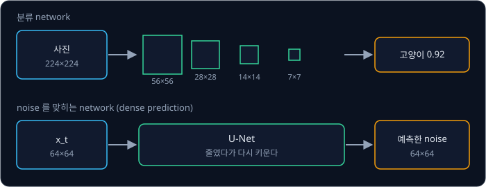
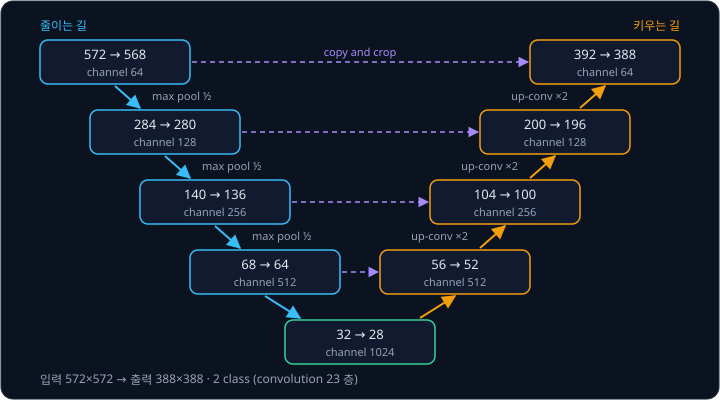
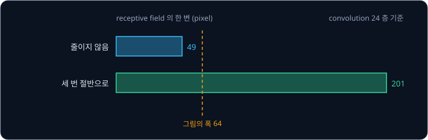
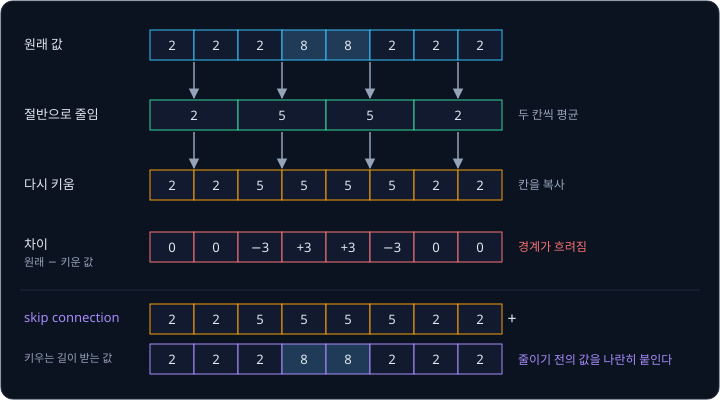
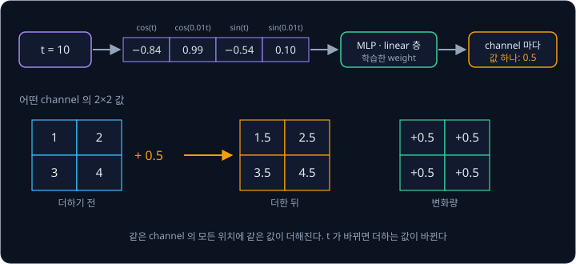
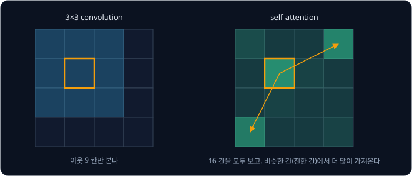
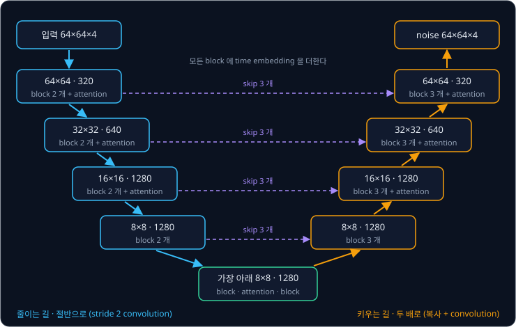

# U-Net

[DDPM](../ddpm/README.md) 의 network 는 noise 가 섞인 그림을 받아 그 그림에 섞인 noise 를 pixel 하나하나 맞혀야 한다. 입력이 $64 \times 64$
이면 출력도 $64 \times 64$ 이다. 그런데 [CNN](../cnn/README.md) 으로 사진을 분류할 때는 그림을 점점 줄여 $224 \times 224$ 사진에서 $7 \times 7$
까지 내려간 뒤 "고양이" 라는 답 하나만 낸다. 줄이면 그림 전체를 보는 대신 pixel 의 위치를 잃고, 줄이지 않으면 위치는 남지만 바로 옆
pixel 밖에 보지 못한다. 그림 전체를 보면서도 pixel 마다 정확한 답을 내려면 network 를 어떻게 짜야 할까?

**U-Net** 은 그림을 줄이는 길과 다시 키우는 길을 이어 붙이고, 줄이기 전의 값을 키우는 길로 바로 건네주는 network 다. 2015 년
Ronneberger, Fischer, Brox 가 현미경 사진에서 세포의 경계를 pixel 마다 가려내려고 만들었고, 학습 사진 30 장만으로 전자현미경 segmentation
대회의 순위표 1 위에 올랐다. Stable Diffusion 은 같은 모양의 U-Net 에 parameter 를 8 억 6 천만 개(860M) 넣었고, 그림 한 장을 만들 때마다 이 network 로 수십 번
계산한다.

## 학습 목표

- 그림을 줄이는 길과 키우는 길, 그리고 skip connection 이 각각 무엇을 맡는지 숫자 예로 설명할 수 있다
- 그림을 줄이면 한 위치가 보는 범위(receptive field)가 넓어지는 이유를 층 수와 함께 계산할 수 있다
- step 번호 $t$ 를 sin·cos 값으로 바꿔 network 의 모든 층에 더하는 time embedding 을 설명할 수 있다
- Stable Diffusion 의 U-Net 에서 크기와 channel 수가 단계마다 어떻게 바뀌는지 표로 따라갈 수 있다

## pixel 마다 답을 내는 network

분류 network 와 noise 를 맞히는 network 는 출력의 모양이 다르다. 분류 network 는 사진 한 장에서 class 마다 점수 하나를 내므로, 사진을
줄여 가며 특징을 모으다가 마지막에 숫자 몇 개만 남긴다. noise 를 맞히는 network 는 입력과 같은 크기의 그림을 내야 하므로, 출력의 pixel
하나하나가 입력의 같은 자리에 대응한다. 이렇게 pixel 마다 답을 내는 문제를 **dense prediction** 이라고 하는데, 세포 사진에서 pixel 마다
"세포" 와 "경계" 를 가리는 segmentation 도 dense prediction 이다.

크기를 줄이지 않고 $3 \times 3$ convolution 만 쌓으면 출력의 모양은 지킬 수 있다. 다만 $3 \times 3$ convolution 한 층은 위치마다 자기와
바로 옆 pixel 만 섞으므로, 층을 하나 쌓을 때마다 한 위치가 보는 범위가 양쪽으로 1 pixel 씩만 넓어진다. 출력의 한 위치가 입력에서
영향을 받는 범위를 **receptive field** 라고 한다.

| 쌓은 $3 \times 3$ convolution 층 수 | 1 | 2 | 3 | 10 | 24 |
| --- | --- | --- | --- | --- | --- |
| receptive field 의 한 변 (pixel) | 3 | 5 | 7 | 21 | 49 |

층 수를 $n$ 이라고 하면 한 변은 $1 + 2n$ 이다. 24 층을 쌓아도 한 위치는 $49 \times 49$ 만 보므로, 폭 64 인 그림의 왼쪽 끝 pixel 은 오른쪽
끝을 보지 못한다. 그런데 noise 를 맞히려면 그림 전체를 보아야 하는 때가 많다. noise 가 많이 섞인 큰 $t$ 에서는 pixel 하나만 보아서는
그 값이 원래 그림의 일부인지 noise 인지 가릴 수 없어서, 이 근처가 얼굴인지 하늘인지 같은 넓은 맥락에 기대야 하기 때문이다.

**확인 문제.** $3 \times 3$ convolution 만 쌓아 한 위치가 폭 64 인 그림 전체를 보게 하려면 몇 층이 필요할까?

답 보기

① 한 변이 $1 + 2n \ge 64$ 여야 한다.

② $2n \ge 63$ 에서 $n \ge 31.5$ 이므로 $n = 32$ 다.

답: 32 층. 이 층들은 모두 $64 \times 64$ 크기 그대로 계산해야 하므로 계산량도 크다.

## 줄이는 길과 키우는 길

그림을 가로세로 절반으로 줄이면 줄인 그림의 1 pixel 이 원래 그림의 $2 \times 2$ pixel 을 대신한다. 이 위에서 $3 \times 3$ convolution 을
하면 한 번에 원래 그림의 6 pixel 폭을 보게 되므로, 같은 층 수로 receptive field 가 두 배씩 빨리 넓어진다. 줄일 때마다 channel 수를 늘리는
것은 [CNN](../cnn/README.md) 에서 본 분류 network 와 같다. 위치의 수가 4 분의 1 로 줄어드는 대신 위치마다 담는 특징의 수를 늘려,
"이 근처에 둥근 것이 있다" 같은 넓은 정보를 담게 한다.

U-Net 은 이렇게 줄이는 길 뒤에 거꾸로 키우는 길을 붙인다. 키울 때는 1 pixel 을 $2 \times 2$ 로 복사해 크기를 두 배로 만들고 바로
convolution 을 한다. 복사만 하면 모서리가 계단처럼 남으므로, 뒤따르는 convolution 이 이웃 값을 섞어 부드럽게 다듬는다. 줄이는 길은
**encoder**(또는 contracting path)라고 부르고, 키우는 길은 **decoder**(또는 expanding path)라고 부른다. 두 길을 그리면 U 자 모양이라 U-Net 이다.

원래 U-Net 은 가장자리에 0 을 덧대지 않는 convolution 을 써서, $3 \times 3$ convolution 한 번에 가로세로가 2 pixel 씩 줄어든다.
단계마다 convolution 을 두 번 하고 $2 \times 2$ pixel 에서 가장 큰 값만 남기는 max pooling 으로 절반으로 줄이므로, 크기를 단계마다 따라
계산하면 아래와 같다.

| 단계 | 입력 크기 | convolution 2 번 뒤 | 절반으로 줄인 뒤 | channel |
| --- | --- | --- | --- | --- |
| 1 | 572 | $572 - 4 = 568$ | 284 | 64 |
| 2 | 284 | 280 | 140 | 128 |
| 3 | 140 | 136 | 68 | 256 |
| 4 | 68 | 64 | 32 | 512 |
| 가장 아래 | 32 | 28 | | 1024 |

키우는 길에서는 두 배로 키운 뒤 convolution 두 번으로 다시 4 pixel 이 줄어서 $28 \to 56 \to 52$, $52 \to 104 \to 100$, $100 \to 200 \to 196$,
$196 \to 392 \to 388$ 로 간다. 그래서 $572 \times 572$ 를 넣으면 가운데 $388 \times 388$ 의 답이 나온다. 마지막에는 $1 \times 1$
convolution 이 pixel 마다 64 개의 값을 class 2 개(세포, 경계)의 점수로 바꾼다. 논문에 따르면 이 network 의 convolution 층은 모두 23 개다.

<b>심화: 0 을 덧대는 convolution 과 덧대지 않는 convolution</b>

$3 \times 3$ convolution 은 한 위치의 위아래·좌우 이웃을 함께 쓰므로, 맨 가장자리 pixel 에서는 이웃 하나가 그림 밖에 있다. 원래
U-Net 은 그 위치의 출력을 아예 만들지 않아(valid convolution) 한 변이 2 씩 줄고, 그래서 키우는 길로 건네는 값의 가장자리를 잘라 크기를
맞춰야 했다(그림의 crop). 그림 밖에 0 을 한 줄 덧대면(padding 1) 크기가 그대로 남는다. DDPM 과 Stable Diffusion 의 U-Net 은 0 을 덧대는
쪽이라 입력과 출력의 크기가 정확히 같고, 건네는 값을 자를 필요도 없다.

Stable Diffusion 의 U-Net 은 줄이는 길에서 convolution 24 층을 지난다. 처음 convolution 1 층, 크기마다 4 층씩 네 단계, 절반으로 줄이는
convolution 3 층, 가장 아래 4 층이다. 절반으로 줄인 뒤에는 한 층이 넓히는 폭이 2 배, 4 배, 8 배로 커진다. 이 층들로 receptive field 를
계산하면 아래 표와 같고, 각 단계의 줄에는 그 단계로 들어오며 절반으로 줄인 convolution 1 층도 들어 있다.

| 지점 | 크기 | 한 층이 넓히는 폭 | receptive field 의 한 변 |
| --- | --- | --- | --- |
| 첫 convolution 뒤 | $64 \times 64$ | 2 | 3 |
| 1 단계 4 층 뒤 | $64 \times 64$ | 2 | $3 + 4 \times 2 = 11$ |
| 줄이는 층과 2 단계 4 층 뒤 | $32 \times 32$ | 4 | $11 + 2 + 4 \times 4 = 29$ |
| 줄이는 층과 3 단계 4 층 뒤 | $16 \times 16$ | 8 | $29 + 4 + 4 \times 8 = 65$ |
| 줄이는 층과 4 단계 4 층 뒤 | $8 \times 8$ | 16 | $65 + 8 + 4 \times 16 = 137$ |
| 가장 아래 4 층 뒤 | $8 \times 8$ | 16 | $137 + 4 \times 16 = 201$ |

줄이는 convolution 은 아직 줄이기 전의 크기에서 계산하므로 그 단계 앞의 폭(2, 4, 8)만큼 넓힌다.

줄이지 않은 24 층의 receptive field 는 한 변 49 pixel 에 그치지만, 세 번 절반으로 줄인 24 층은 201 pixel 로 폭 64 를 넘는다. 가장 아래의
$8 \times 8$ 위치 하나가 그림 전체를 보게 된다. 가로세로를 절반으로 줄이면 위치가 4 분의 1 이 되므로 channel 수를 두 배로 늘려도 한 층의
값 개수가 절반이 되어, 계산량도 줄어든다.

**확인 문제.** $64 \times 64$ 그림을 세 번 절반으로 줄이면 가장 아래의 크기는 얼마이고, 그 1 pixel 은 원래 그림의 몇 pixel 을 대신할까?

답 보기

① $64 \to 32 \to 16 \to 8$ 이므로 가장 아래는 $8 \times 8$ 이다.

② 한 번 줄일 때마다 1 pixel 이 대신하는 폭이 2 배가 되므로 세 번이면 $2 \times 2 \times 2 = 8$ 이고, 넓이로는 $8 \times 8 = 64$ pixel 이다.

답: $8 \times 8$ 이고, 1 pixel 이 원래 그림의 $8 \times 8 = 64$ pixel 을 대신한다.

## skip connection

줄였다가 키우기만 하면 세밀한 값이 사라진다. 예를 들어 한 줄짜리 그림 [2, 2, 2, 8, 8, 2, 2, 2] 에서 가운데의 8 두 개는 밝은 선이다.
두 칸씩 평균해 절반으로 줄이면 [2, 5, 5, 2] 가 되는데, 이 네 값만 보아서는 밝은 선이 3·4 번 칸에 있었는지 2·5 번 칸까지 번져 있었는지
알 수 없다. 이것을 다시 두 배로 키우면 [2, 2, 5, 5, 5, 5, 2, 2] 이고, 원래 값과 칸마다 비교하면 아래와 같다.

| 칸 | 1 | 2 | 3 | 4 | 5 | 6 | 7 | 8 |
| --- | --- | --- | --- | --- | --- | --- | --- | --- |
| 원래 값 | 2 | 2 | 2 | 8 | 8 | 2 | 2 | 2 |
| 줄였다 키운 값 | 2 | 2 | 5 | 5 | 5 | 5 | 2 | 2 |
| 차이(원래 − 키운 값) | 0 | 0 | $-3$ | $+3$ | $+3$ | $-3$ | 0 | 0 |

줄였다 키운 값에서는 선의 자리와 경계가 흐려졌는데, 이 정보는 줄이는 순간 버려졌으므로 키우는 길의 convolution 을 아무리 잘 학습해도
되살릴 수 없다.

U-Net 은 줄이기 전의 값을 키우는 길의 같은 크기 단계로 그대로 건네준다. 키우는 길은 두 배로 키운 값 [2, 2, 5, 5, 5, 5, 2, 2]
옆에 줄이기 전의 값 [2, 2, 2, 8, 8, 2, 2, 2] 를 나란히 붙여 받는다. 넓은 맥락은 아래에서 올라온 값에서 얻고, 정확한 자리는 옆에서 건너온
값에서 얻는다. 이렇게 층을 건너뛰어 값을 건네는 선을 **skip connection** 이라고 한다.

건넨 값은 channel 방향으로 이어 붙이는데, 이 방법을 **concatenation** 이라고 한다. 예를 들어 아래에서 올라온 값이 channel 1280 개이고 건너온 값이
channel 1280 개이면, 붙인 값은 위치마다 숫자 2560 개가 되고 뒤따르는 convolution 이 이것을 다시 1280 개로 섞는다.

**흔한 오해.** [ResNet](../resnet/README.md) 의 residual connection 도 층을 건너뛰지만 하는 일이 다르다. residual connection 은 몇 층 앞의
입력을 출력에 **더해** gradient 가 깊은 층을 잘 지나게 하고, 더할 수 있도록 크기와 channel 이 같은 두 값을 잇는다. U-Net 의 skip
connection 은 줄이는 길과 키우는 길에서 크기가 같은 단계를 길게 건너 잇고, 값을 **붙여** 줄이면서 잃은 세밀한 위치 정보를 건넨다.
Stable Diffusion 의 U-Net 은 두 가지를 모두 쓴다. 단계 안의 block 마다 residual connection 이 있고, 단계 사이에는 skip connection 이 있다.

DDPM 에서 skip connection 이 하는 일도 같다. noise 를 맞히는 network 는 pixel 마다 그 값에서 noise 가 얼마만큼인지를 답해야 하는데, 그
답은 그 pixel 의 정확한 값을 알아야 계산할 수 있다.

원래 U-Net 은 이 구조로 세포 사이의 얇은 경계를 가려냈다. 2012 년 ISBI 학회에서 시작된 전자현미경 segmentation 대회에서 저자들은
$512 \times 512$ 학습 사진 30 장으로 학습했다. 경계를 잘못 이은 정도를 재는 warping error(낮을수록 좋다)는 0.000353 이었고, 이 값으로
2015 년 3 월 순위표의 1 위에 올랐다. ISBI 2015 cell tracking 대회의 두 dataset 에서는 정답 영역과 겹친 비율(IOU)이 92% 와 77.5% 로, 2 위의 83% 와 46% 를 크게 앞섰다. 학습에는
NVidia Titan GPU(6 GB) 로 10 시간이 걸렸다.

**확인 문제.** 한 줄짜리 그림 [0, 0, 6, 0, 0, 0, 0, 0] 을 두 칸씩 평균해 줄였다가 칸을 복사해 다시 키우면 어떤 값이 되고, 3 번 칸의
차이(원래 − 키운 값)는 얼마일까?

답 보기

① 두 칸씩 평균하면 [0, 3, 0, 0] 이다.

② 칸을 복사해 키우면 [0, 0, 3, 3, 0, 0, 0, 0] 이다.

③ 3 번 칸은 원래 6 이고 키운 값은 3 이라 차이는 $6 - 3 = 3$ 이다.

답: [0, 0, 3, 3, 0, 0, 0, 0] 이고 3 번 칸의 차이는 $+3$ 이다. 밝은 점이 3·4 번 칸에 반씩 번졌다.

## time embedding

[DDPM](../ddpm/README.md) 에서 본 것처럼 같은 $x_t$ 라도 step 번호 $t$ 에 따라 섞인 noise 가 다르므로 network 는 $t$ 를 함께 받아야 한다.
DDPM 의 U-Net 은 숫자 하나인 $t$ 를 숫자 수백 개짜리 vector 로 바꿔, 입력에 한 번 넣는 대신 모든 residual block
에 더해 준다(Ho 등의 부록 B). 이 vector 를 **time embedding** 이라고 한다.

$t$ 는 1 부터 1000 까지라서, 그대로 weight 에 곱하면 $t = 1000$ 에서 나오는 값이 $t = 1$ 에서보다 1000 배 커진다. 그래서 $t$ 를 $-1$ ~ 1
사이의 sin·cos 값 여러 개로 바꾼다. 빠르게 도는 값으로는 이웃한 $t$ 를 구별하고, 느리게 도는
값으로는 $t$ 가 큰지 작은지를 가린다. 시계의 초침과 시침을 함께 보는 것과 같다.

예를 들어 빠르기를 1 과 0.01 로 정해 숫자 4 개짜리 time embedding 을 만들어 보자. $t$ 에 빠르기를 곱한 값(단위는 radian)의 cos 과
sin 을 늘어놓는다.

| $t$ | $\cos(1 \times t)$ | $\cos(0.01 \times t)$ | $\sin(1 \times t)$ | $\sin(0.01 \times t)$ |
| --- | --- | --- | --- | --- |
| 10 | $-0.84$ | 0.99 | $-0.54$ | 0.10 |
| 11 | 0.00 | 0.99 | $-1.00$ | 0.11 |
| 500 | $-0.88$ | 0.28 | $-0.47$ | $-0.96$ |

$t = 10$ 과 11 은 느린 두 값이 0.99, 0.10 과 0.99, 0.11 로 거의 같지만 빠른 두 값이 크게 달라 구별된다. $t = 500$ 은 빠른 값만 보면
$t = 10$ 과 비슷하지만 느린 값 0.28, $-0.96$ 이 전혀 달라 멀리 떨어진 step 임을 알 수 있다. 네 값은 어느 것이든 $-1$ ~ 1 안에 있다.

이 방식은 Vaswani 등이 Transformer 에서 단어의 위치를 넣으려고 만든 sinusoidal position embedding 이다. Ho 등은 이것을 DDPM 의 U-Net 에서
단어 위치 대신 step 번호에 썼다. Stable Diffusion 의 U-Net 은 빠르기 160 개로 숫자 320 개를 만든다. 빠르기는 1 에서 시작해 다음 빠르기로
갈 때마다 같은 비율로 줄어들고, 마지막 빠르기는 약 0.0001 이다. 이 320 개를 linear 층 2 개로 된 작은 MLP 로 1280 개로 늘린 것이 그 step 의
time embedding 이다.

<b>심화: 빠르기의 식</b>

숫자 $d$ 개짜리 embedding 에서 $i$ 번째 빠르기는 $\omega_i = 10000^{-i / (d/2)}$ 이고 $i = 0, 1, \ldots, d/2 - 1$ 이다. $\omega$("오메가")는
빠르기를 뜻하는 기호다. 본문의 예는 $d = 4$ 라서 $\omega_0 = 10000^0 = 1$, $\omega_1 = 10000^{-1/2} = 0.01$ 이다. Stable Diffusion 은
$d = 320$ 이라 $\omega_{159} = 10000^{-159/160} \approx 0.000106$ 이다. 이 빠르기의 sin 이 한 바퀴 돌려면 $t$ 가 약 59000 만큼 바뀌어야
하므로, $t \le 1000$ 안에서는 이 값이 한 방향으로만 조금씩 움직인다. 이 계산은 diffusers 의 `get_timestep_embedding` 이 한다. Stable
Diffusion 설정은 `flip_sin_to_cos: true` 라서 cos 값들을 앞에 두고 sin 값들을 뒤에 둔다.

time embedding 은 U-Net 의 block 하나하나에 넣는다. block 은 [ResNet](../resnet/README.md) 의 residual block 과 같은 모양이다. 첫
convolution 뒤에서 time embedding 숫자 1280 개를 작은 linear 층 하나로 그 block 의 channel 수만큼의 숫자로 바꾼 뒤 channel 마다 하나씩
더하는데, 한 channel 에 더하는 값은 그 channel 의 모든 위치에 똑같이 더한다.

예를 들어 어떤 channel 의 값이 $2 \times 2$ 위치에서 [1, 2, 3, 4] 이고 linear 층이 이 channel 에 낸 값이 0.5 라면, 그 channel 은
[1.5, 2.5, 3.5, 4.5] 로 위치마다 0.5 씩 바뀐다. 같은 그림이라도 $t$ 가 바뀌면 channel 마다 더하는 값이 바뀌므로, 뒤따르는 층은 지금이
noise 가 많은 step 이라는 정보를 받아 다르게 계산한다. 1000 개의 step 은 이 모든 block 의 weight 를 함께 쓰므로, step 마다 network 를 따로
둘 필요 없이 time embedding 으로 지금이 몇 번째 step 인지를 넣어 준다.

**확인 문제.** 빠르기 1 과 0.01 로 만든 숫자 4 개짜리 time embedding 에서 $t = 0$ 의 값은 무엇일까?

답 보기

① $t = 0$ 이면 빠르기와 곱한 각도가 모두 0 이다.

② $\cos 0 = 1$, $\sin 0 = 0$ 이다.

답: [1, 1, 0, 0].

## self-attention 층

convolution 은 receptive field 를 아무리 넓혀도 정해진 weight 로 이웃을 섞는다. 그림 왼쪽의 눈과 오른쪽의 눈처럼 멀리 떨어진 두 자리가
서로 맞아야 할 때, convolution 으로는 많은 층을 거쳐야 두 자리의 정보가 이어진다. **self-attention** 은 한 층 안에서 모든 위치가 다른 모든
위치를 보고, 비슷한 특징을 가진 위치의 값을 더 많이 가져오는 계산이다. self-attention 은 [Transformer](../transformer/README.md) 에서
단어끼리 하던 계산을 그림의 위치끼리 하는 것이라서, $16 \times 16$ 그림이면 위치 256 개를 단어 256 개처럼 다룬다.

다만 self-attention 은 위치의 쌍마다 계산하므로, 위치 수의 제곱만큼 비용이 든다.

| 크기 | 위치 수 | 위치 쌍의 수 |
| --- | --- | --- |
| $64 \times 64$ | 4096 | 16,777,216 |
| $32 \times 32$ | 1024 | 1,048,576 |
| $16 \times 16$ | 256 | 65,536 |
| $8 \times 8$ | 64 | 4,096 |

$64 \times 64$ 의 쌍은 $16 \times 16$ 의 256 배라서, self-attention 을 어느 크기에 둘지가 계산량을 크게 바꾼다. Ho 등은 $32 \times 32$
그림을 다루는 DDPM 의 U-Net 에서 self-attention 을 $16 \times 16$ 단계에만 두었다. 이 U-Net 은 크기를 $32 \times 32$ 에서 $4 \times 4$ 까지 네 단계로 줄이고 단계마다 residual block 2 개를
둔다. CIFAR-10 용 모델의 parameter 는 3570 만 개다. Stable Diffusion 은 $8 \times 8$ 을 뺀 세 단계($64 \times 64$, $32 \times 32$,
$16 \times 16$)와 가장 아래의 $8 \times 8$ 에 attention 층을 둔다. 이 층에는 그림의 위치끼리 보는 self-attention 뒤에 글의 단어를 보는
**cross-attention** 이 붙어 있다. cross-attention 은 그림의 위치가 단어에서 값을 가져와 글의 뜻을 그림에 넣는 계산이다.

**확인 문제.** $128 \times 128$ 크기에서 self-attention 을 하면 위치 쌍은 $64 \times 64$ 의 몇 배일까?

답 보기

① 위치 수는 $128 \times 128 = 16384$ 로 $64 \times 64 = 4096$ 의 4 배다.

② 쌍의 수는 위치 수의 제곱이라 $4 \times 4 = 16$ 배다.

답: 16 배. 가로세로를 두 배로 키우면 self-attention 비용은 16 배가 된다.

## Stable Diffusion 의 U-Net

Stable Diffusion 은 $512 \times 512$ 그림을 직접 다루지 않는다. 먼저 VAE 의 encoder 로 그림을 가로세로 8 분의 1 인 $64 \times 64$, channel
4 개짜리 숫자 묶음으로 줄이고, 이 숫자 묶음(latent)에서 diffusion 을 한다. 그래서 U-Net 의 입력과 출력은 $64 \times 64 \times 4$ 이고,
숫자로는 16,384 개다. latent 에서 diffusion 을 하는 이유와 그 VAE 는 [Latent Diffusion](../latent-diffusion/README.md) 에서 다루고, 이 절에서는
$64 \times 64 \times 4$ 를 그대로 그림처럼 다룬다.

Hugging Face 에 올라 있는 Stable Diffusion v1-4 의 U-Net 설정(`unet/config.json`)은 `in_channels: 4`, `sample_size: 64`,
`block_out_channels: [320, 640, 1280, 1280]`, `layers_per_block: 2` 다. 이 설정을 따라 값의 모양을 계산하면 아래와 같다.

| 자리 | 크기 | channel | 하는 일 |
| --- | --- | --- | --- |
| 입력 | $64 \times 64$ | 4 | noise 가 섞인 latent |
| 첫 convolution | $64 \times 64$ | 320 | channel 4 개를 320 개로 늘린다 |
| 줄이는 길 1 단계 | $64 \times 64$ | 320 | residual block 2 개, 각각 뒤에 attention 층. 끝에서 절반으로 |
| 줄이는 길 2 단계 | $32 \times 32$ | 640 | 위와 같음 |
| 줄이는 길 3 단계 | $16 \times 16$ | 1280 | 위와 같음 |
| 줄이는 길 4 단계 | $8 \times 8$ | 1280 | residual block 2 개. attention 없음, 줄이지 않음 |
| 가장 아래 | $8 \times 8$ | 1280 | residual block, attention 층, residual block |
| 키우는 길 4 단계 | $8 \times 8$ | 1280 | residual block 3 개. 끝에서 두 배로 |
| 키우는 길 3 단계 | $16 \times 16$ | 1280 | residual block 3 개, 각각 뒤에 attention 층. 끝에서 두 배로 |
| 키우는 길 2 단계 | $32 \times 32$ | 640 | 위와 같음 |
| 키우는 길 1 단계 | $64 \times 64$ | 320 | residual block 3 개, 각각 뒤에 attention 층. 키우지 않음 |
| 마지막 convolution | $64 \times 64$ | 4 | channel 320 개를 4 개로. 예측한 noise |

키우는 길의 단계마다 residual block 이 줄이는 길보다 하나 많은 3 개인 것은 skip connection 때문이다. 줄이는 길은 첫 convolution 의 출력
1 개, 단계마다 residual block 출력 2 개씩 8 개, 절반으로 줄인 출력 3 개를 합쳐 12 개의 값을 남긴다. 키우는 길의 residual block 12 개가 이
값을 가장 아래 것부터 하나씩 받아 붙인다. 예를 들어 키우는 길 1 단계의 세 block 은 1 단계 residual block 의 출력 두 개(각 320 channel)와
첫 convolution 의 출력(320 channel)을 받는다.

Stable Diffusion 의 U-Net 은 크기를 줄일 때 $2 \times 2$ pixel 의 최댓값을 고르는 max pooling 대신 두 pixel 씩 건너뛰며 계산하는
(stride 2) $3 \times 3$ convolution 을 쓰므로, 줄이는 방법까지 학습한다. 키울 때는 1 pixel 을 $2 \times 2$ 로 복사한 뒤 $3 \times 3$
convolution 을 한다(diffusers 의 `Downsample2D`, `Upsample2D`).

Stable Diffusion 공식 리포의 README 에 따르면 이 U-Net 의 parameter 는 860M 개로, 앞 절의 DDPM CIFAR-10 모델(3570 만 개)의 약 24 배다. 기본 설정으로
그림 한 장을 만들 때는 sampling 50 step 을 밟으므로, 860M 개의 parameter 를 쓰는 계산을 최소 50 번 한다.

<b>심화: convolution 한 층의 parameter 수</b>

$3 \times 3$ convolution 은 출력 channel 하나마다 입력 channel 전체에 걸친 $3 \times 3$ weight 묶음 하나와 bias 하나를 갖는다. 그래서 입력
channel 이 $c_\text{in}$ 개, 출력 channel 이 $c_\text{out}$ 개이면 parameter 는 $9 \times c_\text{in} \times c_\text{out} + c_\text{out}$ 개다.

| 층 | 계산 | parameter |
| --- | --- | --- |
| 첫 convolution (4 → 320) | $9 \times 4 \times 320 + 320$ | 11,840 |
| 1 단계 convolution (320 → 320) | $9 \times 320 \times 320 + 320$ | 921,920 |
| 3·4 단계 convolution (1280 → 1280) | $9 \times 1280 \times 1280 + 1280$ | 14,746,880 |

channel 이 4 배면 parameter 는 $4 \times 4 = 16$ 배라서, 1280 channel 의 convolution 한 층은 320 channel 의 한 층보다 parameter 가 16 배
많다. residual block 하나에는 convolution 이 두 층 있으므로 1280 channel 의 block 하나만으로 parameter 가 약 2950 만 개다. Hugging Face 에
올라 있는 v1-4 U-Net weight 파일(`diffusion_pytorch_model.safetensors`)의 tensor 모양으로 세어 보면 parameter 는 모두 859,520,964 개다. 그
가운데 channel 이 1280 개인 다섯 부분(줄이는 길 3·4 단계, 가장 아래, 키우는 길 4·3 단계)이 약 84% 를 차지한다. 아래쪽 단계는 크기가 작아
위치가 적으므로 계산량은 적지만, parameter 는 대부분 이 단계들에 있다.

**흔한 오해.** Stable Diffusion 의 U-Net 설정에 있는 `attention_head_dim: 8` 은 이름과 달리 head 하나의 크기가 아니라 head 의 수다. diffusers
의 `UNet2DConditionModel` 소스의 주석에 따르면, 라이브러리 초기에 이름을 잘못 붙였지만 이 이름을 쓰는 설정 파일이 이미 많이 퍼져서 이름을
바꾸지 않고 head 의 수로 읽는다. 1 단계의 attention 은 channel 320 개를 head 8 개로 나누므로 head 하나의 크기는 40 이다.

**확인 문제.** Stable Diffusion v1 의 U-Net 에서 줄이는 길 3 단계의 값은 숫자 몇 개일까? 입력 latent 의 몇 배일까?

답 보기

① 3 단계는 $16 \times 16$ 크기에 channel 1280 개다.

$$
16 \times 16 \times 1280 = 327{,}680
$$

② 입력 latent 는 $64 \times 64 \times 4 = 16{,}384$ 개다.

$$
327{,}680 \div 16{,}384 = 20
$$

답: 327,680 개로 입력의 20 배다. 위치 수는 16 분의 1 이지만 channel 이 320 배라서 값은 오히려 많다.

## 정리

- U-Net 은 그림을 절반씩 줄이며 channel 을 늘려 넓은 맥락을 모으는 encoder 와, 두 배씩 키우며 pixel 마다 답을 내는 decoder 를 이은 network
  다. convolution 24 층으로 receptive field 는 줄이지 않으면 49 에 그치지만, Stable Diffusion 처럼 세 번 줄이면 201 이 되어 폭 64 를 덮는다
- 줄였다 키우면 [2, 2, 2, 8, 8, 2, 2, 2] 가 [2, 2, 5, 5, 5, 5, 2, 2] 로 흐려지듯 세밀한 위치가 사라지므로, skip connection 이 줄이기 전의
  값을 같은 크기의 키우는 단계에 이어 붙인다. 더하는 residual connection 과 달리 붙여서 건넨다
- step 번호 $t$ 는 빠르기가 다른 sin·cos 값으로 바꾼 time embedding 이 되어 모든 residual block 에서 channel 마다 더해지고, 1000 개의 step 이
  한 network 를 함께 쓴다. Stable Diffusion 의 U-Net 은 숫자 320 개를 1280 개로 늘린 time embedding 을 쓰고, $64 \times 64 \times 4$ latent 를
  받아 같은 모양의 noise 를 내는 parameter 860M 개짜리 network 다

이 U-Net 이 다루는 $64 \times 64 \times 4$ latent 는 숫자의 개수가 $512 \times 512$ 그림의 48 분의 1 이다. 그림을 latent 로 줄이고 되살리는
VAE 와, pixel 대신 latent 에서 diffusion 을 해서 얻는 계산량의 차이는 [Latent Diffusion](../latent-diffusion/README.md) 에서 다룬다.

## 참고 자료

- Olaf Ronneberger, Philipp Fischer, Thomas Brox, [U-Net: Convolutional Networks for Biomedical Image Segmentation](https://arxiv.org/abs/1505.04597)
  (2015) — U-Net 의 원 논문. 그림 1 의 크기와 channel, 2 절의 구조(23 층), 4 절의 대회 결과(표 1, 2)를 본다
- Jonathan Ho, Ajay Jain, Pieter Abbeel, [Denoising Diffusion Probabilistic Models](https://arxiv.org/abs/2006.11239) (2020) — 부록 B 에 DDPM
  U-Net 의 구조(네 단계, 단계마다 residual block 2 개, $16 \times 16$ 의 self-attention, sinusoidal time embedding, 35.7M parameter)가 있다
- Ashish Vaswani 등, [Attention Is All You Need](https://arxiv.org/abs/1706.03762) (2017) — 3.5 절의 sinusoidal position embedding 이 time
  embedding 의 출발점이다
- Hugging Face, [CompVis/stable-diffusion-v1-4 의 unet/config.json](https://huggingface.co/CompVis/stable-diffusion-v1-4/blob/main/unet/config.json)
  — 이 강의의 표에 쓴 Stable Diffusion v1 U-Net 설정
- diffusers, [unet_2d_condition.py](https://github.com/huggingface/diffusers/blob/main/src/diffusers/models/unets/unet_2d_condition.py) 와
  [embeddings.py](https://github.com/huggingface/diffusers/blob/main/src/diffusers/models/embeddings.py) — U-Net 의 조립, time embedding 의 크기
  (320 → 1280), `attention_head_dim` 이름에 대한 주석, `get_timestep_embedding` 의 계산
- CompVis, [stable-diffusion README](https://github.com/CompVis/stable-diffusion) — 860M U-Net 과 123M text encoder, 기본 sampling 설정
