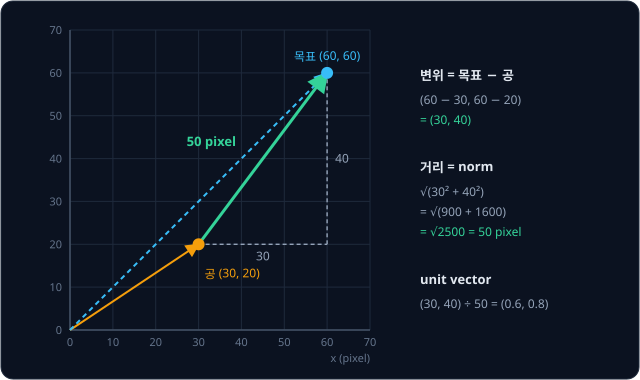
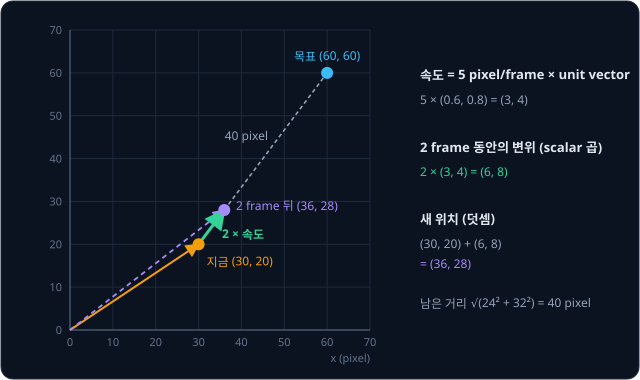
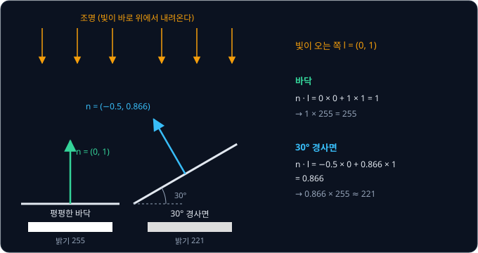
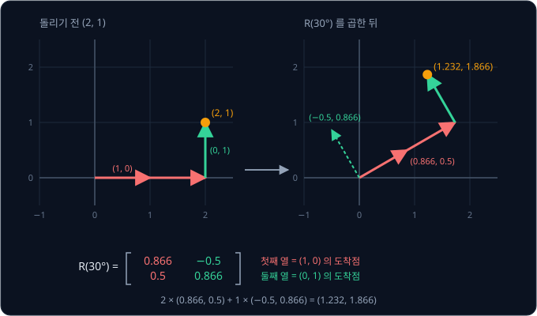
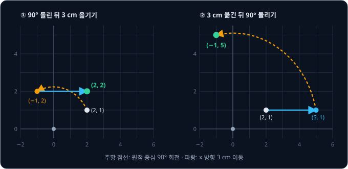
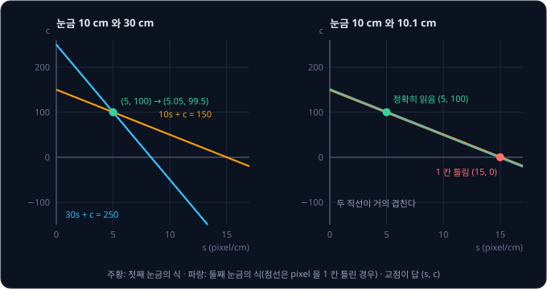

# Vectors & Matrices

사진 편집 프로그램에서 사진을 시계 반대 방향으로 30° 돌린다. 사진 가운데를 원점으로 잡으면, 돌리기 전에 가운데에서 오른쪽으로 2 cm,
위로 1 cm 떨어져 있던 점은 돌린 뒤 어디에 있을까? 사진 한 장에는 pixel 이 수십만 개 있으니, 프로그램은 이 계산을 pixel 마다 빠르게
해야 한다.

이 문제를 푸는 좋은 방법은 행렬과 vector 를 한 번 곱하는 것이다. 숫자를 순서대로 묶은 것을 vector, 숫자를 표처럼 늘어놓은 것을 행렬이라고
하는데, 점의 위치 2 cm 와 1 cm 를 vector 로 묶고 30° 회전을 담은 행렬을 곱하면 돌린 뒤의 위치가 담긴 vector 가 나온다. Python 의 사진
library 인 Pillow 의 소스 코드를 보면, 사진을 돌릴 때 이런 행렬의 숫자를 먼저 만들고 pixel 마다 좌표에 그 행렬을 곱한다. 그림을 그리는
neural network 인 Stable Diffusion 도 층마다 같은 곱셈을 한다.

## 학습 목표

- vector 가 pixel 의 위치·이동·색을 적은 숫자 묶음이고, 덧셈·scalar 곱·norm 이 각각 옮기기·늘이기·거리라는 것을 설명할 수 있다
- dot product 가 한 vector 가운데 다른 방향으로 향하는 몫을 잰다는 것을 비스듬한 면의 밝기 예로 설명할 수 있다
- 행렬과 vector 의 곱을 행마다 dot product 로 계산하고, 행렬의 열이 축 화살표가 도착하는 곳이라는 것을 회전·늘이기의 예로 설명할 수 있다
- 행렬 곱의 순서와 모양 규칙, inverse 로 $A\mathbf{x} = \mathbf{b}$ 를 푸는 방법, inverse 가 없는 행렬이 사진에서 생기는 경우를 설명할 수 있다

## vector

사진에서 다루는 값은 대부분 숫자 하나가 아니라 여러 개가 한 묶음이다. 화면 위 점 하나의 위치는 가로 30 pixel, 세로 20 pixel 처럼 숫자
두 개로 적고, pixel 하나의 색은 빨강·초록·파랑의 밝기 세 개로 적는다. 이렇게 순서를 정해 늘어놓은 숫자 묶음을 **vector** 라고 하고,
$\mathbf{p} = (30, 20)$ 처럼 굵은 글씨로 적는다. 묶음 안의 숫자 하나하나를 component(성분)라고 하고, component 의 개수를
dimension(차원)이라고 한다.

| 사진의 값 | vector | dimension | component 의 뜻 |
| --- | --- | --- | --- |
| 화면 위 점의 위치 | $(30, 20)$ | 2 | 왼쪽 아래 모서리에서 가로 30 pixel, 세로 20 pixel |
| pixel 하나의 색 | $(255, 128, 0)$ | 3 | 빨강·초록·파랑(RGB)의 밝기(0 ~ 255). 이 pixel 은 주황색이다 |
| 흑백 사진의 3×3 조각 | $(0, 0, 255, 0, 0, 255, 0, 0, 255)$ | 9 | 9 칸의 밝기를 윗줄부터 차례로 적었다. 오른쪽 세로줄만 흰 조각이다 |
| 사진 두 장의 색 차이 | $(20, 10, 20)$ | 3 | 같은 자리 pixel 의 빨강·초록·파랑 밝기 차이 |

vector 는 위치(position)를 적기도 하고, 어디서 어디로 움직였는지 적은 변위(displacement)나 한 frame(동영상의 한 장면) 동안 움직이는 양인
속도(velocity)를 적기도 한다. 뜻은 달라도 다음 절부터 볼 계산 규칙은 같다. 다만 숫자만으로는 뜻이 정해지지 않아서, 어디를 원점으로
잡았는지, 첫째 component 가 어느 방향인지, 단위가 pixel 인지 cm 인지를 함께 정해야 한다. 이렇게 원점과 축 방향을 정해 둔 기준을
좌표계라고 한다. 이 강의는 수학 시간처럼 오른쪽을 $+x$, 위쪽을 $+y$ 로 쓰고, 사진 파일의 pixel 좌표가 아래쪽을 $+y$ 로 쓰는 문제는
행렬 절에서 다룬다.

## vector 덧셈과 scalar 곱

dimension 이 같은 vector 끼리는 같은 자리의 component 끼리 더하거나 뺀다. 화면 위 공이 $(30, 20)$ 에 있고 목표가 $(60, 60)$ 에 있으면
목표 위치에서 공의 위치를 뺀 $(60 - 30,\ 60 - 20) = (30, 40)$ 이 공에서 목표까지의 변위다. 거꾸로 위치에 변위를 더하면 옮겨 간 위치가
나온다.

vector 가 아닌 보통 숫자 하나를 scalar 라고 한다. scalar 를 vector 에 곱하면 모든 component 에 그 숫자를 곱해서, 방향은 그대로이고
길이만 그 배수가 된다(음수면 방향이 반대가 된다). frame 마다 $(3, 4)$ pixel 씩 움직이는 공이 2 frame 동안 움직인 변위는
$2 \times (3, 4) = (6, 8)$ pixel 이다.

동영상에서 공의 다음 위치를 계산할 때는 덧셈과 scalar 곱을 한 번씩 쓴다.

$$
\text{새 위치} = \text{지금 위치} + \Delta t \times \text{속도}
$$

$\Delta t$ 는 시간 간격(여기서는 frame 수)이고, $\Delta$(delta)는 변한 양을 나타낼 때 쓰는 그리스 문자다. 색에도 같은 계산을 쓰는데,
지금 색 $(200, 100, 50)$ 에서 목표 색 $(100, 100, 150)$ 까지의 차이는 $(-100, 0, 100)$ 이다. 이 차이의 0.1 배인 $(-10, 0, 10)$ 을
10 번 더하면 빨강은 줄고 파랑은 늘어 10 번째에 목표 색에 닿는다. 한 장면이 다음 장면으로 서서히 바뀌는 crossfade 효과도 pixel 마다
이 계산으로 만든다.

## 길이와 unit vector

vector 의 길이는 원점에서 그 점까지의 직선 거리인데, 가로 $v_1$, 세로 $v_2$ 인 직각삼각형의 빗변이라서 피타고라스 정리로 구한다. 이
길이를 **norm** 이라고 하고 $\|\mathbf{v}\|$ 로 적는다.

$$
\|\mathbf{v}\| = \sqrt{v_1^2 + v_2^2}
$$

$\sqrt{\ }$ 는 제곱하면 안의 수가 되는 양수로, $\sqrt{25} = 5$ 다. 공과 목표 사이의 거리는 두 위치의 차이 vector 의 norm 이다.

$$
\|(30, 40)\| = \sqrt{30^2 + 40^2} = \sqrt{900 + 1600} = \sqrt{2500} = 50 \text{ pixel}
$$

공이 목표에 도착했는지는 이 거리가 미리 정한 값(예를 들어 1 pixel)보다 작은지로 판정한다. component 가 셋이면 제곱을 하나 더 더해서,
두 사진의 같은 자리 pixel 색 차이가 $(20, 10, 20)$ 이면 그 길이는 $\sqrt{400 + 100 + 400} = 30$ 이다. 색 차이의 norm 이 작을수록
두 pixel 의 색이 비슷하다.

vector 를 자기 norm 으로 나누면 방향은 그대로이고 길이가 1 인 vector 가 남는데, 방향만 담은 이 vector 를 **unit vector** 라고 한다.
목표 쪽 unit vector 는 $(30, 40) \div 50 = (0.6, 0.8)$ 이고, 길이를 재 보면 $\sqrt{0.36 + 0.64} = 1$ 이다. 목표 쪽으로 frame 마다
5 pixel 씩 가는 속도는 이 unit vector 에 5 를 곱한 $5 \times (0.6, 0.8) = (3, 4)$ pixel/frame 이다.

이 속도로 2 frame 움직이면 앞 절의 식대로 $(30, 20) + 2 \times (3, 4) = (36, 28)$ 에 있고, 목표까지 남은 변위 $(24, 32)$ 의 길이는
$\sqrt{576 + 1024} = 40$ pixel 이다.

**확인 문제.** 공이 $(10, 10)$ 에, 목표가 $(60, 130)$ 에 있다. 목표까지의 거리와 목표 쪽 unit vector 는?

답 보기

변위는 목표에서 공의 위치를 뺀 $(60 - 10,\ 130 - 10) = (50, 120)$ 이다. 거리는 $\sqrt{50^2 + 120^2} = \sqrt{2500 + 14400} = \sqrt{16900} = 130$
pixel 이고, unit vector 는 변위를 거리로 나눈 $(50 \div 130,\ 120 \div 130) \approx (0.385, 0.923)$ 이다.

## dot product

두 vector 의 같은 자리 component 끼리 곱해 모두 더한 값을 **dot product**(내적)라고 하고 $\mathbf{a} \cdot \mathbf{b}$ 로 적는다.
$(3, 4) \cdot (2, 1) = 3 \times 2 + 4 \times 1 = 10$ 처럼 계산은 단순하다.

컬러 사진을 흑백으로 바꾸는 계산이 바로 dot product 다. Pillow 문서에 따르면 Pillow 는 pixel 색 $(R, G, B)$ 를 흑백 밝기 $L$ 로 바꿀 때
ITU-R 601-2 규격의 식 $L = 0.299R + 0.587G + 0.114B$ 를 쓴다. Wikipedia 의 Grayscale 항목이 설명하듯 사람 눈은 초록에 가장 민감하고 파랑에
가장 둔해서, 초록에는 가장 큰 숫자를 곱하고 파랑에는 가장 작은 숫자를 곱한다. 이 식은 색 vector 와 weight vector $(0.299, 0.587, 0.114)$ 의 dot product 다.

$$
(255, 128, 0) \cdot (0.299, 0.587, 0.114) = 76.245 + 75.136 + 0 = 151.381
$$

주황색 pixel $(255, 128, 0)$ 은 흑백 사진에서 밝기 151 쯤의 회색이 된다.

dot product 로는 한 vector 가 다른 vector 의 방향으로 얼마나 향하는지도 잴 수 있다. 3D 그림에서 면의 밝기를 구할 때 이 성질을 쓴다.
면이 바깥으로 향하는 방향을 나타내는 길이 1 의 화살표를 normal vector 라고 하는데, 무광 페인트처럼 빛을 사방으로 고르게 흩는 면은
normal vector 와 빛이 오는 쪽 unit vector 의 dot product 만큼 밝게 보인다. Lambert 반사라고 부르는 이 계산은 computer graphics 에서
무광 면의 밝기를 구할 때 자주 쓰는 식이다.

조명이 바로 위에 있어서 빛이 오는 쪽 unit vector 가 $\mathbf{l} = (0, 1)$ 이고, 바닥에서 30° 기운 경사면의 normal vector 가
$\mathbf{n} = (-0.5, 0.866)$ 이라고 하자. 0.866 과 0.5 는 30° 의 cos·sin 값이고 $\mathbf{n}$ 의 길이는 $\sqrt{0.25 + 0.75} = 1$ 이다.

$$
\mathbf{n} \cdot \mathbf{l} = (-0.5) \times 0 + 0.866 \times 1 = 0.866
$$

평평한 바닥은 normal vector 가 $(0, 1)$ 이라 dot product 가 1 이고, 빛을 정면으로 받아 가장 밝다. 30° 기운 면은 0.866 이라 바닥 밝기의
86.6% 로, 바닥이 255 로 찍히면 경사면은 $0.866 \times 255 \approx 221$ 로 찍힌다. 이렇게 unit vector 와의 dot product 는 vector 를 그 방향의
직선 위로 수직으로 떨어뜨린 그림자의 길이인데, 이 길이를 projection(사영)이라고 한다. 길이 1 인 normal vector 를 빛 방향 위로 떨어뜨리면
그림자 길이가 0.866 이다.

dot product 는 두 vector 의 길이와 사이 각도 $\theta$ 로도 적을 수 있다.

$$
\mathbf{a} \cdot \mathbf{b} = \|\mathbf{a}\| \, \|\mathbf{b}\| \cos\theta
$$

$\cos\theta$ 는 각도가 0° 면 1, 90° 면 0, 180° 면 −1 인 값이라서, dot product 의 부호만 봐도 두 방향의 관계를 알 수 있다.

| dot product | 사이 각도 | 뜻 | 밝기 계산의 예 |
| --- | --- | --- | --- |
| 양수 | 90° 보다 작다 | 대체로 같은 쪽 | 30° 경사면 $(-0.5, 0.866) \cdot (0, 1) = 0.866 = \cos 30°$, 빛을 받는다 |
| 0 | 90° | 직각 | 세로 벽 $(1, 0) \cdot (0, 1) = 0$, 빛이 면을 스쳐 지나가 밝기 0 이다 |
| 음수 | 90° 보다 크다 | 대체로 반대쪽 | 천장 아랫면 $(0, -1) \cdot (0, 1) = -1$, 면이 빛을 등져 있다 |

음수는 면이 빛을 등지고 있다는 뜻이라, 그 면에는 이 조명의 빛이 닿지 않는다.

두 vector 를 각각 길이 1 로 맞춘 뒤 dot product 를 구하면 길이는 빠지고 $\cos\theta$ 만 남는데, 이 값을 cosine similarity 라고 한다.
cosine similarity 는 길이와 상관없이 두 vector 가 얼마나 같은 쪽을 향하는지만 재는 값이라서, 빛이나 방향처럼 화살표로 그릴 수 있는 vector 가 아니어도 쓸 수
있다. 예를 들어 사진과 글을 함께 다루는 모델인 [CLIP](../clip/README.md) 은 사진 한 장과 문장 하나를 각각 숫자 수백 개짜리 vector 로 바꾸고, 같은
내용을 담은 사진과 문장의 vector 가 같은 쪽을 향하도록 학습한다. 그래서 사진에 맞는 설명을 고를 때는 사진과 cosine similarity 가 가장 큰
문장을 짝으로 고른다.

**확인 문제.** 빛이 오는 쪽 unit vector 가 $(0.6, 0.8)$ 이고 면의 normal vector 가 $(0, 1)$ 이다. 빛을 정면으로 받는 면이 255 로 찍힐 때 이 면의 밝기는?

답 보기

normal vector 와 빛 방향의 dot product 를 구한다. $0 \times 0.6 + 1 \times 0.8 = 0.8$ 이라서 밝기는 $0.8 \times 255 = 204$ 다. 빛이 비스듬히
들어와서 정면으로 받을 때의 80% 만 밝다.

## 행렬과 vector 의 곱

**행렬**(matrix)은 숫자를 가로줄(행, row)과 세로줄(열, column)로 늘어놓은 표다. 행렬 $A$ 와 vector $\mathbf{x}$ 의 곱 $A\mathbf{x}$ 는
$A$ 의 행마다 $\mathbf{x}$ 와 dot product 를 구해 위에서부터 쌓은 vector 다. 행렬 곱에서는 vector 를 세로로 세워 적는데, 모양을 맞추려고
그렇게 적을 뿐 뜻은 $(x, y)$ 와 같다.

서론의 사진 회전 문제도 이 곱으로 푼다. 사진 가운데를 원점으로 두면, 점을 시계 반대 방향으로 30° 돌리는 행렬은 30° 회전 행렬
$R(30°)$ 다. 아래 행렬 안의 0.866 과 0.5 는 30° 의 cos·sin 값이다. 왜 이런 모양인지는 이 절 뒷부분에서 열로 읽으면 보인다.

$$
\begin{bmatrix} 0.866 & -0.5 \\ 0.5 & 0.866 \end{bmatrix}
\begin{bmatrix} 2 \\ 1 \end{bmatrix}
$$

| 행 | 행과 $(2, 1)$ 의 dot product | 결과 |
| --- | --- | --- |
| 첫째 $(0.866, -0.5)$ | $0.866 \times 2 + (-0.5) \times 1$ | 1.232 |
| 둘째 $(0.5, 0.866)$ | $0.5 \times 2 + 0.866 \times 1$ | 1.866 |

돌린 뒤의 점은 가운데에서 오른쪽으로 1.232 cm, 위로 1.866 cm 에 있다. 시계 반대 방향으로 돌렸으니 점이 원점을 중심으로 왼쪽 위로
올라갔다. 회전은 방향만 바꾸고 길이는 바꾸지 않으므로, 가운데에서 점까지의 거리 $\sqrt{2^2 + 1^2}$ 과 $\sqrt{1.232^2 + 1.866^2}$ 은
모두 2.236 cm 로 같다.

같은 곱을 열로 읽을 수도 있다. $(2, 1)$ 은 $x$ 축 방향으로 길이 1 인 화살표 $(1, 0)$ 을 두 번 잇고, 그 끝에 $y$ 축 방향 화살표 $(0, 1)$ 을
한 번 이은 점이다. 행렬 곱은 덧셈과 scalar 곱을 그대로 지키므로 $A(2, 1) = 2 \times A(1, 0) + 1 \times A(0, 1)$ 인데, $A(1, 0)$ 을
계산하면 $A$ 의 첫째 열이 나오고 $A(0, 1)$ 을 계산하면 둘째 열이 나온다.

$$
2 \times \begin{bmatrix} 0.866 \\ 0.5 \end{bmatrix} + 1 \times \begin{bmatrix} -0.5 \\ 0.866 \end{bmatrix} = \begin{bmatrix} 1.232 \\ 1.866 \end{bmatrix}
$$

행렬의 열은 축 화살표가 도착하는 곳이라, 두 도착점만 알면 모든 vector 가 어디로 가는지 정해진다. 화살표 $(1, 0)$ 을 30° 돌리면
$(\cos 30°, \sin 30°) = (0.866, 0.5)$ 에 도착하고, $(0, 1)$ 을 30° 돌리면 $(-0.5, 0.866)$ 에 도착하므로 회전 행렬이 앞의 모양이 된다.
90° 회전에서는 $(1, 0)$ 은 $(0, 1)$ 로 가고 $(0, 1)$ 은 $(-1, 0)$ 으로 가므로 행렬은 $\begin{bmatrix} 0 & -1 \\ 1 & 0 \end{bmatrix}$ 이다.

회전이 아닌 행렬도 같은 방식으로 읽는다. 사진 파일의 pixel 좌표는 수학 시간의 좌표와 달리 아래로 갈수록 세로 좌표가 커지는데, Pillow
문서도 좌표 $(0, 0)$ 을 사진의 왼쪽 위 모서리로 정한다. 책상을 위에서 찍은 사진에서 pixel 한 칸이 책상 위 2 mm(0.2 cm)이고, 책상 위
위치는 위쪽을 $+y$ 로 잰다고 하자. 사진 가운데에서 잰 pixel 좌표를 cm 로 바꾸는 행렬은 다음과 같다.

$$
S = \begin{bmatrix} 0.2 & 0 \\ 0 & -0.2 \end{bmatrix}, \qquad
S \begin{bmatrix} 150 \\ 100 \end{bmatrix} = \begin{bmatrix} 30 \\ -20 \end{bmatrix}
$$

사진 가운데에서 오른쪽 150 pixel, 아래 100 pixel 에 찍힌 물체는 책상 위 $(30, -20)$ cm 에 있다. 대각선 밖이 0 인 행렬은 축마다 따로
늘이거나 줄이고, 음수는 그 축을 뒤집는다. 그래서 둘째 행의 − 를 빠뜨리면 위아래가 뒤집힌 자리가 답으로 나온다. 사진을 확대·축소하는 것도
이런 대각선 행렬이고, 가로 2 배 확대는 $\begin{bmatrix} 2 & 0 \\ 0 & 1 \end{bmatrix}$ 다.

neural network 의 층 하나도 행렬과 vector 의 곱이라서, 숫자 세 개 $\mathbf{x} = (1, 2, 3)$ 을 받아 숫자 두 개를 내는 층은 행이 2 개, 열이 3 개인
행렬 $W$ 를 곱한다.

$$
W = \begin{bmatrix} 0.5 & -1 & 2 \\ 1 & 0 & -0.5 \end{bmatrix}, \qquad
W\mathbf{x} = \begin{bmatrix} 0.5 - 2 + 6 \\ 1 + 0 - 1.5 \end{bmatrix} = \begin{bmatrix} 4.5 \\ -0.5 \end{bmatrix}
$$

2×3 행렬은 3 dimension vector 를 2 dimension vector 로 바꾼다. pixel 색 $(R, G, B)$ 를 받아 숫자 두 개를 내는 층이라고 생각해도 된다.
회전 행렬과 달리 $W$ 의 숫자는 사람이 정하지 않고 데이터로 학습하는데, 이 숫자를 weight 라고 한다. weight 를 학습하는 방법은
[Perceptron](../perceptron/README.md) 부터 다룬다.

**확인 문제.** 사진을 시계 반대 방향으로 90° 돌린다. 가운데에서 $(3, 1)$ cm 에 있던 점은 어디로 가는가?

답 보기

90° 회전 행렬 $\begin{bmatrix} 0 & -1 \\ 1 & 0 \end{bmatrix}$ 을 곱한다. 첫째 행은 $0 \times 3 + (-1) \times 1 = -1$ 이고 둘째 행은
$1 \times 3 + 0 \times 1 = 3$ 이라서 돌린 뒤의 위치는 $(-1, 3)$ 이다. 오른쪽 3 cm 에 있던 점이 위쪽 3 cm 로 올라가고, 위쪽 1 cm 는 왼쪽 1 cm 가 된다.

## 행렬과 행렬의 곱

변환 두 개를 차례로 해도 행렬 하나로 적을 수 있다. $\mathbf{x}$ 를 먼저 $R$ 로 바꾸고 그 결과를 $D$ 로 바꾸면 $D(R\mathbf{x})$ 인데,
두 행렬을 먼저 곱한 $DR$ 을 $\mathbf{x}$ 에 한 번 곱해도 결과가 같다. 행렬 곱 $DR$ 은 $R$ 의 열마다 $D$ 를 곱해 같은 자리의 열로 세운
행렬이다. $R$ 의 열은 축 화살표가 $R$ 로 옮겨 간 곳이라서, 그 도착점을 다시 $D$ 로 옮기면 두 변환을 이은 결과가 된다.

$R$ 을 90° 회전 $\begin{bmatrix} 0 & -1 \\ 1 & 0 \end{bmatrix}$ 로, $D$ 를 사진을 가로로만 2 배 늘이는 $\begin{bmatrix} 2 & 0 \\ 0 & 1 \end{bmatrix}$
로 두고 두 순서를 비교하면 다음과 같다.

| 곱 | 열 계산 | 결과 행렬 | $(2, 1)$ 에 곱한 값 |
| --- | --- | --- | --- |
| $DR$ (회전 먼저) | $D(0, 1) = (0, 1)$, $D(-1, 0) = (-2, 0)$ | $\begin{bmatrix} 0 & -2 \\ 1 & 0 \end{bmatrix}$ | $(-2, 2)$ |
| $RD$ (늘이기 먼저) | $R(2, 0) = (0, 2)$, $R(0, 1) = (-1, 0)$ | $\begin{bmatrix} 0 & -1 \\ 2 & 0 \end{bmatrix}$ | $(-1, 4)$ |

같은 두 변환인데 순서를 바꾸자 결과가 달라졌다. 돌린 뒤 가로로 늘이면 원래 세로였던 방향이 늘어나고, 가로로 늘인 뒤 돌리면 원래
가로였던 방향이 늘어난 채로 세워지기 때문이다. 숫자의 곱셈은 $2 \times 3 = 3 \times 2$ 지만 행렬의 곱셈은 일반적으로 $DR \neq RD$ 다.
$DR\mathbf{x}$ 는 $\mathbf{x}$ 에 가까운 오른쪽 행렬 $R$ 부터 적용한다고 읽는다.

회전과 이동을 섞어도 순서가 결과를 바꾼다. 화면 위 $(2, 1)$ 에 놓인 스티커를 원점 중심으로 90° 돌리고 $x$ 방향으로 3 cm 옮기는데,
두 일의 순서를 바꿔 본다.

돌린 뒤 옮기면 $(2, 1) \to (-1, 2) \to (2, 2)$ 이고, 옮긴 뒤 돌리면 $(2, 1) \to (5, 1) \to (-1, 5)$ 다. 먼저 옮기면 스티커가 원점에서
멀어진 채로 돌아 더 큰 원을 그리므로, 두 도착점은 $\sqrt{3^2 + 3^2} \approx 4.24$ cm 떨어진다. 사진 편집 프로그램에서 "가운데를 중심으로
돌리기" 는 사진 가운데를 원점으로 옮기고, 돌리고, 다시 제자리로 옮기는 세 변환을 이은 것이다. Pillow 의 회전 함수 소스 코드에도 이 세
행렬을 곱하는 순서가 주석으로 적혀 있다.

2×2 행렬에 $(0, 0)$ 을 곱하면 언제나 $(0, 0)$ 이 나오는데 이동은 $(0, 0)$ 을 $(3, 0)$ 으로 보내야 하므로, 이동은 2×2 행렬로 적을 수 없다.
그래서 사진 library 는 점 $(x, y)$ 끝에 1 을 붙인 $(x, y, 1)$ 에 3×3 행렬을 곱해 회전·늘이기와 이동을 한 행렬로 함께 적는데, 이렇게
적은 변환을 affine 변환이라고 한다. Pillow 의 affine 변환은 이 3×3 행렬의 윗줄 두 행에 있는 숫자 6 개를 받는다.

<b>심화: 첨자와 Σ 로 쓰는 행렬 곱</b>

행렬 $A$ 의 $i$ 번째 행, $j$ 번째 열에 있는 숫자는 $a_{ij}$ 로 적고, $\Sigma$ (sigma)는 아래 적힌 첨자를 1 부터 끝까지 바꿔 가며
더하라는 기호다. 행렬과 vector 의 곱에서 결과의 $i$ 번째 component 는 $A$ 의 $i$ 번째 행과 $\mathbf{x}$ 의 dot product 다.

$$
(A\mathbf{x})_i = \sum_{j} a_{ij} \, x_j
$$

행렬과 행렬의 곱 $C = AB$ 의 $i$ 행 $k$ 열은 $A$ 의 $i$ 번째 행과 $B$ 의 $k$ 번째 열의 dot product 다.

$$
c_{ik} = \sum_{j} a_{ij} \, b_{jk}
$$

$DR$ 의 1 행 2 열을 확인하면 $D$ 의 첫째 행 $(2, 0)$ 과 $R$ 의 둘째 열 $(-1, 0)$ 의 dot product 인 $2 \times (-1) + 0 \times 0 = -2$ 로, 표의
결과 행렬과 같다. 행렬 곱은 순서는 바꿀 수 없지만 묶는 방법은 바꿀 수 있어서 $(AB)C = A(BC)$ 다. 그래서 옮기기·돌리기·다시 옮기기의
세 행렬을 미리 곱해 행렬 하나로 만들어 두고 pixel 마다 한 번만 곱해도 결과가 같다.

## 행렬의 모양과 transpose

행이 $m$ 개, 열이 $n$ 개인 행렬을 $m \times n$ 행렬이라고 하고, $m \times n$ 을 행렬의 모양(shape)이라고 한다. dimension 이 $n$ 인 vector 는 열이
하나인 $n \times 1$ 행렬로 본다. 행렬 곱은 앞 행렬의 행과 뒤 행렬의 열로 dot product 를 하므로 앞 행렬의 열 수와 뒤 행렬의 행 수가 같아야
하고, 결과는 앞 행렬의 행 수 × 뒤 행렬의 열 수 모양이다.

$$
(m \times n) \times (n \times p) = (m \times p)
$$

| 계산 | 모양 | 결과 |
| --- | --- | --- |
| 회전 행렬 × 점 | $(2 \times 2) \times (2 \times 1)$ | $2 \times 1$, 돌린 점 |
| neural network 층 × 입력 | $(2 \times 3) \times (3 \times 1)$ | $2 \times 1$, 출력 두 개 |
| neural network 층 × 입력 64 개를 열로 붙인 행렬 | $(2 \times 3) \times (3 \times 64)$ | $2 \times 64$, 입력마다 출력 두 개씩 |
| neural network 층 × 2 dimension 입력 | $(2 \times 3) \times (2 \times 1)$ | 가운데 3 과 2 가 달라 계산할 수 없다 |

입력 64 개를 열로 붙인 경우처럼 입력 여러 개를 한 번에 곱하면 입력마다 따로 곱한 결과가 같은 자리의 열에 나온다. 예를 들어 pixel 64 개의
색을 한 번에 층에 넣을 수 있다. neural network 를 학습할 때 sample 수십 개를 한 번에 계산하는 batch 가 이 방식이다. neural network 코드에서
표의 마지막 줄처럼 shape 오류가 나면 먼저 양쪽의 모양을 이렇게 적어 본다.

행렬의 행과 열을 맞바꾼 것을 **transpose**(전치)라고 하고 $A^\top$ 으로 적는다. 2×3 인 $W$ 의 transpose 는 첫째 행 $(0.5, -1, 2)$ 가
첫째 열이 된 3×2 행렬이다. 세로 vector $\mathbf{a}$ 를 transpose 하면 가로 vector 가 되어서, dot product 를 행렬 곱 $\mathbf{a}^\top\mathbf{b}$
로 적을 수 있다. $(1 \times 3) \times (3 \times 1)$ 의 결과는 숫자 하나인 $1 \times 1$ 행렬이다. 흑백 변환의 weight $(0.299, 0.587, 0.114)$ 를
가로로 눕혀 색 vector 에 곱하면 밝기 하나가 나온다.

**확인 문제.** 4×3 행렬 $W$ 에 dimension 3 인 vector 를 곱하면 결과의 모양은? 같은 $W$ 에 2×5 행렬을 곱할 수 있는가?

답 보기

$(4 \times 3) \times (3 \times 1) = 4 \times 1$ 이라 dimension 4 인 vector 다. 2×5 행렬은 $W$ 의 열 수 3 과 행 수 2 가 달라서 곱할 수 없다.

## 연립방정식과 inverse

지금까지는 $\mathbf{x}$ 를 알고 $A\mathbf{x}$ 를 구했지만, 반대로 결과 $\mathbf{b}$ 를 알고 $\mathbf{x}$ 를 구해야 할 때도 많다. 돌린 사진의
pixel 하나가 원래 사진의 어느 점에서 왔는지 찾는 일, 사진 속 눈금 두 개로 pixel 과 실제 길이의 관계를 구하는 일이 모두
$A\mathbf{x} = \mathbf{b}$ 꼴이다.

행렬 $A$ 가 한 일을 되돌리는 행렬을 $A$ 의 **inverse**(역행렬)라 하고 $A^{-1}$ 로 적는다. $A$ 를 곱한 뒤 $A^{-1}$ 을 곱하면 처음 vector
가 그대로 돌아오므로, 두 행렬을 곱한 $A^{-1}A$ 는 아무것도 바꾸지 않는 행렬 $\begin{bmatrix} 1 & 0 \\ 0 & 1 \end{bmatrix}$ 이다. 이 행렬을
identity matrix 라 하고 $I$ 로 적는다. $A\mathbf{x} = \mathbf{b}$ 의 양쪽에 $A^{-1}$ 을 곱하면 $A^{-1}A = I$ 라서 $\mathbf{x} = A^{-1}\mathbf{b}$ 가 남는다.

30° 회전의 inverse 는 반대로 30° 돌리는 행렬이고, $R(30°)$ 의 transpose 와 같다.

| 행 | $R(30°)^\top$ 의 행과 $(1.232, 1.866)$ 의 dot product | 결과 |
| --- | --- | --- |
| 첫째 $(0.866, 0.5)$ | $0.866 \times 1.232 + 0.5 \times 1.866 = 1.067 + 0.933$ | 2 |
| 둘째 $(-0.5, 0.866)$ | $-0.5 \times 1.232 + 0.866 \times 1.866 = -0.616 + 1.616$ | 1 |

돌린 뒤의 점 $(1.232, 1.866)$ 이 돌리기 전의 $(2, 1)$ 로 돌아왔다. transpose 가 그대로 inverse 가 되는 것은 회전 행렬의 성질이고,
일반 행렬의 inverse 는 따로 계산해야 한다.

사진을 실제로 돌릴 때는 이 inverse 를 쓴다. 원래 pixel 마다 $R$ 을 곱해 새 자리에 색을 찍으면, 도착점이 1.232 처럼 pixel 칸 사이에
떨어져서 어떤 칸에는 색이 두 번 찍히고 어떤 칸은 비어 구멍이 난다. 그래서 거꾸로, 새 사진의 pixel 마다 inverse 를 곱해 원래 사진의
어느 점에서 왔는지 찾고 그 자리의 색을 가져온다. Pillow 문서는 affine 변환에 넘기는 숫자 6 개를 "inverse 행렬의 첫 두 행" 이라고
적고, 새 사진의 pixel $(x, y)$ 마다 원래 사진의 $(ax + by + c,\ dx + ey + f)$ 에서 색을 가져온다고 설명한다. PyTorch 의 사진 library 인
torchvision 의 회전 함수도 이 inverse 행렬을 계산하는 함수를 거쳐 사진을 돌린다.

사진 속 길이 재기도 $A\mathbf{x} = \mathbf{b}$ 꼴로 푼다. 책상을 위에서 찍은 사진에서 책상 위 위치 $X$(cm)가 사진의 가로 pixel 좌표
$u$ 로 $u = sX + c$ 처럼 찍힌다고 하자. $s$ 는 1 cm 가 몇 pixel 인지를 나타내고 $c$ 는 $X = 0$ 인 곳의 pixel 좌표다. 둘 다 모르는
값이라서 책상 위에 자를 놓고, 위치를 아는 눈금 두 개가 사진의 어느 pixel 에 찍혔는지 본다.

| 눈금 | 책상 위 위치 $X$ | 사진의 pixel $u$ | 식 |
| --- | --- | --- | --- |
| 첫째 | 10 cm | 150 | $10s + c = 150$ |
| 둘째 | 30 cm | 250 | $30s + c = 250$ |

둘째 식에서 첫째 식을 빼면 $c$ 가 없어져 $20s = 100$ 이 남으므로 $s = 5$ pixel/cm 이고, 이 값을 첫째 식에 넣으면 $c = 150 - 50 = 100$
pixel 이다. 1 cm 가 5 pixel 이면 pixel 한 칸은 $1 \div 5 = 0.2$ cm 이고, 앞에서 $S$ 에 쓴 2 mm 가 이렇게 잰 값이다. 같은 두 식을
행렬로 적으면 모르는 값 $(s, c)$ 가 vector $\mathbf{x}$ 가 된다.

$$
\underbrace{\begin{bmatrix} 10 & 1 \\ 30 & 1 \end{bmatrix}}_{A}
\begin{bmatrix} s \\ c \end{bmatrix} =
\begin{bmatrix} 150 \\ 250 \end{bmatrix}, \qquad
A^{-1} = \begin{bmatrix} -0.05 & 0.05 \\ 1.5 & -0.5 \end{bmatrix}
$$

$A^{-1}$ 을 구하는 공식은 다음 절의 심화에 있다. $A^{-1}\mathbf{b}$ 를 계산하면 $(-0.05 \times 150 + 0.05 \times 250,\ 1.5 \times 150 - 0.5 \times 250)
= (5, 100)$ 으로, 빼기로 푼 답과 같다. 눈금이 셋 이상이면 식이 모르는 값보다 많아져서 모든 식을 정확히 맞추는 답이 없을 수 있다. 그때
오차 제곱의 합이 가장 작은 답을 행렬 곱으로 구하는 방법은 [Linear Regression](../linear-regression/README.md) 에서 다룬다.

**확인 문제.** 눈금 $X = 20$ cm 와 $X = 40$ cm 가 사진의 pixel 좌표 200 과 300 에 찍혔다. $s$ 와 $c$ 는?

답 보기

식은 $20s + c = 200$, $40s + c = 300$ 이다. 둘째에서 첫째를 빼면 $20s = 100$ 이라 $s = 5$ pixel/cm 이고, 첫째 식에 넣으면
$c = 200 - 20 \times 5 = 100$ pixel 이다.

## inverse 가 없는 행렬

$M = \begin{bmatrix} 1 & 2 \\ 2 & 4 \end{bmatrix}$ 의 두 열 $(1, 2)$ 와 $(2, 4)$ 는 같은 방향이라서, 축 화살표가 둘 다 같은 직선 위로 간다.
그래서 어떤 vector 를 곱해도 결과가 그 직선 위에 놓이고, 평면 전체가 직선 하나로 눌린다. 서로 다른 입력 $(2, 0)$ 과 $(0, 1)$ 이 둘 다
$(2, 4)$ 가 되니, 결과 $(2, 4)$ 만 보고는 입력이 무엇이었는지 알 수 없다. 이렇게 inverse 가 없는 행렬을 **singular matrix** 라고 한다.

2×2 행렬 $\begin{bmatrix} a & b \\ c & d \end{bmatrix}$ 에서 $ad - bc$ 를 **determinant** 라고 하고, 이 값은 한 변이 1 인 정사각형을 그
행렬로 바꾼 뒤의 넓이다. 평면을 직선으로 누르면 넓이가 0 이 되므로 singular matrix 의 determinant 는 0 이고, $M$ 도 $1 \times 4 - 2 \times 2 = 0$ 이다.

사진에서는 가로를 0 배로 줄이는 행렬 $\begin{bmatrix} 0 & 0 \\ 0 & 1 \end{bmatrix}$ 이 singular matrix 다. 사진 전체가 세로선 하나로 눌려서, 눌린 선만
보고는 원래 가로 어디에 있던 pixel 인지 알 수 없다. determinant 도 $0 \times 1 - 0 \times 0 = 0$ 이다. 컬러 사진을 흑백으로 바꾸는 계산도
되돌릴 수 없는데, 색 세 개를 밝기 하나로 누르기 때문이다. 주황 $(255, 128, 0)$ 과 회색 $(151, 151, 151)$ 은 둘 다 밝기 151 쯤이
되어서, 흑백 사진만 보고는 원래 색을 알 수 없다.

<b>심화: 2×2 inverse 공식과 determinant</b>

$A = \begin{bmatrix} a & b \\ c & d \end{bmatrix}$ 의 inverse 는 아래와 같다.

$$
A^{-1} = \frac{1}{ad - bc} \begin{bmatrix} d & -b \\ -c & a \end{bmatrix}
$$

분모 $ad - bc$ 가 determinant 이고 $\det A$ 로 적는다. 앞 절 눈금 계산의 $A$ 는 determinant 가 $10 \times 1 - 1 \times 30 = -20$ 이라서
$A^{-1} = \frac{1}{-20}\begin{bmatrix} 1 & -1 \\ -30 & 10 \end{bmatrix} = \begin{bmatrix} -0.05 & 0.05 \\ 1.5 & -0.5 \end{bmatrix}$ 이다.

한 변이 1 인 정사각형(꼭짓점 $(0,0), (1,0), (1,1), (0,1)$)을 $A$ 로 바꾸면 두 열을 변으로 하는 평행사변형이 되고, 그 넓이가 $|\det A|$ 다.
determinant 의 부호가 음수면 모양이 거울에 비친 것처럼 뒤집혔다는 뜻이다. 사진을 좌우로 뒤집는 $\begin{bmatrix} -1 & 0 \\ 0 & 1 \end{bmatrix}$
의 determinant 는 −1 이다.

| 행렬 | determinant | 정사각형이 바뀐 모양 |
| --- | --- | --- |
| 30° 회전 | $0.866^2 + 0.5^2 = 1$ | 돌아간 정사각형, 넓이 그대로 |
| 가로 2 배 $D$ | $2 \times 1 - 0 = 2$ | 가로로 긴 직사각형, 넓이 2 |
| $\begin{bmatrix} 1 & 2 \\ 2 & 4 \end{bmatrix}$ | $1 \times 4 - 2 \times 2 = 0$ | 선분 하나로 눌림, 넓이 0 |

넓이가 0 이면 공식의 분모가 0 이라 inverse 를 구할 수 없다.

singular matrix 는 앞 절의 눈금 계산에서도 생긴다. 눈금 두 개를 찍어 $s$ 와 $c$ 를 구할 때 두 눈금이 같은 자리 $X = 10$ cm 면
$A = \begin{bmatrix} 10 & 1 \\ 10 & 1 \end{bmatrix}$ 의 두 행이 같아 singular 가 된다. 같은 정보를 두 번 얻었을 뿐이라 $s$ 와 $c$ 를 따로 구할
수 없다. 눈금 두 개가 거의 같은 자리에 있으면 계산은 되지만, pixel 을 읽을 때의 작은 오차가 답을 크게 바꿔서 오히려 더 위험하다.

| 눈금 위치 | determinant | pixel 정확히 읽음 | 둘째 pixel 을 1 칸 틀림 |
| --- | --- | --- | --- |
| 10 cm, 30 cm | $-20$ | $s = 5$, $c = 100$ | $s = 5.05$, $c = 99.5$ |
| 10 cm, 10.1 cm | $-0.1$ | $s = 5$, $c = 100$ | $s = 15$, $c = 0$ |

눈금을 10 cm 와 10.1 cm 에 둔 경우 둘째 눈금의 pixel 은 $10.1 \times 5 + 100 = 150.5$ 인데, 이 값을 151.5 로 1 칸 잘못 읽으면 $s$ 가
세 배가 된다. 식 하나를 $(s, c)$ 평면의 직선 하나로 그리면 해는 두 직선이 만나는 점이다. 눈금이 가까우면 두 직선이 거의 겹쳐서, 직선이
조금만 움직여도 교점이 멀리 옮겨 간다.

**흔한 오해.** "숫자가 0 이 아니면 나눌 수 있듯, 0 이 아닌 숫자가 들어 있는 행렬은 inverse 가 있다." $\begin{bmatrix} 1 & 2 \\ 2 & 4 \end{bmatrix}$
처럼 0 이 하나도 없어도 열들이 한 직선 위에 있으면 inverse 가 없다. inverse 가 있는지는 determinant 가 0 인지로 판단한다.

**확인 문제.** $\begin{bmatrix} 2 & 1 \\ 4 & 2 \end{bmatrix}$ 는 inverse 가 있는가?

답 보기

없다. 두 열 $(2, 4)$ 와 $(1, 2)$ 는 첫째 열이 둘째 열의 2 배라 같은 방향이고, determinant 도 $2 \times 2 - 1 \times 4 = 0$ 이다.

<b>심화: 계산량과 수치 계산</b>

$n \times n$ 행렬과 vector 를 곱하면 행마다 곱셈이 $n$ 번이라 모두 $n^2$ 번이고, $n \times n$ 행렬끼리 곱하면 결과 $n^2$ 칸마다 곱셈이
$n$ 번이라 $n^3$ 번이다.

| 계산 | 곱셈 수 |
| --- | --- |
| 3×3 affine 행렬 × 512 × 512 사진의 pixel 262,144 개 | $9 \times 262{,}144 = 2{,}359{,}296$ |
| 4096 × 4096 neural network 층 × 입력 하나 | $4096^2 \approx 1{,}680$ 만 |

$A\mathbf{x} = \mathbf{b}$ 를 풀 때는 inverse 를 따로 구해 곱하지 않고, 앞의 눈금 계산처럼 식을 빼서 모르는 값을 하나씩 없애는
elimination 으로 바로 푼다. 이렇게 풀면 곱셈이 약 $n^3 / 3$ 번이라 inverse 를 구하는 것보다 적고 반올림 오차도 덜 쌓인다. NumPy 의
`numpy.linalg.solve` 는 LAPACK 의 `gesv` 로 이 방식을 써서 $\mathbf{x}$ 를 구하고, 행렬이 singular 면 `LinAlgError` 를 낸다. 행렬이 거의
singular 면 오류 없이 답이 나오지만, 앞의 눈금 계산 표처럼 입력의 작은 오차가 답을 크게 바꾼다.

## 정리

- vector 는 위치·변위·속도·색을 순서 있는 숫자 묶음으로 적은 것이고, 덧셈은 옮기기, scalar 곱은 늘이기, norm 은 거리다. 공의 위치
  $(30, 20)$ 에서 목표 $(60, 60)$ 까지의 변위는 $(30, 40)$, 거리는 50 pixel 이다
- dot product 는 같은 자리끼리 곱해 더한 값이고, unit vector 와의 dot product 는 그 방향의 몫이다. 흑백 변환은 색과 weight 의 dot product 이고,
  조명이 바로 위에 있으면 30° 기운 면은 normal vector 와 빛 방향의 dot product 가 0.866 이라 바닥 밝기의 86.6% 로 보인다
- 행렬은 vector 를 다른 vector 로 바꾸는 표로, 행마다 dot product 로 계산하고 열은 축 화살표가 도착하는 곳이다. 행렬 곱은 변환을 차례로
  이은 것이라 순서를 바꾸면 결과가 달라지고, 앞 행렬의 열 수와 뒤 행렬의 행 수가 같아야 곱할 수 있다
- inverse 는 변환을 되돌려 $A\mathbf{x} = \mathbf{b}$ 를 풀게 해 준다. 사진을 돌릴 때는 새 pixel 마다 inverse 로 원래 자리를 찾는다. 평면을
  직선으로 누르는 행렬은 determinant 가 0 이라 inverse 가 없고, 같은 자리의 눈금 두 개로 세운 식이 이런 행렬을 만든다

이 강의는 고정된 행렬 하나가 vector 를 어떻게 바꾸는지만 다뤘다. 옆 pixel 로 갈 때 밝기가 얼마나 바뀌는지처럼 값이 변하는 비율을
구하려면 미분이 필요한데, 미분은 [Derivatives & Gradients](../derivatives/README.md) 에서 다룬다. 식이 모르는 값보다 많을 때 오차가 가장
작은 답을 행렬 곱으로 구하는 방법은 [Linear Regression](../linear-regression/README.md) 에서 다룬다.

## 참고 자료

- 3Blue1Brown, [Essence of linear algebra](https://www.youtube.com/playlist?list=PLZHQObOWTQDPD3MizzM2xVFitgF8hE_ab) — 행렬을 축 화살표가
  도착하는 곳으로 보는 영상 연재. 1 ~ 4편(vector 에서 행렬 곱까지), 6 ~ 7편(determinant, inverse), 9편(dot product)
- Gilbert Strang, [MIT 18.06 Linear Algebra (Spring 2010)](https://ocw.mit.edu/courses/18-06-linear-algebra-spring-2010/) — 1강에서 연립방정식을
  직선의 교점(행 그림)과 열의 조합(열 그림)으로 보고, 2 ~ 3강에서 elimination, 행렬 곱, inverse 를 다룬다
- Pillow, [`Image.convert`·`Image.rotate`·`Image.transform` 소스 코드](https://github.com/python-pillow/Pillow/blob/main/src/PIL/Image.py) — 흑백
  변환의 ITU-R 601-2 식, 회전 행렬을 가운데로 옮기고 돌리고 되돌리는 순서로 만드는 주석, affine 변환이 새 pixel 마다 원래 자리를 찾는 방식
- Pillow, [`ImageTransform.AffineTransform`](https://github.com/python-pillow/Pillow/blob/main/src/PIL/ImageTransform.py) 과
  [Concepts: Coordinate system](https://pillow.readthedocs.io/en/stable/handbook/concepts.html#coordinate-system) — affine 변환에 inverse 행렬의
  첫 두 행을 넘긴다는 설명과, $(0, 0)$ 이 왼쪽 위 모서리인 pixel 좌표계
- torchvision, [`transforms/functional.py`](https://github.com/pytorch/vision/blob/main/torchvision/transforms/functional.py) — `rotate` 가
  `_get_inverse_affine_matrix` 로 inverse 행렬을 만들어 사진을 돌리는 소스 코드
- Wikipedia, [Grayscale](https://en.wikipedia.org/wiki/Grayscale) — 흑백 변환의 weight 가 사람 눈이 초록에 가장 민감하고 파랑에 가장 둔한
  성질을 반영한다는 설명
- Wikipedia, [Lambertian reflectance](https://en.wikipedia.org/wiki/Lambertian_reflectance) — normal vector 와 빛 방향의 dot product 로 무광 면의
  밝기를 구하는 computer graphics 의 계산
- NumPy, [`numpy.linalg.solve`](https://numpy.org/doc/stable/reference/generated/numpy.linalg.solve.html) — $A\mathbf{x} = \mathbf{b}$ 를
  LAPACK `gesv` 로 풀고 singular 행렬에서 오류를 내는 함수의 문서
