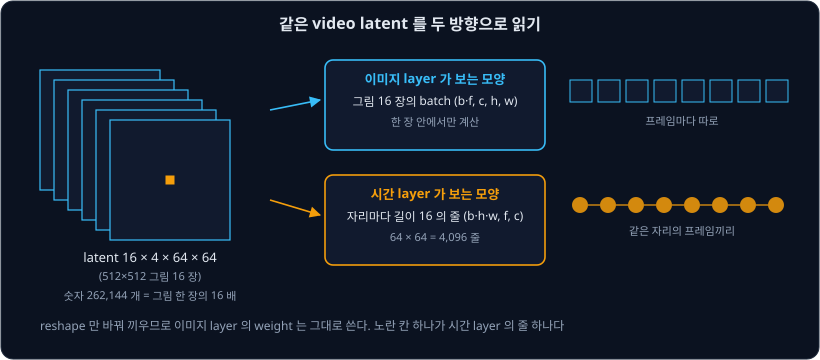
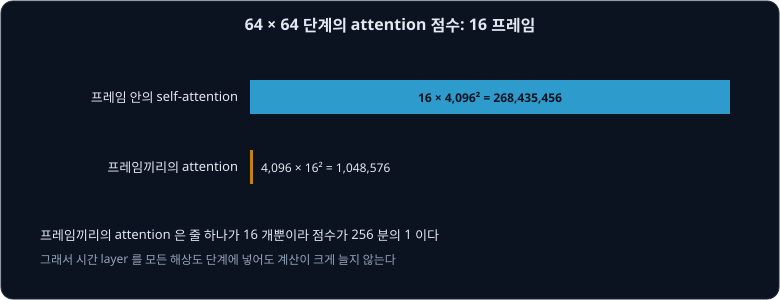
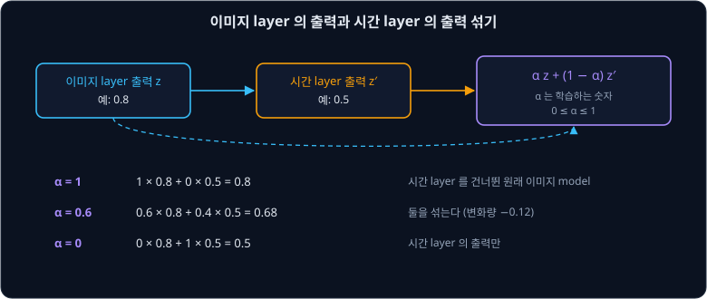
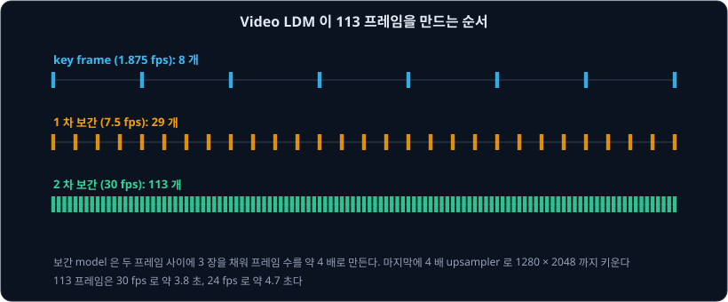
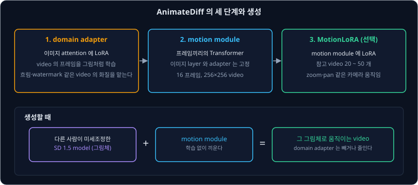

# Video Diffusion

Stable Diffusion 에 "a horse galloping" 을 넣고 seed 만 바꿔 16 장을 만들면, 말은 16 장 모두에 나오지만 털 색과 자세와 배경이 장마다 다르다. 이어 붙여
재생하면 움직이는 말이 아니라 깜빡이는 그림 16 장이다. 이미지 model 은 그림을 한 장씩 따로 만들 뿐이라서, 앞 장과 다음 장을 이어 주는 정보가 없다.
이미 잘 그리는 이미지 model 에 "프레임끼리 이어지게" 만드는 능력만 더할 수는 없을까?

2023 년의 두 연구가 같은 답을 냈다. NVIDIA 와 LMU Munich 의 Blattmann 등이 발표한 **Video LDM**("Align your Latents")과 CUHK·Stanford 등의 Guo 등이 발표한
**AnimateDiff** 는 이미 학습한 Stable Diffusion 의 layer 를 고정해 두고, 같은 자리의 프레임끼리 정보를 주고받는 새 layer 만 끼워 video 로 학습했다.
Video LDM 은 이렇게 Stable Diffusion 을 $1280 \times 2048$ 까지의 text-to-video model 로 바꿨고, AnimateDiff 의 motion module 은 다른 사람이 미세조정한
SD 1.5 model 에 학습 없이 끼워 그 그림체로 움직이는 video 를 만든다.

## 학습 목표

- video latent 를 이미지 layer 는 그림의 batch 로, 시간 layer 는 자리마다 프레임의 줄로 읽는 reshape 를 숫자로 따라갈 수 있다
- 프레임끼리의 attention 이 같은 자리의 값을 섞어 깜빡임을 줄이는 방식과, 그 점수 수가 프레임 안의 attention 보다 훨씬 작은 이유를 계산할 수 있다
- 이미지 layer 를 고정하고 시간 layer 만 학습할 때 처음 model 을 지키는 두 장치(섞는 비율 α, 0 에서 시작하는 출력 층)를 설명할 수 있다
- Video LDM 이 key frame, 보간, upsampler, decoder 미세조정으로 긴 고해상도 video 를 만드는 순서를 설명할 수 있다
- AnimateDiff 의 domain adapter, motion module, MotionLoRA 가 각각 무엇을 맡는지 설명하고, 내 컴퓨터에서 video 를 만들 때의 계산량을 셀 수 있다

## video latent 를 두 방향으로 읽기

$512 \times 512$ 그림 한 장의 latent 는 [Latent Diffusion](../latent-diffusion/README.md) 에서 본 대로 $4 \times 64 \times 64$ 이고 숫자가 16,384 개다.
16 프레임 video 는 이런 latent 16 장이라 모양은 $16 \times 4 \times 64 \times 64$ 이고 숫자는 262,144 개다. autoencoder 는 이미지용 그대로 프레임마다 따로 줄인다.

이 latent 를 두 방향으로 읽을 수 있다. 이미지 layer(convolution, 프레임 안의 self-attention, 글과의 cross-attention)는 프레임 축을 batch 축에 합쳐
그림 16 장의 batch 로 읽는다. 각 장을 따로 계산하므로 weight 는 이미지 model 그대로 쓴다. 새로 넣는 시간 layer 는 반대로 가로세로 자리를 batch 축에
합친다. 그러면 $64 \times 64 = 4096$ 개 자리마다 길이 16 인 줄이 하나씩 생기고, 줄 하나는 같은 자리의 16 프레임 값이다.

| 읽는 쪽 | 모양 | 한 번에 계산하는 단위 |
| --- | --- | --- |
| 이미지 layer | $(b \cdot f, c, h, w) = (16, 4, 64, 64)$ | 그림 한 장 |
| 시간 layer | $(b \cdot h \cdot w, f, c) = (4096, 16, 4)$ | 한 자리의 프레임 16 개 |

여기서 $b$ 는 video 의 수(위에서는 1)이고, $f$ 는 프레임 수다. 실제 U-Net 안에서는 channel $c$ 가 4 가 아니라 단계마다 320 ~ 1280 이지만 읽는 방법은 같다.
diffusers 의 AnimateDiff 구현도 시간 layer 앞에서 hidden state 를 `(batch_size * height * width, num_frames, channel)` 로 바꾸고, 뒤에서 되돌린다.
Video LDM 논문은 같은 일을 einops 표기 `(b t) c h w -> b c t h w` 로 적었다.

**확인 문제.** $512 \times 768$ 그림 24 프레임 video 의 latent 가 $24 \times 4 \times 64 \times 96$ 이다. 시간 layer 가 보는 줄은 몇 개이고, 줄 하나의 길이는?

답 보기

① 가로세로 자리는 $64 \times 96 = 6144$ 개다.

② 줄 하나는 한 자리의 프레임 값이라 길이가 24 다.

답: 줄 6,144 개, 길이 24.

## 프레임끼리의 attention

AnimateDiff 의 motion module 은 줄 하나에 [Transformer](../transformer/README.md) 의 self-attention 을 쓴다. 프레임 하나가 query 가 되어 같은 자리의
다른 프레임들을 읽고, 그 값들의 가중 평균을 받는다. 이 attention 을 temporal attention 이라고 한다.

자리 하나에 숫자가 하나만 있다고 하자. 예를 들어 세 프레임의 같은 자리 값이 0.8, 0.2, 0.6 이라 깜빡이고, 둘째 프레임의 query 가 세 프레임에
0.25, 0.5, 0.25 의 비율을 준다면

$0.25 \times 0.8 + 0.5 \times 0.2 + 0.25 \times 0.6 = 0.45$

다. 둘째 프레임은 혼자 0.2 였지만 앞뒤 프레임을 읽어 0.45 를 받는다. 이 값이 원래 값에 더해지면서 프레임끼리의 차이가 줄어든다. 학습하면 이 비율은
단순한 평균이 아니라, 움직이는 물체가 다음 프레임에서 어디로 가야 하는지까지 반영하게 된다.

attention 계산에는 순서 정보가 없으므로 프레임 번호를 따로 넣어야 한다. AnimateDiff 는 attention 앞에서 프레임마다 sin·cos 위치 값을 더하고, 저자들은
이 위치 값이 없으면 module 이 프레임 순서를 구별하지 못한다고 적었다. diffusers 의 motion adapter 설정에서 위치 표 길이는 32 프레임이다(`motion_max_seq_length: 32`).

프레임끼리의 attention 은 계산량도 작다. $512 \times 512$, 16 프레임에서 U-Net 의 $64 \times 64$ 단계를 세면 아래와 같다.

| attention | 줄의 수 × 줄 하나의 점수 | 점수의 수 |
| --- | --- | --- |
| 프레임 안의 self-attention | 프레임 16 개 × $4096^2$ | 268,435,456 |
| 프레임끼리의 attention | 자리 4,096 개 × $16^2$ | 1,048,576 |

줄 하나의 길이가 4,096 이 아니라 16 이라서 프레임끼리의 attention 은 점수가 256 분의 1 이다. AnimateDiff 의 공개 학습 설정은 U-Net 의 네 해상도 단계 모두에
motion module 을 넣는다(`motion_module_resolutions: [1, 2, 4, 8]`). 저자들은 attention 대신 시간 방향의 1 차원 convolution 을 같은 parameter 수로 넣어 비교했는데, convolution 은 모든 프레임을 같게
맞출 뿐 움직임을 만들지 못했다. Video LDM 은 temporal attention 과 3 차원 convolution 을 쓰는 residual block 두 종류의 시간 layer 를 함께 넣었다.

**흔한 오해.** 프레임끼리의 attention 은 같은 자리끼리만 이어지므로, 자리를 옮겨 가는 물체는 따라가지 못한다고 생각하기 쉽다. 하지만 motion module 은
U-Net 의 모든 단계에 들어간다. $512 \times 512$ 그림에서 U-Net 의 가장 낮은 단계는 latent 가 $8 \times 8$ 이라, 한 자리가 그림의 $64 \times 64$ pixel 을
덮는다. 이 정도 크기의 자리라면 한 프레임 사이에 움직이는 물체도 대개 같은 자리 안에 있다. 또 시간 layer 사이사이의 이미지 layer 가 프레임 안에서 이웃한
자리의 정보를 섞으므로, 층을 거듭하면 옆 자리로 옮겨 간 물체의 정보도 전해진다.

**확인 문제.** 같은 $64 \times 64$ 단계에서 프레임을 16 개에서 32 개로 늘리면 프레임 안의 self-attention 점수와 프레임끼리의 attention 점수는 각각 몇 배가 될까?

답 보기

① 프레임 안의 점수는 $32 \times 4096^2$ 이라 프레임 수에 비례해 2 배다.

② 프레임끼리의 점수는 $4096 \times 32^2$ 이라 프레임 수의 제곱에 비례해 4 배다.

답: 2 배와 4 배. 다만 4 배가 되어도 $4{,}194{,}304$ 개로, 프레임 안의 점수 536,870,912 개보다 훨씬 작다.

## 이미지 layer 는 고정하고 시간 layer 만 학습하기

두 연구 모두 이미지 layer 의 weight 를 고정하고 시간 layer 만 학습한다. 이미지 model 은 video 보다 훨씬 많고 화질이 좋은 그림으로 그림 그리는 법을 이미 배웠고, video
dataset 은 그보다 작고 화질도 낮기 때문이다. 시간 layer 는 그림을 그리는 법이 아니라 프레임을 이어 붙이는 법만 배우면 된다.

새 layer 를 끼우면 학습 처음에 원래 model 이 망가질 수 있다. Video LDM 은 이를 막으려고 시간 layer 마다 학습하는 숫자 $\alpha$ 를 두어 두 출력을 섞는다.
이미지 layer 의 출력을 $z$, 그 뒤 시간 layer 의 출력을 $z'$ 라 하면 다음 층으로 가는 값은 $\alpha z + (1 - \alpha) z'$ 이다.

| $\alpha$ | 이 예의 값 ($z = 0.8$, $z' = 0.5$) | 기호로 쓴 값 |
| --- | --- | --- |
| 1 | $1 \times 0.8 + 0 \times 0.5 = 0.8$ | $z$ |
| 0.6 | $0.6 \times 0.8 + 0.4 \times 0.5 = 0.68$ | $0.6z + 0.4z'$ |
| 0 | $0 \times 0.8 + 1 \times 0.5 = 0.5$ | $z'$ |

$\alpha = 1$ 이면 시간 layer 를 건너뛴 것과 같아, 논문도 이때 원래 이미지 model 이 된다고 적었다. AnimateDiff 는 다른 방법을 쓴다. motion module 의 출력
층 weight 를 0 으로 두고 시작하고 residual 연결로 더하므로, 처음에는 module 이 아무것도 더하지 않는다. [ControlNet](../controlnet/README.md) 의
zero convolution 과 같은 방법이고, AnimateDiff 논문도 ControlNet 을 따랐다고 적었다.

학습 loss 는 이미지 때와 같다. video 를 프레임마다 latent 로 줄이고 같은 noise schedule 로 noise 를 섞은 뒤, [DDPM](../ddpm/README.md) 처럼 섞은 noise 를
맞히게 한다. 다른 점은 16 프레임을 한 번에 넣는다는 것뿐이다. AnimateDiff 의 공개 학습 설정은 SD 1.5 위에서 $256 \times 256$, 16 프레임을 4 프레임 간격으로
뽑아 쓰고, `motion_modules.` 만 learning rate $10^{-4}$ 로 학습한다.

시간 layer 의 parameter 수는 작지 않다. Video LDM 논문의 부록 H.2.1 에 따르면 SD 2.1 기반 model 은 고정한 이미지 layer 가 865M 이고 학습한 시간 layer 가
656M 이었다. AnimateDiff
의 motion adapter v1-5-2 weight 파일을 세면 숫자가 453,813,440 개이고, 그 가운데 604,160 개는 sin·cos 위치 표라서 학습한 weight 는 453,209,280 개다.
SD 1.5 U-Net(859,520,964 개)의 약 53% 다.

<b>심화: motion adapter 의 parameter 수를 모양으로 세기</b>

motion module 하나의 channel 을 $c$ 라 하자. weight 파일의 tensor 모양을 보면 module 하나는 아래 부분들로 이루어진다.

| 부분 | 모양 | 숫자의 수 |
| --- | --- | --- |
| norm, 앞뒤 투영 `proj_in`·`proj_out` | $c$ 2 개, $c \times c$ 와 bias 2 벌 | $2c^2 + 4c$ |
| 시간 self-attention 2 개 | query·key·value $c \times c$(bias 없음), 출력 $c \times c$ 와 bias | $2 \times (4c^2 + c)$ |
| MLP (GEGLU) | $8c \times c$ 와 bias, $c \times 4c$ 와 bias | $12c^2 + 9c$ |
| norm 3 개 | $2c$ 씩 | $6c$ |
| 합 | | $22c^2 + 21c$ |

$c = 320$ 이면 $22 \times 102{,}400 + 21 \times 320 = 2{,}259{,}520$ 개다. v1-5-2 의 module 21 개에서 down 쪽 channel 은 320·320·640·640·1280·1280·1280·1280
이고, up 쪽은 1280 여섯 개·640 세 개·320 세 개이고, 가운데는 1280 하나다. channel 제곱의 합은 20,582,400 이고 channel 의 합은 18,880 이라

$22 \times 20{,}582{,}400 + 21 \times 18{,}880 = 452{,}812{,}800 + 396{,}480 = 453{,}209{,}280$

으로, weight 파일에서 위치 표를 뺀 수와 같다. 위치 표는 module 마다 $32 \times c$ 라서 $32 \times 18{,}880 = 604{,}160$ 개다.

**확인 문제.** $\alpha = 0.9$, $z = 1.0$, $z' = 0.2$ 이다. 다음 층으로 가는 값은 얼마이고, 시간 layer 가 없을 때보다 얼마나 바뀌었을까?

답 보기

① $0.9 \times 1.0 + 0.1 \times 0.2 = 0.92$ 다.

② 시간 layer 가 없으면 $z = 1.0$ 이 그대로 간다.

답: 0.92 이고, 변화량은 $0.92 - 1.0 = -0.08$ 이다.

## Video LDM: key frame 에서 긴 고해상도 video 로

Video LDM 은 Stable Diffusion 을 WebVid-10M 으로 video model 로 바꿨다. WebVid-10M 은 stock footage 사이트의 짧은 video 와 설명 글 10.7M 쌍이고,
길이는 모두 52,000 시간이다(부록 E.2). 저자들은 먼저 Stable Diffusion 의 이미지 layer 를 WebVid 의 프레임으로 짧게 미세조정했다. video 를
$320 \times 512$ 로 줄여 쓰는데, 이 크기에 $512 \times 512$ 로 학습한 model 을 그대로 쓰면 화질이 크게 떨어졌다. 그 뒤 시간 layer 를 넣어 학습했고, 시간
layer 에도 글을 넣었다.

긴 video 는 아래처럼 단계를 나눠 만든다.

1. 1.875 fps 의 듬성듬성한 key frame 을 만든다
2. 보간(interpolation) model 이 두 프레임 사이에 3 장을 채워 7.5 fps 로 만들고, 같은 model 로 한 번 더 채워 30 fps 로 만든다. 보간 model 도 같은 방식의 video
   model 이고, 채울 프레임을 가린 채 주어진 프레임을 조건으로 받는다
3. Stable Diffusion 의 4 배 upsampler 를 같은 방식으로 video 용으로 미세조정해 $1280 \times 2048$ 까지 키운다

논문은 이렇게 113 프레임을 만들어 24 fps 로 4.7 초, 30 fps 로 3.8 초 video 로 쓴다고 적었다. 30 fps 의 113 프레임은 프레임 사이 간격이 112 개이고
1.875 fps 에서는 간격 16 개마다 key frame 이 하나이므로, $112 \div 16 + 1$ 로 계산하면 key frame 은 8 개다.

video 를 더 길게 이어 가는 방법도 있다. 저자들은 Video LDM 의 운전 영상 model 이 앞 프레임 몇 개를 조건으로 받아 나머지를 예측하도록 학습시켰다(3.2 절).
프레임 $T$ 개 가운데 앞의 $S$ 개만 보여 주는 가림 표시(mask)를 두고, 보여 준 프레임의 latent 와 가림 표시를 이어 붙여 시간 layer 에 넣는다. 학습할 때는
조건으로 주는 앞 프레임 수를 0·1·2 개 가운데 하나로 뽑는다. 생성할 때는 처음 sequence 를 프레임 하나에서 만들고, 그 뒤로는 마지막 두 프레임을 조건으로 다음
sequence 를 만드는 일을 되풀이한다. 앞 프레임이 없는 경우도 학습했으므로 [Classifier-Free Guidance](../classifier-free-guidance/README.md) 처럼 두 예측의 차이를
키울 수 있고, 논문은 이를 context guidance 라고 불렀다. Stable Diffusion 기반 text-to-video 에서는 이 예측 model 을 학습하지 않았다(부록 H.2).
예를 들어 두 예측이 0.4 와 0.7 이고 $s = 1.5$ 로 두면 context guidance 는 아래처럼 계산한다.

| 단계 | 이 예의 값 | 기호로 쓴 값 |
| --- | --- | --- |
| 앞 프레임 없이 낸 예측 | 0.4 | $f(z)$ |
| 앞 프레임을 조건으로 낸 예측 | 0.7 | $f(z; c_S)$ |
| context guidance, $s = 1.5$ | $0.4 + 1.5 \times (0.7 - 0.4) = 0.85$ | $f(z) + s\,(f(z; c_S) - f(z))$ |

latent 를 그림으로 되돌리는 decoder 도 문제였다. 이미지로만 학습한 decoder 는 프레임마다 따로 되돌리므로, 이어진 latent 를 넣어도 작은 세부가 깜빡인다.
저자들은 encoder 는 그대로 두고 decoder 에 시간 layer 를 넣고, 진짜 video 와 복원한 video 를 가려내도록 함께 학습하는 network(판별기, discriminator)를 3 차원
convolution 으로 만들어 미세조정했다. FID 는 만든 그림들이 진짜 그림들과 얼마나 다른지 재는 값이고, FVD 는 이를 video 로 넓힌
값이다. 둘 다 작을수록 좋다. WebVid 의 video 를 복원했을 때 FVD 는 이미지용 decoder 에서
35.82 이고 미세조정한 decoder 에서 18.66 이었다(표 11).

Video LDM 의 시간 layer 는 다른 이미지 model 에도 끼울 수 있다. 저자들은 Stable Diffusion 을 [LoRA](../lora/README.md) 강의에서 다룬 DreamBooth 로 고양이
한 마리에 맞춰 미세조정하고, 원래 Stable Diffusion 에서 학습한 시간 layer 를 그대로 끼웠더니 그 고양이가 걷는 video 가 나왔다.

**확인 문제.** 8 프레임 sequence 에서 앞 2 프레임을 조건으로 준다. 가림 표시를 프레임 순서대로 적으면 무엇이고, model 이 만들어야 하는 프레임은 몇 개일까?

답 보기

① 보여 주는 앞 2 프레임은 1 이고 나머지 6 프레임은 0 이라 $(1, 1, 0, 0, 0, 0, 0, 0)$ 이다.

② 만들어야 하는 프레임은 $8 - 2 = 6$ 개다.

답: $(1, 1, 0, 0, 0, 0, 0, 0)$, 6 개. 다음 sequence 는 이 6 개 가운데 마지막 2 개를 조건으로 다시 시작한다.

**확인 문제.** key frame 이 5 개이고 보간 model 이 두 프레임 사이에 3 장씩 채운다. 한 번 채우면 몇 프레임이고, 두 번 채우면 몇 프레임일까?

답 보기

① key frame 5 개 사이의 간격은 4 개이고, 간격마다 3 장을 채우면 $5 + 4 \times 3 = 17$ 프레임이다.

② 17 프레임 사이의 간격 16 개에 3 장씩 채우면 $17 + 16 \times 3 = 65$ 프레임이다.

답: 17 프레임과 65 프레임.

## AnimateDiff: 어떤 SD 1.5 model 에도 끼우는 motion module

인터넷에는 SD 1.5 를 그림체나 인물에 맞춰 미세조정한 model 이 많다. AnimateDiff 의 목표는 이런 model 을 하나하나 다시 학습하지 않고 움직이게 하는 것이다.
motion module 을 원래 SD 1.5 에서 한 번 학습해 두면, 같은 SD 1.5 에서 갈라진 다른 model 에도 그대로 끼울 수 있다. 저자들은 학습을 세 단계로 나눴다.

| 단계 | 학습하는 것 | 데이터 | 맡는 일 |
| --- | --- | --- | --- |
| 1. domain adapter | 이미지 attention 의 LoRA | video 의 프레임 (그림으로) | video 의 낮은 화질 |
| 2. motion module | 프레임끼리의 Transformer | 16 프레임 video | 움직임 |
| 3. MotionLoRA (선택) | motion module 의 LoRA | 참고 video 20 ~ 50 개 | zoom·pan 같은 카메라 움직임 |

domain adapter 는 화질 차이를 따로 떼어 두는 장치다. WebVid 의 video 는 그림 dataset 보다 흐리고, 압축 자국과 watermark 가 있다. motion module 이
이런 화질까지 배우면 다른 model 에 끼웠을 때 그림이 나빠진다. 그래서 먼저 이미지 attention 의 query 같은 투영에 LoRA 를 붙여 프레임을 그림으로
학습시키고, 이 LoRA 가 화질 차이를 맡게 한다. 투영의 출력은 $W^Q z + \alpha \cdot A B^\top z$ 다. 이 $\alpha$ 는 앞 절 Video LDM 의 섞는 비율과 다른, LoRA 의 세기이고, 생성할 때 0 으로 두면 adapter 를 뺀 것이 된다.
논문의 그림 6 에서 $\alpha$ 를 1 에서 0 으로 줄이자 화질이 좋아지고 WebVid 의 watermark 가 사라졌다.

MotionLoRA 는 motion module 의 self-attention 에 LoRA 를 붙인다. 참고 video 는 규칙으로 만든다. 예를 들어 프레임마다 잘라 내는 영역을 조금씩 줄이면
zoom-in video 가 된다. 논문은 참고 video 20 ~ 50 개, 2,000 iteration(약 1 ~ 2 시간), 약 30M 의 저장 공간이면 된다고 적었다. 저장 공간은 rank 2 에서 1M
이고 rank 128 에서 36M 이었다. 참고 video 가 5 개뿐이면 MotionLoRA 가 움직임 대신 참고 video 의 질감을 배웠다.

생성할 때는 미세조정한 SD 1.5 model 에 motion module 을 끼운다. 사람 평가(표 1)는 세 방법의 순위를 매겨 평균한 점수라 클수록 좋다. 움직임의 부드러움 점수는 AnimateDiff 가 2.825 이고,
Tune-a-Video 가 1.615 이고, Text2Video-Zero 가 1.560 이었다. 글과의 일치는 AnimateDiff 가 2.210 이고 Tune-a-Video 가 2.180 이라 비슷했다. 저자들은
ControlNet 도 그대로 함께 써서, depth map 의 흐름을 따라 움직이는 video 를 만들었다.

**확인 문제.** domain adapter 를 붙인 query 투영에서 $W^Q z = 2.0$, $A B^\top z = 0.5$ 다. $\alpha = 1$, $0.6$, $0$ 일 때 투영의 출력은 각각 얼마일까?

답 보기

① $\alpha = 1$ 이면 $2.0 + 1 \times 0.5 = 2.5$ 다.

② $\alpha = 0.6$ 이면 $2.0 + 0.6 \times 0.5 = 2.3$ 이다.

③ $\alpha = 0$ 이면 $2.0 + 0 \times 0.5 = 2.0$ 으로, adapter 를 뺀 원래 투영과 같다.

답: 2.5, 2.3, 2.0.

## 내 컴퓨터에서 돌리기

diffusers 의 `AnimateDiffPipeline` 은 기본값으로 16 프레임을 50 step 에 걸쳐 만들고, `guidance_scale` 기본값은 7.5 다. guidance 때문에 step 마다 U-Net 을 두 번 실행하고, 한 번에
16 프레임을 함께 계산하므로 이미지 layer 의 계산은 그림 한 장을 만들 때의 16 배다.

| 항목 | 그림 한 장 | AnimateDiff 기본값 |
| --- | --- | --- |
| U-Net 실행 횟수 | $50 \times 2 = 100$ | $50 \times 2 = 100$ |
| 한 번에 계산하는 그림 수 | 1 | 16 |
| 그림 한 장 기준의 이미지 layer 계산 | 100 | $100 \times 16 = 1600$ |

여기에 motion module 의 계산이 더해지므로 짧은 video 도 그림 한 장보다 훨씬 오래 걸린다.

weight 메모리는 SD 1.5 U-Net 의 fp16(숫자 하나를 16 bit, 2 byte 로 두는 형식) weight 약 1.72 GB 에 motion adapter 의 약 0.91 GB 를 더한 만큼이다. 둘 다 weight 파일의 숫자 수 × 2 byte 로 셈한
값이다. 계산 중간값을 담는 메모리도 16 프레임을 함께 다루므로 그림 한 장보다 많이 든다. VAE decoder 는 프레임을 `decode_chunk_size` 개씩 나눠
되돌린다. 이 값의 기본값은 16 이고, 줄이면 되돌리는 단계의 메모리가 준다.

diffusers 문서는 AnimateDiff checkpoint 가 scheduler 의 beta schedule 에 민감하다며 `beta_schedule="linear"` 를 권한다. AnimateDiff 의 공개 학습 설정도
noise schedule 이 `linear` 다. [Diffusion Distillation](../distillation/README.md) 강의에서 다룬 step 을 줄이는 방법도 video 에 쓰인다. diffusers 문서의 예제
하나는 AnimateDiff 용으로 consistency distillation 한 motion adapter 와 LoRA 를 `LCMScheduler` 와 함께 쓴다.

**확인 문제.** AnimateDiff 로 24 프레임을 25 step, `guidance_scale` 7.5 로 만들면, 그림 한 장 기준으로 이미지 layer 의 계산은 몇 장 분일까?

답 보기

① U-Net 실행은 $25 \times 2 = 50$ 번이다.

② 한 번에 24 프레임을 계산하므로 $50 \times 24 = 1200$ 이다.

답: 1,200 장 분. 다만 diffusers 설정의 위치 표는 32 프레임까지라, 그보다 긴 video 는 프레임을 나눠 만드는 방법이 필요하다.

## 정리

- video latent $f \times c \times h \times w$ 를 이미지 layer 는 그림 $f$ 장의 batch 로, 시간 layer 는 $h \times w$ 개 자리마다 길이 $f$ 인 줄로 읽는다.
  reshape 만 바꾸므로 이미지 model 의 weight 를 그대로 쓴다
- 프레임끼리의 attention 은 같은 자리의 프레임 값을 섞어 깜빡임을 줄이고, sin·cos 위치 값으로 프레임 순서를 구별한다. $64 \times 64$, 16 프레임에서 점수는
  1,048,576 개로 프레임 안의 self-attention 268,435,456 개의 256 분의 1 이다
- 이미지 layer 를 고정하고 시간 layer 만 학습한다. Video LDM 은 $\alpha z + (1 - \alpha) z'$ 로 섞어 $\alpha = 1$ 에서 원래 model 이 되고, AnimateDiff 는 출력 층을
  0 으로 시작해 처음에 아무것도 더하지 않는다
- Video LDM 은 1.875 fps key frame 을 두 번의 보간으로 30 fps 113 프레임으로 채우고, upsampler 로 $1280 \times 2048$ 까지 키우며, decoder 도 video 로 미세조정한다
- AnimateDiff 는 domain adapter 로 video 의 화질을 떼어 두고, motion module(학습한 weight 453,209,280 개)을 한 번 학습해 다른 SD 1.5 model 에 끼우며,
  MotionLoRA 로 카메라 움직임을 더한다
- 16 프레임 video 는 같은 step 수에서 이미지 layer 의 계산이 그림 한 장의 16 배다

이 강의의 model 들은 글에서 video 를 만들었다. 다음 강의인 [Stable Video Diffusion](../svd/README.md) 은 그림 한 장을 받아 움직이게 하는 image-to-video model 이고, video
dataset 을 고르는 방법과 움직임의 크기를 조건으로 주는 방법을 다룬다.

## 참고 자료

- Andreas Blattmann 등, [Align your Latents: High-Resolution Video Synthesis with Latent Diffusion Models](https://arxiv.org/abs/2304.08818) (2023) —
  Video LDM 논문. 3.1 절과 그림 4 의 시간 layer·reshape·$\alpha$, 3.1.1 절과 표 11 의 decoder 미세조정, 3.3·3.4 절의 보간과 upsampler, 4.2 절과 부록 H.2 의
  Stable Diffusion 기반 text-to-video(113 프레임, $320 \times 512$, 1.875·7.5·30 fps), 4.2.1 절의 DreamBooth, 부록 E.2 의 WebVid-10M, 부록 H.2.1 의 parameter 수
- Yuwei Guo 등, [AnimateDiff: Animate Your Personalized Text-to-Image Diffusion Models without Specific Tuning](https://arxiv.org/abs/2307.04725) (2023) —
  4.1 절의 domain adapter(식 4), 4.2 절의 inflation·temporal Transformer·위치 값·0 에서 시작하는 출력 층, 4.3 절의 MotionLoRA, 표 1 의 비교, 5.3 절의
  adapter·convolution·MotionLoRA ablation, 5.4 절의 ControlNet
- AnimateDiff, [GitHub `configs/training/v1/training.yaml`](https://github.com/guoyww/AnimateDiff/blob/main/configs/training/v1/training.yaml) —
  `sample_size: 256`, `sample_stride: 4`, `sample_n_frames: 16`, `learning_rate: 1.e-4`, `trainable_modules: motion_modules.`, `beta_schedule: linear`
- Hugging Face, [guoyww/animatediff-motion-adapter-v1-5-2](https://huggingface.co/guoyww/animatediff-motion-adapter-v1-5-2) — `config.json`
  (`motion_max_seq_length: 32`, `motion_layers_per_block: 2`)과 weight 파일의 tensor 모양
- diffusers, [`pipeline_animatediff.py`](https://github.com/huggingface/diffusers/blob/main/src/diffusers/pipelines/animatediff/pipeline_animatediff.py) —
  기본값 16 프레임·50 step·7.5·`decode_chunk_size` 16. [`unet_motion_model.py`](https://github.com/huggingface/diffusers/blob/main/src/diffusers/models/unets/unet_motion_model.py)
  의 시간 layer 앞뒤 reshape. [AnimateDiff 문서](https://github.com/huggingface/diffusers/blob/main/docs/source/en/api/pipelines/animatediff.md) 의
  `beta_schedule="linear"` 권장과 `LCMScheduler` 예제
