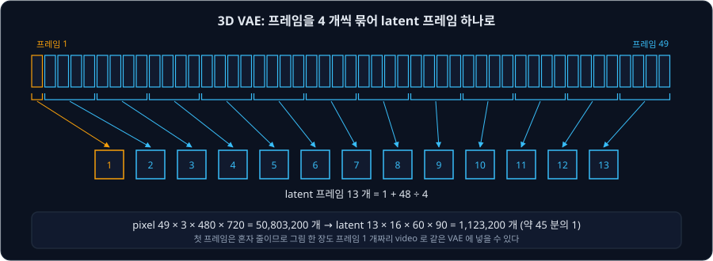
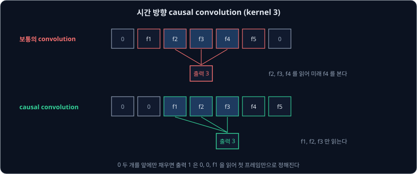
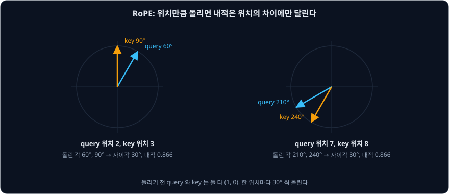

# Video Diffusion Transformer

[Stable Video Diffusion](../svd/README.md) 은 이미지용 VAE 로 프레임을 한 장씩 줄이고, U-Net 의 이미지 layer 사이에 시간 layer 를 끼웠다. 저자들은 논문의
한계 절에 여러 프레임을 한꺼번에 만드는 방식이 긴 video 에서 비싸다고 적고, video 전용 tokenizer 가 필요하다고 했다. 같은 무렵
[Stable Diffusion 3](../sd3/README.md) 는 그림을 만드는 network 를 U-Net 에서 Transformer 로 바꿨다.

2024 ~ 2025 년의 공개 video model 은 이 두 방향을 합쳤다. Tsinghua 와 Zhipu AI 의 **CogVideoX**(2024 년 8 월), Tencent 의 **HunyuanVideo**(2024 년 12 월),
Alibaba 의 **Wan**(2025 년 3 월 논문)은 모두 시간 축까지 함께 줄이는 3D VAE 로 video 를 latent 로 바꾸고, 그 latent 를 patch token 으로 잘라 Transformer 에
넣는다. Transformer 안에서는 프레임 안과 프레임 사이를 가리지 않고 모든 token 이 서로 attention 한다. 이 강의에서는 세 model 의 공개 설정과 weight 파일을 놓고, 이 설계가
숫자로 무엇을 바꾸는지 따라간다.

## 학습 목표

- 3D causal VAE 가 49 프레임을 latent 프레임 13 개로 줄이는 방식과, 첫 프레임을 따로 두고 앞쪽에만 padding 을 두는 이유를 설명할 수 있다
- latent 를 patch token 으로 자른 수를 세고, 3D full attention 과 프레임 안·자리별로 나눈 attention 의 점수 수를 비교할 수 있다
- RoPE 가 query 와 key 를 위치만큼 돌려 내적이 위치의 차이에만 달리게 만드는 방식을 숫자로 따라갈 수 있다
- CogVideoX, HunyuanVideo, Wan 이 글을 넣는 방법의 차이를 설명할 수 있다
- 세 model 의 parameter 수와 기본 설정으로 내 컴퓨터에서 필요한 메모리와 계산을 셀 수 있다

## 시간까지 줄이는 3D VAE

SVD 의 VAE 는 프레임마다 가로세로를 8 배씩 줄이고 channel 4 개를 두지만, 프레임 수는 줄이지 않는다. $480 \times 720$ 의 49 프레임 video 라면 latent 는
$49 \times 4 \times 60 \times 90$ 이고 숫자는 1,058,400 개다.

CogVideoX 의 VAE 는 시간 방향도 4 배로 줄인다. 첫 프레임은 혼자 latent 프레임 하나가 되고, 나머지 48 프레임은 4 개씩 묶여 12 개가 된다. 그래서 49 프레임은
$1 + 48 \div 4 = 13$ 개의 latent 프레임이 된다. 대신 channel 을 16 개로 늘린다.

| 방식 | latent 모양 | 숫자의 수 | pixel 대비 |
| --- | --- | --- | --- |
| pixel | $49 \times 3 \times 480 \times 720$ | 50,803,200 | 1 |
| 프레임마다 줄이기 (SVD) | $49 \times 4 \times 60 \times 90$ | 1,058,400 | 48 분의 1 |
| 3D VAE (CogVideoX) | $13 \times 16 \times 60 \times 90$ | 1,123,200 | 약 45 분의 1 |

숫자의 수는 두 방식이 비슷하지만, Transformer 가 받을 token 수는 크게 다르다. Transformer 는 latent 프레임 하나를 $2 \times 2$ 자리씩 묶어 token 으로 만들므로, 프레임 수가 49 에서 13 으로
줄면 token 도 약 4 분의 1 이 된다. 저자들은 3D VAE 가 sequence 길이와 학습 계산을 크게 줄이고, 프레임 사이의 깜빡임(flicker)도 막는다고 적었다.

CogVideoX 저자들이 압축 배율과 channel 수를 바꿔 본 결과는 표 1 과 같다. 깜빡임은 이웃한 두 프레임의 pixel 값 차이의 절댓값(L1)으로 재므로 작을수록 좋다. PSNR 은 원래
video 와 복원한 video 가 얼마나 가까운지 재는 값이라, 차이가 작을수록 커진다. 기준은 SDXL 의 이미지 VAE 다.

| 압축 (가로 × 세로 × 시간) | channel | 깜빡임 | PSNR |
| --- | --- | --- | --- |
| $8 \times 8 \times 1$ (SDXL VAE) | 4 | 93.2 | 28.4 |
| $8 \times 8 \times 4$ | 8 | 87.6 | 27.2 |
| $8 \times 8 \times 4$ (사전학습에 씀) | 16 | 86.3 | 28.7 |
| $8 \times 8 \times 4$ | 32 | 87.7 | 30.5 |
| $16 \times 16 \times 8$ | 128 | 87.3 | 27.9 |

3D VAE 는 모두 깜빡임이 이미지 VAE 보다 작았다. channel 을 늘리면 복원은 좋아졌지만, $16 \times 16 \times 8$ 처럼 너무 세게 줄이면 channel 을 128 개로 늘려도
학습이 잘 수렴하지 않았다고 저자들은 적었다. HunyuanVideo 와 Wan 의 VAE 도 같은 $4 \times 8 \times 8$ 압축과 channel 16 개를 쓴다.

**causal convolution.** 3D VAE 는 시간 방향에도 convolution 을 쓴다. kernel 이 3 이면 출력 프레임 하나가 입력 프레임 세 개를 읽는다. 보통의 convolution 은
양쪽에 0 을 하나씩 채워 프레임 $t$ 를 만들 때 $t-1$, $t$, $t+1$ 을 읽는다. CogVideoX 가 쓰는 temporally causal convolution 은 0 두 개를 앞에만 채워 $t-2$, $t-1$,
$t$ 만 읽는다. 그래서 앞 프레임의 결과는 뒤 프레임의 영향을 받지 않는다.

이렇게 하면 첫 프레임의 latent 는 첫 프레임만으로 정해진다. 그래서 그림 한 장을 프레임 1 개짜리 video 로 넣어도 video 의 첫 프레임과 같은 방식으로 줄어든다.
HunyuanVideo 저자들은 video 와 그림을 함께 다루려고 causal convolution 을 썼다고 적었고, 세 model 모두 그림을 프레임 1 개짜리 video 로 보고 함께 학습한다.

causal 구조는 긴 video 를 나눠 처리할 때도 쓸모가 있다. Wan 의 VAE 는 video 를 latent 프레임 하나에 해당하는 조각(첫 조각 1 프레임, 그 뒤 4 프레임씩)으로 나눠
차례로 encode 한다. 앞 조각의 마지막 두 프레임의 중간값을 저장해 다음 조각의 padding 자리에 넣으므로, 한 번에 4 프레임만 메모리에 올리고도 이어서 계산할 수
있다. 저자들은 이 feature cache 로 길이에 제한 없이 video 를 encode·decode 할 수 있다고 적었다. 같은 이유로 Wan 은 VAE 의 GroupNorm 을 RMSNorm 으로 바꿨다.
GroupNorm 은 시간 축을 포함한 여러 값의 평균을 내므로 뒤 프레임이 앞 프레임의 결과에 섞이지만, RMSNorm 은 자리마다 따로 계산한다.

세 VAE 의 학습은 조금씩 다르다. CogVideoX 는 $256 \times 256$, 17 프레임으로 학습한 뒤 161 프레임으로 미세조정했다. HunyuanVideo 는 이미지 VAE 없이
처음부터 학습했고, video 와 그림을 4 : 1 로 섞었다. Wan 은 같은 구조의 2D 이미지 VAE 를 먼저 학습해 3D 로 늘린(inflate) 뒤 video 로 학습했다. 셋 모두
L1 복원 loss, 사람이 느끼는 차이에 가깝게 재는 LPIPS, KL loss 에, 진짜 video 와 복원한 video 를 가려내는 3D convolution
network(판별기)를 속이도록 하는 GAN loss 를 더했다. weight 파일의 숫자를 세면 VAE 의 parameter 는 Wan 이 126,892,531 개(논문 127M), CogVideoX 가
215,583,907 개, HunyuanVideo 가 246,478,803 개다.

**확인 문제.** Wan 의 기본값은 81 프레임, $480 \times 832$ 다. VAE 를 지난 latent 의 모양은?

답 보기

① 시간: $1 + (81 - 1) \div 4 = 21$ 개다.

② 가로세로: $480 \div 8 = 60$, $832 \div 8 = 104$ 다.

답: $21 \times 16 \times 60 \times 104$. 숫자는 2,096,640 개다.

## 모든 token 끼리의 attention

latent 를 Transformer 에 넣는 방법은 [Stable Diffusion 3](../sd3/README.md) 와 같다. 가로세로 $2 \times 2$ 자리를 patch 하나로 묶어 vector 하나로 바꾼다.
CogVideoX-5b 의 기본값인 49 프레임 $480 \times 720$ 에서 latent 는 $13 \times 16 \times 60 \times 90$ 이고, 프레임마다 $30 \times 45 = 1350$ 개, 모두
$13 \times 1350 = 17{,}550$ 개의 video token 이 생긴다. CogVideoX 는 여기에 글 token 226 개를 이어 붙인다.

앞 강의들의 model 은 attention 을 두 가지로 나눴다. 프레임 안의 자리끼리 하는 2D attention 과, 같은 자리의 프레임끼리 하는 1D attention 이다. CogVideoX 는
이를 하나로 합친 3D full attention 을 쓰므로, video token 과 글 token 을 합친 17,776 개의 token 이 모두 서로를 본다. head 하나, layer 하나의 점수 수를 세면 아래와 같다.

| attention | 계산 | 점수의 수 |
| --- | --- | --- |
| 3D full attention | $(17{,}550 + 226)^2$ | 315,986,176 |
| 2D (프레임 안) | $13 \times 1350^2$ | 23,692,500 |
| 1D (같은 자리의 프레임끼리) | $1350 \times 13^2$ | 228,150 |
| 2D + 1D | | 23,920,650 |

점수는 약 13 배 많다. 그래도 full attention 을 쓰는 이유는 CogVideoX 의 그림 5 에 나온다. 사람이 프레임 $i$ 에서 $i+1$ 로 크게 움직이면 머리의 자리가
바뀐다. 나눈 attention 에서는 프레임 $i+1$ 의 머리가 프레임 $i$ 의 머리를 직접 볼 수 없다. 같은 자리의 프레임끼리만 이어지므로, 머리의 정보는 배경 같은 다른
token 을 거쳐 간접으로 전해져야 한다. 저자들은 이 때문에 크게 움직이는 물체를 일관되게 유지하기 어렵다고 보았다. 저자들의 실험에서도 2D + 1D 로 바꾸면 FVD(만든 video 와 진짜 video 의 차이, 작을수록 좋음)가 학습
초반에 훨씬 높았고, 학습이 불안정해 쉽게 무너졌다(4.1 절).

계산 시간은 점수 수만큼 늘지 않는다. H800 GPU 에서 Transformer 를 한 번 계산하는 시간은 CogVideoX 의 표 8 과 같다.

| 해상도·길이 | 2D + 1D | 3D full | 배율 |
| --- | --- | --- | --- |
| $256 \times 384$, 6 초 | 0.38 초 | 0.41 초 | 약 1.08 |
| $480 \times 720$, 6 초 | 1.26 초 | 2.11 초 | 약 1.67 |
| $768 \times 1360$, 5 초 | 4.17 초 | 9.60 초 | 약 2.30 |

attention 말고도 MLP 와 투영 같은 계산이 있고, FlashAttention 같은 구현이 attention 을 빠르게 하기 때문이다. 하지만 token 이 많을수록 attention 의 몫이
커진다. Wan 논문에 따르면 sequence 가 100 만 token 에 이를 때 attention 이 학습 시간의 95% 까지 차지할 수 있다.

여기서 3D VAE 의 시간 압축이 중요해진다. 시간 방향으로 줄이지 않고 49 프레임을 그대로 두면 video token 은 $49 \times 1350 = 66{,}150$ 개다. 점수는 token
수의 제곱에 비례하므로 $(66{,}150 \div 17{,}550)^2 \approx 14.2$ 배가 된다.

**확인 문제.** Wan 의 기본값(latent $21 \times 16 \times 60 \times 104$, patch $1 \times 2 \times 2$)에서 video token 은 몇 개이고, head 하나의 full attention 점수는?

답 보기

① 프레임마다 $30 \times 52 = 1560$ 개이고, 21 프레임이라 $21 \times 1560 = 32{,}760$ 개다.

② 점수는 $32{,}760^2 = 1{,}073{,}217{,}600$ 개다.

답: 32,760 개, 약 10.7 억 개. Wan 은 글 token 을 video token 과 같은 sequence 에 넣지 않고 따로 읽으므로, 이 점수에 글은 들어가지 않는다.

## 위치를 돌려 넣는 3D RoPE

attention 은 순서를 모르므로 token 의 위치를 따로 알려야 한다. SD3 는 sin·cos 위치 표를 token 에 더했지만, 세 video model 은 모두 RoPE(Rotary Position
Embedding)를 쓴다. RoPE 는 언어 model 에서 쓰던 방법으로, 위치를 더하는 대신 query 와 key 를 위치만큼 돌린다.

query 와 key 의 숫자 두 개를 평면 위의 화살표로 보고, 예를 들어 위치 하나마다 30° 씩 돌린다고 하자. 돌리기 전 query 와 key 가 모두 $(1, 0)$ 이면 아래와 같다.

| query 위치 | key 위치 | 돌린 각 | 사이각 | 내적 |
| --- | --- | --- | --- | --- |
| 2 | 3 | 60°, 90° | 30° | $\cos 30° \approx 0.866$ |
| 7 | 8 | 210°, 240° | 30° | $\cos 30° \approx 0.866$ |
| 2 | 5 | 60°, 150° | 90° | $\cos 90° = 0$ |
| 4 | 4 | 120°, 120° | 0° | $\cos 0° = 1$ |

두 화살표를 같은 각만큼 함께 돌려도 사이각은 그대로이므로, 내적은 두 위치의 차이에만 달린다. 위치 2 와 3 의 관계와 위치 7 과 8 의 관계가 같게 보인다.
실제로는 query 와 key 의 숫자를 두 개씩 짝지어, 위치 하나마다 돌리는 각을 짝마다 다르게 둔다.

video 의 token 은 위치가 (시간, 세로, 가로) 세 개다. 3D RoPE 는 query 와 key 의 숫자를 세 묶음으로 나눠 묶음마다 한 좌표만큼 돌린다. HunyuanVideo 는 head 하나의
숫자 128 개를 시간 16 개, 세로 56 개, 가로 56 개로 나눈다(표 2, diffusers 설정 `rope_axes_dim: [16, 56, 56]`). CogVideoX 는 숫자의 3/8 을 가로에 쓰고, 3/8 을
세로에 쓰고, 2/8 을 시간에 쓴다. 같은 자리의 다음 프레임은 시간 묶음만 다르게 돌아가고, 같은 프레임의 옆 자리는 가로 묶음만 다르게 돌아간다.

RoPE 는 위치를 차이로만 다루므로 학습 때보다 큰 그림에도 쓸 수 있다. CogVideoX 저자들은 해상도를 올릴 때 위치 표를 늘려 앞부분을 쓰는 방법(extrapolation)과, 같은 길이의 표를
늘여 맞추는 방법(interpolation)을 비교했다(부록 A 그림 9). interpolation 은 전체 구도를 잘 지켰지만 흐린 큰 그림이 되었고, extrapolation 은 작고 선명한
그림이 반복되는 경향이 있었다. 저자들은 RoPE 가 상대 위치를 쓴다는 점을 들어 이웃한 pixel 사이의 관계를 지키는 extrapolation 을 골랐다. 또 sin·cos 위치 표를
더하는 방법과 비교하면 RoPE 쪽 loss 가 훨씬 빨리 줄었다(그림 10a).

**확인 문제.** 한 위치마다 30° 씩 돌릴 때, 위치 1 의 query 와 위치 7 의 key 의 내적은? 돌리기 전 둘 다 $(1, 0)$ 이다.

답 보기

① 돌린 각은 30° 와 210° 라서 사이각이 180° 다.

② 내적은 $\cos 180° = -1$ 이다.

답: −1. 위치 차이가 6 이면 어느 위치에서 시작해도 같다.

## 글을 넣는 세 방법

SD3 의 MMDiT 는 글 token 과 그림 token 을 한 attention 에 넣되, 두 종류가 각자의 weight 로 query·key·value 를 만들었다. 세 video model 은 이 문제를 서로
다르게 풀었다.

**CogVideoX: expert AdaLN.** T5 가 만든 글 token 226 개를 video token 뒤에 이어 붙이고, attention 과 MLP 의 weight 는 둘이 함께 쓴다. 따로 쓰는 것은 LayerNorm 뒤에
곱하고 더하는 scale·shift·gate 뿐이다. SD3 의 adaLN 처럼 시각 $t$ 로 이 숫자들을 만들되, 글 token 용과 video token 용을 따로 만든다. weight 파일에서 block 하나의
`norm1.linear` 출력은 18,432 개다. CogVideoX-5b 의 token 하나는 숫자 3072 개(hidden 크기)이고, 18,432 는 $2 \times 3 \times 3072$ 라서 글과 video 가 scale·shift·gate 를 3072 개씩 가진다.
gate 는 SD3 강의에서 본 대로 attention 이나 MLP 의 출력에 곱해 얼마나 더할지 정하는 숫자다. 저자들은 같은 parameter 수의 MMDiT 와
비교해 expert AdaLN 이 FVD 와 글 일치(CLIP4Clip 점수) 모두에서 나았다고 적고, 글 token 과 video token 의 차이를 맞추는 데는 이 정도로 충분하다고 보았다(그림 8).

**HunyuanVideo: dual-stream 에서 single-stream 으로.** 처음 20 개 block 은 MMDiT 처럼 글과 video 가 각자의 weight 로 계산하고 attention 만 함께 한다.
나머지 40 개 block 은 두 token 을 한 줄로 합쳐 같은 weight 로 계산한다(표 2). 글은 multimodal LLM(그림과 글을 함께 학습한 대형 언어 model)이 읽는다. GPT-2 처럼 앞 token 만 보며 다음 token 을 맞히는 구조다. 저자들은 이 LLM 이 그림과 글을
함께 학습해 T5 보다 그림 설명에 잘 맞고, 지시문을 앞에 붙이면 중요한 내용에 더 집중한다고 설명했다. LLM 은 앞 token 만 보는 causal attention 을 쓰므로, 양쪽을
모두 보는 작은 token refiner 를 더해 글 token 을 다듬는다. 글 전체를 요약한 CLIP-L 의 vector 하나(pooled vector)도 시각 embedding 에 더한다.

**Wan: cross-attention.** video token 끼리만 self-attention 하고, 글은 [Cross-Attention](../cross-attention/README.md) 강의의 방식으로 따로 읽는다. 글은
umT5 가 만든 512 개 token 이다. 저자들은 cross-attention 이 긴 sequence 에서도 지시를 따르게 한다고 적었다. 또 시각 $t$ 로 scale·shift·gate 6 묶음을 만드는
MLP 를 모든 block 이 함께 쓰고, block 마다 따로 배우는 것은 bias 뿐이다. weight 파일에서 이 공유 층은 $9216 \times 1536$(9216 = 6 × 1536)이고 block 마다
`scale_shift_table` 이 $6 \times 1536$ 이다. 논문에 따르면 이 설계로 parameter 가 약 25% 줄었다. 1.3B model 에서 block 30 개가 각자 이 층을 가졌다고 계산하면
$30 \times (6 \times 1536 \times 1536 + 6 \times 1536) = 424{,}949{,}760$ 개가 더 필요하다.

model 이름의 1.3B, 5b, 14B 같은 숫자는 parameter 수이고, B 는 billion(10 억)이다.

| model | 글 encoder | 글이 들어가는 곳 | Transformer parameter (weight 파일) |
| --- | --- | --- | --- |
| CogVideoX-5b | T5-XXL encoder, 226 token | video 와 한 sequence | 5,570,283,072 |
| HunyuanVideo | multimodal LLM + CLIP-L | 20 block 은 따로, 40 block 은 한 sequence | 12,821,012,544 |
| Wan 2.1 1.3B | umT5, 512 token | cross-attention | 1,418,996,800 |
| Wan 2.1 14B | umT5, 512 token | cross-attention | 14,288,491,584 |

HunyuanVideo 논문에는 13B 가 넘는다고 적혀 있지만, diffusers 로 옮긴 Transformer weight 파일을 세면 12,821,012,544 개다. 이 차이가 어디서 오는지는 논문에
나오지 않는다.

**확인 문제.** CogVideoX-2b 는 hidden 크기가 1920 이다(표 6). block 하나의 `norm1.linear` 는 몇 개의 숫자를 내야 할까?

답 보기

① 글과 video 가 scale·shift·gate 를 하나씩 따로 가지므로 $2 \times 3 = 6$ 묶음이다.

② $6 \times 1920 = 11{,}520$ 개다.

답: 11,520 개.

## 해상도와 길이를 늘려 가는 학습

세 model 모두 작은 해상도와 짧은 video 에서 시작해 점점 키운다. 큰 video 는 token 이 많아 한 step 이 비싸기 때문이다. CogVideoX 저자들은 인터넷 video 에 낮은
해상도가 많다는 점도 들었다. 낮은 해상도에서 의미와 큰 구도를 배우고, 높은 해상도에서 세부를 배운다는 설명이다. CogVideoX 의 표 5 는 아래와 같다.

| 단계 | 최대 해상도 | 최대 길이 | batch size | sequence 길이 | step |
| --- | --- | --- | --- | --- | --- |
| 1 | $256 \times 384$ | 6 초 | 2000 | 25k | 400k |
| 2 | $480 \times 720$ | 6 초 | 1000 | 75k | 220k |
| 3 | $768 \times 1360$ | 10 초 | 250 | 700k | 120k |
| 4 (고화질 미세조정) | $768 \times 1360$ | 10 초 | 100 | 700k | 10k |

해상도가 커질수록 batch size 는 줄었다. 마지막 단계는 전체 데이터에서 고른 20% 의 고화질 video 로 미세조정했고, 저자들은 자막과 watermark 가 사라지고 화질이
조금 좋아졌지만 의미를 따르는 능력이 약간 떨어졌다고 적었다(부록 A). HunyuanVideo 는 video 학습의 크기를 $256 \times 256 \times 65$ 에서 $720 \times 1280 \times 129$
까지 키웠고, Wan 은 256 px 그림으로 시작해 192 px video(5 초, 16 fps), 480 px, 720 px 순서로 올렸다.

길이가 다른 video 를 함께 학습하는 방법도 필요하다. CogVideoX 는 길이와 해상도가 다른 video 를 한 batch 의 sequence 안에 채워 넣고(Multi-Resolution Frame
Pack), HunyuanVideo 는 길이와 가로세로 비율로 bucket 을 나눠 bucket 마다 batch 를 만든다. RoPE 는 위치의 차이만 쓰므로 모양이 다른 video 가 섞여도
그대로 쓸 수 있다.

noise 를 섞는 방식은 model 마다 다르다. CogVideoX 는 Latent Diffusion 의 noise schedule 에 v-prediction 을 쓰고, schedule 을 고쳐 마지막 단계 1000 에서 원래 값의
몫이 0 이 되게 한다(신호 대 잡음비 SNR 이 0 이라 zero SNR 이라고 부른다). Latent Diffusion 강의에서 본 원래 schedule 은 이 단계에서도 원래 값의 몫이 0.068 남는다. HunyuanVideo 와 Wan 은 [Flow Matching](../flow-matching/README.md) 강의의 rectified flow 로 학습하고, 생성할 때는 SD3 처럼 시각을 noise 쪽으로
옮기는 shift 를 쓴다. HunyuanVideo 논문은 50 step 에서는 shift 를 7 로 두고 20 step 보다 적으면 17 로 두라고 권하며, diffusers 설정도 `shift: 7.0` 이다. 논문은 step 이 적을수록
shift 를 크게 두어야 한다고 적었다. Wan 의 diffusers 예제는 480P 에서는 3.0 을 쓰고 720P 에서는 5.0 을 쓰며, Wan 의 GitHub 설명은 1.3B model 에 8 ~ 12 를 권한다. 높은 해상도에서 noise
쪽으로 더 옮기는 것은 SD3 와 SVD 에서 본 이유와 같다.

HunyuanVideo 는 guidance 의 계산도 줄였다. guidance 는 step 마다 글이 있는 예측과 없는 예측을 둘 다 계산해야 한다. 저자들은 guidance 를 쓴 결과를 학생 model
하나가 한 번에 내도록 distillation 하고, guidance 세기를 학생의 입력으로 넣었다. 1 ~ 8 의 세기를 뽑아 학습했고 약 1.9 배 빨라졌다고 적었다. diffusers 설정의
`guidance_embeds: true` 가 이 입력이고, pipeline 의 `guidance_scale` 6.0 은 이 입력으로 들어간다.

**확인 문제.** CogVideoX 의 1 단계와 2 단계에서 step 마다 다루는 token 의 수를 batch size × sequence 길이로 어림하면 몇 배 차이일까?

답 보기

① 1 단계: $2000 \times 25{,}000 = 50{,}000{,}000$ 이다.

② 2 단계: $1000 \times 75{,}000 = 75{,}000{,}000$ 이다.

답: 1.5 배. batch size 를 절반으로 줄였지만 sequence 가 3 배라서 step 하나가 더 크다.

## 내 컴퓨터에서 돌리기

먼저 weight 메모리를 세자. bf16 은 숫자 하나를 2 byte 로 두므로 숫자 수에 2 를 곱한다.

| 부분 | 숫자 수 | bf16 메모리 |
| --- | --- | --- |
| Wan 2.1 1.3B Transformer | 1,418,996,800 | 약 2.84 GB |
| Wan 2.1 umT5 encoder | 5,680,910,336 | 약 11.36 GB |
| Wan VAE | 126,892,531 | 약 0.25 GB |
| CogVideoX-5b Transformer | 5,570,283,072 | 약 11.14 GB |
| CogVideoX T5-XXL encoder | 4,762,310,656 | 약 9.52 GB |
| HunyuanVideo Transformer | 12,821,012,544 | 약 25.64 GB |
| HunyuanVideo LLM 글 encoder | 7,505,186,816 | 약 15.01 GB |
| Wan 2.1 14B Transformer | 14,288,491,584 | 약 28.58 GB |

Wan 1.3B 에서는 글 encoder 가 Transformer 보다 4 배 크다. 글 encoder 는 생성을 시작할 때 한 번만 쓰므로 GPU 에 둘 필요가 없다. Wan 의 GitHub 설명에 따르면
1.3B model 은 8.19 GB VRAM 만 필요하고, RTX 4090 에서 5 초 480P video 를 양자화 없이 약 4 분에 만든다. 같은 설명의 GPU 별 효율 표에는 RTX 4090 한 장에서
1.3B 를 잴 때 model 을 CPU 로 내려 두는 `--offload_model True` 와 umT5 를 CPU 에서 돌리는 `--t5_cpu` 를 켰다고 적혀 있다.

계산은 Transformer 가 대부분이다. Wan 1.3B 의 기본값은 50 step, guidance 5.0 이라 step 마다 Transformer 를 두 번 계산하므로 모두 100 번이고, 한 번에 32,760
개의 token 을 다룬다. H800 GPU 에서 50 step 을 돌린 시간과 메모리는 CogVideoX 의 표 7 과 같다.

| model, 해상도, 길이 | 시간 | 메모리 |
| --- | --- | --- |
| CogVideoX-2b, $480 \times 720$, 6 초 | 49 초 | 18 GB |
| CogVideoX-5b, $480 \times 720$, 6 초 | 113 초 | 26 GB |
| CogVideoX-2b, $768 \times 1360$, 5 초 | 220 초 | 53 GB |
| CogVideoX-5b, $768 \times 1360$, 5 초 | 500 초 | 76 GB |

같은 model 에서 해상도를 올리면 시간이 4 배를 넘게 는다. 프레임 하나의 token 이 $(96 \times 170) \div (60 \times 90) \approx 3$ 배가 되고, attention 의
점수는 token 의 제곱으로 늘기 때문이다.

메모리가 작은 GPU 에서는 VAE 도 문제가 된다. HunyuanVideo 는 video 를 시간과 공간 방향으로 겹치는 조각(tile)으로 나눠 encode·decode 하고 겹친 부분을 섞으며, 조각으로 나눌 때 생기는
자국을 줄이려고 조각 나누기를 켜고 끄며 VAE 를 한 번 더 미세조정했다. Wan 은 앞에서 본 feature cache 로 4 프레임씩 처리한다.

**확인 문제.** Wan 1.3B 를 GPU 에 Transformer 와 VAE 만 두고 돌린다. weight 메모리는 얼마이고, umT5 까지 GPU 에 두면 얼마일까?

답 보기

① Transformer 2.84 GB 와 VAE 0.25 GB 를 더하면 약 3.09 GB 다.

② umT5 11.36 GB 를 더하면 약 14.45 GB 다.

답: 약 3.09 GB 와 약 14.45 GB. 8.19 GB 는 weight 에 계산 중간값까지 더한 값이므로, umT5 를 CPU 에 두지 않으면 맞출 수 없다.

## 정리

- 3D causal VAE 는 첫 프레임은 혼자 두고 나머지는 4 프레임씩 묶어 시간 방향도 줄이고 channel 을 16 개로 둔다. 49 프레임은 latent 프레임 13 개가 되고, 앞쪽에만
  padding 을 두어 그림 한 장도 같은 VAE 로 다룬다. Wan 은 이 구조로 4 프레임씩 이어 encode·decode 한다
- latent 를 $2 \times 2$ patch 로 자른 token 에 3D full attention 을 쓴다. CogVideoX 기본값에서 점수는 315,986,176 개로 2D + 1D 의 약 13 배지만, 크게
  움직이는 물체를 직접 이어 준다. 시간 압축이 없으면 점수가 약 14 배 더 늘어난다
- 3D RoPE 는 query 와 key 를 (시간, 세로, 가로) 위치만큼 묶음마다 돌려, 내적이 위치의 차이에만 달리게 한다
- CogVideoX 는 글을 한 sequence 에 이어 붙이고 scale·shift·gate 만 따로 둔다. HunyuanVideo 는 20 block 에서 글을 따로 계산하고 40 block 에서 함께
  계산하며, Wan 은 글을 cross-attention 으로 읽는다
- 세 model 모두 낮은 해상도와 짧은 video 에서 시작해 키우고, HunyuanVideo 와 Wan 은 flow matching 과 shift 를 쓴다
- Wan 1.3B 의 Transformer 는 bf16 약 2.84 GB 이고 umT5 는 약 11.36 GB 다. Wan 의 공개 설명에 나온 8.19 GB 는 글 encoder 를 CPU 에서 돌리는 설정으로 RTX 4090 에서 잰 값이다

[다음 강의](../fast-video/README.md)는 이런 video model 을 더 빠르게 만드는 방법을 다룬다. latent 를 더 세게 줄여 token 을 줄이는 LTX-Video 와, step 수를 줄이는 distillation, 그리고
메모리를 아끼는 방법이다.

## 참고 자료

- Zhuoyi Yang 등, [CogVideoX: Text-to-Video Diffusion Models with An Expert Transformer](https://arxiv.org/abs/2408.06072) (2024) — 2.1 절과 표 1·그림 4 의 3D
  causal VAE, 2.2 절의 patch·3D-RoPE(3/8, 3/8, 2/8)·expert AdaLN·3D full attention 과 그림 5, 3 절의 v-prediction·zero SNR·Frame Pack·점진 학습, 4.1 절과
  그림 8·10 의 ablation, 부록 A 의 고화질 미세조정·RoPE extrapolation(그림 9)·표 5·6·7·8
- Weijie Kong 등, [HunyuanVideo: A Systematic Framework For Large Video Generative Models](https://arxiv.org/abs/2412.03603) (2024) — 4.1 절의 3D VAE($4 \times 8
  \times 8$, channel 16, 처음부터 학습, 4 : 1, tiling), 4.2 절과 표 2 의 dual-stream·single-stream 과 3D RoPE $(16, 56, 56)$, 4.3 절의 MLLM 글 encoder·token
  refiner·CLIP-L, 3.1 절의 $256 \times 256 \times 65$ 에서 $720 \times 1280 \times 129$ 까지의 단계, 5.1 절의 shift 7·17, 5.2 절의 guidance distillation(1.9 배)
- Team Wan, [Wan: Open and Advanced Large-Scale Video Generative Models](https://arxiv.org/abs/2503.20314) (2025) — 4.1 절의 Wan-VAE(127M, RMSNorm, 2D 에서
  늘리기, feature cache), 4.2.1 절의 patch $(1, 2, 2)$·cross-attention·공유한 modulation MLP(약 25%)·umT5, 4.2.2 절의 flow matching 과 학습 단계, 4.3.1 절의
  attention 이 차지하는 시간(95%), 1 절의 8.19 GB
- Wan, [Wan2.1 GitHub README](https://github.com/Wan-Video/Wan2.1) — 8.19 GB VRAM, RTX 4090 에서 5 초 480P 약 4 분, 효율 표 주석의 `--offload_model True`·`--t5_cpu`,
  1.3B 의 `--sample_shift` 8 ~ 12 권장
- Hugging Face, [THUDM/CogVideoX-5b](https://huggingface.co/THUDM/CogVideoX-5b)·[THUDM/CogVideoX-2b](https://huggingface.co/THUDM/CogVideoX-2b) — `transformer/config.json`
  (`num_layers: 42`, `patch_size: 2`, `sample_frames: 49`, `sample_height: 60`, `sample_width: 90`, `max_text_seq_length: 226`), `vae/config.json`
  (`latent_channels: 16`, `temporal_compression_ratio: 4`), `scheduler/scheduler_config.json`(`v_prediction`, `rescale_betas_zero_snr: true`)과 weight 파일의 tensor 모양
- Hugging Face, [Wan-AI/Wan2.1-T2V-1.3B-Diffusers](https://huggingface.co/Wan-AI/Wan2.1-T2V-1.3B-Diffusers)·[Wan-AI/Wan2.1-T2V-14B-Diffusers](https://huggingface.co/Wan-AI/Wan2.1-T2V-14B-Diffusers)
  — `transformer/config.json`(`patch_size: [1, 2, 2]`, 1.3B 의 `num_layers: 30`·`ffn_dim: 8960`, 14B 의 `num_layers: 40`), `scheduler/scheduler_config.json`
  (`flow_shift: 3.0`)과 weight 파일의 tensor 모양
- Hugging Face, [hunyuanvideo-community/HunyuanVideo](https://huggingface.co/hunyuanvideo-community/HunyuanVideo) — `transformer/config.json`(`num_layers: 20`,
  `num_single_layers: 40`, `rope_axes_dim: [16, 56, 56]`, `guidance_embeds: true`), `scheduler/scheduler_config.json`(`shift: 7.0`)과 weight 파일의 tensor 모양
- diffusers, [`pipeline_cogvideox.py`](https://github.com/huggingface/diffusers/blob/main/src/diffusers/pipelines/cogvideo/pipeline_cogvideox.py)(50 step, guidance 6,
  `(num_frames - 1) // 4 + 1`), [`pipeline_wan.py`](https://github.com/huggingface/diffusers/blob/main/src/diffusers/pipelines/wan/pipeline_wan.py)(480 × 832, 81 프레임,
  50 step, guidance 5.0, 480P 3.0·720P 5.0 의 `flow_shift` 예제), [`pipeline_hunyuan_video.py`](https://github.com/huggingface/diffusers/blob/main/src/diffusers/pipelines/hunyuan_video/pipeline_hunyuan_video.py)
  (720 × 1280, 129 프레임, `guidance_scale` 6.0), [`transformer_hunyuan_video.py`](https://github.com/huggingface/diffusers/blob/main/src/diffusers/models/transformers/transformer_hunyuan_video.py)
  의 dual-stream block 이 글과 video 를 함께 attention 하는 구현
